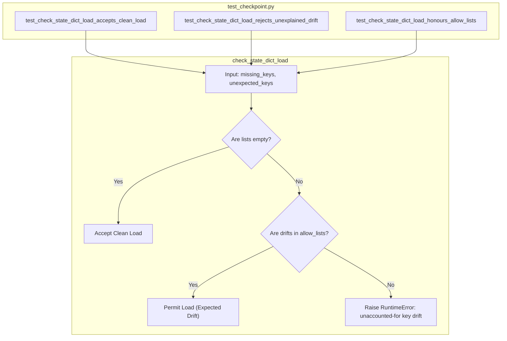
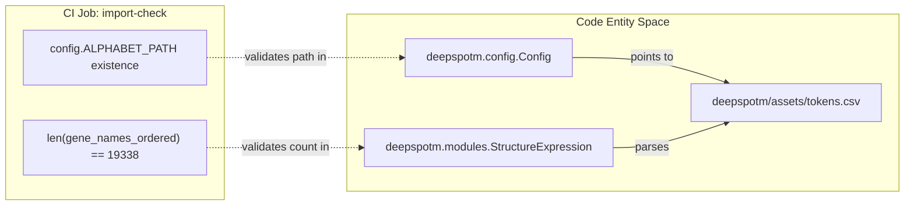

# Checkpoint and Packaging Tests

Relevant source files

The following files were used as context for generating this wiki page:

- [.github/workflows/ci.yml](.github/workflows/ci.yml)
- [tests/test_checkpoint.py](tests/test_checkpoint.py)
- [tests/test_packaging.py](tests/test_packaging.py)

This page documents the testing infrastructure responsible for ensuring the integrity of the DeepSpotM distribution and the safety of model weight loading. These tests prevent silent failures caused by missing assets in the wheel or partial state-dict loads that would otherwise result in uninitialized weights during inference.

## Checkpoint Guard Mechanism

The `checkpoint.py` module implements guards to prevent architecture-checkpoint mismatches. `test_checkpoint.py` validates these guards to ensure that any "key drift" (missing or unexpected keys) between a state-dict and a model instance is explicitly caught unless specifically allowed.

### State-Dict Filtering and Validation
The system identifies specific modules that are tied to the gene vocabulary. When loading a model with a different vocabulary or source configuration, these keys are expected to drift. The `VOCAB_SPECIFIC_PREFIXES` constant defines these sensitive areas [tests/test_checkpoint.py:10-14]().

| Function | Purpose | Implementation Detail |
| :--- | :--- | :--- |
| `filter_state_dict` | Removes keys matching specific prefixes. | Used to strip vocabulary-specific weights when performing cross-vocabulary loading [tests/test_checkpoint.py:24-33](). |
| `check_state_dict_load` | Validates `missing_keys` and `unexpected_keys`. | Raises `RuntimeError` if drift is detected outside of allowed prefixes [tests/test_checkpoint.py:55-59](). |

### Key Drift Detection Flow
The following diagram illustrates how `check_state_dict_load` evaluates the success of a weight loading operation.

**Checkpoint Validation Logic**

**Sources:** [tests/test_checkpoint.py:43-68]()

## Packaging and Asset Integrity

The packaging tests in `test_packaging.py` verify that the DeepSpotM wheel is correctly built and contains all static assets required for inference. Since model weights are gated on the Hugging Face Hub, these tests ensure the package structure is sound even when the environment is offline (`HF_HUB_OFFLINE=1`) [.github/workflows/ci.yml:60-61]().

### Asset Verification
The test suite confirms the existence and non-zero size of critical files in `deepspotm.assets` [tests/test_packaging.py:35-43]():
*   `tokens.csv`: The gene vocabulary and token ID mapping.
*   `ensp_to_gene.csv`: Ensembl protein ID to gene symbol mapping.
*   `midnight_config.json`: Configuration for the Midnight backbone.

### Vocabulary Integrity
A core requirement for model consistency is the stability of the gene panel. `test_token_vocabulary_matches_model_panel` asserts that `tokens.csv` contains exactly 19,338 gene entries [tests/test_packaging.py:17-19](). It also verifies that `token_id` values form a dense range from `0` to `n-1`, as the `CrossAttentionGeneDecoder` indexes into these IDs directly [tests/test_packaging.py:54-57]().

**Sources:** [tests/test_packaging.py:1-63]()

## CI/CD Integration

The testing philosophy is enforced through three primary GitHub Action jobs in `ci.yml`.

### Job: `test`
Runs the `pytest` suite across a matrix of Python versions (3.10–3.13) [.github/workflows/ci.yml:30-36](). It installs a CPU-only version of `torch` and `torchvision` to optimize runner performance and avoid CUDA dependency conflicts [.github/workflows/ci.yml:49-50]().

### Job: `import-check`
This is a "black-box" validation job. It builds a wheel, moves outside the source tree to `/tmp`, and installs the wheel [.github/workflows/ci.yml:73-77](). It executes a script to verify:
1.  `config.ALPHABET_PATH` resolves to a valid file within the installed site-packages [.github/workflows/ci.yml:81]().
2.  `StructureExpression().gene_names_ordered` reports exactly 19,338 genes [.github/workflows/ci.yml:82]().

### System Component Mapping
The following diagram bridges the CI validation steps to the internal code entities they protect.

**CI Validation to Code Entity Mapping**

**Sources:** [.github/workflows/ci.yml:63-84](), [tests/test_packaging.py:59-63]()

## Summary of Test Constraints

| Test Target | Constraint / Requirement | Source |
| :--- | :--- | :--- |
| **State-Dict Keys** | Must match exactly unless prefix is in `VOCAB_SPECIFIC_PREFIXES`. | [tests/test_checkpoint.py:17-22]() |
| **Gene Count** | Must be exactly 19,338 in `tokens.csv`. | [tests/test_packaging.py:46-52]() |
| **Token IDs** | Must be a dense range (0, 1, 2... N). | [tests/test_packaging.py:54-57]() |
| **Environment** | `HF_HUB_OFFLINE` must be set to `1` during CI. | [.github/workflows/ci.yml:60-61]() |
| **Installation** | Package must be importable from a built `.whl` file. | [.github/workflows/ci.yml:74-84]() |

**Sources:** [tests/test_checkpoint.py:1-68](), [tests/test_packaging.py:1-63](), [.github/workflows/ci.yml:1-100]()

---