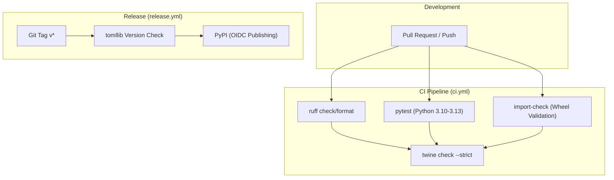
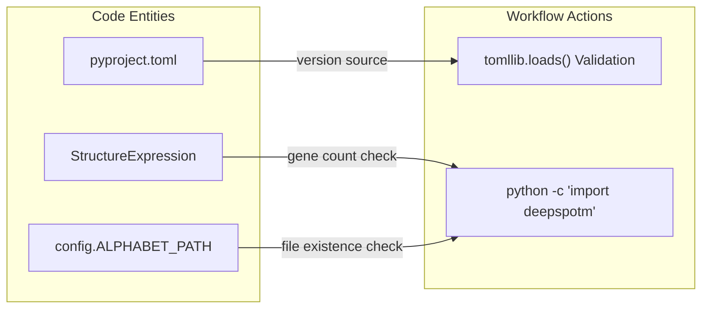

# CI/CD and Release Infrastructure

Relevant source files

The following files were used as context for generating this wiki page:

- [.github/dependabot.yml](.github/dependabot.yml)
- [.github/workflows/ci.yml](.github/workflows/ci.yml)
- [.github/workflows/release.yml](.github/workflows/release.yml)

The DeepSpotM project utilizes GitHub Actions to automate the software development lifecycle, ensuring code quality through rigorous testing and facilitating secure package distribution. The infrastructure is designed to handle the specific challenges of machine learning repositories, such as managing large dependencies (PyTorch) and verifying the integrity of packaged assets like gene vocabularies.

## Automation Overview

The automation suite is divided into three primary functional areas:
1.  **Continuous Integration**: Validates code changes via linting, multi-version testing, and wheel integrity checks.
2.  **Release Management**: Handles automated publishing to PyPI using Trusted Publishing (OIDC).
3.  **Dependency Maintenance**: Keeps the "model stack" and scientific computing libraries up to date via grouped updates.

### System Workflow Diagram

The following diagram illustrates the relationship between code changes, the CI pipeline, and the eventual release to PyPI.

**DeepSpotM Pipeline Orchestration**

Sources: [.github/workflows/ci.yml:1-100](), [.github/workflows/release.yml:1-88]()

---

## Continuous Integration (CI)

The CI pipeline is triggered on every push to the `main` branch and all pull requests. It focuses on ensuring that the package remains functional across supported Python versions and that the internal gene vocabulary assets are correctly bundled.

Key features of the CI environment:
*   **CPU-only Optimization**: To minimize runner overhead, CI uses CPU-only `torch` and `torchvision` wheels, avoiding massive CUDA downloads [.github/workflows/ci.yml:49-50]().
*   **Offline Mode**: The environment variable `HF_HUB_OFFLINE: "1"` is enforced to ensure tests rely only on local assets or mock data, preventing failures due to gated Hugging Face Hub access [.github/workflows/ci.yml:60-61]().
*   **Wheel Validation**: A dedicated `import-check` job installs the built `.whl` in a clean environment to verify that `ALPHABET_PATH` and the `StructureExpression` vocabulary are correctly included [.github/workflows/ci.yml:63-84]().

For detailed configuration of the test matrix and environment constraints, see **[Continuous Integration (ci.yml)](#8.1)**.

Sources: [.github/workflows/ci.yml:30-62](), [.github/workflows/ci.yml:63-84]()

---

## Release and Dependency Management

DeepSpotM uses a secure release process and proactive dependency tracking to maintain stability in a fast-moving ecosystem.

### Secure Publishing
Releases are primarily triggered by Git tags (e.g., `v1.0.0`). The `release.yml` workflow performs a strict version check, ensuring the Git tag matches the `version` field in `pyproject.toml` before publishing [.github/workflows/release.yml:38-50](). It utilizes **OpenID Connect (OIDC)** Trusted Publishing, which eliminates the need for long-lived PyPI tokens stored in repository secrets [.github/workflows/release.yml:3-6]().

### Proactive Maintenance
Dependabot is configured to manage updates on a weekly cadence. To prevent PR fatigue, updates are organized into logical groups:
*   `model-stack`: Deep learning libraries like `torch`, `timm`, and `peft`.
*   `scientific-python`: Core data science tools like `numpy` and `pandas`.
*   `dev-tooling`: Testing and linting utilities.

For details on the release triggers and OIDC configuration, see **[Release and Dependency Management](#8.2)**.

**Code-to-Workflow Association**

Sources: [.github/workflows/ci.yml:77-84](), [.github/workflows/release.yml:41-44](), [.github/dependabot.yml:1-41]()

---

## Child Pages

*   **[Continuous Integration (ci.yml)](#8.1)**: Detailed breakdown of the `lint`, `test`, `import-check`, and `build` jobs.
*   **[Release and Dependency Management](#8.2)**: Guide to the release workflow, OIDC setup, and Dependabot grouping strategy.

---