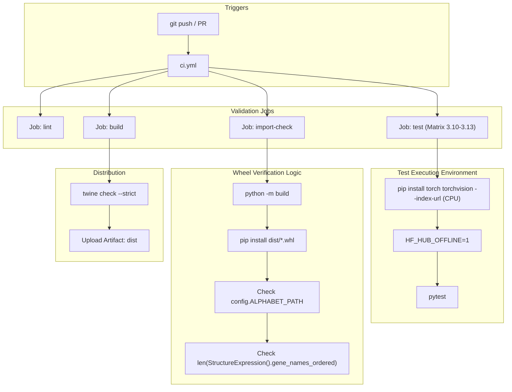
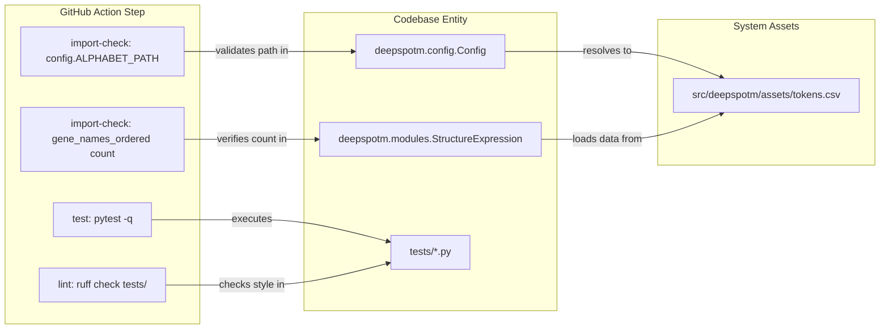

# Continuous Integration (ci.yml)

Relevant source files

The following files were used as context for generating this wiki page:

- [.github/workflows/ci.yml](.github/workflows/ci.yml)

The Continuous Integration (CI) pipeline for DeepSpotM is defined in `.github/workflows/ci.yml`. It ensures code quality through automated linting, validates the package against multiple Python versions, and performs "black-box" verification of the built distribution to ensure critical assets are correctly bundled.

Sources: [.github/workflows/ci.yml:1-7]()

## Pipeline Workflow Overview

The CI workflow is triggered on every `push` to the `main` branch, all `pull_request` events, and manual `workflow_dispatch` triggers [.github/workflows/ci.yml:3-7](). To optimize runner usage, `concurrency` is configured to cancel in-progress runs if a new commit is pushed to the same branch [.github/workflows/ci.yml:9-11]().

### CI Job Structure

| Job | Purpose | Environment |
| :--- | :--- | :--- |
| `lint` | Enforces code style and formatting using `ruff`. | Ubuntu, Python 3.12 |
| `test` | Runs the `pytest` suite across a Python version matrix. | Ubuntu, Python 3.10–3.13 |
| `import-check` | Validates that the built wheel contains necessary assets (CSV files). | Ubuntu, Python 3.12 |
| `build` | Verifies the build process and checks distribution metadata. | Ubuntu, Python 3.12 |

Sources: [.github/workflows/ci.yml:17-100]()

## Implementation Details

### Linting and Formatting
The `lint` job uses `ruff` to check and format the codebase. Currently, this is scoped specifically to the `tests/` directory to maintain existing style in the core library while ensuring new tests adhere to standards [.github/workflows/ci.yml:24-28]().

### Test Matrix and Environment
The `test` job executes the suite against Python versions 3.10, 3.11, 3.12, and 3.13 [.github/workflows/ci.yml:34-36](). 

#### Torch Synchronization Requirement
A critical constraint in the environment setup is the synchronization of `torch` and `torchvision`. The pipeline explicitly installs CPU-only versions from the PyTorch index [.github/workflows/ci.yml:49-50](). This prevents the runner from downloading large CUDA binaries (~2.5 GB) and avoids a common failure where `timm` or `lightning` might pull a mismatched `torchvision` version from PyPI, leading to the error: `"operator torchvision::nms does not exist"` [.github/workflows/ci.yml:45-48]().

#### Offline Execution
Because DeepSpotM model weights are gated on the Hugging Face Hub, the CI environment does not have access to authentication tokens. The `test` job sets `HF_HUB_OFFLINE: "1"` to ensure tests only use packaged assets or randomly initialized modules, preventing attempts to reach the external Hub [.github/workflows/ci.yml:55-61]().

### Wheel Validation (import-check)
The `import-check` job is a "black-box" validation step. Unlike the `test` job which runs against the source tree, this job builds a `.whl`, installs it, and runs a script from a temporary directory [.github/workflows/ci.yml:73-77](). This verifies that `package-data` defined in `pyproject.toml` is correctly included in the distribution.

It specifically validates:
1.  **Asset Resolution**: Confirms `config.ALPHABET_PATH` points to a valid file on disk [.github/workflows/ci.yml:81]().
2.  **Vocabulary Integrity**: Instantiates `StructureExpression` and asserts that the `gene_names_ordered` list contains exactly 19,338 genes [.github/workflows/ci.yml:82]().

Sources: [.github/workflows/ci.yml:30-85]()

## Data Flow and Logic

The following diagram illustrates the progression of code from a commit through the various validation stages of the CI pipeline.

**CI Pipeline Data Flow**

Sources: [.github/workflows/ci.yml:17-100]()

## Code Entity Association

This diagram maps the CI configuration steps to the specific Python entities and assets they validate within the DeepSpotM package.

**CI Validation to Code Mapping**

Sources: [.github/workflows/ci.yml:27-28](), [.github/workflows/ci.yml:79-82]()

---