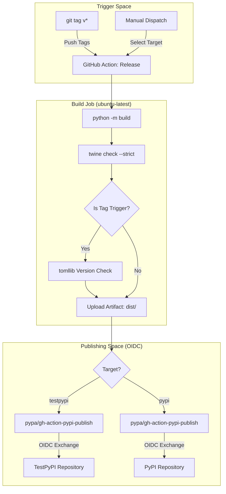
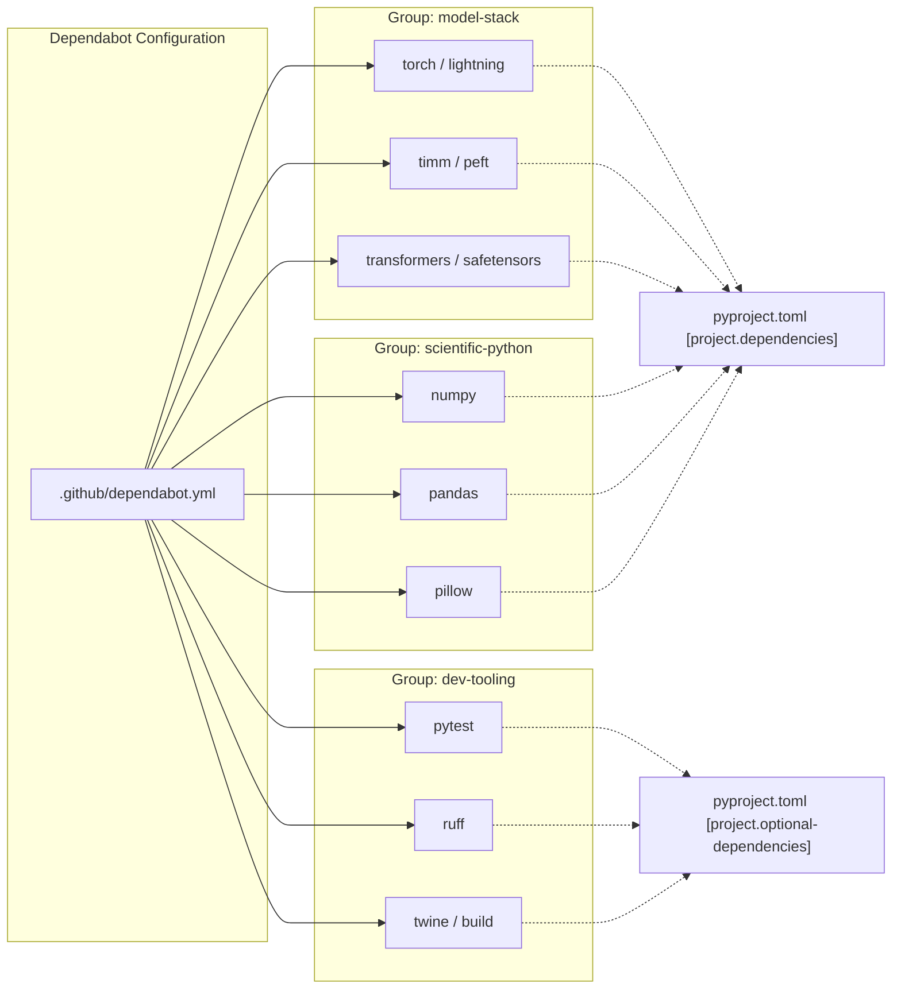

# Release and Dependency Management

Relevant source files

The following files were used as context for generating this wiki page:

- [.github/dependabot.yml](.github/dependabot.yml)
- [.github/workflows/release.yml](.github/workflows/release.yml)

This page documents the automation infrastructure for releasing DeepSpotM to the Python Package Index (PyPI) and the strategy for managing third-party dependencies. The system leverages GitHub Actions for secure, OIDC-based publishing and Dependabot for structured dependency updates.

## Release Workflow (`release.yml`)

The release process is managed by `.github/workflows/release.yml`. It supports two primary triggers: tag-based production releases and manual dispatch for testing.

### Execution Triggers
1.  **Tag-based Release**: Pushing a tag matching the pattern `v*` (e.g., `v1.0.0`) triggers a build and deployment to the production PyPI environment [`.github/workflows/release.yml`:8-13]().
2.  **Manual Dispatch**: Developers can manually trigger the workflow via `workflow_dispatch`, selecting either `testpypi` or `pypi` as the target destination [`.github/workflows/release.yml`:14-21]().

### Build and Validation Logic
The `build` job ensures that the package is valid before any publishing occurs:
*   **Artifact Generation**: Uses the `build` module to generate source distributions and wheels [`.github/workflows/release.yml`:34-35]().
*   **Strict Twine Check**: Executes `twine check --strict` to validate that the package metadata is compliant and will be accepted by PyPI [`.github/workflows/release.yml`:36-36]().
*   **Version Validation**: For tag-based triggers, the workflow uses `tomllib` to extract the version from `pyproject.toml` and compares it against the git tag. If they do not match, the workflow fails to prevent version mismatch in the repository history [`.github/workflows/release.yml`:38-49]().

### OIDC Trusted Publishing
DeepSpotM uses **Trusted Publishing** (OpenID Connect). This eliminates the need for long-lived PyPI API tokens stored as repository secrets.
*   **Permissions**: The jobs require `id-token: write` permissions to exchange a GitHub token for a short-lived PyPI session token [`.github/workflows/release.yml`:63-64](), [`.github/workflows/release.yml`:81-82]().
*   **Environments**: Publishing is gated by GitHub Environments (`pypi` and `testpypi`), allowing for environment-specific protection rules [`.github/workflows/release.yml`:60-62](), [`.github/workflows/release.yml`:78-80]().

### Release Pipeline Flow
The following diagram illustrates the data flow from a developer action to the final PyPI publication.

**Release Workflow Data Flow**

*Sources: [`.github/workflows/release.yml`:1-89]()*

## Dependency Management (`dependabot.yml`)

DeepSpotM uses `.github/dependabot.yml` to maintain its dependency tree. Given the fast-moving nature of the machine learning ecosystem, the configuration uses **Dependency Grouping** to minimize noise while ensuring the model stack remains current.

### Grouping Strategy
Dependencies are categorized into four logical groups to consolidate Pull Requests [`.github/dependabot.yml`:12-42]():

| Group | Included Patterns | Purpose |
| :--- | :--- | :--- |
| `model-stack` | `torch`, `lightning`, `timm`, `peft`, `transformers`, `safetensors`, `huggingface_hub` | Core ML infrastructure; high risk of breaking changes. |
| `scientific-python` | `numpy`, `pandas`, `pillow` | Data processing and array manipulation. |
| `dev-tooling` | `pytest*`, `ruff`, `build`, `twine` | Testing, linting, and packaging tools. |
| `actions` | `*` (GitHub Actions) | CI/CD workflow security and feature updates. |

### Configuration Parameters
*   **Schedule**: Checked weekly to avoid daily interruption [`.github/dependabot.yml`:10-10](), [`.github/dependabot.yml`:37-37]().
*   **Open PR Limit**: Capped at 5 open PRs to prevent backlog exhaustion [`.github/dependabot.yml`:11-11]().
*   **Ecosystems**: Covers both `pip` (via `pyproject.toml`) and `github-actions` [`.github/dependabot.yml`:7-7](), [`.github/dependabot.yml`:34-34]().

### Dependency Ecosystem Mapping
This diagram maps the logical groups defined in the configuration to the specific code entities and ecosystems they manage.

**Dependency Grouping Architecture**

*Sources: [`.github/dependabot.yml`:1-42]()*

## Summary of Release Operations

| Task | Command / Action | File Reference |
| :--- | :--- | :--- |
| **Validate Version** | `python -c "import tomllib; ..."` | [`.github/workflows/release.yml`:41-44]() |
| **Strict Check** | `twine check --strict dist/*` | [`.github/workflows/release.yml`:36-36]() |
| **Publish** | `pypa/gh-action-pypi-publish` | [`.github/workflows/release.yml`:70-70](), [`.github/workflows/release.yml`:88-88]() |
| **Group Updates** | `dependabot.yml` groups | [`.github/dependabot.yml`:12-32]() |

Sources:
*   [`.github/workflows/release.yml`:1-89]()
*   [`.github/dependabot.yml`:1-42]()

---