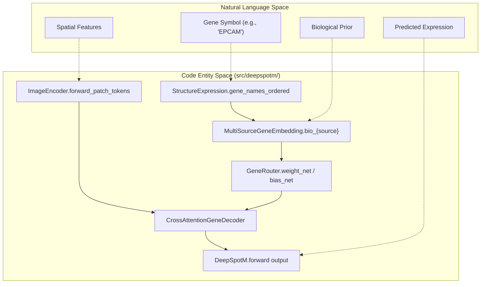
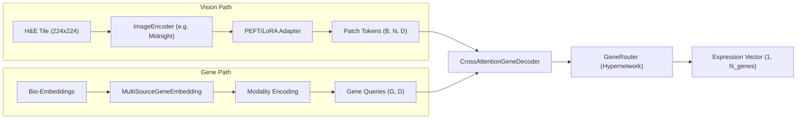

# Glossary

Relevant source files

The following files were used as context for generating this wiki page:

- [CITATION.cff](CITATION.cff)
- [README.md](README.md)
- [pyproject.toml](pyproject.toml)
- [src/deepspotm/assets/tokens.csv](src/deepspotm/assets/tokens.csv)
- [src/deepspotm/checkpoint.py](src/deepspotm/checkpoint.py)
- [src/deepspotm/image_encoder.py](src/deepspotm/image_encoder.py)
- [src/deepspotm/model.py](src/deepspotm/model.py)
- [src/deepspotm/modules.py](src/deepspotm/modules.py)
- [tests/test_decoder.py](tests/test_decoder.py)

This glossary defines technical terms, domain concepts, and implementation details specific to the **DeepSpotM** codebase. It serves as a reference for engineers to understand the mapping between biological concepts and the architectural components of the model.

## 1. Core Model Concepts

### Virtual Spatial Transcriptomics
The process of predicting transcriptome-wide gene expression from histology (H&E) images. DeepSpotM performs this by tokenizing image tiles and using gene-specific queries to predict expression levels [README.md:24-32]().

### Zero-Shot Gene Prediction
The ability to predict expression for genes not seen during training. This is enabled by the `GeneRouter` hypernetwork, which generates output projections from biological embeddings rather than learning a fixed weight matrix for a static set of genes [README.md:39-42](), [src/deepspotm/modules.py:111-117]().

### Biological Embeddings (Bio-Embeddings)
High-dimensional vectors representing genes, extracted from external foundation models (e.g., scGPT, Evo 2, ProtT5). These serve as the "prior" knowledge for the model [README.md:27-32](). In the code, these are handled by `MultiSourceGeneEmbedding` [src/deepspotm/modules.py:148-157]().

### Gene Router (Hypernetwork)
A specialized module (`GeneRouter`) that takes a biological embedding as input and produces a gene-specific linear projection (weight and bias). This allows the model to generalize to any gene for which a bio-embedding exists [src/deepspotm/modules.py:110-134]().

**Natural Language to Code Entity Mapping: Gene Prediction Flow**

Sources: [src/deepspotm/model.py:73-111](), [src/deepspotm/modules.py:110-146](), [src/deepspotm/image_encoder.py:70-84]()

---

## 2. Architectural Components

### Image Encoder
The vision backbone that processes 224x224 H&E tiles into spatial patch tokens. The default is `MidnightEncoder` [src/deepspotm/model.py:40](). It supports various architectures via the `ImageEncoder` base class and `ENCODER_REGISTRY` [src/deepspotm/image_encoder.py:34-43]().

### Cross-Attention Gene Decoder
The module (`CrossAttentionGeneDecoder`) that allows gene queries to attend to spatial image tokens. It consists of multiple `CrossAttentionLayer` instances [src/deepspotm/modules.py:38-62]().

### Modality Vocabulary
A canonical ordering of biological data types (DNA, RNA, Protein, Single-cell, Text) used to provide context to the model when using multiple embedding sources [src/deepspotm/modules.py:71-72](). The mapping is defined in `MODALITY_BY_SOURCE` [src/deepspotm/modules.py:79-92]().

### LoRA (Low-Rank Adaptation)
A parameter-efficient fine-tuning technique used to adapt the vision backbone. DeepSpotM maintains a contract where LoRA adapters remain wrapped during inference to ensure state-dict compatibility [src/deepspotm/model.py:22-36]().

**System Component Interaction**

Sources: [src/deepspotm/model.py:86-111](), [src/deepspotm/modules.py:135-146](), [src/deepspotm/modules.py:148-175]()

---

## 3. Data & State Management

### AnnData (.h5ad)
The standard file format for spatial transcriptomics data. The `predict_wsi.py` script outputs predictions in this format, where `X` contains log1p-CPM values and `obsm['spatial']` contains coordinates [README.md:105-112]().

### log1p-CPM
The normalization scheme used for predictions: $log_e(1 + \text{Counts Per Million})$. The TCGA atlas and model outputs follow this convention [README.md:148-150]().

### StructureExpression
A utility class that manages the gene vocabulary. It uses `tokens.csv` to map gene symbols to indices and handles out-of-vocabulary (OOV) genes [src/deepspotm/modules.py:11-32]().

### State-Dict Filtering
A mechanism in `checkpoint.py` to handle "cross-vocab" loading. When loading weights for a different set of genes than the training set, `VOCAB_SPECIFIC_PREFIXES` are dropped from the state dict to allow the model to re-initialize these layers for the new vocabulary [src/deepspotm/checkpoint.py:16-23]().

### OOV (Out of Vocabulary)
Refers to genes not present in the primary `tokens.csv` asset. While the model can predict new genes via the `GeneRouter`, the standard inference panel is limited to the ~19k genes defined in the bundled assets [README.md:87-92](), [src/deepspotm/assets/tokens.csv:1-376]().

---

## 4. Key Functions & Symbols Reference

| Symbol | Location | Description |
| :--- | :--- | :--- |
| `DeepSpotM` | [src/deepspotm/model.py:15]() | The main LightningModule orchestrating the backbone and decoder. |
| `from_pretrained` | [src/deepspotm/model.py:236]() | Factory method to load model, config, and vocabulary from HuggingFace or local disk. |
| `predict_genes` | [src/deepspotm/model.py:328]() | Optimized inference method that only computes queries for requested gene symbols. |
| `swap_gene_vocabulary` | [src/deepspotm/model.py:126]() | In-place modification of the model to target a new set of gene embeddings. |
| `forward_patch_tokens` | [src/deepspotm/image_encoder.py:70]() | Extracts spatial features from the vision backbone, stripping CLS or register tokens. |
| `ALPHABET_PATH` | [src/deepspotm/config.py:18]() | Path to the default `tokens.csv` gene vocabulary asset. |
| `MODALITY_VOCABULARY` | [src/deepspotm/modules.py:71]() | The fixed list of modalities (`dna`, `rna`, `protein`, etc.) used for modality encoding. |

Sources: [src/deepspotm/model.py:15-350](), [src/deepspotm/image_encoder.py:70-96](), [src/deepspotm/modules.py:11-92](), [src/deepspotm/config.py:8-19]()