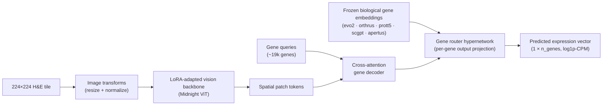

This page introduces **DeepSpot-M**, a research codebase for predicting gene expression directly from histology images. It explains what the model does, how its architecture fits together at a high level, what ships inside this repository, and how to install and run your first prediction — everything a beginner needs before diving deeper. For hands-on setup, continue to [Quick Start](2-quick-start).

## What Is DeepSpot-M?

DeepSpot-M is a **multimodal foundation model for transcriptome-wide virtual spatial transcriptomics**. In practical terms: you give it a small patch of an H&E-stained tissue image (a 224×224 pixel tile), and it returns predicted expression levels across a panel of roughly **19,000 genes** — effectively "reading out" the molecular state of the tissue from how it looks under a microscope.

The key design insight is that **genes are represented as queryable embeddings rather than fixed outputs**. Each gene query attends to the image's patch tokens through a cross-attention decoder, and a *gene router hypernetwork* generates gene-specific output projections from frozen biological embeddings drawn from five foundation models covering different modalities: Evo 2 (DNA), Orthrus (RNA), ProtT5 (protein), scGPT (single-cell), and Apertus (text). Because gene identity is an input rather than a hardwired output neuron, the model can even predict **genes it never saw during training** (zero-shot prediction).


The project comes with pretrained weights on Hugging Face, a Python package (`deepspotm` on PyPI), command-line prediction tools, a complete end-to-end tutorial, and a released **TCGA virtual spatial transcriptomics atlas** of 28,664 whole-slide images across 32 cancer types (295.3 million spots from 10,865 patients).

> ⚠️ **Research use only.** Not for clinical or diagnostic use.

Sources: [README.md](README.md#L1-L32), [README.md](README.md#L34-L44), [model.py](src/deepspotm/model.py#L15-L38)

## How It Works: Architecture at a Glance

The diagram below traces a single H&E tile through the four conceptual stages of the model. Before reading it, note that **LoRA** (Low-Rank Adaptation) is a technique that freezes a large pretrained model and trains only small adapter matrices — this lets the team adapt a pathology vision backbone cheaply — and a **hypernetwork** is a small network whose job is to generate the weights of another layer.



Reading the pipeline left to right:

1. **Vision stage** — the tile is resized/normalized, then tokenized into spatial patch tokens by a LoRA-adapted pathology foundation backbone. The released model uses the `MidnightEncoder` (ViT, embedding dim 1536) as the default; the code also ships adapters for UNI, UNI2, H-optimus-0/1, H0-mini, and CLIP through a shared encoder registry.
2. **Gene queries** — the vocabulary of ~19k gene names comes from a bundled `tokens.csv` asset; output column `i` of the forward pass always corresponds to `model.gene_names[i]`.
3. **Cross-attention decoder** — each gene query independently attends to the patch tokens via multi-head attention (2 layers, 8 heads, 256-dim gene embeddings by default), refining "what this gene should look like given this tissue."
4. **Gene router hypernetwork** — a small network reads each gene's frozen biological embedding and *generates* that gene's output projection weights and bias on the fly, producing the final scalar expression value.

Sources: [README.md](README.md#L24-L32), [model.py](src/deepspotm/model.py#L40-L68), [model.py](src/deepspotm/model.py#L72-L111), [modules.py](src/deepspotm/modules.py#L111-L145), [image_encoder.py](src/deepspotm/image_encoder.py#L301-L343), [config.py](src/deepspotm/config.py#L5-L19)

### Gene-Embedding Sources and Modalities

Each source is a different biological "prior" describing what genes are. At load time you pick **one** active source; the model collapses to that single pathway for efficient inference.

| Source | Modality | Foundation model origin |
|---|---|---|
| `evo2` | DNA | Genomic sequence model |
| `orthrus` | RNA | Transcriptomic sequence model |
| `prott5` | Protein | Protein language model |
| `scgpt` | single-cell | Single-cell expression model *(released default)* |
| `apertus` | text | Text foundation model |

Sources: [examples/predict.py](examples/predict.py#L2-L16), [modules.py](src/deepspotm/modules.py#L59-L88), [README.md](README.md#L24-L32)

## Key Capabilities

| Capability | What it means for you | Where to learn more |
|---|---|---|
| **Tile-level prediction** | One forward pass returns the full ~19k-gene expression vector per tile | [Quick Start](2-quick-start) |
| **Selective gene prediction** | `model.predict_genes(tile, ["EPCAM", ...])` computes only the requested gene queries — faster than the full panel | [Selective Gene Prediction](16-selective-gene-prediction) |
| **Whole-slide pipeline** | `predict_wsi.py` tiles an SVS-style slide, drops background, and writes a scanpy/squidpy-ready `.h5ad` | [Whole-Slide Image Pipeline](17-whole-slide-image-pipeline) |
| **Five gene-embedding sources** | Swap between evo2/orthrus/prott5/scgpt/apertus with one argument | [Multi-Source Gene Embeddings](11-multi-source-gene-embeddings) |
| **Zero-shot genes** | The router hypernetwork can score genes absent from training | [Gene Router Hypernetwork](10-gene-router-hypernetwork) |
| **Self-contained checkpoints** | `from_pretrained` needs no download of the upstream backbone repo | [Pretrained Model Loading](13-pretrained-model-loading) |
| **Published atlas** | Ready-made predictions for 28,664 TCGA slides across 32 cancers | [Atlas and Dataset Access](5-atlas-and-dataset-access) |

Sources: [README.md](README.md#L65-L97), [README.md](README.md#L99-L121), [model.py](src/deepspotm/model.py#L370-L391)

## Repository Layout

The repository is deliberately compact — one installable package, a handful of examples, and a test suite:

```
DeepSpotM/
├── pyproject.toml          # packaging, dependencies, licenses
├── README.md               # project front page
├── assets/                 # model_overview.png used in docs
├── src/deepspotm/          # the installable package
│   ├── model.py            # DeepSpotM class: backbone + decoder assembly,
│   │                       #   from_pretrained, forward, predict_genes
│   ├── modules.py          # cross-attention decoder, gene router
│   │                       #   hypernetwork, multi-source embeddings
│   ├── image_encoder.py    # vision backbones (Midnight, UNI, H-optimus...)
│   ├── checkpoint.py       # state-dict loading & cross-vocabulary handling
│   ├── config.py           # paths to bundled gene vocabulary (tokens.csv)
│   ├── utils.py            # shared helpers (transforms, normalization)
│   └── assets/             # tokens.csv, midnight_config.json, mappings
├── examples/
│   ├── predict.py          # CLI: tile(s) → predictions / CSV
│   ├── predict_wsi.py      # CLI: whole slide → AnnData .h5ad
│   └── predict_tcga_skcm.ipynb  # end-to-end TCGA-SKCM tutorial
├── tests/                  # pytest suite (checkpoint, decoder, utils...)
└── LICENSE / WEIGHTS_LICENSE.md / THIRD_PARTY_LICENSES.md
```

The single public entry point `DeepSpotM` (plus the decoder, router, and loading utilities) is exported from the package root, so `from deepspotm import DeepSpotM` is all most users ever need to import.

Sources: [pyproject.toml](pyproject.toml#L7-L14), [\_\_init\_\_.py](src/deepspotm/__init__.py#L1-L31), [config.py](src/deepspotm/config.py#L5-L19)

## Installation & Requirements

```bash
pip install deepspotm                # core package
pip install "deepspotm[wsi]"         # adds pyvips + anndata for predict_wsi.py
```

Python **3.10 or newer** is required — the core dependencies (torch, transformers, peft, lightning) no longer resolve on older versions.

| Dependency | Minimum | Role |
|---|---|---|
| `torch` | ≥ 2.0 | Tensor compute & model runtime |
| `lightning` | ≥ 2.0 | `LightningModule` base for `DeepSpotM` |
| `timm` | ≥ 0.9 | Builds timm-family vision backbones |
| `transformers` | ≥ 4.43 | Builds Midnight / CLIP backbones |
| `peft` | ≥ 0.6 | LoRA adapter wrapping of the backbone |
| `safetensors` | ≥ 0.3 | Weight file format |
| `huggingface_hub` | ≥ 0.20 | Downloads model files from the Hub |
| `pandas` / `numpy` / `pillow` | ≥ 2.0 / 1.24 / 9.0 | Vocabulary CSV, arrays, image I/O |

Sources: [README.md](README.md#L46-L63), [pyproject.toml](pyproject.toml#L18-L29), [pyproject.toml](pyproject.toml#L46-L67)

## Your First Prediction

The minimal end-to-end flow is four steps: load the model, transform a tile, run the forward pass, and map the output vector back to gene symbols.

```python
from deepspotm import DeepSpotM

model, image_processor = DeepSpotM.from_pretrained(
    "ratschlab/DeepSpotM",
    source="scgpt",   # one of evo2, orthrus, prott5, scgpt, apertus
)

import torch
tile = image_processor(my_pil_tile).unsqueeze(0)   # 224x224 H&E tile
with torch.no_grad():
    expression, _, _ = model(tile)                 # (1, n_genes)

preds = dict(zip(model.gene_names, expression.squeeze(0).tolist()))
```

A few things worth noticing for beginners: `from_pretrained` returns the model **and** its matching image transform (normalization differs per backbone, so never skip it); the model is returned already on GPU (if available) and in eval mode; and because output column `i` is `model.gene_names[i]`, mapping predictions to gene symbols requires no extra vocabulary parsing.

> [!TIP]
> `from_pretrained` builds the Midnight backbone **offline** from a bundled config (`midnight_config.json`) and takes its weights entirely from the checkpoint — so loading works with no network access to the upstream `kaiko-ai/midnight` repo, and the released checkpoint is fully self-contained.

> [!TIP]
> For a handful of genes of interest (e.g. markers `BRAF`, `CD3D`, `COL1A1`), use `model.predict_genes(tile, genes)` instead of the full forward — only those gene queries are built and attended, which is measurably faster.

If you prefer not to write code at all, the bundled CLI tools cover the same workflows:

```bash
python examples/predict_wsi.py slide.svs -o slide.h5ad              # slide → .h5ad
python examples/predict.py tiles/ --genes EPCAM CD3D --output p.csv # tiles → CSV
```

Sources: [README.md](README.md#L65-L89), [README.md](README.md#L91-L97), [README.md](README.md#L99-L121), [model.py](src/deepspotm/model.py#L252-L331)

## Licensing & Usage Boundaries

The project uses a **split license**, which matters if you plan to redistribute anything:

| Artifact | License | Practical meaning |
|---|---|---|
| Source code | PolyForm Noncommercial 1.0.0 | Non-commercial use only |
| Model weights | CC-BY-NC-SA-4.0 | Non-commercial, ShareAlike, with attribution |
| Backbone & gene-embedding sources | MIT / Apache-2.0 | Permissive (see THIRD_PARTY_LICENSES.md) |

This is a research tool: predictions are estimates derived from image appearance and must not be used for clinical or diagnostic decisions. The package metadata itself encodes this stance (`license = "PolyForm-Noncommercial-1.0.0"`).

Sources: [pyproject.toml](pyproject.toml#L7-L14), [README.md](README.md#L172-L183)

## Suggested Learning Path

This documentation is organized as **Get Started** → **Deep Dive**. A productive route for a beginner:

1. **[Quick Start](2-quick-start)** — environment setup and a working first run.
2. **[Command-Line Prediction Tools](3-command-line-prediction-tools)** — score tiles or whole slides without writing code.
3. **[TCGA-SKCM Tutorial Notebook](4-tcga-skcm-tutorial-notebook)** — end-to-end walkthrough reproducing an atlas example on a melanoma slide.
4. **[Atlas and Dataset Access](5-atlas-and-dataset-access)** — download the released 28,664-slide TCGA virtual atlas from Hugging Face.
5. **[Architecture Overview](6-architecture-overview)** — then go component by component: [Pathology Vision Encoders](7-pathology-vision-encoders), [Cross-Attention Gene Decoder](9-cross-attention-gene-decoder), [Gene Router Hypernetwork](10-gene-router-hypernetwork), and [Multi-Source Gene Embeddings](11-multi-source-gene-embeddings).
6. Finally, the inference-engineering pages — starting with [Pretrained Model Loading](13-pretrained-model-loading) — explain how checkpoints, vocabularies, and memory-efficient loading fit together.
