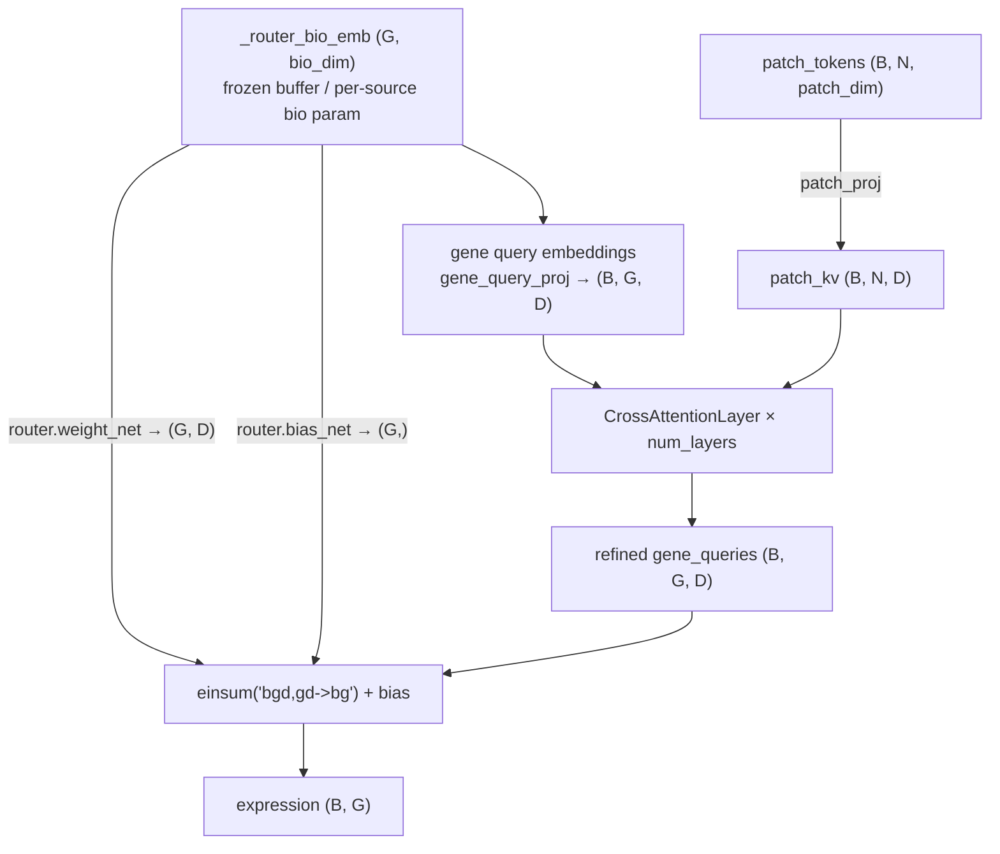
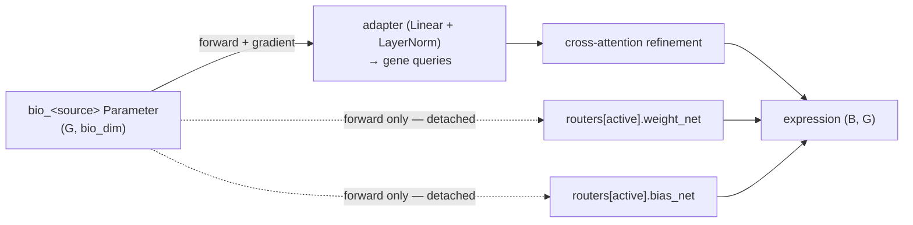
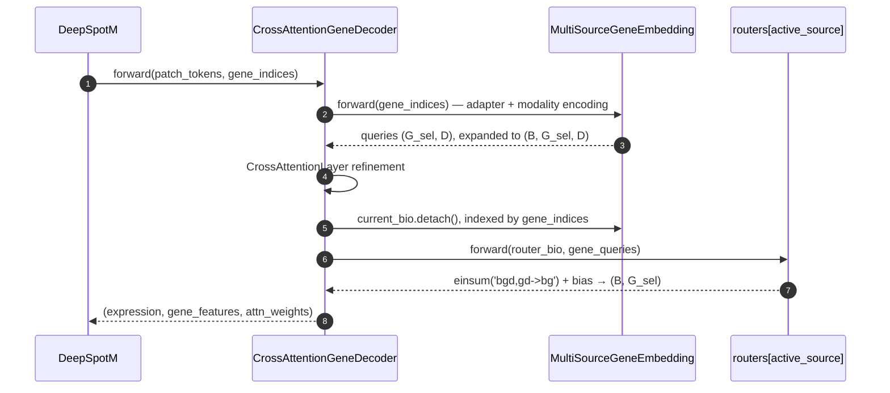

This page explains the **GeneRouter** — the hypernetwork that serves as the output head of DeepSpot-M's cross-attention gene decoder. A hypernetwork is a network whose weights *produce* the weights of another network; here, two small MLPs read a gene's biological embedding (scGPT, Evo 2, Orthrus, ProtT5, Apertus, …) and generate that gene's projection vector and bias on the fly, instead of storing a fixed per-gene weight matrix. This design is what allows one checkpoint to predict expression for genes it never saw during training — the repository's stated zero-shot capability.

Scope of this page: module anatomy, the construction matrix (single-source vs. multi-source), runtime dispatch and gradient behavior, vocabulary-swap semantics, and the unseen-gene pathways. It sits between [Cross-Attention Gene Decoder](9-cross-attention-gene-decoder) (query refinement) and [Multi-Source Gene Embeddings](11-multi-source-gene-embeddings) (query initialization).

Sources: [README.md](/README.md#L23-L41), [modules.py](/src/deepspotm/modules.py#L110-L145)

## Architectural Role: One Shared Head vs. Generated Per-Gene Heads

Without the router, the decoder's output head is a single shared projection — `nn.Linear(gene_embed_dim, 1)` — meaning every gene's refined query vector is squeezed through the *same* scalar projection. The router replaces this: for gene *g* with biological embedding *bio_g*, it computes a dedicated projection `w_g = weight_net(bio_g)` and bias `b_g = bias_net(bio_g)`, then produces the prediction as an inner product between the gene's refined query and its generated weight, plus the generated bias. The biological embedding effectively acts as a *content address* into a space of output projections, so a gene that never appeared in training can still receive a meaningful projection as long as a biological embedding for it exists.

Sources: [modules.py](/src/deepspotm/modules.py#L578-L589), [README.md](/README.md#L35-L41)

The following data-flow diagram shows where the router sits relative to the decoder's query pathway — the biological embedding feeds **both** the query initialization (via the embedding/projection path) and the output head (via the router MLPs), which is the design invariant the code repeatedly preserves ("same embedding feeds adapter + router"):

| Property | Shared head (`output_proj`) | GeneRouter |
|---|---|---|
| Output weights | One `Linear(D, 1)`, shared by all genes | Per-gene `(D,)` projection, generated per forward from `bio_g` |
| New/unseen gene | Impossible — no weight exists for it | Works — MLP evaluates on any bio embedding of matching dim |
| Parameter count | `D + 1` | Two MLPs, **independent of the number of genes** G |
| Biological prior usage | Query init only | Query init **and** output head |

Sources: [modules.py](/src/deepspotm/modules.py#L110-L145), [README.md](/README.md#L23-L31)

## Module Anatomy: Two MLPs and an Einstein Sum

`GeneRouter` is deliberately minimal — two independent `nn.Sequential` MLPs and no internal state. `weight_net` maps `(G, bio_dim) → (G, D)` through a `Linear → GELU → Linear` stack (input `gene_bio_dim`, hidden `hidden_dim`, output `gene_embed_dim`); `bias_net` shares the same hidden width but outputs a scalar per gene, squeezed to `(G,)`. The default hidden size is `gene_embed_dim * 2` when `router_hidden_dim` is not supplied.

Sources: [modules.py](/src/deepspotm/modules.py#L119-L133)

The forward pass is a single expression: `torch.einsum('bgd,gd->bg', gene_queries, proj) + bias`. Because `proj` and `bias` depend only on gene identity — not on the image — they are computed **once per gene**, independent of batch size. For a batch of B tiles the cost is `G × bio_dim × H + G × H × D` for generation plus one batched bilinear product; the biological embeddings are shared across the batch dimension, which is what makes this head cheap relative to re-attending per gene.

| Stage | Operator | Input → Output shape |
|---|---|---|
| Projection generation | `weight_net(bio)` | `(G, bio_dim)` → `(G, D)` |
| Bias generation | `bias_net(bio).squeeze(-1)` | `(G, bio_dim)` → `(G,)` |
| Score computation | `einsum('bgd,gd->bg')` | `(B, G, D)`, `(G, D)` → `(B, G)` |
| Output | `+ bias` | `(B, G)` |

Sources: [modules.py](/src/deepspotm/modules.py#L135-L145)

## Construction Matrix: When Is a Router Built?

Router construction is decided by the interaction of two decoder arguments: `init_gene_embeddings` (which biological prior, if any) and `use_router`. The decoder validates their combination at construction time — a router with no biological input is a logical contradiction and raises `ValueError`. At the `DeepSpotM` level, `use_router` defaults to `True` and is forwarded into the decoder alongside `router_hidden_dim`.

| `init_gene_embeddings` | `use_router=False` | `use_router=True` |
|---|---|---|
| `"xavier"` (random init) | Shared head, standard path | **`ValueError`** — no biological embedding to condition on |
| Single source name (e.g. `"scgpt"`) | Shared head; bio initializes queries only | Registers `_router_bio_emb` **buffer** (frozen prior) + `self.router = GeneRouter(bio_dim, D, hidden)` |
| List of sources (multi-source) | Shared head + `MultiSourceGeneEmbedding` queries | `self.routers = nn.ModuleDict(...)` — one `GeneRouter` **per source**, each built with that source's own `bio_dim` |

Sources: [modules.py](/src/deepspotm/modules.py#L498-L512), [modules.py](/src/deepspotm/modules.py#L545-L563), [model.py](/src/deepspotm/model.py#L48-L50), [model.py](/src/deepspotm/model.py#L97-L111)

The per-source construction preserves the single-source invariant under multi-source dispatch: each `GeneRouter` receives `gene_bio_dim=self.multi_source.bio_dims[name]`, so a 1280-d text prior and a 512-d RNA prior each get a router whose input layer matches their embedding width. In the no-router multi-source branch, the decoder falls back to the shared `Linear(gene_embed_dim, 1)` head and returns early, skipping the single-source initialization entirely.

Sources: [modules.py](/src/deepspotm/modules.py#L545-L563)

## Multi-Source Dispatch and the Gradient Contract

At runtime the decoder never iterates routers — it dispatches to exactly one: `self.routers[active]`, where `active` is `self.multi_source.active_source`, selected externally via `DeepSpotM.set_source`. The biological input is obtained through the `current_bio` property, which returns the **trainable** `bio_{source}` parameter for the active source — with one critical modification: it is passed as `current_bio.detach()`.

> [!TIP]
> The `.detach()` is a deliberate gradient-routing decision, documented inline: the router *reads* the bio embedding's current value but backpropagation does **not** flow into `bio_{source}` through the router pathway. Bio parameters receive gradients only via the adapter (query) path. Without this isolation, a single bio tensor would be co-optimized by three consumers simultaneously — the adapter, `weight_net`, and `bias_net` — a dynamic the authors report as unstable enough to hurt validation Pearson correlation.

Sources: [modules.py](/src/deepspotm/modules.py#L760-L777), [modules.py](/src/deepspotm/modules.py#L391-L408), [model.py](/src/deepspotm/model.py#L196-L211)

This makes the two modes gradient-equivalent at the router boundary: the single-source `_router_bio_emb` is a frozen *buffer* (never trained at all), while the multi-source `bio_*` are trainable *parameters* that train only through the adapter path. The concept relationship below summarizes which consumers write gradients back into the biological embedding:

Sources: [modules.py](/src/deepspotm/modules.py#L763-L777), [modules.py](/src/deepspotm/modules.py#L386-L408)

Because `active_source` is a plain Python attribute — intentionally excluded from `state_dict` — a freshly loaded multi-source checkpoint has no active pathway until `set_source` is called; the loader-side contract for this is covered in [Pretrained Model Loading](13-pretrained-model-loading) and [Memory-Efficient Source Loading](15-memory-efficient-source-loading).

Sources: [modules.py](/src/deepspotm/modules.py#L175-L181), [model.py](/src/deepspotm/model.py#L196-L211)

## Runtime Flow Through `forward`

The full forward sequence through the decoder, with the router as the final stage:

Sources: [modules.py](/src/deepspotm/modules.py#L713-L790), [model.py](/src/deepspotm/model.py#L370-L391)

Subsetting interacts correctly with the router because the biological input is indexed with the *same* `gene_indices` used to gather queries (`router_bio = router_bio[gene_indices]`), preserving column alignment. The repository's contract tests pin the surrounding guarantee the router relies on: `gene_indices` must both **subset** the output and **respect requested order** (`subset ≡ full[:, wanted]`, and reversed indices flip output columns accordingly).

Sources: [modules.py](/src/deepspotm/modules.py#L774-L784), [test_decoder.py](/tests/test_decoder.py#L57-L77)

## Vocabulary Surgery: `swap_vocabulary` Router Semantics

When a checkpoint is retargeted to a new gene vocabulary (custom panel, cross-species), the decoder's `swap_vocabulary` applies conservative rebuild rules to the router — trained router weights are preserved whenever mathematically possible:

| Scenario | Router action |
|---|---|
| New vocab, **same** `bio_dim` (e.g. human prott5 → mouse prott5, both 1024-d) | Keep the trained router verbatim; refresh the `_router_bio_emb` buffer to the new vocab's embeddings |
| New vocab with **different** `bio_dim`, or no router yet | Rebuild `GeneRouter(bio_dim_new, D, hidden)`; inherit hidden width from the old router |
| Explicit `use_router=False` | Create shared head; delete `router` and the `_router_bio_emb` buffer |
| Multi-source + `source=` | Collapse to one source; kept source's router preserved, all other routers deleted (`use_router`/`router_hidden_dim` ignored) |

> [!TIP]
> The hidden-width inheritance trick: `swap_vocabulary` reads the trained hidden dim by introspection — `existing_router.weight_net[0].out_features` — rather than trusting a passed argument. This means a same-dim vocabulary swap round-trips with zero architectural drift, and an explicit `router_hidden_dim` only takes effect when a rebuild is genuinely required.

Sources: [modules.py](/src/deepspotm/modules.py#L608-L712), [modules.py](/src/deepspotm/modules.py#L684-L698)

The model-level wrapper `DeepSpotM.swap_gene_vocabulary` exposes this surgery and keeps `hparams["use_router"]` (and the multi-source collapse reflected in `init_gene_embeddings`) synchronized so that a subsequent `load_from_checkpoint` rebuilds the identical structure — the checkpoint round-trip aspect is detailed in [Cross-Vocabulary Checkpoint Handling](14-cross-vocabulary-checkpoint-handling).

Sources: [model.py](/src/deepspotm/model.py#L126-L191)

## Zero-Shot and Unseen-Gene Pathways

The router enables unseen-gene prediction through two mechanisms at different abstraction levels. At the **decoder level**, `CrossAttentionGeneDecoder.forward` accepts an optional `gene_bio_embeddings` override of shape `(G, bio_dim)` which bypasses the stored buffer entirely — the documented hook for zero-shot inference on arbitrary genes. Its hard constraint is dimensional: `bio_dim` must match the router's trained input width (`weight_net`'s first layer), since the hypernetwork's weights were learned for a specific embedding geometry. Note that the public `DeepSpotM.forward` does not surface this argument; the override lives at the decoder API boundary.

Sources: [modules.py](/src/deepspotm/modules.py#L713-L729), [modules.py](/src/deepspotm/modules.py#L778-L785)

At the **model level**, retargeting to a genuinely new vocabulary goes through `swap_gene_vocabulary` (embeddings + token CSV in, rebuilt router out), which is the path used by fine-tuning and cross-vocabulary workflows. When reconstructing a multi-source model from a checkpoint alone, the `bio_dims` hyperparameter drives shape-only construction (`MultiSourceGeneEmbedding.from_shapes`) so per-source routers can be allocated without downloading raw embedding assets — the trained values then arrive via `load_state_dict`.

Sources: [model.py](/src/deepspotm/model.py#L126-L191), [modules.py](/src/deepspotm/modules.py#L529-L538)

## Configuration Reference

| Parameter | Defined in | Default | Effect on the router |
|---|---|---|---|
| `use_router` | `DeepSpotM.__init__` → decoder | `True` | Selects hypernetwork head over shared `Linear(D, 1)` |
| `router_hidden_dim` | `DeepSpotM.__init__` → router | `None` → `gene_embed_dim * 2` | Hidden width of both router MLPs; recovered by introspection on vocab swaps |
| `init_gene_embeddings` | `DeepSpotM.__init__` → decoder | `"xavier"` | Source of bio embeddings; must be non-xavier for the router; a list builds per-source routers |
| `gene_embed_dim` | `DeepSpotM.__init__` → decoder | `256` | Router output width; must match the decoder's query space |
| `use_modality_encoding` | decoder → `MultiSourceGeneEmbedding` | `True` | Adjacent concern — affects queries, not router weights |

Sources: [model.py](/src/deepspotm/model.py#L38-L67), [modules.py](/src/deepspotm/modules.py#L119-L133), [modules.py](/src/deepspotm/modules.py#L498-L512)

## Summary and Next Steps

The Gene Router Hypernetwork is a small component with outsized consequences: two MLPs turn a gene's frozen biological identity into a bespoke output projection, making the model's output space *queryable* rather than fixed. Its implementation is characterized by three verified invariants — construction-time validation that a router always has a biological input, per-source router dispatch with detached bio reads in multi-source mode, and conservative weight preservation across vocabulary surgery.

To continue through this section of the catalog: [Cross-Attention Gene Decoder](9-cross-attention-gene-decoder) covers the query refinement stage feeding the router, [Multi-Source Gene Embeddings](11-multi-source-gene-embeddings) covers the `bio_*` parameters and adapters it consumes, and [Gene Vocabulary and Output Mapping](12-gene-vocabulary-and-output-mapping) covers how the router's output columns map back to gene symbols. For inference-time engineering around these components, see [Cross-Vocabulary Checkpoint Handling](14-cross-vocabulary-checkpoint-handling) and [Selective Gene Prediction](16-selective-gene-prediction).
