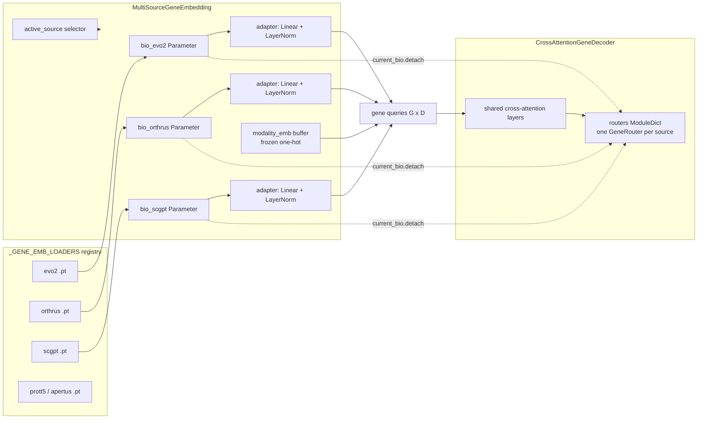
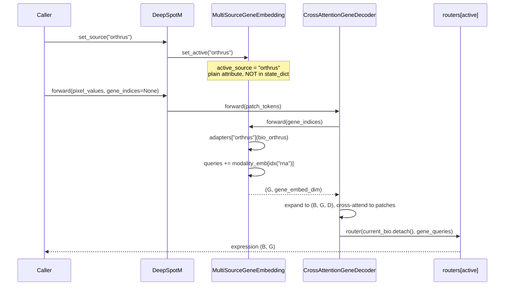

This page explains the machinery that lets a single DeepSpotM decoder draw gene identity from *several* independent biological embedding spaces — DNA, RNA, protein, single-cell, and text foundation models — and switch between them at runtime. The centerpiece is `MultiSourceGeneEmbedding`, a per-source stack of trainable gene-token parameters, projection adapters, and a frozen modality signal, orchestrated by a runtime `active_source` selector. It sits between the [Cross-Attention Gene Decoder](9-cross-attention-gene-decoder), which consumes the queries it produces, and the [Gene Router Hypernetwork](10-gene-router-hypernetwork), which shares the same per-source embeddings for output projections.

Sources: [modules.py](src/deepspotm/modules.py#L148-L181), [model.py](src/deepspotm/model.py#L47-L66)

## Why Multiple Biological Priors

DeepSpot-M's gene decoder does not treat genes as fixed output columns; each gene is a queryable embedding that attends to image patch tokens. The multi-source design generalizes this: instead of committing to one prior (e.g. scGPT alone), the model ships one gene-embedding bank per source — the five published sources are `evo2`, `orthrus`, `prott5`, `scgpt`, and `apertus` — plus one trainable adapter and, in router mode, one hypernetwork per source. The shared cross-attention stack is identical to the single-source path; only the gene-query generation and the output head become per-source and runtime-dispatched. This is what lets `from_pretrained(..., source="scgpt")` and `--source evo2` select a pathway on the same published weights.

Sources: [README.md](README.md#L24-L42), [examples/predict.py](examples/predict.py#L16-L16), [model.py](src/deepspotm/model.py#L213-L236)

The dispatch is **exclusive, not fused**: exactly one source is active per forward pass. There is no concatenation or averaging of sources — the invariant maintained throughout is *"the same embedding feeds the adapter (query init) and the router (output hypernet)"*, extended on a per-source basis. Switching sources therefore changes the model's complete gene-identity pathway, which is why the selection must be made explicitly before every forward.

Sources: [modules.py](src/deepspotm/modules.py#L547-L561), [modules.py](src/deepspotm/modules.py#L391-L399)

## The Source Registry and the Asset Contract

Every source is registered in `_GENE_EMB_LOADERS` as a `partial` bound to a `<name>_gene_embeddings.pt` file inside the packaged `deepspotm.assets` directory. Loading goes through `_load_gene_embeddings`, which uses `importlib.resources` (so the assets resolve from an installed wheel, not just a source checkout) and `weights_only=True` for safe deserialization. A missing asset raises a `FileNotFoundError` that points to the generating notebooks rather than failing opaquely. To add a new source, you must register both its loader and — if modality encoding is enabled — its modality mapping.

Sources: [modules.py](src/deepspotm/modules.py#L458-L470), [modules.py](src/deepspotm/modules.py#L95-L104), [modules.py](src/deepspotm/modules.py#L77-L78)

| Registry key | Asset file | Modality (`MODALITY_BY_SOURCE`) | Published default |
|---|---|---|---|
| `evo2` | `evo2_7b_gene_embeddings.pt` | `dna` | ✅ |
| `orthrus` | `orthrus_gene_embeddings.pt` | `rna` | ✅ |
| `prott5` | `prott5_gene_embeddings.pt` | `protein` | ✅ |
| `esm2` | `esm2_gene_embeddings.pt` | `protein` | — |
| `scgpt` | `scgpt_gene_embeddings.pt` | `single_cell` | ✅ |
| `geneformer` | `geneformer_gene_embeddings.pt` | `single_cell` | — |
| `geneformer_cancer` | `geneformer_cancer_gene_embeddings.pt` | `single_cell` | — |
| `string_network` | `string_network_gene_embeddings.pt` | *(unmapped)* | — |
| `apertus` | `apertus_gene_embeddings.pt` | `text` | ✅ |
| `genept_ada` | `genept_ada_gene_embeddings.pt` | `text` | — |
| `genept_m3` | `genept_m3_gene_embeddings.pt` | `text` | — |

Sources: [modules.py](src/deepspotm/modules.py#L79-L92), [examples/predict.py](examples/predict.py#L16-L16)

Note that `string_network` is loadable but intentionally absent from `MODALITY_BY_SOURCE` — sources without a modality entry can only be used with `use_modality_encoding=False`. All sources in one multi-source model must also share the same gene count; the constructor rejects mismatched first dimensions, since each bank is row-aligned with the same ordered vocabulary from `tokens.csv`.

Sources: [modules.py](src/deepspotm/modules.py#L90-L92), [modules.py](src/deepspotm/modules.py#L203-L209), [config.py](src/deepspotm/config.py#L11-L16)

## Modality Encoding: Frozen Categorical Signals

When `use_modality_encoding=True` (the default for multi-source models), each gene query gains an explicit signal about *which modality* of prior produced it. The vocabulary `("dna", "rna", "protein", "single_cell", "text")` has a canonical, load-bearing ordering — the index is what the one-hot encoding reads, so new modalities must be **appended** to keep existing checkpoints valid. The encoding itself is a `(n_modalities, gene_embed_dim)` buffer with an identity on the first *n* columns; it is registered as a buffer rather than a parameter deliberately: modality identity is categorical, there is nothing for the model to *learn* about it — only how to *use* it via cross-attention.

Sources: [modules.py](src/deepspotm/modules.py#L65-L71), [modules.py](src/deepspotm/modules.py#L246-L280)

Two consequences are worth internalizing. First, modality is keyed by *modality*, not source name: `evo2` and a future `hyenaDNA` would both map to `dna` and share the same token, letting cross-attention exploit modality-level invariances. Second, the design imposes structural constraints enforced at construction: `gene_embed_dim` must be ≥ 5 to fit the one-hot into the query space, and every registered source must appear in `MODALITY_BY_SOURCE` or construction raises a `ValueError` suggesting registration or ablation via `use_modality_encoding=False`. A consistency test pins both the vocabulary subset relation and the ordering.

Sources: [modules.py](src/deepspotm/modules.py#L73-L78), [modules.py](src/deepspotm/modules.py#L255-L268), [tests/test_decoder.py](tests/test_decoder.py#L89-L94)

## Anatomy of `MultiSourceGeneEmbedding`

Each source gets two kinds of learned state plus one bookkeeping attribute. The **gene-token bank** is a trainable `nn.Parameter` named `bio_{source}` of shape `(n_genes, bio_dim_i)`, initialized *directly from the raw biological prior with no rescaling* — mirroring the single-source `nn.Embedding` copy path and deliberately preserving per-gene learnable degrees of freedom. Cross-source scale differences are handled not by normalization but by trusting AdamW's per-element second-moment estimates. The **adapter** is a `Linear(bio_dim_i, gene_embed_dim) → LayerNorm` pair; the trailing LayerNorm normalizes per gene, so the shared cross-attention sees comparably-scaled queries regardless of which source's dimensional space they came from.

Sources: [modules.py](src/deepspotm/modules.py#L148-L181), [modules.py](src/deepspotm/modules.py#L216-L234)

The dispatch state, `active_source`, is a *plain Python attribute — deliberately excluded from both parameters and buffers* so it never enters the `state_dict`. This is the module's central contract, and it has a hard corollary: after any checkpoint load, `active_source` is `None`, and both `forward()` and the `current_bio` property raise `RuntimeError` until a source is selected.

> [!TIP]
> The exclusion of `active_source` from the state dict is why "freshly loaded checkpoint → forward" always fails. Every loader that returns a model (`from_pretrained`, `load_for_inference`) calls `set_source` internally; any custom loading path you write must do the same before the first forward pass.

Sources: [modules.py](src/deepspotm/modules.py#L242-L244), [modules.py](src/deepspotm/modules.py#L404-L409), [modules.py](src/deepspotm/modules.py#L430-L434)

### Two construction paths

The class offers two classmethods corresponding to the two lifecycle stages of a model:

| | `from_registry` | `from_shapes` |
|---|---|---|
| Input | list of source *names* | `{name: bio_dim}` mapping (`bio_dims`) |
| Bank initialization | loads each `.pt` prior from packaged assets | zeros of the given shape |
| Intended for | fresh training-time builds | checkpoint loading (`from_pretrained`) |
| Opens asset files | yes, one per source | no — shapes only |
| Validation | row count vs `n_genes`, unknown-name rejection | adapter input shapes checked by strict `state_dict` load |

The zero-initialized `from_shapes` route exists because a published checkpoint already carries the trained `bio_{source}` tensors: the raw `.pt` priors are unnecessary, and skipping them means loading needs no access to the embedding assets at all. `bio_dims` itself is derived metadata, not persisted state — the adapters' input shapes carry the same information.

Sources: [modules.py](src/deepspotm/modules.py#L282-L324), [modules.py](src/deepspotm/modules.py#L214-L215), [model.py](src/deepspotm/model.py#L59-L66)

## Runtime Dispatch: The `set_source` Contract

At the model level, dispatch is exposed as `DeepSpotM.set_source(name)`, which validates against the decoder's `MultiSourceGeneEmbedding` and delegates to `set_active`. Read-side symmetry is provided by the `sources` property (registered names, or `None` for single-source models) and `current_source` (the active name, or `None` for single-source or freshly loaded multi-source checkpoints). The published CLI mirrors this: `predict.py` exposes `--source` with `choices=["evo2", "orthrus", "prott5", "scgpt", "apertus"]` and defaults to `scgpt`.

Sources: [model.py](src/deepspotm/model.py#L196-L211), [model.py](src/deepspotm/model.py#L333-L350), [examples/predict.py](examples/predict.py#L62-L65), [examples/predict.py](examples/predict.py#L161-L162)

Sources: [model.py](src/deepspotm/model.py#L193-L211), [modules.py](src/deepspotm/modules.py#L411-L442), [modules.py](src/deepspotm/modules.py#L738-L742)

## Forward Pass Mechanics: Efficient Projection and Gradient Routing

`MultiSourceGeneEmbedding.forward` returns a `(G, gene_embed_dim)` query template — the decoder performs the batch expansion. When `gene_indices` is supplied for [Selective Gene Prediction](16-selective-gene-prediction), the bank is *indexed before the adapter*, so the projection cost is `G · bio_dim · D` instead of the `B · G · bio_dim · D` a post-expand projection would incur. After the adapter, the active source's frozen modality vector is broadcast-added to every query, and the decoder expands to `(B, G, D)` symmetrically with the single-source path.

Sources: [modules.py](src/deepspotm/modules.py#L411-L442), [modules.py](src/deepspotm/modules.py#L738-L742)

The output head in multi-source + router mode is an `nn.ModuleDict` of per-source `GeneRouter`s, each sized to its own `bio_dim`. The routing step reads the active bank via `current_bio` — but with a decisive twist: it is **detached** first.

> [!TIP]
> `router_bio = current_bio.detach()` mirrors the single-source design, where the router reads a frozen `_router_bio_emb` buffer. Without the detach, `bio_{source}` would be co-optimized by three simultaneous consumers — the adapter, `router.weight_net`, and `router.bias_net` — producing unstable training dynamics that measurably hurt validation Pearson. Gradient reaches the banks exclusively through the adapter pathway; the router sees the banks' current values but never shapes them.

Sources: [modules.py](src/deepspotm/modules.py#L761-L777), [modules.py](src/deepspotm/modules.py#L547-L561)

In non-router multi-source mode, a single shared `output_proj` head is used instead, and the routers are not built at all. The `use_router` decision is therefore orthogonal to multi-source capability, but only the router mode consumes the per-source bank a second time.

Sources: [modules.py](src/deepspotm/modules.py#L562-L564), [modules.py](src/deepspotm/modules.py#L786-L787)

## Collapse: Specialization and Memory-Efficient Deployment

Because only one source is ever active, the other banks are dead weight at inference. Two mechanisms exploit this. `collapse_to_source(name, new_bio_emb)` prunes the module in place: it deletes every other source's `bio_` parameter and adapter, re-registers the kept source's bank (re-registration, not `.data.copy_`, because `n_genes` *may change* — the documented cross-species case grows orthrus from ~20k human genes to 74,815 mouse genes at a constant 512-d), prunes the modality index mapping, and sets `active_source` to the survivor. The kept adapter and the surrounding decoder's per-source router retain their trained weights verbatim, since `bio_dim` must match.

Sources: [modules.py](src/deepspotm/modules.py#L333-L385)

At the model level this is surfaced by `swap_gene_vocabulary(..., source=...)`, which additionally prunes the other sources' routers and — critically for persistence — rewrites `hparams["init_gene_embeddings"]` to `[source]`, so a subsequently saved checkpoint round-trips as a naturally single-source model. Inference-side, `load_for_inference(path, source=...)` never collapses at all: it overrides `init_gene_embeddings` to `[source]` so the module is *built* with only one bank and adapter (opening just one `.pt` via the registry), loads with `strict=False` so the other sources' tensors in the checkpoint are silently dropped, then calls `set_source`. Passing `source=` to a genuinely single-source checkpoint is surfaced as an explicit `RuntimeError` rather than silently losing the `bio_emb` weights under `strict=False`.

Sources: [model.py](src/deepspotm/model.py#L126-L191), [model.py](src/deepspotm/model.py#L213-L249), [modules.py](src/deepspotm/modules.py#L639-L655)

The published multi-source checkpoint holds all five banks and adapters — roughly **750 MB** on disk — so `from_pretrained` also requires an explicit `source=` whenever more than one source is present, and `from_pretrained` reads `bio_dims` from the repo's `config.json` to drive the shape-only build. These deployment workflows are covered in depth on [Memory-Efficient Source Loading](15-memory-efficient-source-loading) and [Cross-Vocabulary Checkpoint Handling](14-cross-vocabulary-checkpoint-handling).

Sources: [model.py](src/deepspotm/model.py#L217-L229), [model.py](src/deepspotm/model.py#L294-L305), [model.py](src/deepspotm/model.py#L318-L327)

## Single-Source vs Multi-Source: Pattern Summary

| Aspect | Single-source path | Multi-source path |
|---|---|---|
| `init_gene_embeddings` | `"xavier"` or one source name | list/tuple of source names |
| Gene query state | `nn.Embedding` + optional `gene_query_proj` | per-source `bio_{name}` Parameter + `Linear+LayerNorm` adapter |
| Router input | frozen `_router_bio_emb` buffer | `current_bio.detach()` (trainable, adapter-fed) |
| Output head | one `GeneRouter` or shared `output_proj` | `nn.ModuleDict` of routers or shared `output_proj` |
| Modality encoding | ignored | optional frozen one-hot added to queries |
| Selection step | none | `set_source()` before *every* forward |
| Vocabulary swap | `swap_vocabulary(bio_emb)` in place | requires `source=` → `collapse_to_source` |
| Checkpoint build | reads one `.pt` at init | `bio_dims` shape-only build, zero asset access |

Sources: [modules.py](src/deepspotm/modules.py#L522-L564), [modules.py](src/deepspotm/modules.py#L566-L602)

For debugging, `extra_repr` renders the full dispatch state — source names, per-source `bio_dims`, the source→modality mapping (or `"disabled"`), and the current `active_source` — making a mis-set selector visible in any `print(module)`.

Sources: [modules.py](src/deepspotm/modules.py#L444-L455)

## Where to Go Next

The natural continuations of this page: [Gene Router Hypernetwork](10-gene-router-hypernetwork) details the `weight_net`/`bias_net` MLPs consuming `current_bio.detach()`; [Gene Vocabulary and Output Mapping](12-gene-vocabulary-and-output-mapping) explains the `tokens.csv` alignment every bank depends on; [Pretrained Model Loading](13-pretrained-model-loading) covers the `from_pretrained` + `source=` contract; [Memory-Efficient Source Loading](15-memory-efficient-source-loading) expands on `load_for_inference`; and [Selective Gene Prediction](16-selective-gene-prediction) shows how `gene_indices` interacts with the pre-adapter indexing described above.
