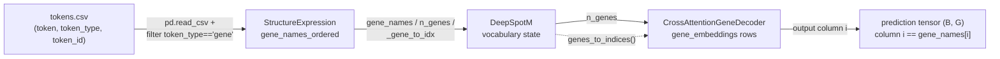
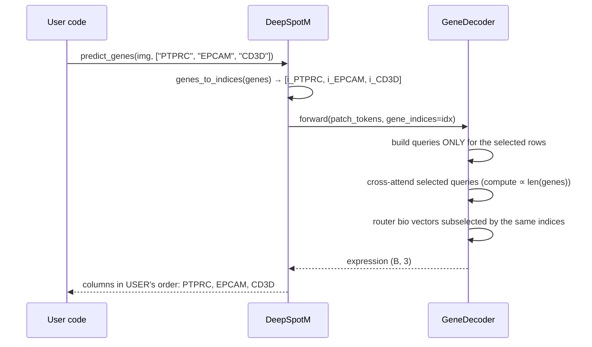

When DeepSpotM predicts gene expression from a histology tile, the raw output of `forward()` is just a tensor of shape `(B, G)` — a grid of numbers with no biological meaning attached. What turns column 42 into "KCnj6" and not "BRCA1" is a **vocabulary contract**: an ordered list of gene symbols, shipped inside the package, that binds every output column to exactly one gene. This page explains how that vocabulary is stored, how it becomes the model's output order, how predictions map back to gene names, and how a model can be retargeted to a different vocabulary. It is the bridge between the decoder architecture you saw in [Cross-Attention Gene Decoder](9-cross-attention-gene-decoder) and the inference utilities described in [Pretrained Model Loading](13-pretrained-model-loading) and [Selective Gene Prediction](16-selective-gene-prediction).

Sources: [model.py](src/deepspotm/model.py#L370-L391), [modules.py](src/deepspotm/modules.py#L11-L32)

## The Vocabulary File: tokens.csv

The single source of truth is a bundled CSV asset, `tokens.csv`, resolved at import time by `config.py` through `importlib.resources` (with a filesystem fallback for source-tree runs). Resolving the path this way — rather than hard-coding a relative path — is what guarantees the vocabulary works when the package is installed as a wheel, a property the test suite explicitly verifies.

The file contains more than genes. Each row has three columns — `token`, `token_type`, and `token_id` — and three token categories coexist:

| token_type | Count | token_id range | Role in the output contract |
|---|---|---|---|
| `gene` | 19,338 | 0 – 19337 | **The output vocabulary** — defines prediction column order |
| `disease` | 15 | 19338 – 19352 | Ancillary tokens; excluded from prediction |
| `tissue` | 13 | 19353 – 19365 | Ancillary tokens; excluded from prediction |
| `special` | 2 (`<PAD>`, `<MASK>`) | 19366 – 19367 | Bookkeeping tokens; excluded from prediction |

Sources: [config.py](src/deepspotm/config.py#L8-L17), [tokens.csv](src/deepspotm/assets/tokens.csv#L1-L15), [tokens.csv](src/deepspotm/assets/tokens.csv#L19336-L19370), [test_structure_expression.py](tests/test_structure_expression.py#L8-L19)

The critical invariant is **ordering**: gene rows appear first, in sorted position, and their `token_id` matches their row order. The first genes are `NAALADL1` (id 0), `REXO2` (id 1), `KCNJ6` (id 2), and the last gene before the disease block is `HAPLN1` (id 19337). This positional layout means "gene index" and "row order in the CSV" are the same thing — the foundation every downstream mapping relies on.

Sources: [tokens.csv](src/deepspotm/assets/tokens.csv#L1-L15), [tokens.csv](src/deepspotm/assets/tokens.csv#L19336-L19360)

## From CSV to Canonical Gene Order

Three pieces of code cooperate to turn the CSV into the model's vocabulary state, and each has a distinct responsibility:

**Step 1 — Parsing.** `StructureExpression` reads the CSV (from an explicit `token_path` if given, otherwise the packaged default) and filters to `token_type == 'gene'` with pandas. The result, `gene_names_ordered`, is the canonical gene ordering. The same class also serves the *training-side* reverse mapping: `structure_expression()` converts a `{gene: value}` dict into a fixed-length tensor aligned to that ordering, zero-filling unmeasured genes, clamping negatives, and producing a boolean mask — unknown symbols are silently ignored so they cannot shift a value into the wrong column.

Sources: [modules.py](src/deepspotm/modules.py#L11-L32), [test_structure_expression.py](tests/test_structure_expression.py#L21-L33)

**Step 2 — Model state.** `DeepSpotM.__init__` instantiates `StructureExpression` and copies the ordering into three attributes that define the output contract:

| Attribute | Type | Purpose |
|---|---|---|
| `gene_names` | `list[str]` | The public, ordered gene panel — **output column `i` of `forward()` corresponds to `gene_names[i]`** |
| `n_genes` | `int` | Vocabulary size (19,338 by default); sizes every vocab-dependent layer |
| `_gene_to_idx` | `dict[str, int]` | Reverse lookup, symbol → column index, used for selective prediction |

Sources: [model.py](src/deepspotm/model.py#L71-L81), [model.py](src/deepspotm/model.py#L97-L117)

**Step 3 — Decoder sizing.** The cross-attention decoder receives `n_genes` and allocates one gene query embedding per vocabulary row (`nn.Embedding(n_genes, bio_dim)` in the single-source path, or per-source bio parameters in the multi-source path). Because queries are built by iterating over vocabulary indices, the decoder's output is vocabulary-ordered by construction.

Sources: [model.py](src/deepspotm/model.py#L97-L117), [modules.py](src/deepspotm/modules.py#L592-L603), [modules.py](src/deepspotm/modules.py#L744-L752)

> [!TIP]
> The vocabulary also travels with published checkpoints: `DeepSpotM.from_pretrained` downloads/reads `tokens.csv` alongside `config.json` and `model.safetensors`, then injects it as `token_path`. A checkpoint and its vocabulary are therefore always loadable as one consistent unit — never mix a checkpoint's weights with a different `tokens.csv`.

Sources: [model.py](src/deepspotm/model.py#L251-L331)

## The Output Mapping Contract

For a full-panel prediction, the contract is simple and positional:

- `forward(pixel_values)` returns `expression` of shape `(B, n_genes)`;
- `expression[b, i]` is the predicted expression of `gene_names[i]` for tile `b`;
- when the decoder uses the router output head, the per-gene projection weights are likewise indexed by the same vocabulary positions, so routing does not reorder anything.

The decoder achieves this by building gene queries for `arange(n_genes)` when no subset is requested — literally walking the vocabulary in order — then cross-attending each query against the patch tokens and projecting to a scalar. If you disable the cross-attention decoder entirely (the MLP `gene_head` fallback), the same contract holds: the final `nn.Linear` emits exactly `n_genes` columns in vocabulary order.

Sources: [model.py](src/deepspotm/model.py#L370-L391), [modules.py](src/deepspotm/modules.py#L713-L752), [modules.py](src/deepspotm/modules.py#L760-L790), [model.py](src/deepspotm/model.py#L112-L117)

## Selective Prediction: When Column Order Follows the Caller

Asking for a subset of genes introduces a second ordering rule, and confusing the two is the most common beginner mistake. The selective path works as follows:

Two methods implement the symbol→index translation and the subsetting:

| API | Input | Output | Output column order |
|---|---|---|---|
| `forward(pixel_values)` | image tensor | `(B, n_genes)` | **Vocabulary order** (`gene_names`) |
| `forward(pixel_values, gene_indices=idx)` | image + index tensor | `(B, len(idx))` | **`idx` order** |
| `genes_to_indices(["EPCAM", "CD3D"])` | symbol(s) | `LongTensor` of indices | caller's symbol order |
| `predict_genes(img, genes)` | image + symbol(s) | `(B, len(genes))` | **caller's symbol order** |
| `get_gene_attention_maps(img, gene_indices)` | image + optional indices | `(B, G_sel, N_patches)` | vocabulary order (or `gene_indices` order) |

Unknown symbols are not silently skipped: `genes_to_indices` raises a `KeyError` listing the offending names (truncated to the first ten), so a typo like `EPCAMM` fails loudly at the call site. Beyond convenience, the subset path is also a compute optimization — the decoder builds and cross-attends only the requested queries, so cost scales with `len(genes)` rather than 19,338. The deeper mechanics of that optimization are covered in [Selective Gene Prediction](16-selective-gene-prediction).

Sources: [model.py](src/deepspotm/model.py#L370-L391), [model.py](src/deepspotm/model.py#L393-L404), [model.py](src/deepspotm/model.py#L406-L420), [modules.py](src/deepspotm/modules.py#L713-L790), [model.py](src/deepspotm/model.py#L425-L453)

> [!TIP]
> `predict_genes` returns columns in **your** order, not the vocabulary's — pass `["CD3D", "EPCAM"]` and you get those columns back in exactly that sequence. Only full-panel `forward()` output is guaranteed vocabulary-ordered, so always zip against the list you passed in (or `model.gene_names`), never against a hardcoded assumption.

Sources: [model.py](src/deepspotm/model.py#L406-L420)

## Mapping Predictions Back to Gene Names in Practice

The bundled CLI example, `examples/predict.py`, shows the end-to-end mapping workflow and is the best template for your own inference code. It chooses the column labels first — `list(genes)` when scoring specific genes, otherwise `list(model.gene_names)` — then keeps prediction rows and label columns aligned through batching, ranking, and export:

- **Top-k report**: for full-panel predictions, it zips `gene_names` with each row's values and sorts by predicted value to print the highest-expression genes per tile with their symbols.
- **Targeted scoring**: with `--genes EPCAM CD3D PTPRC`, it delegates to `predict_genes` and prints `symbol=value` pairs in the order given; a `KeyError` from the vocabulary lookup is caught and reported as "unknown gene symbol(s)".
- **CSV export**: `--output preds.csv` writes a DataFrame whose *columns are gene names* and rows are tiles — the mapping contract made tangible in a file you can open in pandas.

Sources: [predict.py](examples/predict.py#L127-L165), [predict.py](examples/predict.py#L167-L209)

For interpretability, the same contract extends to attention: `get_gene_attention_maps` returns per-gene attention over spatial patches shaped `(B, G_selected, N_patches)`, with rows indexed in vocabulary order (or `gene_indices` order when subsetting), so `attn[b, i]` describes where the model "looked" for `gene_names[i]`.

Sources: [model.py](src/deepspotm/model.py#L425-L453)

## Retargeting to a Different Vocabulary

A trained model is not permanently bound to its 19,338-gene panel. `DeepSpotM.swap_gene_vocabulary(embeddings_path, token_path, ...)` rebuilds every vocabulary-dependent layer in place so a checkpoint can be pointed at a custom panel (e.g. a mouse vocabulary or a small marker set) before loading vocab-specific weights. The model-side wrapper performs the bookkeeping — refresh `n_genes`, update hyperparameters so checkpoints round-trip — while validation happens against the new token file:

| Validation / bookkeeping step | What happens |
|---|---|
| Token list load | Parses the new `token_path`, filtering `token_type == 'gene'` — same rule as the default vocabulary |
| Shape check | The `.pt` embedding tensor's row count must equal the new gene list length, or a `ValueError` is raised naming both counts |
| Decoder rebuild | `swap_vocabulary` replaces `gene_embeddings`, rebuilds `gene_query_proj` only when the embedding dimension changes, and rebuilds or swaps the router/shared output head — preserving trained weights wherever shapes allow |
| Model state update | `n_genes` refreshed; router overrides and multi-source collapses recorded in `hparams` for checkpoint round-trips |

Two details matter when you do this. First, the method requires the cross-attention decoder — a checkpoint built with the MLP `gene_head` has no vocabulary-specific layers to swap, and the method raises `RuntimeError` if you try. Second, on multi-source models you must pass `source=` to name which embedding pathway survives the swap; the model collapses to that single source and the others' parameters are dropped. The checkpoint-side story — how the new vocabulary's weights are then loaded consistently — is covered in [Cross-Vocabulary Checkpoint Handling](14-cross-vocabulary-checkpoint-handling).

Sources: [model.py](src/deepspotm/model.py#L127-L191), [modules.py](src/deepspotm/modules.py#L608-L711)

## Where the Vocabulary Does *Not* Apply

A few adjacent concepts look vocabulary-related but follow separate rules, and this page deliberately stops at their boundary. The **modality vocabulary** (`dna`, `rna`, `protein`, `single_cell`, `text`) is a frozen one-hot encoding over embedding *sources*, not genes — reordering it would invalidate existing checkpoints, which is why the source code marks it "DON'T reorder" — and the gene-embedding **source registry** (`scgpt`, `prott5`, `evo2`, …) controls which biological prior initializes queries and routers, not which genes are predicted. Both are documented in [Multi-Source Gene Embeddings](11-multi-source-gene-embeddings) and [Gene Router Hypernetwork](10-gene-router-hypernetwork). Likewise, the runtime selection of an active source via `set_source` is a *dispatch* decision orthogonal to gene-column mapping, and it is deliberately not persisted in the state dict — see [Memory-Efficient Source Loading](15-memory-efficient-source-loading).

Sources: [modules.py](src/deepspotm/modules.py#L65-L92), [modules.py](src/deepspotm/modules.py#L458-L470), [model.py](src/deepspotm/model.py#L333-L350)

## Summary and Next Steps

The gene vocabulary is a single ordered CSV (`tokens.csv`, 19,338 gene rows) whose row positions *are* the model's output columns. `StructureExpression` extracts that ordering, `DeepSpotM` exposes it as `gene_names`/`n_genes`/`_gene_to_idx`, and the decoder produces columns in exactly that order for full-panel predictions. Subsetting via `predict_genes` reorders columns to the caller's symbol list while shrinking compute proportionally. Retargeting to a new panel is a validated, in-place swap that rebuilds only the shape-dependent layers.

Suggested reading from here:

- Going deeper on architecture: [Cross-Attention Gene Decoder](9-cross-attention-gene-decoder) explains what those gene queries attend to; [Gene Router Hypernetwork](10-gene-router-hypernetwork) covers the per-gene output head referenced above.
- Inference engineering: [Selective Gene Prediction](16-selective-gene-prediction) expands on the subset-compute path; [Pretrained Model Loading](13-pretrained-model-loading) and [Cross-Vocabulary Checkpoint Handling](14-cross-vocabulary-checkpoint-handling) cover how vocabularies and weights travel together.
- Hands-on: [Command-Line Prediction Tools](3-command-line-prediction-tools) walks through `predict.py` end to end, and the [TCGA-SKCM Tutorial Notebook](4-tcga-skcm-tutorial-notebook) shows the mapping workflow in a runnable notebook.
