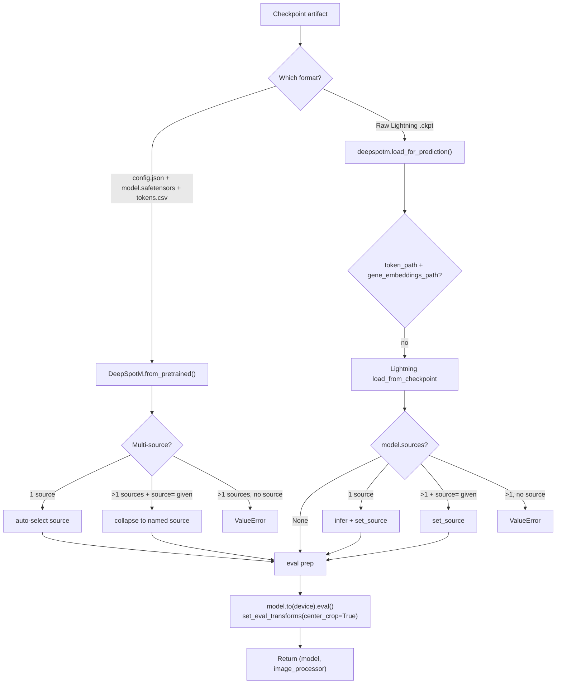
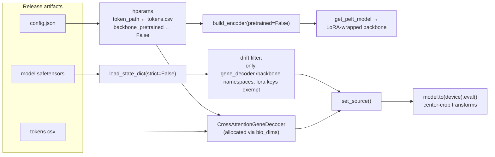

DeepSpotM ships pretrained weights in two artifact formats, and this page documents the exact contract for turning either into a ready-to-use `(model, image_processor)` pair. You will learn the three public loading entry points, the file layout each expects, the state-dict integrity guards that prevent silent uninitialised-weight inference, and the two invariants that most often surprise new users: LoRA keys must stay PEFT-prefixed, and gene-source selection is *not* stored in the state dict.

## Loading Entry Points at a Glance

The library exposes three loaders, each tuned to a different artifact and resource profile. All of them converge on the same terminal state: model on the requested device, in `eval()` mode, with center-crop evaluation transforms installed on the backbone. [model.py](src/deepspotm/model.py#L272-L274), [checkpoint.py](src/deepspotm/checkpoint.py#L98-L99)

| Entry point | Artifact | Weights format | Multi-source handling | Typical caller |
|---|---|---|---|---|
| `DeepSpotM.from_pretrained()` | HF repo or local directory (`config.json` + `model.safetensors` + `tokens.csv`) | safetensors | `source=` arg selects/collapses the pathway | Default for published releases; used by `examples/predict.py` |
| `deepspotm.load_for_prediction()` | Raw Lightning `.ckpt` | PyTorch state dict | Auto-infers single source; requires `source=` otherwise; optional cross-vocab swap | Training-repo checkpoints |
| `DeepSpotM.load_for_inference()` | Raw Lightning `.ckpt` | PyTorch state dict | Builds *only* the named source's bank/adapter | Memory-constrained multi-source inference |

The decision logic above is verified in the loader implementations: source inference rules for `from_pretrained` at [model.py](src/deepspotm/model.py#L318-L327) and for `load_for_prediction` at [checkpoint.py](src/deepspotm/checkpoint.py#L169-L178). Note that cross-vocabulary loading (the `token_path` branch) is documented in depth on [Cross-Vocabulary Checkpoint Handling](14-cross-vocabulary-checkpoint-handling) — this page covers only its placement in the dispatch flow.

Sources: [model.py](src/deepspotm/model.py#L251-L331), [checkpoint.py](src/deepspotm/checkpoint.py#L89-L183), [predict.py](examples/predict.py#L156-L162)

## Loading a Published Release with `from_pretrained`

`DeepSpotM.from_pretrained(repo_id_or_path)` is the canonical way to consume a published model. It accepts either a Hugging Face repo id (e.g. `"ratschlab/DeepSpotM"`, optionally pinned with `revision=`) or a local directory, and downloads — or reads — exactly three files:

| File | Role | Consumption detail |
|---|---|---|
| `config.json` | Saved hyper-parameters, including `bio_dims` | JSON-loaded into `hparams`; the `_deepspotm_format_version` marker is popped before construction |
| `model.safetensors` | Baked-in weights: vision backbone + LoRA adapters + gene decoder | Loaded via `safetensors.torch.load_file`, applied with `load_state_dict(strict=False)` |
| `tokens.csv` | The gene vocabulary | Passed as `token_path` so the constructor resolves the ordered gene list |

Sources: [model.py](src/deepspotm/model.py#L263-L298), [config.py](src/deepspotm/config.py#L11-L16)

Two construction-time overrides make this path self-contained and network-light. First, the loader forces `backbone_pretrained=False`, so the vision backbone's architecture is built *without* downloading upstream weights — they arrive from the safetensors file instead, meaning no network access to the upstream backbone repository is needed at load time. Second, `bio_dims` from `config.json` lets the gene decoder allocate per-source parameters purely by shape, without reading the raw gene-embedding `.pt` assets. Both flags exist solely for checkpoint loading; their defaults preserve training-time behaviour. [model.py](src/deepspotm/model.py#L57-L67)

Because the export format may omit PEFT bookkeeping buffers, `from_pretrained` does not naively reject every missing key. Instead it runs a *targeted* drift check: only keys under the substantive namespaces `gene_decoder.` or `backbone.` are inspected, and any key whose name contains `lora` (case-insensitive) is exempt. Unexplained drift in real weights raises a `RuntimeError` that names the first offending keys and states that "the config and weights disagree". [model.py](src/deepspotm/model.py#L305-L316)

Sources: [model.py](src/deepspotm/model.py#L280-L331)

## Loading a Lightning Checkpoint with `load_for_prediction`

`deepspotm.load_for_prediction(checkpoint_path, ...)` is the workhorse for raw training-repo `.ckpt` files, including those containing a full `hyper_parameters` record. In its plain mode (no `token_path`/`gene_embeddings_path`), it delegates to Lightning's `DeepSpotM.load_from_checkpoint(..., map_location="cpu", strict=False)` — hyperparameters are restored from the checkpoint automatically because the constructor calls `save_hyperparameters()` — and then resolves the active source (see [Source Selection at Load Time](#source-selection-at-load-time) below). [checkpoint.py](src/deepspotm/checkpoint.py#L160-L178)

Regardless of mode, every path through `load_for_prediction` finishes with the same normalization sequence: `model.to(device).eval()`, then `set_eval_transforms(center_crop=True)`, then return `(model, model.backbone.transforms)`. This is why every loader in the library hands back a *pair*: the `image_processor` is the backbone's own transform callable, already switched to the evaluation regime — the same object you stack image tiles against in the prediction loop. [checkpoint.py](src/deepspotm/checkpoint.py#L180-L182), [predict.py](examples/predict.py#L130-L134)

> [!TIP]
> Device selection is centralized: both `from_pretrained` and `load_for_prediction` default to `cuda` when available, falling back to `cpu` — you only need to pass `device=` explicitly for deterministic placement. Also note that loading happens on `map_location="cpu"` in every branch; tensors are moved to the target device only in the final normalization step, which keeps peak host memory predictable.

Sources: [checkpoint.py](src/deepspotm/checkpoint.py#L116-L182)

## State-Dict Integrity Guards

The loading layer enforces a strict no-silent-drift policy through three exported utilities. The premise is stated in the guard's own docstring: weights the model expects but the checkpoint omitted (`missing`), or checkpoint keys the model lacks (`unexpected`), indicate the runtime model and the checkpoint disagree — and unaccounted drift "would silently use uninitialised weights, which is exactly the case we want to surface." [checkpoint.py](src/deepspotm/checkpoint.py#L57-L71)

| Utility | Signature contract | Behavior |
|---|---|---|
| `filter_state_dict` | `(state_dict, drop_prefixes)` | Returns a copy with any key starting with a dropped prefix removed; empty prefixes yield an equal but distinct dict |
| `check_state_dict_load` | `(missing, unexpected, *, allow_missing_prefixes, allow_unexpected_prefixes)` | Raises `RuntimeError` listing counts and example keys for any drift outside the allow lists |
| `VOCAB_SPECIFIC_PREFIXES` | `("gene_decoder.gene_embeddings", "gene_decoder._router_bio_emb")` | The canonical allow/drop list for keys whose shape is tied to the gene vocabulary |

All three are part of the public API surface exported from `deepspotm`. [__init__.py](src/deepspotm/__init__.py#L10-L30)

The test suite pins the guard's semantics deliberately, because — as the test module puts it — "a regression in it fails quietly and looks like a bad model rather than a bad load." The tests cover clean loads, rejection of drift in either direction, prefix-filter removal semantics, copy-not-mutate behavior, and that declared allow-lists are honoured. [test_checkpoint.py](tests/test_checkpoint.py#L1-L6)

Sources: [checkpoint.py](src/deepspotm/checkpoint.py#L50-L86), [test_checkpoint.py](tests/test_checkpoint.py#L24-L68)

## The LoRA Wrap Contract During Loading

When `use_lora=True`, the backbone is wrapped by PEFT (`PeftModel` → `LoraModel` → `ImageEncoder`), so every backbone state-dict key carries the `backbone.base_model.model.` prefix and LoRA adapters sit alongside it in the same namespace. The contract — and this is the invariant that trips up most custom inference code — is to keep LoRA *wrapped* at predict time, in `forward`, in `predict_genes`, and inside `load_for_prediction`. [model.py](src/deepspotm/model.py#L22-L31)

> [!TIP]
> Never call `model.backbone.merge_and_unload()` in the inference path. Doing so silently breaks the load-side round-trip: a freshly constructed `DeepSpotM(use_lora=True)` expects the PEFT-prefixed keys, so merged weights will match nothing and `strict=False`-style loads will drop them. Merge only if you fully control both the export and the load-side construction.

This prefixing is why `from_pretrained`'s drift filter exempts keys containing `lora`: a clean export may omit adapter bookkeeping buffers, but the adapter weights themselves still load into the wrapped structure. The eval-transform helper `set_eval_transforms` is also PEFT-aware — it walks the `base_model` → `model` delegation chain explicitly rather than relying on `__getattr__`, so a future PEFT release that breaks the chain cannot silently regress to a no-op. [model.py](src/deepspotm/model.py#L352-L365)

Sources: [model.py](src/deepspotm/model.py#L22-L36), [model.py](src/deepspotm/model.py#L305-L311)

## Source Selection at Load Time

Multi-source checkpoints (five default sources: `evo2`, `orthrus`, `prott5`, `scgpt`, `apertus`) carry one gene-embedding bank and one adapter per source, and the active pathway is a **runtime-only decision**: "the selection is not persisted in `state_dict`, so freshly loaded checkpoints start with no active source." This makes `set_source()` a mandatory post-load step for any multi-source model, and explains why `current_source` returns `None` both for single-source models and for freshly loaded multi-source checkpoints. [model.py](src/deepspotm/model.py#L196-L211), [model.py](src/deepspotm/model.py#L340-L350)

All three loaders encode the same resolution policy, differing only in where the source list is read from:

| Situation | `load_for_prediction` / `from_pretrained` behavior |
|---|---|
| Single-source checkpoint, no `source` arg | Source auto-inferred; `set_source` is effectively a consistency check |
| Multi-source checkpoint, `source=` given | Validated against the checkpoint's source list, then selected via `set_source` |
| Multi-source checkpoint, no `source` arg | Raises `ValueError` naming the available sources |
| Unknown `source` name | Raises `ValueError` listing the checkpoint's available sources |

For `load_for_prediction`'s plain mode, resolution happens after Lightning load against `model.sources`; for `from_pretrained`, after the safetensors load against the same property. The validation-and-collapse sequence is identical in spirit to the cross-vocab branch's earlier validation at [checkpoint.py](src/deepspotm/checkpoint.py#L126-L143). Note that if you are loading a multi-source checkpoint under memory pressure, [DeepSpotM.load_for_inference](#loading-entry-points-at-a-glance) goes further and skips constructing the unused banks entirely — the full mechanics live on [Memory-Efficient Source Loading](15-memory-efficient-source-loading).

Sources: [checkpoint.py](src/deepspotm/checkpoint.py#L160-L178), [model.py](src/deepspotm/model.py#L213-L249), [model.py](src/deepspotm/model.py#L318-L327), [predict.py](examples/predict.py#L62-L65)

## Where to Go Next

Loading is deliberately the boundary between artifacts and inference. Depending on your goal, continue with:

- **Custom gene vocabularies** — the `token_path`/`gene_embeddings_path` swap branch of `load_for_prediction`, `swap_gene_vocabulary()`, and the prefix-drop algebra behind it: [Cross-Vocabulary Checkpoint Handling](14-cross-vocabulary-checkpoint-handling)
- **Skipping unused source banks entirely** — how `load_for_inference` overrides `init_gene_embeddings` before construction to avoid materializing ~750 MB of unneeded embeddings: [Memory-Efficient Source Loading](15-memory-efficient-source-loading)
- **What the loaded model does next** — restricting predictions to a gene subset with `predict_genes`: [Selective Gene Prediction](16-selective-gene-prediction)
- **Why the state dict looks the way it does** — the PEFT wrapping and adapter targeting that produce the `backbone.base_model.model.` prefixes: [LoRA Adaptation Contract](8-lora-adaptation-contract)
- **Running it end to end** — the CLI that wraps `from_pretrained`: [Command-Line Prediction Tools](3-command-line-prediction-tools)