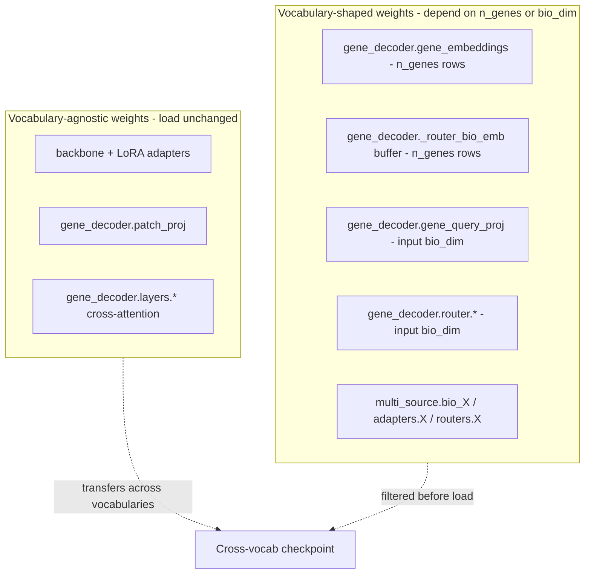
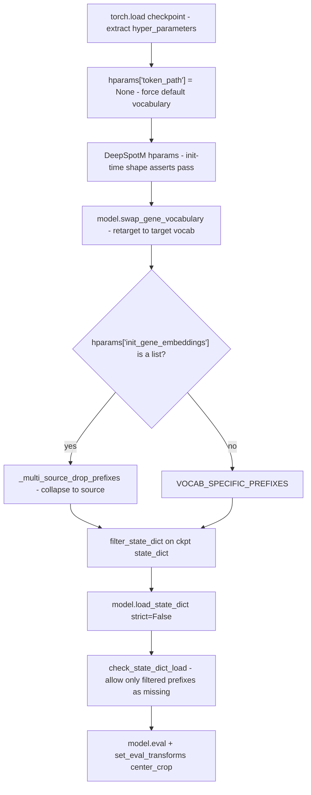
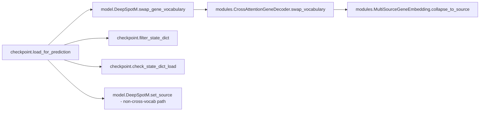

This page documents the mechanism that lets a DeepSpotM checkpoint trained against one gene vocabulary be loaded into a model targeting a different vocabulary — a custom gene panel, or a cross-species retarget such as human-orthrus (~20k genes) → mouse-orthrus (74,815 genes). The design rests on three cooperating pieces: a classification of which state-dict keys are *vocabulary-shaped*, a weight-preserving vocabulary swap that runs *before* weight loading, and a strict drift guard that converts `strict=False` loading into an explicit, auditable allow-list. All of this is centralized in `checkpoint.py` and exported from the package's public API.

Sources: [checkpoint.py](src/deepspotm/checkpoint.py#L1-L23), [__init__.py](src/deepspotm/__init__.py#L10-L15)

## Why Checkpoints and Vocabularies Diverge

Every DeepSpotM model is built against an expression vocabulary: the packaged default `tokens.csv` (resolved via `config.ALPHABET_PATH`) unless a `token_path` hyperparameter overrides it. The decoder's cross-attention weight matrices, the vision backbone, and the LoRA adapters are all independent of the vocabulary size — but the gene-query embedding table and the biological-prior buffer are literally sized by it, and the output head (router or shared linear) is shaped by `bio_dim`. Loading a checkpoint whose vocabulary differs therefore cannot be a plain `load_state_dict`: the vocabulary-shaped tensors are incompatible by construction, and the temptation to silently drop them is exactly what the rest of this page guards against.

Sources: [config.py](src/deepspotm/config.py#L8-L16), [model.py](src/deepspotm/model.py#L72-L79), [modules.py](src/deepspotm/modules.py#L592-L602)

The following concept map distinguishes the two weight classes before we examine the load protocol. **Vocabulary-agnostic** weights transfer between vocabularies unchanged; **vocabulary-shaped** weights must be either freshly installed (via the swap) or explicitly excluded from the state dict.



The full inventory, with the state-dict key each layer occupies and what drives its shape, is the foundation for every filtering decision downstream:

| Layer | State-dict key | Shape driver | Vocabulary sensitivity |
|---|---|---|---|
| Gene query embedding | `gene_decoder.gene_embeddings.weight` | `(n_genes, bio_dim)` | Rows = vocabulary size |
| Router bio-prior buffer | `gene_decoder._router_bio_emb` | `(n_genes, bio_dim)` | Rows = vocabulary size |
| Query projection | `gene_decoder.gene_query_proj` | `bio_dim → gene_embed_dim` | Input dim only (`bio_dim`) |
| Router MLPs (`weight_net`, `bias_net`) | `gene_decoder.router.*` | `bio_dim → hidden → D / 1` | Input dim only |
| Multi-source bio bank | `gene_decoder.multi_source.bio_<source>` | `(n_genes, bio_dim_i)` | Rows = vocabulary size |
| Multi-source adapters | `gene_decoder.multi_source.adapters.<source>.*` | `bio_dim_i → gene_embed_dim` | `bio_dim_i` only |
| Per-source routers | `gene_decoder.routers.<source>.*` | `bio_dim_i → …` | `bio_dim_i` only |
| Backbone / LoRA / `patch_proj` / attention | `backbone.*`, `gene_decoder.patch_proj`, `gene_decoder.layers.*` | Architecture hparams | None |

Sources: [checkpoint.py](src/deepspotm/checkpoint.py#L16-L23), [modules.py](src/deepspotm/modules.py#L514-L602), [modules.py](src/deepspotm/modules.py#L183-L234)

## The Build–Swap–Load Protocol

The entry point for cross-vocabulary loading is `load_for_prediction`. Its contract, stated in the module docstring, is deliberate about ordering: **construct with the default vocabulary, swap the gene decoder to the target vocabulary, then load the checkpoint with vocab-specific keys filtered out.** The protocol proceeds as follows (prerequisite: a Lightning `.ckpt` whose `hyper_parameters` describe the training-time architecture, plus the target vocabulary's `tokens.csv` and a `(n_genes_new, bio_dim)` embedding tensor):



Cross-vocab mode activates when *both* `token_path` and `gene_embeddings_path` are supplied. The checkpoint's hyperparameters are read eagerly with `torch.load(..., weights_only=False)`, and `hparams["token_path"]` is forced to `None` so the model builds against the packaged default vocabulary rather than the checkpoint's (custom) one. Only then does `model.swap_gene_vocabulary(gene_embeddings_path, token_path, source=...)` retarget the decoder in place, after which the state dict is filtered, loaded with `strict=False`, and validated. The function returns `(model, image_processor)` with the model on device, in eval mode, and the backbone switched to center-crop inference transforms.

> [!TIP]
> Constructing with the default vocabulary first is not incidental — it is required for the swap to be reachable. `CrossAttentionGeneDecoder.__init__` asserts that a registry-loaded bio embedding's row count equals `n_genes`; building directly with a custom `token_path` would pair a custom-sized vocabulary with default-sized registry embeddings and fail that assert at construction. Building default-first defers all vocabulary retargeting to `swap_vocabulary`, which is built to handle it.

Sources: [checkpoint.py](src/deepspotm/checkpoint.py#L89-L148), [checkpoint.py](src/deepspotm/checkpoint.py#L180-L182), [modules.py](src/deepspotm/modules.py#L566-L578)

## Vocabulary-Shaped Keys and the Drift Guard

`VOCAB_SPECIFIC_PREFIXES` names exactly the two single-source tensors whose *row count* is tied to the training vocabulary: `gene_decoder.gene_embeddings` and `gene_decoder._router_bio_emb`. These are dropped from the checkpoint's state dict because `swap_vocabulary` has already installed fresh, target-vocabulary versions of both — reloading the checkpoint's stale-shaped copies would either fail or overwrite the swap.

Sources: [checkpoint.py](src/deepspotm/checkpoint.py#L16-L23)

| Filtering scenario | Dropped prefixes | Rationale |
|---|---|---|
| Single-source cross-vocab | `gene_decoder.gene_embeddings`, `gene_decoder._router_bio_emb` | Rows are checkpoint-vocab-shaped; fresh copies installed by the swap |
| Multi-source cross-vocab keeping source *S* | `gene_decoder.multi_source.bio_S`; plus `bio_X`, `adapters.X.*`, `routers.X.*` for every *X* ≠ *S* | Kept bank changes shape with the new vocab; other sources no longer exist on the collapsed model |

`filter_state_dict` performs prefix-based key removal and returns a **copy** — the input state dict is never mutated (a contract pinned by `test_filter_state_dict_without_prefixes_is_a_copy`). Because filtered keys are now legitimately missing from the state dict, the load must use `strict=False`; that flag alone would also swallow *accidental* drift, so `check_state_dict_load` re-implements strictness with explicit allow-lists: any missing or unexpected key that does not start with a declared prefix raises `RuntimeError` reporting counts and examples. The stated rationale in both the guard's docstring and the test module is that the alternative failure mode — predictions silently produced by uninitialized weights — *looks like a bad model rather than a bad load*, and is therefore worth failing fast on.

Sources: [checkpoint.py](src/deepspotm/checkpoint.py#L26-L86), [checkpoint.py](src/deepspotm/checkpoint.py#L150-L159), [test_checkpoint.py](tests/test_checkpoint.py#L1-L45)

The guard's behavior is directly pinned by the test suite (see [Test Suite and Packaging](19-test-suite-and-packaging)):

| Test | Verified behavior |
|---|---|
| `test_filter_state_dict_drops_matching_prefixes` | Vocab-shaped keys removed; shared keys (e.g. `image_encoder.blocks.*`) kept |
| `test_filter_state_dict_without_prefixes_is_a_copy` | No-mutation contract |
| `test_check_state_dict_load_accepts_clean_load` | Zero drift passes |
| `test_check_state_dict_load_rejects_unexplained_drift` | Missing *or* unexpected keys outside allow lists raise `RuntimeError("unaccounted-for key drift")` |
| `test_check_state_dict_load_honours_allow_lists` | Drift the caller declared expected is permitted |
| `test_vocab_specific_prefixes_shape` | The prefix registry is a non-empty tuple of strings |

Sources: [test_checkpoint.py](tests/test_checkpoint.py#L17-L68)

> [!TIP]
> Note what the guard deliberately does *not* allow-list: the router MLP weights (`gene_decoder.router.*`) and `gene_query_proj`. Their shapes depend only on `bio_dim`, so the supported cross-vocabulary scenarios in this codebase are `bio_dim`-preserving swaps (orthrus 512-d, prott5 1024-d — only `n_genes` changes), under which those checkpoint weights load intact and are reused. If `bio_dim` were to change, those tensors could no longer reconcile with the freshly swapped model, and the drift surfaces as an explicit error instead of a silent reinitialization.

## Weight-Preserving Swap Semantics

The swap itself — `CrossAttentionGeneDecoder.swap_vocabulary` — is engineered around a single principle: **rebuild only what the new vocabulary's shape forces; preserve trained weights everywhere else.** On the single-source path, `gene_embeddings` is always replaced (the vocabulary's content changed by definition). `gene_query_proj` is rebuilt *only* when the new `bio_dim` differs from both the embedding dim and the current projection's input features — the code cites the `prott5 → mouse-prott5` case (both 1024-d) as the scenario where the trained projection survives. The router is rebuilt only when it is absent or its input `bio_dim` changes, inheriting the existing router's hidden dim when present; switching output-head representations in either direction (shared `Linear(gene_embed_dim, 1)` ↔ router hypernetwork) is supported, with the stale side's module and buffer deleted to keep the state-dict surface clean.

| Component | Swap action | Preservation rule |
|---|---|---|
| `gene_embeddings` | Always rebuilt from new bio embeddings | Never preserved (vocab content changed) |
| `gene_query_proj` | Rebuilt only if required input dim differs | Preserved when `bio_dim` unchanged |
| `router` + `_router_bio_emb` | Router rebuilt only when absent or input `bio_dim` changes; buffer always refreshed | MLP weights preserved when `bio_dim` unchanged |
| Shared `output_proj` ↔ router | Both transition directions supported; stale side deleted | Never cross-preserved |
| Multi-source decoder | `collapse_to_source`: prune other sources, re-register kept bio parameter | Kept adapter + router preserved verbatim when `bio_dim` matches |

Sources: [modules.py](src/deepspotm/modules.py#L608-L711), [modules.py](src/deepspotm/modules.py#L666-L678)

At the model level, `DeepSpotM.swap_gene_vocabulary` wraps this with vocabulary-file I/O and validation: it reads the target `tokens.csv`, filters `token_type == 'gene'` rows, loads the embedding tensor with `weights_only=True`, and rejects any row-count/list-length mismatch with a `ValueError` *before* touching the decoder. It then updates `n_genes`, propagates an explicit `use_router` override into the hyperparameters, and returns the ordered gene-name list — which becomes the authoritative mapping for interpreting output columns under the new vocabulary (for the general mapping machinery, see [Gene Vocabulary and Output Mapping](12-gene-vocabulary-and-output-mapping) and [Selective Gene Prediction](16-selective-gene-prediction)).

Sources: [model.py](src/deepspotm/model.py#L126-L191), [modules.py](src/deepspotm/modules.py#L1-L32)

## Multi-Source Collapse at Load Time

When the checkpoint declares a multi-source decoder (`init_gene_embeddings` is a list of source names from the registry spanning evo2, orthrus, prott5, scgpt, apertus, and others), cross-vocab loading requires a `source` argument naming which pathway survives. `_multi_source_drop_prefixes` builds the exclusion set: the *kept* source's `bio_{S}` bank (its rows change with the new vocabulary), plus every other source's `bio_{X}`, `adapters.X.*`, and `routers.X.*` (those parameters do not exist on the collapsed model). The swap itself delegates to `MultiSourceGeneEmbedding.collapse_to_source`, which enforces the load-bearing invariant: **the new vocabulary's `bio_dim` must equal the kept source's existing adapter input dim**, so the trained adapter `Linear` and the per-source router (see [Gene Router Hypernetwork](10-gene-router-hypernetwork), [Multi-Source Gene Embeddings](11-multi-source-gene-embeddings)) are preserved verbatim while `n_genes` changes freely.

Sources: [checkpoint.py](src/deepspotm/checkpoint.py#L26-L47), [checkpoint.py](src/deepspotm/checkpoint.py#L126-L153), [modules.py](src/deepspotm/modules.py#L333-L385)

Source resolution is strict but forgiving of the already-collapsed case: a single-element `init_gene_embeddings` list lets `load_for_prediction` infer the source; a multi-element list raises `ValueError` if `source` is omitted or names an unknown pathway. Two round-trip details close the loop. First, `collapse_to_source` sets `active_source` immediately, so the collapsed model is forward-ready without a separate `set_source` call. Second, `swap_gene_vocabulary` rewrites `hparams["init_gene_embeddings"]` to `[source]`, so if the retargeted model is later re-serialized, `load_from_checkpoint` rebuilds the same collapsed structure — the collapse is durable across checkpoint generations, not just a load-time trick. This contrasts with the non-cross-vocab multi-source path, where `active_source` is a plain Python attribute excluded from the state dict and must be selected via `set_source` after load; for the memory-oriented variant of that path, see [Memory-Efficient Source Loading](15-memory-efficient-source-loading).

Sources: [checkpoint.py](src/deepspotm/checkpoint.py#L126-L143), [checkpoint.py](src/deepspotm/checkpoint.py#L160-L178), [model.py](src/deepspotm/model.py#L184-L190), [modules.py](src/deepspotm/modules.py#L175-L181), [modules.py](src/deepspotm/modules.py#L639-L655)

The interaction structure across the three modules involved is:



Sources: [checkpoint.py](src/deepspotm/checkpoint.py#L89-L182), [model.py](src/deepspotm/model.py#L126-L211), [modules.py](src/deepspotm/modules.py#L608-L711)

## Choosing the Right Loader

For a raw Lightning checkpoint with a non-default target vocabulary, the cross-vocab path is one call:

```python
from deepspotm import load_for_prediction

model, image_processor = load_for_prediction(
    "strs_mouse.ckpt",
    token_path="mouse_tokens.csv",            # target vocabulary (gene rows)
    gene_embeddings_path="mouse_orthrus.pt",  # (74815, 512) bio embeddings
    source="orthrus",                         # required for multi-source checkpoints
)
```

Sources: [checkpoint.py](src/deepspotm/checkpoint.py#L89-L115), [__init__.py](src/deepspotm/__init__.py#L10-L15)

`load_for_prediction` is one of four loading surfaces; the matrix below positions it against the alternatives. Note that `from_pretrained` (published safetensors, default vocabulary) and `load_for_inference` (bank-skipping multi-source load) solve different problems and are covered in [Pretrained Model Loading](13-pretrained-model-loading) and [Memory-Efficient Source Loading](15-memory-efficient-source-loading) respectively.

| API | Input artifact | Cross-vocab support | Multi-source handling | Use when |
|---|---|---|---|---|
| `load_for_prediction` | Lightning `.ckpt` | Yes — `token_path` + `gene_embeddings_path` | Collapse to one `source` at load | Training checkpoints retargeted to another vocabulary |
| `DeepSpotM.swap_gene_vocabulary` | A constructed model | Yes — in-place retarget | `source` arg collapses the model | Retargeting a live model already in memory |
| `DeepSpotM.from_pretrained` | `config.json` + `model.safetensors` + `tokens.csv` | No (default vocabulary) | `set_source` selection | Published models |
| `DeepSpotM.load_for_inference` | Lightning `.ckpt` | No | `source` override skips unused banks | Memory-constrained multi-source inference |

Sources: [checkpoint.py](src/deepspotm/checkpoint.py#L89-L182), [model.py](src/deepspotm/model.py#L213-L331)

## Failure Modes This Design Eliminates

The architecture closes three specific silent-failure channels. First, *stale-shaped overwrite*: vocabulary-shaped checkpoint tensors are filtered before load, so a cross-vocab load can never clobber the freshly swapped embeddings or bio buffer. Second, *uninitialized-weight prediction*: because filtering forces `strict=False`, the drift guard restores strictness with explicit allow-lists — any key drift outside the declared prefixes raises with diagnostics rather than degrading quietly. Third, *lost collapse state*: the hyperparameter rewrite to `[source]` and the immediate `active_source` assignment mean a collapsed, cross-vocab model round-trips through save/load and is forward-ready without hidden post-load state. These guarantees, and the tests that pin them, are the reason cross-vocabulary prediction can be treated as a first-class supported operation rather than a best-effort hack — for the decoder internals being retargeted, continue with [Cross-Attention Gene Decoder](9-cross-attention-gene-decoder), and for the attention mechanics underlying gene queries, see the decoder's interaction with [Gene Router Hypernetwork](10-gene-router-hypernetwork).
