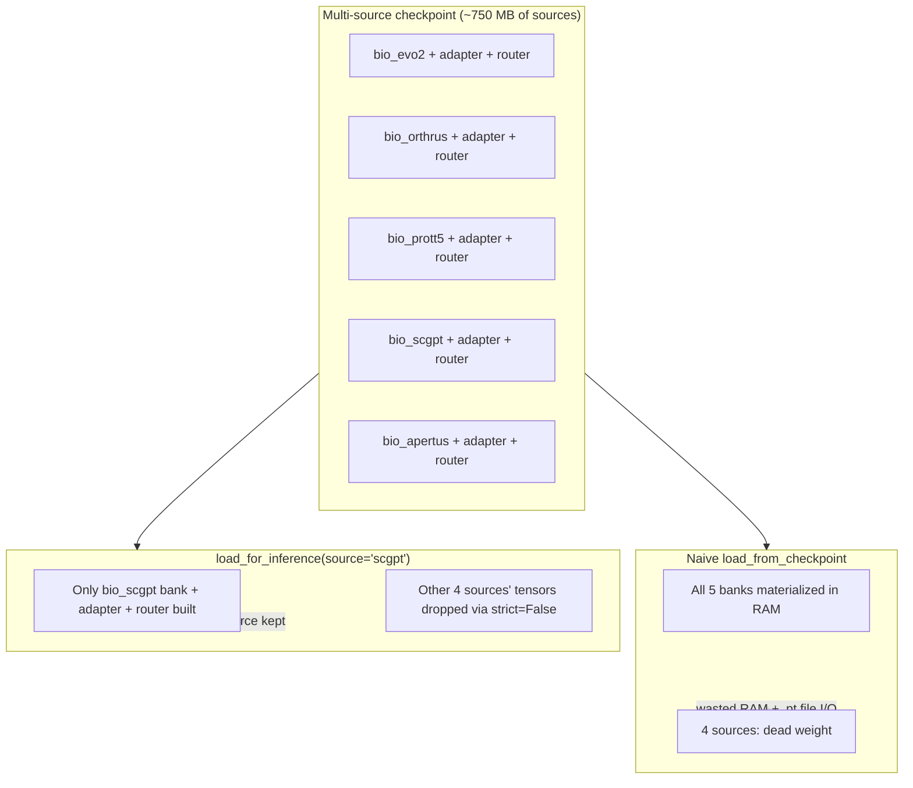
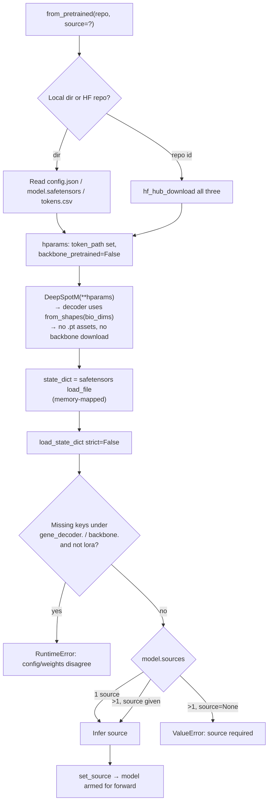

DeepSpotM checkpoints can carry a **multi-source gene decoder** — one biological gene-embedding bank, one projection adapter, and one hypernetwork router per source (evo2, orthrus, prott5, scgpt, apertus, …). At inference time, however, only *one* of those sources ever fires. This page explains the loading machinery that exploits that asymmetry: how `load_for_inference(source=...)` and `from_pretrained(source=...)` build the model with a single source's parameters, skip reading the raw gene-embedding `.pt` assets entirely, and verify that nothing substantive was silently dropped in the process. For the architecture of the multi-source decoder itself, see [Multi-Source Gene Embeddings](11-multi-source-gene-embeddings); for the general `from_pretrained` entry point, see [Pretrained Model Loading](13-pretrained-model-loading).

## The Problem: Five Sources Loaded, One Source Used

A multi-source checkpoint's `state_dict` is dominated by per-source payloads. Each source contributes a trainable `bio_{source}` gene-token bank of shape `(n_genes, bio_dim_i)`, an adapter (`Linear(bio_dim_i → gene_embed_dim)` + `LayerNorm`), and — when routing is enabled — a `GeneRouter` hypernetwork. The five default sources total roughly **750 MB on disk** before you count the vision backbone, yet inference dispatches on a single `active_source` string per forward pass ([Multi-Source Gene Embeddings](11-multi-source-gene-embeddings)).

The loading trap comes from how `active_source` is stored. It is deliberately a *plain Python attribute, not a buffer or parameter*, so it never appears in `state_dict` and cannot survive a checkpoint round-trip. A freshly loaded multi-source model has no active source until you set one explicitly — and a naive `load_from_checkpoint` materializes **all five** source banks into RAM whether or not you will ever touch four of them.

Sources: [model.py](src/deepspotm/model.py#L216-L229), [modules.py](src/deepspotm/modules.py#L174-L181), [modules.py](src/deepspotm/modules.py#L242-L244)

## The Primary Mechanism: `load_for_inference(source=...)`

`DeepSpotM.load_for_inference` is the inference-optimized loader that makes source collapse a one-argument operation. When `source` is passed, it executes a three-step contract documented in its docstring: **(1)** it overrides the checkpoint's `init_gene_embeddings` hyperparameter to `[source]`, so the decoder constructs a `MultiSourceGeneEmbedding` holding *only* that source's bank and adapter — the embedding registry opens just that one `.pt` file; **(2)** it loads the checkpoint `state_dict` with `strict=False`, so the unused sources' tensors are silently dropped instead of raising key-mismatch errors; **(3)** it calls `set_source(source)` so the model is immediately forward-ready despite `active_source` not persisting through the round-trip.

The method is deliberately conservative at its boundary: for a **single-source** checkpoint you must omit `source` (it then delegates to `load_from_checkpoint` unchanged), and passing `source` to a single-source checkpoint raises a `RuntimeError` *after* load. The guard exists because the single-source layout stores the bio weights as a `bio_emb` buffer rather than a per-source `bio_<name>` parameter — under `strict=False` that mismatch would silently discard the actual trained bio weights, so the loader surfaces it explicitly instead.

Sources: [model.py](src/deepspotm/model.py#L213-L249), [model.py](src/deepspotm/model.py#L196-L211)

> [!TIP]
> The `strict=False` in step 2 is scoped and intentional — it is what permits the key-set mismatch between a five-source checkpoint and a one-source runtime model. Every other loading path in the codebase pairs `strict=False` with an explicit drift check (below), so "strict=False" here is never a license for silent weight loss on the *kept* source.

## Building by Shape, Not by File: `from_shapes` vs `from_registry`

The memory savings above are powered by a constructor-level choice inside `CrossAttentionGeneDecoder`. When `init_gene_embeddings` is a list, the decoder picks between two builders:

- **`from_registry`** (training-time default): iterates the source names through `_GENE_EMB_LOADERS`, which opens each `deepspotm.assets/*.pt` file via `importlib.resources` and `torch.load(..., weights_only=True)`, then copies the raw biological prior into each trainable `bio_{source}` parameter.
- **`from_shapes`** (checkpoint-loading path): receives only a `bio_dims` dict mapping each source name to its embedding width, and allocates **zero-initialized** tensors of the right `(n_genes, bio_dim)` shapes. The raw `.pt` assets are never opened — the docstring is explicit that the trained `bio_{source}` values arrive via `load_state_dict` and overwrite the zeros.

The decoder switches on one signal: if `bio_dims` is provided, it takes the shape path; otherwise it hits the registry. This is why `bio_dims` is described in the model's hyperparameters as *derived metadata, not state* — adapter input shapes carry the same information and a strict load would catch any disagreement — but storing it in `config.json` lets a published checkpoint reconstruct its parameter geometry without shipping or reading eleven embedding files.

Sources: [modules.py](src/deepspotm/modules.py#L528-L546), [modules.py](src/deepspotm/modules.py#L306-L324), [modules.py](src/deepspotm/modules.py#L282-L304), [modules.py](src/deepspotm/modules.py#L214-L226), [modules.py](src/deepspotm/modules.py#L458-L470), [modules.py](src/deepspotm/modules.py#L95-L104)

| Dimension | `from_registry` | `from_shapes` |
|---|---|---|
| Input data | Source name list → opens each `assets/*.pt` | `bio_dims` dict from `config.json` only |
| File I/O at build | One `.pt` read per source (up to 11 registered) | **Zero** asset reads |
| Initial `bio_*` values | Raw biological prior (`weights_only=True` load) | Zeros, overwritten by `load_state_dict` |
| Used when | Training-time construction | Any checkpoint load with `bio_dims` set |
| Failure mode | `FileNotFoundError` naming the missing asset | Shape mismatch caught by load-drift checks |

## The Full Picture: `from_pretrained` Source Selection

`DeepSpotM.from_pretrained` composes all of these techniques into the published-artifact loading path. It reads `config.json` for hyperparameters (including `bio_dims`), then performs two memory-relevant overrides before constructing the model: it injects `token_path` from the repo's `tokens.csv` and forces `backbone_pretrained=False`, so the vision backbone is built as *bare architecture* without downloading its upstream weights — those arrive from `model.safetensors` instead, making the load fully offline. The decoder then takes the `from_shapes` branch, allocating `bio_*` parameters by shape alone.

Weights are read with `safetensors.torch.load_file`, which memory-maps the serialized tensors rather than eagerly materializing a full `torch.load` pickle. The load uses `strict=False` paired with a **targeted drift check**: missing keys are only tolerated in LoRA/PEFT bookkeeping namespaces (any key containing `lora`, case-insensitive), while a missing key under `gene_decoder.` or `backbone.` raises a `RuntimeError` declaring that the config and weights disagree. This mirrors the guard philosophy in [Cross-Vocabulary Checkpoint Handling](14-cross-vocabulary-checkpoint-handling): relax strictness precisely where a structural difference is expected, and audit everything else.

Finally, source selection runs on the reconstructed model. If `model.sources` is a single source, it is inferred automatically; a multi-source model demands `source=` explicitly and raises `ValueError` if omitted; then `set_source(source)` arms the dispatch. The CLI wraps this end-to-end — `examples/predict.py` exposes `--source` with the five default choices and calls `DeepSpotM.from_pretrained(args.repo, source=args.source)`.

Sources: [model.py](src/deepspotm/model.py#L251-L331), [model.py](src/deepspotm/model.py#L57-L66), [image_encoder.py](src/deepspotm/image_encoder.py#L43-L52), [examples/predict.py](examples/predict.py#L62-L65), [examples/predict.py](examples/predict.py#L156-L162)

> [!TIP]
> Reading `from_shapes`' zero-init parameters through a safetensors mmap means the peak memory cost of the unused-source path is never paid at *any* stage — not at parameter allocation (zeros are cheap placeholders of the right shape), not at file I/O (only the checkpoint you asked for is opened), and not at load time (`strict=False` drops foreign keys before they are bound to modules).

## The Cross-Vocab Collapse Filter

A second, related collapse mechanism lives in `checkpoint.py` for the cross-vocabulary flow. When `load_for_prediction` detects a multi-source checkpoint (its saved `init_gene_embeddings` is a list), it requires a `source` argument and builds a set of state-dict prefixes to drop via `_multi_source_drop_prefixes`: the kept source's `bio_{kept}` (whose shape is about to change under the vocabulary swap) plus *every* other source's `bio_{other}`, `adapters.{other}.*`, and `routers.{other}.*` — parameters that no longer exist on the collapsed model. `filter_state_dict` then strips matching keys, and `check_state_dict_load` validates that `load_state_dict`'s missing/unexpected key reports fall exactly within the declared allow lists, raising a `RuntimeError` naming sample keys on any unexplained drift.

This is the same "filter, load, then audit" pattern as `load_for_inference`, applied one level up: instead of *not building* the unused sources, the cross-vocab path builds the full default-vocab model first (so init-time asserts pass), swaps the vocabulary, and *filters out* the collapsed parameters before binding. The unit tests pin the filter semantics: dropped prefixes remove exactly the matching keys and everything else survives; an empty prefix list yields an equal-but-distinct copy.

Sources: [checkpoint.py](src/deepspotm/checkpoint.py#L26-L47), [checkpoint.py](src/deepspotm/checkpoint.py#L50-L54), [checkpoint.py](src/deepspotm/checkpoint.py#L57-L86), [checkpoint.py](src/deepspotm/checkpoint.py#L121-L159), [tests/test_checkpoint.py](tests/test_checkpoint.py#L24-L32)

## Choosing the Right Loader

| Entry point | Memory behavior | Use when |
|---|---|---|
| `DeepSpotM.from_pretrained(repo, source=…)` | Shape-built sources, safetensors mmap, offline backbone, single source armed | Loading a published HF repo or export dir — the default inference path |
| `DeepSpotM.load_for_inference(ckpt, source=…)` | Skips unused multi-source banks; registry opens one `.pt` only | Loading a raw Lightning `.ckpt` for single-source inference |
| `DeepSpotM.load_from_checkpoint(ckpt)` | Materializes *all* sources of a multi-source checkpoint | Reproducing training state, or single-source checkpoints |
| `checkpoint.load_for_prediction(ckpt, …, source=…)` | Prefix-filtered collapse, required for cross-vocab multi-source loads | Custom-vocabulary prediction over a multi-source checkpoint ([Cross-Vocabulary Checkpoint Handling](14-cross-vocabulary-checkpoint-handling)) |

One safety property ties the loaders together: none of them trust `strict=False` alone. Every path either raises on source ambiguity before load, raises on missing substantive weights after load, or validates the missing/unexpected key reports against explicit allow lists. That is what makes "load less" safe rather than merely convenient — the weights you *do* load are guaranteed complete.

Sources: [model.py](src/deepspotm/model.py#L238-L249), [model.py](src/deepspotm/model.py#L305-L316), [checkpoint.py](src/deepspotm/checkpoint.py#L156-L159)

**Where to go next**: for the runtime dispatch that `set_source` arms — how `active_source` selects the bank/adapter pair at forward time — see [Multi-Source Gene Embeddings](11-multi-source-gene-embeddings); for restricting the output panel itself, see [Selective Gene Prediction](16-selective-gene-prediction); for the CLI walkthrough built on this loader, see [Command-Line Prediction Tools](3-command-line-prediction-tools).