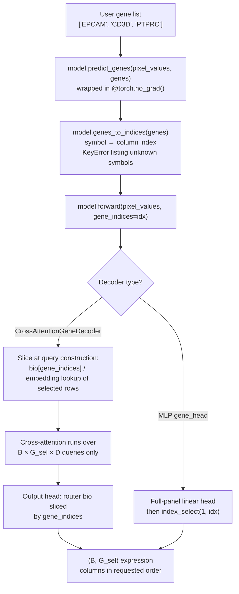
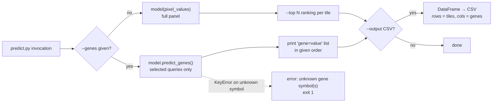

Selective gene prediction is DeepSpot-M's mechanism for computing expression values for an **arbitrary subset of genes** — by symbol or by index — instead of always evaluating the full vocabulary. This page documents the three access levels (the `predict_genes` convenience API, the raw `forward(gene_indices=...)` path, and the CLI `--genes` flag), the decoder-level mechanics that make subsetting a genuine compute reduction rather than a post-hoc slice, and the behavioral contract verified by the test suite. It assumes familiarity with the decoder architecture described in [Cross-Attention Gene Decoder](9-cross-attention-gene-decoder).

## Why Subsetting Works: Queries, Not Outputs

The key architectural insight is that DeepSpot-M's decoder generates **per-gene queries** from biological gene embeddings, then lets each query cross-attend to the image's patch tokens. Because genes enter the computation as independently constructed query vectors, a subset request can be applied at *query construction time* — the selected queries are built, attended, and projected, and the unselected ones are never materialized. Contrast this with a conventional fixed output head (a single `Linear(hidden, n_genes)` matrix), where the full panel must be computed first and the subset can only be extracted afterward.

This is exactly the split you see in `DeepSpotM.forward`: with the cross-attention decoder, `gene_indices` flows down into the decoder and reduces work; with the legacy MLP `gene_head`, the full panel is computed and the result is post-hoc `index_select`-ed.

Sources: [model.py](/src/deepspotm/model.py#L370-L391), [modules.py](/src/deepspotm/modules.py#L721-L724)

## The Python API: `predict_genes` and `genes_to_indices`

The public entry point is `DeepSpotM.predict_genes(pixel_values, genes)`. It accepts a single gene symbol (`str`) or a list of symbols, and returns a `(B, len(genes))` tensor whose **column order follows the input order** — not the vocabulary's canonical order. The method is decorated with `@torch.no_grad()`, so it is inference-only by construction and moves the index tensor onto the input's device before calling `forward`.

Symbol resolution is delegated to `genes_to_indices`, which performs a dictionary lookup against `_gene_to_idx` — a mapping built once in `__init__` from the ordered gene list loaded from `tokens.csv` (see [Gene Vocabulary and Output Mapping](12-gene-vocabulary-and-output-mapping) for the vocabulary mechanics). Validation is strict: any symbol outside the model's panel raises a `KeyError` that lists up to ten offending names, so a typo like `EPCAN` fails loudly rather than silently producing wrong indices.

| API surface | Input | Output | Subset applied at | Failure mode |
|---|---|---|---|---|
| `predict_genes(pixel_values, genes)` | gene symbol(s) as `str`/`list[str]` | `(B, len(genes))` tensor, input-ordered | Query construction (cross-attention path) | `KeyError` naming missing symbols |
| `forward(pixel_values, gene_indices=idx)` | 1-D LongTensor or list of ints | `(expression, gene_features, attn_weights)` triple | Query construction (decoder) / `index_select` (MLP head) | none — caller owns the indices |
| `model.gene_names` / `_gene_to_idx` | — | ordered panel / symbol→index dict | — | read-only reference data |

Sources: [model.py](/src/deepspotm/model.py#L406-L420), [model.py](/src/deepspotm/model.py#L393-L404), [model.py](/src/deepspotm/model.py#L72-L79)

## What Happens Inside the Decoder

Inside `CrossAttentionGeneDecoder.forward`, the `gene_indices` argument is first normalized — non-tensor inputs are converted with `torch.as_tensor(..., dtype=torch.long)` and then moved to the patch tokens' device. From that point, three stages respect the subset.

First, **query construction**. In single-source mode, the decoder embeds only the selected rows (`gene_embeddings(gene_ids)` where `gene_ids` is either the full `arange` or your `gene_indices`), applies `gene_query_proj` to those rows alone, and expands to the batch. In multi-source mode, `MultiSourceGeneEmbedding.forward` slices the trainable `bio_<source>` parameter (`bio[gene_indices]`) *before* the adapter projection — the code comments note this pre-expand ordering costs `G × bio_dim × D` rather than `B × G × bio_dim × D`, and slicing first compounds that saving. (The multi-source machinery itself is documented in [Multi-Source Gene Embeddings](11-multi-source-gene-embeddings).)

Second, **cross-attention**. The selected `(B, G_sel, D)` queries flow through every `CrossAttentionLayer`, so attention compute scales with `len(gene_indices)` instead of the full panel — the decoder docstring states this explicitly: *"only those gene queries are built and cross-attended, so cost scales with len(gene_indices) instead of the full panel."*

Third, **the output head**. When the router hypernetwork is active ([Gene Router Hypernetwork](10-gene-router-hypernetwork)), its per-gene projection weights derive from the biological embeddings — so the router's bio input must be sliced too. The decoder does exactly that in both modes: `router_bio[gene_indices]` for the multi-source path and `bio_emb[gene_indices]` for single-source. Without this, the router would generate `n_genes` projection rows against only `G_sel` queries, and the `einsum` would fail on a shape mismatch.

> [!TIP]
> Subsetting is **numerically equivalent** to slicing the full output. `test_gene_indices_subset_the_output` asserts that a `gene_indices=[7, 1, 4]` call matches `full[:, wanted]` within `rtol=1e-4` — selective prediction changes *how much* is computed, never *what* the selected values are.

Sources: [modules.py](/src/deepspotm/modules.py#L713-L752), [modules.py](/src/deepspotm/modules.py#L411-L442), [modules.py](/src/deepspotm/modules.py#L421-L423), [modules.py](/src/deepspotm/modules.py#L775-L785)

## Selective Prediction from the Command Line

The CLI example script `examples/predict.py` exposes subsetting through `--genes GENE [GENE ...]`, described as *"score only these gene symbols instead of the full panel"*. The canonical usage from the script's own help text: `python examples/predict.py tiles/ --genes EPCAM CD3D PTPRC --output preds.csv`.

Internally, the batch loop branches on whether genes were requested: with `--genes`, each batch goes through `model.predict_genes(pixel_values, genes)`; without it, the full panel comes from `model(pixel_values)` and only the `--top N` highest-expression genes are printed per tile. Unknown symbols surface as the same `KeyError` from `genes_to_indices`, which `main()` catches and reports as `error: unknown gene symbol(s): ...` with exit code 1 — no partial CSV is written. When `--output` is set, the resulting CSV has tiles as rows and your requested genes as columns, in exactly the order you typed them.

| CLI flag | Effect on selective prediction |
|---|---|
| `--genes GENE...` | Predicts only these symbols via `predict_genes`; output columns follow the given order |
| `--top N` | Ranks the full panel per tile; **ignored** when `--genes` is set |
| `--output CSV` | Writes the prediction matrix (tiles × genes); with `--genes`, columns are the requested subset |
| `--batch-size N` | Unchanged — batching is orthogonal; subsetting reduces work *within* each forward |

Sources: [predict.py](/examples/predict.py#L62-L74), [predict.py](/examples/predict.py#L103-L141), [predict.py](/examples/predict.py#L169-L194), [predict.py](/examples/predict.py#L18-L28)

## Cost and Correctness Guarantees

The savings are stage-by-stage and only materialize on the cross-attention architecture. The MLP head path accepts `gene_indices` purely for output-shaping convenience — it computes all `n_genes` columns and slices afterward, so there is no speedup. On the cross-attention path (the shipped configuration), every gene-proportional stage shrinks:

| Stage | Full panel (G genes) | Subset (g genes) | Mechanism |
|---|---|---|---|
| Bio slice / embedding lookup | materialize G rows | materialize g rows | `bio[gene_indices]` before adapter; embedding lookup of selected ids |
| Adapter projection (multi-source) | `G × bio_dim × D` (pre-expand) | `g × bio_dim × D` | slice-then-project compounds the documented pre-expand saving |
| Cross-attention (all layers) | `O(B × G × N × D)` | `O(B × g × N × D)` | only selected queries attend |
| Router output | einsum over G | einsum over g | `router_bio` sliced by `gene_indices` |
| MLP `gene_head` | `B × hidden × G` matmul | same, then `index_select` | **no saving** — post-hoc slice |

Correctness rests on two contract tests in `tests/test_decoder.py`, whose module docstring states the guarantee downstream integrations (such as TIAToolbox) rely on: *expression is (batch, n_requested_genes), and `gene_indices` both subsets and orders the columns*. One test asserts subset values match the sliced full panel; the other asserts that reversing the requested indices reverses the output columns.

> [!TIP]
> The returned `gene_features` triple element is the **mean over the selected queries only** (`gene_queries.mean(dim=1)`). If your pipeline consumes pooled slide-level features alongside expression, note that this vector is subset-dependent — mixing outputs from different `gene_indices` sets means the pooled features are not comparable across calls.

Sources: [test_decoder.py](/tests/test_decoder.py#L1-L8), [test_decoder.py](/tests/test_decoder.py#L57-L77), [modules.py](/src/deepspotm/modules.py#L787-L790)

## Related Capabilities and Where to Go Next

Selective prediction is deliberately distinct from three neighboring capabilities. **Vocabulary swapping** (`swap_gene_vocabulary`) *changes* the gene panel the decoder is built around — e.g., retargeting to a custom panel — which is checkpoint surgery, not a per-call filter; see [Cross-Vocabulary Checkpoint Handling](14-cross-vocabulary-checkpoint-handling). **Source selection** (`set_source`) chooses which embedding modality pathway is active in multi-source models; it composes orthogonally with `gene_indices`, and is covered in [Multi-Source Gene Embeddings](11-multi-source-gene-embeddings). Finally, `get_gene_attention_maps` accepts `gene_indices` too, but as a **post-hoc slice of full-panel attention** rather than query-level subsetting — useful for interpretability ([Pretrained Model Loading](13-pretrained-model-loading) covers the loading context in which all of these run).

Suggested reading progression:

- For the mechanism behind per-gene queries: [Cross-Attention Gene Decoder](9-cross-attention-gene-decoder), then [Gene Router Hypernetwork](10-gene-router-hypernetwork)
- For the symbol→index mapping this page builds on: [Gene Vocabulary and Output Mapping](12-gene-vocabulary-and-output-mapping)
- For running this end-to-end on tiles or slides: [Command-Line Prediction Tools](3-command-line-prediction-tools) and [Whole-Slide Image Pipeline](17-whole-slide-image-pipeline)
