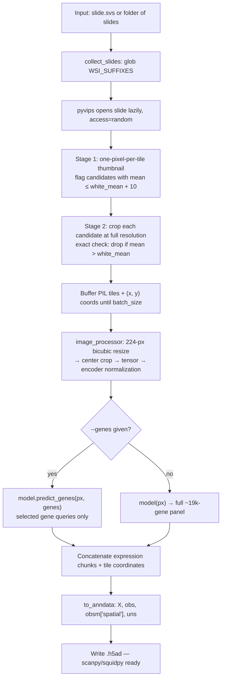

This page documents how DeepSpot-M turns a gigapixel whole-slide image (WSI) into a spatial gene-expression matrix. The pipeline lives in [`examples/predict_wsi.py`](examples/predict_wsi.py#L1-L231): it reads a slide with pyvips, lays a non-overlapping 224-px grid over it at native (~20x) resolution, discards background tiles with a two-stage filter, streams the surviving tissue tiles through the model in batches, and writes one spatial AnnData (`.h5ad`) per slide — the same format as the published TCGA virtual spatial transcriptomics atlas, ready for scanpy/squidpy. Unlike [`predict.py`](examples/predict.py#L2-L8), which scores pre-cut 224x224 tiles, this script owns the entire slide-to-data lifecycle: ingestion, tiling, filtering, inference, and spatial serialization.

Sources: [predict_wsi.py](examples/predict_wsi.py#L2-L14), [README.md](README.md#L99-L105)

## Pipeline at a Glance

The pipeline is a linear flow with two decision points: which slides to process, and whether to score the full ~19k-gene panel or a user-specified subset. Note the memory contract throughout — the slide is opened lazily and only `batch_size` tiles are ever held in RAM/VRAM at once, which is what makes gigapixel slides tractable on a single GPU.

Sources: [predict_wsi.py](examples/predict_wsi.py#L79-L113), [predict_wsi.py](examples/predict_wsi.py#L116-L136)

## Slide Ingestion and Format Support

The script accepts individual files or folders and recognizes the OpenSlide-family formats: `.svs`, `.tif`, `.tiff`, `.ndpi`, `.scn`, `.mrxs`, `.svslide`, and `.bif` (the `WSI_SUFFIXES` set). `collect_slides` expands inputs recursively (opt-out via `--no-recursive`), de-duplicates resolved paths, and returns a sorted list, so folder-of-slides runs produce deterministic output ordering. Slides are opened with `pyvips.Image.new_from_file(..., access="random")`, which keeps the pyramidal file on disk and satisfies `crop()` requests on demand — the ~1 GB slide in the tutorial never enters memory as a whole. Because tiles are cut at the slide's native pixel resolution, inputs should be ~20x H&E, the magnification DeepSpot-M was trained on.

Sources: [predict_wsi.py](examples/predict_wsi.py#L29-L44), [predict_wsi.py](examples/predict_wsi.py#L86-L88), [predict_wsi.py](examples/predict_wsi.py#L10-L11)

> [!TIP]
> Install the pipeline's dependencies with `pip install "deepspotm[wsi]"` — the `wsi` extra pulls in `pyvips>=2.2` and `anndata>=0.10`, which are deliberately excluded from the core package so tile-only users never need the libvips system library.

Sources: [pyproject.toml](pyproject.toml#L57-L62), [README.md](README.md#L52-L57)

## Two-Stage Tissue Detection

Background rejection is the pipeline's performance lever: a melanoma slide can be over 90% white space, and every tile skipped is a forward pass saved. The `tile_slide` generator implements a two-stage filter that exploits the cost asymmetry between reading a thumbnail and reading full-resolution tiles:

| | Stage 1 — Thumbnail sweep | Stage 2 — Exact per-tile check |
|---|---|---|
| **Input** | One thumbnail pixel per tile column (resized to the `nx × ny` grid) | The full 224-px crop from the pyramid |
| **Computation** | `grid_mean` of the thumbnail, one `np.argwhere` | `arr.mean()` over the cropped tile |
| **Threshold** | `grid_mean ≤ white_mean + 10` | `arr.mean() > white_mean` → drop |
| **Cost** | One cheap pass per slide | One `slide.crop` read per candidate |
| **Purpose** | Prune the candidate set | Final decision per tile |

The +10 margin in Stage 1 is deliberate: the thumbnail pass is a *screening* step, so it errs toward keeping tiles (a tile slightly darker than the threshold at thumbnail scale might still be tissue at full resolution). Stage 2 then applies the authoritative `white_mean` test on real pixels. On the tutorial's TCGA-SKCM slide (99,960 × 65,991 px → a 446 × 294 grid), this cascade reduces 45,751 candidate tiles to 36,392 scored tissue tiles — roughly 20% pruned after the exact check alone, before any model compute.

Sources: [predict_wsi.py](examples/predict_wsi.py#L47-L76), [predict_tcga_skcm.ipynb](examples/predict_tcga_skcm.ipynb#L9-L31), [predict_tcga_skcm.ipynb](examples/predict_tcga_skcm.ipynb#L68-L79)

## Streaming Batched Inference

`predict_slide` consumes the `tile_slide` generator through an accumulator-and-flush loop: tiles and their `(x, y)` origins are buffered in plain Python lists, and when the buffer reaches `batch_size` (default 64), `flush()` stacks the tiles through `image_processor` — the encoder's eval transform, which bicubic-resizes to 224 px, optionally center-crops, converts to a tensor, and applies the encoder's normalization statistics — then runs a `torch.no_grad()` forward and appends the float32 CPU result to `chunks`. The gene-selection branch mirrors the model's public API: with `--genes`, the buffered tensor goes to `model.predict_genes(px, genes)`, which builds cross-attention only for the requested gene queries (three marker genes cost a fraction of the full panel); without it, `model(px)` returns the full `(n_tiles, ~19k)` panel whose column order is `model.gene_names`. The same flush pattern is what bounds memory: peak RAM holds one batch of PIL tiles, peak VRAM one batch of tensors, regardless of slide size.

Sources: [predict_wsi.py](examples/predict_wsi.py#L79-L113), [model.py](src/deepspotm/model.py#L406-L420), [model.py](src/deepspotm/model.py#L370-L391), [utils.py](src/deepspotm/utils.py#L26-L74)

> [!TIP]
> In the tutorial the same pattern is reproduced with one caveat: `import pyvips` must happen *before* `import torch` (libvips/glib initialization order). `predict_wsi.py` handles this implicitly — `main()` imports pyvips and anndata first and defers the `torch`/`deepspotm` imports until after dependency validation.

Sources: [predict_tcga_skcm.ipynb](examples/predict_tcga_skcm.ipynb#L33-L63), [predict_wsi.py](examples/predict_wsi.py#L171-L202)

## Spatial AnnData Output

`to_anndata` packages predictions in the convention that downstream single-cell tooling expects. The expression matrix `X` holds predicted log1p-CPM values (rows = tissue tiles, columns = genes in prediction order); tile provenance lives in three AnnData slots:

| AnnData slot | Contents | Convention served |
|---|---|---|
| `adata.X` | `(n_tiles, n_genes)` float32 log1p-CPM expression | scanpy/squidpy standard |
| `adata.obs` | `x`, `y` columns; index `"{slide}_{x}_{y}"` | per-tile metadata, unique keys |
| `adata.obsm["spatial"]` | Tile *center* coordinates (`coords + tile/2`, float) | squidpy/scanpy `spatial` key |
| `adata.uns["deepspotm"]` | Slide filename, tile size, embedding source, `"log1p-CPM"` | provenance/reproducibility |

Because `obsm["spatial"]` stores tile centers in pixel space, `squidpy.pl.spatial_scatter` or the tutorial's matplotlib overlay places predictions correctly on the H&E with no rescaling logic on the consumer side. The `main()` loop writes one `.h5ad` per slide (or directly to `--output` when a single slide is given), skipping slides that raise `KeyError` for unknown gene symbols or yield zero tissue tiles — in both cases reporting the fix (check gene spelling, raise `--white-mean`) and exiting with a non-zero return code.

Sources: [predict_wsi.py](examples/predict_wsi.py#L116-L136), [predict_wsi.py](examples/predict_wsi.py#L204-L226)

## CLI Reference

All knobs are exposed through argparse; defaults match the model's training regime and the tutorial's verified configuration:

| Parameter | Default | Purpose |
|---|---|---|
| `inputs` (positional) | required | Slide file(s) or folder(s) of slides |
| `--output / -o` | `.` | `.h5ad` path (single slide) or output directory |
| `--repo` | `ratschlab/DeepSpotM` | HF repo id or local model directory |
| `--source` | `scgpt` | Gene-embedding source: `evo2`, `orthrus`, `prott5`, `scgpt`, `apertus` |
| `--genes` | none (full panel) | Score only these symbols (orders output columns) |
| `--tile` | `224` | Grid tile size in pixels |
| `--batch-size` | `64` | Tiles per forward pass |
| `--white-mean` | `220.0` | Mean-pixel threshold above which a tile is background |
| `--no-recursive` | off | Don't descend into sub-folders |
| `--device` | auto (`cuda` if available) | Force `cuda` or `cpu` |

Sources: [predict_wsi.py](examples/predict_wsi.py#L139-L168), [predict_wsi.py](examples/predict_wsi.py#L16-L22)

## Tile Pipeline vs Slide Pipeline

DeepSpot-M ships two sibling entry points that share the same model interface (`from_pretrained` → `image_processor` → `predict_genes`/`forward`) but diverge at I/O and filtering policy:

| Aspect | [`predict.py`](examples/predict.py#L1-L209) (tiles) | [`predict_wsi.py`](examples/predict_wsi.py#L1-L231) (slides) |
|---|---|---|
| Input | Pre-cut 224x224 tiles (`.png`, `.jpg`, …) | Pyramidal WSIs via pyvips |
| Tiling | Caller's responsibility | 224-px grid at native resolution |
| Background filtering | Opt-in (`--skip-background`) | Always on, two-stage |
| Output | Per-tile top-N printout or CSV | Spatial AnnData `.h5ad` with coordinates |
| Default batch size | 16 | 64 |
| Ecosystem | Quick inspection, pipelines over pre-chipped data | scanpy/squidpy spatial analysis, atlas-compatible |

The CSV output of `predict.py` lacks spatial coordinates by construction — it never knows where a tile came from — which is precisely the gap `predict_wsi.py` closes with its coordinate bookkeeping.

Sources: [predict.py](examples/predict.py#L103-L141), [predict.py](examples/predict.py#L83-L91), [predict_wsi.py](examples/predict_wsi.py#L4-L8)

## End-to-End Walkthrough: TCGA-SKCM

The tutorial notebook [examples/predict_tcga_skcm.ipynb](examples/predict_tcga_skcm.ipynb#L1-L31) executes this exact pipeline by hand on an open-access melanoma slide downloaded from the GDC portal with MD5 verification. It loads the released model with `source="scgpt"`, scores three compartment markers — `BRAF` (tumour), `CD37` (immune infiltrate), `COL1A1` (stroma) — across the 36,392 kept tiles, and overlays per-gene expression on a 2000-px slide thumbnail by scaling tile centers to overview coordinates. The notebook also documents the honest caveat that atlas figures were produced with cancer-finetuned models, so the base model's zero-shot maps look softer. For the guided, executable version of this walkthrough, see the dedicated tutorial page.

Sources: [predict_tcga_skcm.ipynb](examples/predict_tcga_skcm.ipynb#L9-L31), [predict_tcga_skcm.ipynb](examples/predict_tcga_skcm.ipynb#L95-L113), [predict_tcga_skcm.ipynb](examples/predict_tcga_skcm.ipynb#L221-L279)

## Where to Go Next

The WSI pipeline is a thin orchestration layer over deeper subsystems, each documented separately. To understand what happens to each tile *inside* the model — patch tokenization, LoRA adaptation, cross-attention decoding — start with [Architecture Overview](6-architecture-overview). The preprocessing step applied per tile (`image_processor`: resize → center-crop → normalize) is unpacked in [Image Preprocessing Transforms](18-image-preprocessing-transforms). The gene-subset fast path (`--genes` → `predict_genes`) is specified in [Selective Gene Prediction](16-selective-gene-prediction), and the loading contract behind `from_pretrained` in [Pretrained Model Loading](13-pretrained-model-loading). For a working command-line companion that scores already-cut tiles, see [Command-Line Prediction Tools](3-command-line-prediction-tools); for the notebook counterpart of this page, see [TCGA-SKCM Tutorial Notebook](4-tcga-skcm-tutorial-notebook).
