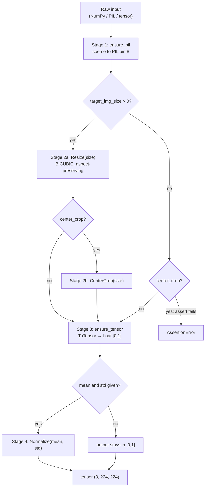
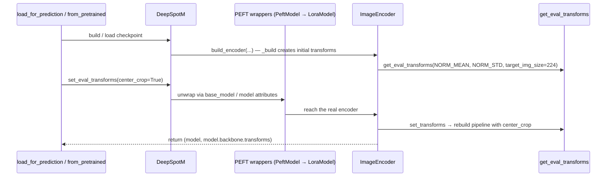

Every image that reaches a DeepSpotM vision encoder must pass through a deterministic preprocessing pipeline: it must arrive as a tensor with the exact spatial size the encoder expects and pixel values standardized with the exact mean/std statistics the encoder was trained with. This page explains how that pipeline is built, who owns its configuration, and how it is wired into every inference path. The implementation lives almost entirely in two files — a generic factory in `src/deepspotm/utils.py` and encoder-specific normalization constants in `src/deepspotm/image_encoder.py` — with consumer wiring in `model.py`, `checkpoint.py`, and the example scripts.

Sources: [utils.py](/src/deepspotm/utils.py#L1-L75), [image_encoder.py](/src/deepspotm/image_encoder.py#L1-L380)

## Why Normalization Is Encoder-Owned

DeepSpotM does not hardcode one preprocessing recipe. Each vision backbone — UNI, H-optimus, CLIP, Midnight — was pretrained with a different pixel standardization scheme, and feeding it tiles normalized with the wrong statistics silently degrades feature quality. The design therefore assigns every encoder subclass two class attributes, `NORM_MEAN` and `NORM_STD`, declared as a contract on the `ImageEncoder` base class ("Image normalization — every subclass must set these"). The encoder knows its own statistics; the transform factory only knows how to *apply* whatever statistics it is handed.

Sources: [image_encoder.py](/src/deepspotm/image_encoder.py#L34-L52), [image_encoder.py](/src/deepspotm/image_encoder.py#L156-L159)

This separation produces a clean dependency direction: `image_encoder.py` imports the factory functions from `utils.py`, builds one transform pipeline per encoder at construction time, and stores it as `self.transforms`. Nothing else in the codebase needs to know which statistics belong to which backbone — a caller simply calls the callable stored on the encoder.

Sources: [image_encoder.py](/src/deepspotm/image_encoder.py#L1-L3), [image_encoder.py](/src/deepspotm/image_encoder.py#L127-L140)

The transform-relevant code is concentrated in a small set of files:

```
src/deepspotm/
├── utils.py           # get_normalize_params + get_eval_transforms (the factory)
├── image_encoder.py   # per-encoder NORM_MEAN/NORM_STD, set_transforms, registry
├── model.py           # DeepSpotM.set_eval_transforms (PEFT-aware rebuild)
└── checkpoint.py      # load_for_prediction: switches to center-crop at predict time
examples/
├── predict.py         # applies image_processor to tile files
└── predict_wsi.py     # applies image_processor to whole-slide tiles
tests/
└── test_utils.py      # behavioral contract for the pipeline
```

Sources: [utils.py](/src/deepspotm/utils.py#L1-L75), [image_encoder.py](/src/deepspotm/image_encoder.py#L34-L52)

## The Anatomy of `get_eval_transforms`

The single factory function `get_eval_transforms(mean, std, target_img_size=-1, center_crop=False)` assembles a `torchvision.transforms.Compose` pipeline in four ordered stages. Understanding this order matters because each stage assumes a specific input format: stages 1–2 operate on PIL images, stage 3 produces a tensor, and stage 4 standardizes tensor values.

Sources: [utils.py](/src/deepspotm/utils.py#L27-L31)



| Stage | Operation | Trigger condition | Output state |
|---|---|---|---|
| 1 | `ensure_pil` lambda | always | PIL image, `uint8`, HWC layout |
| 2a | `Resize(size, InterpolationMode.BICUBIC)` | `target_img_size > 0` | shorter side resized to `target_img_size` |
| 2b | `CenterCrop(size)` | `center_crop=True` (asserts 2a ran) | square `size × size` image |
| 3 | `ensure_tensor` lambda | always | `float32` tensor, values scaled to `[0, 1]` |
| 4 | `Normalize(mean, std)` | both `mean` and `std` are not `None` | standardized tensor |

Sources: [utils.py](/src/deepspotm/utils.py#L34-L75)

Two details deserve attention for beginners. First, torchvision's `Resize` with an integer argument resizes only the *shorter* side to that value while preserving aspect ratio — so a 256×300 tile becomes 224×263 before an optional `CenterCrop(224)` trims the longer dimension from the middle. That is why both the tile CLI and the checkpoint loaders ultimately run with `center_crop=True`: the encoder demands exactly 224×224. Second, the composition is built once and reused — the returned `Compose` object is a callable you apply per image, not a class you instantiate per batch.

Sources: [utils.py](/src/deepspotm/utils.py#L56-L61), [predict.py](/examples/predict.py#L53-L56)

## Input Coercion: One Pipeline for NumPy, PIL, and Tensors

Real-world producers of pathology tiles disagree on formats: slide-reading libraries hand over channel-last `uint8` NumPy arrays, some code paths carry tensors, and the package's own examples pass PIL images. Rather than forcing every caller to convert first, stage 1 (`ensure_pil`) accepts all three and raises a `TypeError` for anything else — the test suite's module docstring states this explicitly: "`get_eval_transforms` is the boundary every downstream integration crosses."

Sources: [utils.py](/src/deepspotm/utils.py#L34-L53), [test_utils.py](/tests/test_utils.py#L1-L6)

| Input type | Handling in stage 1 | Result |
|---|---|---|
| `np.ndarray`, `uint8` | passed straight to `Image.fromarray` | PIL uint8 |
| `np.ndarray`, float | scaled by 255, clipped, cast to uint8 | PIL uint8 |
| `torch.Tensor` (CHW, float) | moved to CPU, `CHW → HWC` permute, ×255, clipped to uint8 | PIL uint8 |
| `PIL.Image.Image` | returned unchanged | PIL passthrough |
| anything else | `TypeError("Unsupported input type: ...")` | loud failure |

Sources: [utils.py](/src/deepspotm/utils.py#L34-L53)

The tensor branch deserves a closer look for beginners: a channel-first tensor of shape `(3, H, W)` with float values in `[0, 1]` — the format torchvision's `ToTensor` produces — is detected by checking `x.shape[0] in (1, 3)`, permuted to height-width-channel order, and quantized back to 8-bit pixels. The parametrized test then proves all four accepted input shapes converge to the identical output: a `float32` tensor of shape `(3, 224, 224)`.

Sources: [test_utils.py](/tests/test_utils.py#L19-L42)

## Normalization Constants Across the Encoder Registry

Each encoder in the registry pairs its architecture with the statistics its upstream pretraining used. The constants are defined once at module level and referenced by subclasses:

| Encoder | `NORM_MEAN` / `NORM_STD` source | Notes |
|---|---|---|
| `UNI1Encoder`, `UNI2Encoder` | ImageNet `(0.485, 0.456, 0.406)` / `(0.229, 0.224, 0.225)` | classic torchvision ImageNet stats |
| `H0miniEncoder`, `H0Encoder`, `H1Encoder` | Bioptimus `(0.707223, 0.578729, 0.703617)` / `(0.211883, 0.230117, 0.177517)` | H-optimus / Virchow-family stats |
| `ImageCLIPEncoder` | OpenAI CLIP `(0.48145466, 0.4578275, 0.40821073)` / `(0.26862954, 0.26130258, 0.27577711)` | may be overridden by checkpoint processor (see below) |
| `MidnightEncoder` | `(0.5, 0.5, 0.5)` for both mean and std | plain centering to `[-1, 1]` |

Sources: [image_encoder.py](/src/deepspotm/image_encoder.py#L156-L159), [image_encoder.py](/src/deepspotm/image_encoder.py#L162-L169), [image_encoder.py](/src/deepspotm/image_encoder.py#L250-L254), [image_encoder.py](/src/deepspotm/image_encoder.py#L301-L304)

The CLIP encoder adds a refinement on top of the contract: during `_build`, it attempts to load a Hugging Face `AutoImageProcessor` from the weights directory and, if that processor declares `image_mean`/`image_std`, those values **replace** the class defaults before the transform is built. The comment explains why — it "covers fine-tuned CLIP variants with custom norms." This is also the consumer of the second utility in `utils.py`, `get_normalize_params`, which extracts statistics from three shapes of object: a torchvision `Compose` pipeline (scanning for a `Normalize` step), a plain dict with `image_mean`/`image_std` keys, or any object carrying those attributes.

Sources: [image_encoder.py](/src/deepspotm/image_encoder.py#L276-L290), [utils.py](/src/deepspotm/utils.py#L8-L24)

> [!TIP]
> The CLIP override assigns to `type(self).NORM_MEAN` and `type(self).NORM_STD` — class attributes, not instance attributes ([image_encoder.py](/src/deepspotm/image_encoder.py#L282-L284)). Constructing an `ImageCLIPEncoder` with a checkpoint that ships custom processor stats therefore mutates the class-level defaults process-wide. Harmless for the single-encoder workflows in this repo, but worth knowing if you instantiate multiple CLIP variants in one process.

## Rebuilding Transforms at Predict Time

Transforms are constructed once per encoder during `_build` — for timm-based encoders, right after weights are resolved and loaded, always with `target_img_size=224`. But two inference loaders deliberately *rebuild* the pipeline afterwards, because evaluation uses a stricter geometry than construction-time defaults: both call `set_eval_transforms(center_crop=True)` immediately before returning the model.

Sources: [image_encoder.py](/src/deepspotm/image_encoder.py#L136-L140), [model.py](/src/deepspotm/model.py#L329-L331), [checkpoint.py](/src/deepspotm/checkpoint.py#L182-L183)



Sources: [model.py](/src/deepspotm/model.py#L352-L365), [checkpoint.py](/src/deepspotm/checkpoint.py#L89-L99)

The `DeepSpotM.set_eval_transforms` method is the PEFT-aware entry point. When LoRA is enabled, `self.backbone` is not the encoder itself but a chain of wrappers (`PeftModel` → `LoraModel` → `ImageEncoder`); the method walks the chain explicitly by following `base_model`/`model` attributes until it finds an object exposing `set_transforms`, then delegates. The code comments that this explicitness guards against a future PEFT release breaking attribute delegation silently. At the encoder level, `set_transforms` merges any keyword arguments with the stored `build_kwargs` and calls the same factory — the model is untouched, only the transform pipeline is replaced.

Sources: [model.py](/src/deepspotm/model.py#L352-L365), [image_encoder.py](/src/deepspotm/image_encoder.py#L62-L68)

Both public loaders follow the identical closing ritual: move to device, switch to eval, rebuild transforms with `center_crop=True`, and return the tuple `(model, model.backbone.transforms)`. The docstrings name this second element `image_processor` — that is the callable the example scripts invoke per tile.

Sources: [model.py](/src/deepspotm/model.py#L329-L331), [checkpoint.py](/src/deepspotm/checkpoint.py#L182-L183)

> [!TIP]
> Always treat the returned `image_processor` as the single source of truth for feeding images to the model — never hand-roll a `Compose` yourself. It encodes the encoder-specific statistics, the 224-px contract, and the eval-time center-crop in one object; replicating any of the three by hand is the most common way beginners produce silently wrong predictions.

## Transforms Inside the Inference Entry Points

The tile-based script `predict.py` demonstrates the minimal integration loop: it opens each image file with PIL, converts to RGB, applies an optional background filter, and then hands the PIL image to `image_processor`. Note the ordering — background tiles are rejected *before* the transform runs, so no resize/normalize compute is wasted on blank glass:

```python
image = Image.open(path).convert("RGB")
if white_mean is not None and float(np.asarray(image).mean()) > white_mean:
    continue                                   # skip background before transforming
batch_tiles.append(image_processor(image))     # the pipeline from utils.py
```

Sources: [predict.py](/examples/predict.py#L130-L134), [predict.py](/examples/predict.py#L161-L162)

The whole-slide script `predict_wsi.py` follows the same pattern at larger scale. It cuts the slide into tiles on a 224-pixel grid at native resolution (default `--tile 224`), applies a two-stage background filter — a cheap one-pixel-per-tile thumbnail flags candidate tissue regions, then each candidate is re-checked at full resolution against `--white-mean` — and only surviving PIL tiles are transformed in the batch `flush()` step via `torch.stack([image_processor(im) for im in buf_imgs])`. Both scripts therefore rely on stage 1's PIL passthrough: the images they feed are already PIL, and the coercion lambda returns them unchanged.

Sources: [predict_wsi.py](/examples/predict_wsi.py#L47-L76), [predict_wsi.py](/examples/predict_wsi.py#L95-L95), [predict_wsi.py](/examples/predict_wsi.py#L157-L163)

## Behavior Guarantees from the Test Suite

`tests/test_utils.py` pins the pipeline's contract so refactors cannot silently change what models see. Each test maps to a guarantee you can rely on as a consumer:

| Test | Guarantee |
|---|---|
| `test_accepts_every_input_type` | NumPy uint8, NumPy float, PIL, and CHW tensors all produce a `(3, 224, 224)` `float32` tensor |
| `test_rejects_unsupported_input` | non-image inputs raise `TypeError` instead of failing downstream |
| `test_normalization_is_applied` | with stats: output standardized; with `None` stats: output stays in `[0, 1]` (verified against the exact value `128/255` for a uniform gray tile) |
| `test_center_crop_requires_a_size` | `center_crop=True` without `target_img_size` is an `AssertionError` at pipeline-build time |
| `test_get_normalize_params_*` | stats recovery works for `Compose` pipelines, pipelines without `Normalize` (returns `(None, None)`), and HF-style processor dicts |

Sources: [test_utils.py](/tests/test_utils.py#L19-L58), [test_utils.py](/tests/test_utils.py#L61-L95)

## Hands-On: Getting a Transform Without Weights

If you need to preprocess tiles to DeepSpotM's expected format without loading any model — for example to build a dataset cache or inspect tiles the way the encoder would — use the factory-level helper `build_encoder_transforms`, exported from the package root. It looks up the encoder class in the registry, reads its `NORM_MEAN`/`NORM_STD`, and calls the same `get_eval_transforms` with `target_img_size=224` — no timm import, no weight download, no model construction:

```python
from deepspotm import build_encoder_transforms

processor = build_encoder_transforms("H0Encoder", center_crop=True)
tensor = processor(pil_tile)   # ready-to-encode (3, 224, 224)
```

Sources: [image_encoder.py](/src/deepspotm/image_encoder.py#L369-L379), [__init__.py](/src/deepspotm/__init__.py#L12-L26)

Passing an unknown encoder name raises a `ValueError` listing the available registry keys, mirroring `build_encoder`'s behavior — a useful safety net when experimenting with encoder names.

Sources: [image_encoder.py](/src/deepspotm/image_encoder.py#L348-L366)

## Where to Go Next

To see where these transformed tensors go next, follow the pipeline downstream: [Pathology Vision Encoders](7-pathology-vision-encoders) explains the encoder classes that own the normalization constants you met here; [Pretrained Model Loading](13-pretrained-model-loading) details the loading paths that trigger the center-crop rebuild; and [Whole-Slide Image Pipeline](17-whole-slide-image-pipeline) covers the tiling and background-filtering stages that run *before* the transform in `predict_wsi.py`. For how the transform contract is verified in CI, continue to [Test Suite and Packaging](19-test-suite-and-packaging).