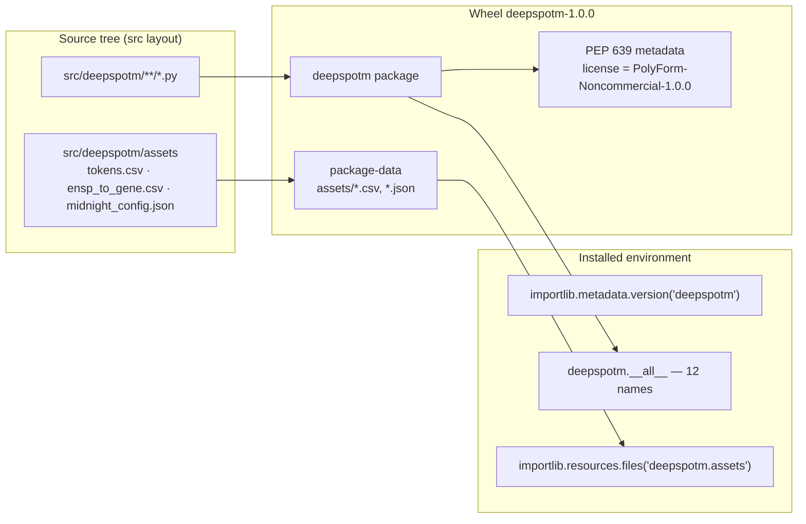
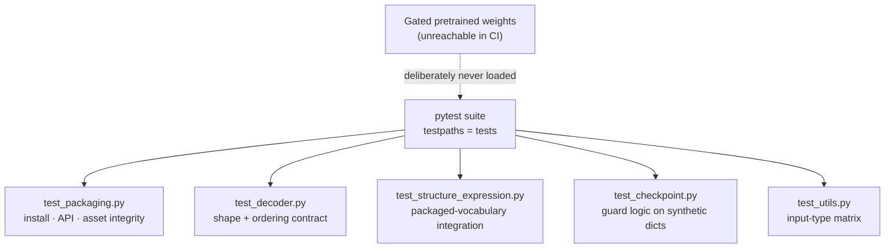
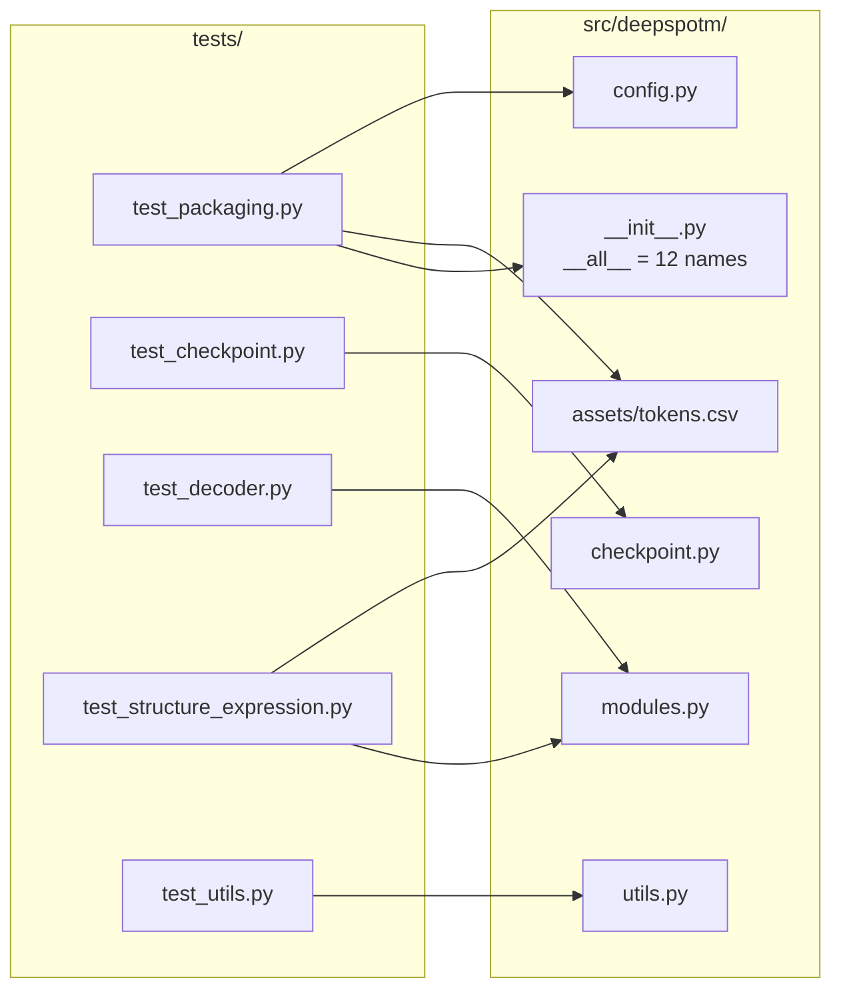

DeepSpotM ships as a standard Python wheel whose correctness is enforced by a deliberately **checkpoint-free test suite**: because the pretrained weights are gated, every test is designed to verify guarantees that hold *without* ever downloading them. This page explains how the package is built, what the five test files guarantee on top of it, and why the testing strategy is shaped the way it is.

Sources: [pyproject.toml](pyproject.toml#L1-L87), [tests/test_packaging.py](tests/test_packaging.py#L1-L7)

## Packaging Architecture: A src-Layout Wheel with Shipped Data

The build is plain setuptools, pinned to **`setuptools>=77`** for a specific reason: PEP 639. That standard introduced the machine-readable `license` and `license-files` fields, which the project uses to encode its dual-licensing scheme directly into distribution metadata — `PolyForm-Noncommercial-1.0.0` for the code, with `WEIGHTS_LICENSE.md` and `THIRD_PARTY_LICENSES.md` shipped alongside so license terms travel with the artifact itself.

Sources: [pyproject.toml](pyproject.toml#L1-L4), [pyproject.toml](pyproject.toml#L11-L14), [Licensing and Research Use](20-licensing-and-research-use)

The distribution uses a **src layout**: `tool.setuptools.packages.find` searches only under `src/`, which makes it impossible for a test to accidentally import the source tree instead of the installed package — a property the packaging tests actively depend on. Crucially, the `package-data` directive ships `assets/*.csv` and `assets/*.json` into the wheel, so the gene vocabulary (`tokens.csv`), the Ensembl-to-symbol mapping (`ensp_to_gene.csv`), and the encoder configuration (`midnight_config.json`) travel with the code rather than being reconstructed at runtime.

Sources: [pyproject.toml](pyproject.toml#L79-L83)

| Configuration field | Value | Why it matters |
|---|---|---|
| Name / version | `deepspotm` / `1.0.0` | Asserted by `test_version_is_installed` |
| `requires-python` | `>=3.10` | torch, transformers, peft, lightning all require ≥3.10; a 3.9 install cannot resolve a working dependency set |
| Build backend | `setuptools.build_meta` (≥77) | Enables the PEP 639 `license` / `license-files` fields |
| `license-files` | `LICENSE`, `WEIGHTS_LICENSE.md`, `THIRD_PARTY_LICENSES.md` | Dual code/weights licensing baked into the wheel |
| `packages.find` | `where = ["src"]` | src layout; tests exercise the installed package, not the tree |
| `package-data` | `assets/*.csv`, `assets/*.json` | Vocabulary and config data ship inside the wheel |

Sources: [pyproject.toml](pyproject.toml#L6-L28), [pyproject.toml](pyproject.toml#L79-L83)

Dependency management follows a layered extras model: the core dependencies cover inference (torch, lightning, timm, peft, transformers), while optional extras scope heavier tooling to the workflows that need it. Note that `torchvision` — imported by the transform tests — is not declared directly; it arrives transitively through `timm`'s dependency chain.

Sources: [pyproject.toml](pyproject.toml#L44-L55), [tests/test_utils.py](tests/test_utils.py#L12-L14)

| Extra | Installs | Serves |
|---|---|---|
| `wsi` | `pyvips`, `anndata` | Whole-slide reading and AnnData export in `examples/predict_wsi.py` |
| `test` | `pytest>=7.0` | The test suite |
| `dev` | `test` + `wsi` + `build`, `ruff`, `twine` | Full development workflow including wheel building and linting |

Sources: [pyproject.toml](pyproject.toml#L57-L71)

The flow from source tree to validated installation looks like this:



At runtime, packaged assets are resolved through **`importlib.resources.files()`**, never through source-tree paths. `config.py` builds `ALPHABET_PATH` from `files("deepspotm.assets")` with a filesystem fallback only as a last resort, and the inline comment documents why the deprecated `importlib.resources.path()` was avoided: it returns a context-managed path that is released on exit, so the stored value could outlive the guarantee it was valid.

Sources: [src/deepspotm/config.py](src/deepspotm/config.py#L7-L15)

> [!TIP]
> `importlib.resources.files()` returns a `Traversable` that stays valid for the process lifetime, whereas the deprecated `path()` hands back a `TemporaryDirectory`-managed path. Storing the latter in a class attribute (as `Config.ALPHABET_PATH` does) is exactly the bug class the comment guards against — the resource could vanish after the context manager exits.

## Testing Under Constraint: The Gated-Weights Problem

The pretrained weights live behind a gated Hugging Face repository, so an automated environment can never load a real checkpoint. The test suite turns this constraint into a design principle: rather than mocking the model, it tests **contracts** — shapes, types, orderings, and invariants — using a tiny randomly-initialised decoder, the packaged vocabulary, and pure functions over synthetic state dicts. The packaging test docstring states the philosophy explicitly: what can be guaranteed is that the package installs, that its public API is importable, and that the data files the model depends on actually ship in the wheel — *"Those are the failures that silently reach users."*

Sources: [tests/test_packaging.py](tests/test_packaging.py#L1-L7), [tests/test_decoder.py](tests/test_decoder.py#L1-L8), [Pretrained Model Loading](13-pretrained-model-loading)



Sources: [tests/test_packaging.py](tests/test_packaging.py#L1-L7), [pyproject.toml](pyproject.toml#L85-L86)

Three complementary strategies emerge, each with a distinct verification boundary:

| Strategy | Representative tests | What it proves | What it cannot prove |
|---|---|---|---|
| **Packaging contract** | `test_version_is_installed`, `test_asset_is_packaged` | Wheel installs; data files ship; metadata resolves | That the real weights load |
| **Small-model contract** | `test_forward_returns_the_documented_triple` | Shapes, dtypes, and orderings of the public API | Numeric quality of trained weights |
| **Guard unit tests** | `test_check_state_dict_load_rejects_unexplained_drift` | Failure modes raise loudly instead of silently degrading | End-to-end prediction correctness |

Sources: [tests/test_packaging.py](tests/test_packaging.py#L22-L24), [tests/test_decoder.py](tests/test_decoder.py#L46-L54), [tests/test_checkpoint.py](tests/test_checkpoint.py#L55-L58)

## Test Suite Coverage Map

The five files partition cleanly along module boundaries. Each file's docstring doubles as a statement of which silent failure it exists to prevent:



Sources: [src/deepspotm/__init__.py](src/deepspotm/__init__.py#L1-L31), [tests/](tests/test_checkpoint.py#L1-L6)

| Test file | Module under test | Technique | Headline guarantees |
|---|---|---|---|
| `test_packaging.py` | Distribution metadata, `deepspotm.assets`, `config` | `importlib.metadata` / `importlib.resources` | Installed version; `__all__` importable; assets shipped and non-empty; vocabulary invariants |
| `test_checkpoint.py` | `deepspotm.checkpoint` | Synthetic state dicts | Prefix filtering; drift raises `RuntimeError`; allow-lists honoured |
| `test_decoder.py` | `CrossAttentionGeneDecoder` | Tiny randomly-initialised model, seeded with `torch.manual_seed` | Three-tuple return; `gene_indices` subsets *and* orders; attention path; modality registry consistency |
| `test_structure_expression.py` | `StructureExpression` | The packaged `tokens.csv` itself | 19 338 genes; placement by name; negative clamping; unknown genes ignored |
| `test_utils.py` | `get_eval_transforms`, `get_normalize_params` | Parametrised input-type matrix | numpy/PIL/tensor → `(3, 224, 224)` float32; loud `TypeError`; normalize-parameter extraction |

Sources: [tests/test_packaging.py](tests/test_packaging.py#L1-L64), [tests/test_checkpoint.py](tests/test_checkpoint.py#L1-L69), [tests/test_decoder.py](tests/test_decoder.py#L1-L94), [tests/test_structure_expression.py](tests/test_structure_expression.py#L1-L55), [tests/test_utils.py](tests/test_utils.py#L1-L96)

## The Packaging Contract: tests/test_packaging.py

Installability is checked first: `test_version_is_installed` asserts that `importlib.metadata.version("deepspotm")` resolves, proving the distribution — not just a directory of source files — is present in the environment. `test_public_api_is_importable` then parametrizes over `deepspotm.__all__` itself, so any of the twelve advertised names that fails to exist on the package fails a named test. This converts the `__all__` list from documentation into an enforced contract.

Sources: [tests/test_packaging.py](tests/test_packaging.py#L22-L32), [src/deepspotm/__init__.py](src/deepspotm/__init__.py#L20-L31)

Asset integrity is checked against the three data files the model depends on: each must exist via `importlib.resources.files("deepspotm.assets")` *and* be non-empty via `read_bytes()`. This is the direct backstop for the `package-data` glob — the classic silent packaging failure is a wheel that installs cleanly but ships without its data, which only surfaces as a user-side `FileNotFoundError`.

Sources: [tests/test_packaging.py](tests/test_packaging.py#L35-L43), [pyproject.toml](pyproject.toml#L82-L83)

The vocabulary test encodes the deepest invariant. `EXPECTED_GENES = 19338` ties `tokens.csv` to the model's reported output width — the module comment notes that a change to this file *is* a change to the model's output width. Two assertions follow: the count of rows with `token_type == "gene"` must equal 19 338, and token ids must form a **dense `0..n-1` range**, because the decoder indexes into them directly.

Sources: [tests/test_packaging.py](tests/test_packaging.py#L17-L19), [tests/test_packaging.py](tests/test_packaging.py#L46-L56), [Gene Vocabulary and Output Mapping](12-gene-vocabulary-and-output-mapping)

Finally, `test_config_alphabet_path_resolves` closes the loop between packaging and runtime: it asserts that `config.ALPHABET_PATH` — built from the `importlib.resources` chain — points at an existing file, proving the packaged-vocabulary resolution works from the installed distribution rather than only from a source checkout.

Sources: [tests/test_packaging.py](tests/test_packaging.py#L59-L63), [src/deepspotm/config.py](src/deepspotm/config.py#L8-L15)

> [!TIP]
> The dense token-id assertion (`ids == list(range(len(rows)))`) is load-bearing: the decoder treats `token_id` values as direct tensor row indices. A sparse or shifted id range would not raise anywhere — it would silently misalign every gene's output column, which is precisely the class of failure this suite is built to catch.

## Component Contracts Under Test

**Decoder contract.** Two seeded fixtures construct a miniature `CrossAttentionGeneDecoder` (12 genes, 16-dim patches) and a batch of patch tokens, so every test runs in milliseconds without network access. The assertions pin the API downstream integrations rely on: `forward` returns exactly the triple `(expression, gene_features, attn_weights)` with `attn` as `None` by default; expression is `(batch, n_requested_genes)` and finite; passing `gene_indices` computes *only* those columns and honours their requested order (verified by comparing a reversed index request against a flipped slice of the full output); and `need_weights=True` switches the third element to real per-layer attention.

Sources: [tests/test_decoder.py](tests/test_decoder.py#L26-L43), [tests/test_decoder.py](tests/test_decoder.py#L46-L77), [Cross-Attention Gene Decoder](9-cross-attention-gene-decoder)

The registry test guards a subtler invariant: every source in `MODALITY_BY_SOURCE` must map into the canonical `MODALITY_VOCABULARY`, and position 0 must be `"dna"` — the module comment states the ordering is load-bearing because the index is what the one-hot encoding uses.

Sources: [tests/test_decoder.py](tests/test_decoder.py#L89-L93), [Gene Router Hypernetwork](10-gene-router-hypernetwork)

**Checkpoint-loading guards.** The docstring explains why these pure functions deserve tests: a regression in the drift guard "fails quietly and looks like a bad model rather than a bad load." The tests establish that `filter_state_dict` removes keys under vocab-specific prefixes while preserving everything else, and that filtering with an empty prefix tuple returns an *equal but distinct* dict (no accidental aliasing). For the guard itself: a clean load passes; unexplained missing or unexpected keys raise `RuntimeError` matching `"unaccounted-for key drift"`; and drift that the caller declared expected — via `allow_missing_prefixes` / `allow_unexpected_prefixes` set to `VOCAB_SPECIFIC_PREFIXES` — is permitted through.

Sources: [tests/test_checkpoint.py](tests/test_checkpoint.py#L1-L6), [tests/test_checkpoint.py](tests/test_checkpoint.py#L24-L40), [tests/test_checkpoint.py](tests/test_checkpoint.py#L48-L68), [Cross-Vocabulary Checkpoint Handling](14-cross-vocabulary-checkpoint-handling)

**Transform input matrix.** `get_eval_transforms` is described as "the boundary every downstream integration crosses": TIAToolbox hands it channel-last uint8 tiles, the WSI example hands it PIL images, and the model's own transform hands it tensors. A single parametrised test drives all four input flavours — numpy uint8, numpy float32, PIL, and CHW tensor — through the pipeline and asserts each emerges as a `(3, 224, 224)` float32 tensor. Complementary tests pin the failure mode (a string input raises `TypeError` rather than producing garbage), normalization behaviour (standardized when mean/std are given, `[0, 1]` when not), the configuration assertion that `center_crop` requires a positive `target_img_size`, and `get_normalize_params` extraction from a torchvision `Compose`, an empty pipeline, and a HuggingFace-style processor dict.

Sources: [tests/test_utils.py](tests/test_utils.py#L1-L6), [tests/test_utils.py](tests/test_utils.py#L26-L47), [tests/test_utils.py](tests/test_utils.py#L56-L71), [tests/test_utils.py](tests/test_utils.py#L74-L95), [Image Preprocessing Transforms](18-image-preprocessing-transforms)

**Vocabulary integration.** `test_structure_expression.py` deliberately instantiates `StructureExpression()` with its default constructor, which resolves the packaged vocabulary — the docstring notes this "doubles as a check that the shipped tokens.csv is usable from an installed wheel rather than only from a source tree." The behavioural assertions cover placement by gene name (values land at vocabulary positions, the mask marks exactly the provided genes), clamping of negative expression values to zero, and isolation of unknown gene names, which must not shift or corrupt the output.

Sources: [tests/test_structure_expression.py](tests/test_structure_expression.py#L1-L5), [tests/test_structure_expression.py](tests/test_structure_expression.py#L12-L17), [tests/test_structure_expression.py](tests/test_structure_expression.py#L20-L44), [tests/test_structure_expression.py](tests/test_structure_expression.py#L47-L54)

## Running the Suite

Because `pyproject.toml` sets `testpaths = ["tests"]`, the standard workflow is an editable install followed by a bare `pytest` invocation. The `dev` extra bundles everything the suite and packaging workflow need; the `test` extra alone is sufficient if you only want to run the tests.

```bash
pip install -e ".[dev]"   # editable install + pytest + WSI extras + build/ruff/twine
pytest                    # discovers tests via testpaths = ["tests"]
```

Sources: [pyproject.toml](pyproject.toml#L57-L71), [pyproject.toml](pyproject.toml#L85-L86)

Each test is designed to diagnose its own packaging failure mode, so a red test points at a specific broken invariant:

| Failing test | Most likely cause |
|---|---|
| `test_version_is_installed` | Package not installed — running `pytest` from a source tree without `pip install -e .` |
| `test_asset_is_packaged` | A data file missing from `src/deepspotm/assets`, or the `package-data` glob no longer matching |
| `test_public_api_is_importable` | `__all__` advertises a name that no longer exists on the package |
| `test_token_vocabulary_matches_model_panel` | `tokens.csv` edited without re-deriving the 19 3338-gene panel width, or a non-dense token-id assignment |
| `test_config_alphabet_path_resolves` | Broken `importlib.resources` chain — assets present in source but absent from the installed distribution |

Sources: [tests/test_packaging.py](tests/test_packaging.py#L22-L63)

## Navigating Further

The contracts verified here anchor several deeper pages: the decoder triple tested in `test_decoder.py` is unpacked by the downstream tooling described in [Cross-Attention Gene Decoder](9-cross-attention-gene-decoder); the dense token-id invariant underpins [Gene Vocabulary and Output Mapping](12-gene-vocabulary-and-output-mapping); the drift guard is applied in [Cross-Vocabulary Checkpoint Handling](14-cross-vocabulary-checkpoint-handling); and the dual license metadata declared via PEP 639 is elaborated in [Licensing and Research Use](20-licensing-and-research-use). For the components these tests wrap at a conceptual level, start with [Architecture Overview](6-architecture-overview).
