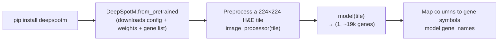
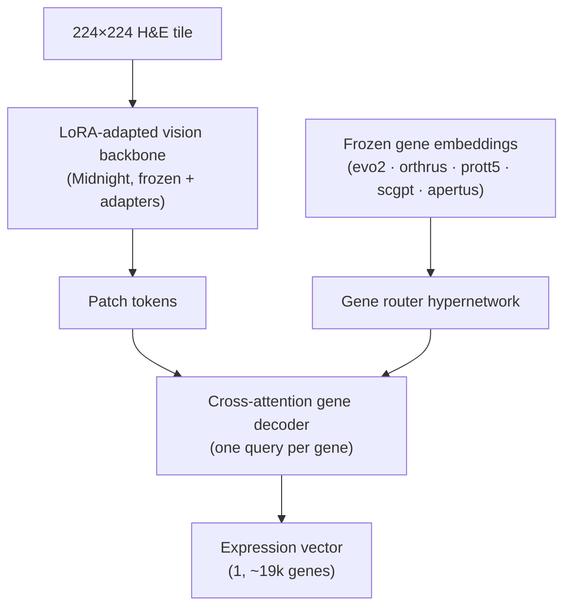

This page takes you from an empty environment to your first predicted gene-expression profile. DeepSpot-M is a multimodal foundation model that maps a single 224×224 H&E histology tile to transcriptome-wide spatial gene expression (~19k genes): a LoRA-adapted pathology backbone tokenises the tile, each gene query attends to the patch tokens through a cross-attention decoder, and a gene router hypernetwork generates gene-specific output projections. Here you will install the package, load the published Hugging Face checkpoint, run one prediction, interpret the output, and learn the fastest command-line paths. Deeper topics — architecture internals, checkpoint handling, WSI pipelines — are linked at the end.

> ⚠️ **Research use only. Not for clinical or diagnostic use.** The code is PolyForm Noncommercial licensed and the weights are CC-BY-NC-SA-4.0; see [Licensing and Research Use](20-licensing-and-research-use).

Sources: [README.md](README.md#L12-L44), [pyproject.toml](pyproject.toml#L13-L20)

## The Three-Step Journey

Everything in this page reduces to three operations. The first run only downloads three files from the Hugging Face repo (`config.json`, `model.safetensors`, `tokens.csv`) — the Midnight vision backbone is built offline from a bundled config and its weights come from the checkpoint, so no network access to the upstream backbone repo is needed.



Sources: [model.py](src/deepspotm/model.py#L251-L331), [README.md](README.md#L65-L89)

## Installation

One command installs the core package with all inference dependencies (torch, timm, peft, transformers, safetensors, huggingface_hub, and friends). Python **3.10 or newer** is required, because torch, transformers, peft and lightning all mandate it in current releases — a 3.9 install cannot resolve a working dependency set.

```bash
pip install deepspotm
```

If you plan to run the whole-slide example (or want the extras used by it), install the `wsi` extra instead. It adds `pyvips` (a libvips binding) and `anndata`:

```bash
pip install "deepspotm[wsi]"
```

To track the development branch rather than the PyPI release:

```bash
pip install git+https://github.com/ratschlab/DeepSpotM.git
```

| Install target | Command | What you get |
|---|---|---|
| Core inference | `pip install deepspotm` | Python API + `examples/predict.py` |
| Whole-slide support | `pip install "deepspotm[wsi]"` | Adds `pyvips` + `anndata` for `examples/predict_wsi.py` |
| Development branch | `pip install git+https://github.com/ratschlab/DeepSpotM.git` | Latest main, pre-release |
| Development setup | extras `test`, `dev` | pytest, ruff, build tooling |

Sources: [README.md](README.md#L46-L63), [pyproject.toml](pyproject.toml#L32), [pyproject.toml](pyproject.toml#L45-L53)

## Your First Prediction

The Python API is deliberately minimal. `DeepSpotM.from_pretrained` downloads (or reads from a local directory containing) the three model files, rebuilds the architecture from the saved hyper-parameters, loads the weights, moves the model to GPU if available, sets eval mode, and returns the model together with its image transform callable:

```python
from deepspotm import DeepSpotM

model, image_processor = DeepSpotM.from_pretrained(
    "ratschlab/DeepSpotM",
    source="scgpt",   # one of evo2, orthrus, prott5, scgpt, apertus
)
```

The `source` argument selects the gene-embedding pathway the decoder uses. The released model is **multi-source** — it ships one frozen gene-embedding bank and one adapter per source — so a source *must* be named; omitting it raises a `ValueError`. The five valid choices are `evo2`, `orthrus`, `prott5`, `scgpt` (the default in every example), and `apertus`.

Now preprocess a tile and predict. `image_processor` applies the backbone's evaluation transforms (center-crop eval transforms are configured automatically), and `forward` returns a three-tuple — expression, a pooled image embedding, and attention weights (both extra outputs can be ignored for now):

```python
import torch

tile = image_processor(my_pil_tile).unsqueeze(0)   # (1, 3, 224, 224)
with torch.no_grad():
    expression, _, _ = model(tile)                 # (1, ~19k genes)
```

> [!TIP]
> At load time, `backbone_pretrained` is forced to `False`: the backbone architecture is constructed without touching the network, and every weight — backbone, LoRA adapters, gene decoder — arrives in the single `model.safetensors` file. A firewall that blocks Hugging Face but allows your environment elsewhere will still complete a local-directory load.

Sources: [model.py](src/deepspotm/model.py#L251-L331), [model.py](src/deepspotm/model.py#L318-L331), [README.md](README.md#L67-L85)

## Understanding the Output

The output vector is **log1p-CPM predicted expression** — higher means more expressed — ordered by the model's gene panel. The mapping rule is simple: output column `i` corresponds to `model.gene_names[i]`. The gene list is read once at model construction from `tokens.csv` and stored on the model, so you never need to re-parse the vocabulary yourself:

```python
preds = dict(zip(model.gene_names, expression.squeeze(0).tolist()))
```

The panel covers the ~19k genes listed in the published `tokens.csv`. Because genes are represented as queryable embeddings rather than fixed output heads, the model can even predict genes it never saw during training (zero-shot) — a property we examine in [Architecture Overview](6-architecture-overview).

Sources: [README.md](README.md#L83-L89), [model.py](src/deepspotm/model.py#L63-L69), [predict.py](examples/predict.py#L193-L195)

## Predicting Specific Genes

Predicting the full panel for every tile is wasteful when you care about a handful of markers. `predict_genes` computes **only the requested gene queries**, which is both faster and returns a compact tensor whose columns follow your input order. It accepts a single symbol or a list, and unknown symbols raise a `KeyError` listing the offenders:

```python
vals = model.predict_genes(tile, ["EPCAM", "CD3D", "PTPRC"])   # (1, 3)
vals = model.predict_genes(tile, "EPCAM")                      # (1, 1)
```

This selection mechanism is the inference-side payoff of the gene-query design: the cross-attention decoder builds only the gene queries you ask for, skipping the rest of the panel entirely. The full mechanics are covered in [Selective Gene Prediction](16-selective-gene-prediction).

Sources: [model.py](src/deepspotm/model.py#L406-L420), [README.md](README.md#L91-L97)

## The Fastest Path: Command Line

If your goal is results rather than code, two ready-made scripts cover the two common input shapes. Both load the same Hugging Face checkpoint and share the same core flags (`--source`, `--genes`, `--device`, background filtering); run either with `--help` for the complete list.

For **pre-cut 224×224 tiles**, `examples/predict.py` scores one tile or a whole folder (recursively by default, filtering common image suffixes), prints the top-N highest-expression genes per tile, and optionally writes every prediction to a CSV. Batch size defaults to 16 tiles per forward pass:

```bash
# one tile, print the 10 highest-expression genes
python examples/predict.py tile.png

# every tile in a folder, score three markers, write a CSV
python examples/predict.py tiles/ --genes EPCAM CD3D PTPRC --output preds.csv

# different gene-embedding source, forced onto CPU
python examples/predict.py tile.png --source evo2 --device cpu
```

| Flag | Default | Purpose |
|---|---|---|
| `PATH` (positional) | required | Tiles or folders of tiles; RGB, resized to 224×224 |
| `--repo` | `ratschlab/DeepSpotM` | HF repo id or local directory with the model files |
| `--source` | `scgpt` | Gene-embedding source (`evo2`/`orthrus`/`prott5`/`scgpt`/`apertus`) |
| `--genes` | full panel | Score only these symbols instead of all ~19k |
| `--top` | `10` | Highest-expression genes printed per tile (ignored with `--genes`) |
| `--output` / `-o` | none | Write all predictions to a CSV (rows = tiles, columns = genes) |
| `--batch-size` | `16` | Tiles per forward pass |
| `--skip-background` | off | Drop near-white tiles (mean pixel above `--white-mean`) |
| `--device` | auto | `cuda` if available, else `cpu` |

For **whole-slide images**, `examples/predict_wsi.py` tiles a slide on a 224-px grid at native (~20x) resolution, drops background tiles, predicts per tile, and writes a spatial AnnData `.h5ad` — the same format as the TCGA atlas, ready for scanpy/squidpy. It requires the `wsi` extra installed above:

```bash
python examples/predict_wsi.py slide.svs -o slide.h5ad
python examples/predict_wsi.py slides/ -o out/ --genes BRAF CD37 COL1A1
```

The CLI surface, performance knobs, and end-to-end examples are documented in [Command-Line Prediction Tools](3-command-line-prediction-tools); the slide-reading and tiling internals are covered in [Whole-Slide Image Pipeline](17-whole-slide-image-pipeline).

Sources: [predict.py](examples/predict.py#L54-L110), [predict.py](examples/predict.py#L15-L22), [predict_wsi.py](examples/predict_wsi.py#L1-L22), [README.md](README.md#L99-L123)

## What Happens Under the Hood

It helps to see the shape of the computation you just triggered. The tile is tokenised by a LoRA-adapted pathology foundation backbone; each gene query independently attends to the patch tokens via multi-head cross-attention; and a gene router hypernetwork produces gene-specific output projections from frozen biological embeddings drawn from DNA, RNA, protein, single-cell and text foundation models:




**Fig. DeepSpot-M predicts transcriptome-wide spatial gene expression from histology.** The design enables zero-shot prediction of genes at inference time because genes are queryable embeddings rather than fixed outputs.

> [!TIP]
> When `from_pretrained` returns, the model is already in eval mode with center-crop evaluation transforms active and the source pathway selected via `set_source` — you do not need to call `.eval()` or configure preprocessing yourself. The returned `image_processor` is that exact backbone transform.

You do not need any of this for basic use, but when you are ready, the components each have a dedicated page: [Pathology Vision Encoders](7-pathology-vision-encoders), [Cross-Attention Gene Decoder](9-cross-attention-gene-decoder), and [Gene Router Hypernetwork](10-gene-router-hypernetwork).

Sources: [README.md](README.md#L24-L42), [model.py](src/deepspotm/model.py#L60-L106)

## Project Layout at a Glance

The repository is a compact `src`-layout package. As a beginner you will touch only the first two layers — the package root and `examples/`:

```
DeepSpotM/
├── examples/                  ← runnable entry points
│   ├── predict.py             ← tile scoring CLI
│   ├── predict_wsi.py         ← whole-slide → .h5ad CLI
│   └── predict_tcga_skcm.ipynb← guided end-to-end notebook
├── src/deepspotm/             ← the installable package
│   ├── __init__.py            ← exports DeepSpotM + loading helpers
│   ├── model.py               ← DeepSpotM class, from_pretrained, predict_genes
│   ├── image_encoder.py       ← backbone construction + transforms
│   ├── modules.py             ← decoder, gene embeddings, router
│   ├── checkpoint.py          ← checkpoint/vocab loading utilities
│   ├── config.py / utils.py   ← configuration and helpers
│   └── assets/                ← bundled gene-embedding metadata
└── tests/                     ← pytest suite (test_*.py)
```

Sources: [__init__.py](src/deepspotm/__init__.py#L1-L31), [pyproject.toml](pyproject.toml#L77-L82)

## Common First-Run Issues

| Symptom | Cause | Fix |
|---|---|---|
| `ValueError: Multi-source model ... requires source=` | The released checkpoint is multi-source; the decoder refuses to guess a pathway | Pass `source="scgpt"` (or another of the five valid names) |
| `KeyError: gene(s) not in the model panel` | A gene symbol passed to `predict_genes` is not among the ~19k panel genes | Check spelling/casing against `model.gene_names` |
| Download stalls on first load | `from_pretrained` fetches three files from the Hugging Face repo on first use | Pre-download, or pass a local directory containing `config.json`, `model.safetensors`, `tokens.csv` |
| `predict.py` reports every tile filtered as background | `--skip-background` with a `--white-mean` threshold (default 220) too low for pale tiles | Lower `--white-mean` or drop `--skip-background` |
| `ModuleNotFoundError: pyvips` | Whole-slide script run without the `wsi` extra | `pip install "deepspotm[wsi]"` |
| Slow inference on CPU | Default device is `cuda` when available; large tiles fall back to CPU | Install CUDA-enabled torch, or accept smaller batches via `--batch-size` |

Sources: [model.py](src/deepspotm/model.py#L318-L327), [model.py](src/deepspotm/model.py#L393-L404), [model.py](src/deepspotm/model.py#L280-L292), [predict.py](examples/predict.py#L89-L103), [predict_wsi.py](examples/predict_wsi.py#L13-L14)

## Where to Go Next

You now have a working model and know the two usage modes. A natural progression through this documentation:

1. **[Command-Line Prediction Tools](3-command-line-prediction-tools)** — master the full CLI surface, background filtering, and batch workflows before writing custom code.
2. **[TCGA-SKCM Tutorial Notebook](4-tcga-skcm-tutorial-notebook)** — a guided notebook that downloads an open-access whole-slide TCGA melanoma image, tiles it, predicts BRAF/CD37/COL1A1, and overlays predictions on the tissue end to end.
3. **[Atlas and Dataset Access](5-atlas-and-dataset-access)** — download from the published TCGA virtual spatial transcriptomics atlas (28,664 slides, 32 cancer types) to compare your predictions against.
4. **[Architecture Overview](6-architecture-overview)** — when the "under the hood" sketch above leaves you curious about *why* genes-as-queries enables zero-shot prediction.
