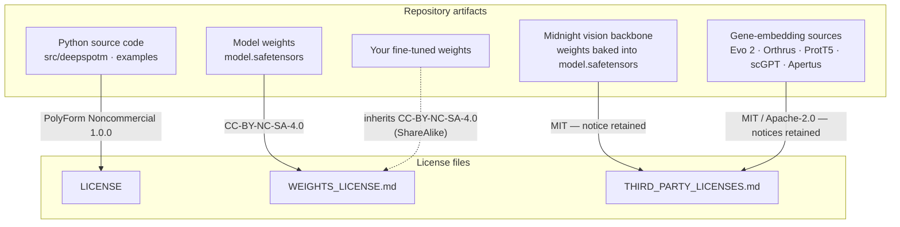
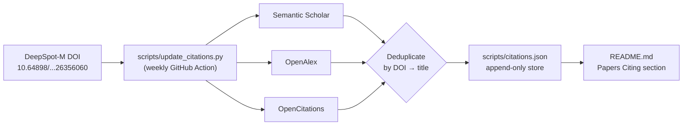

DeepSpotM is released as a **research artifact**, and that intent is encoded in how the repository licenses its different parts. This page explains exactly what you may do with the code, the pretrained weights, and the third-party components they build on, what obligations follow from each, and how to cite the work correctly. Nothing here changes what the model does — it defines the legal and scholarly contract around it. If you have not yet run your first prediction, start with [Overview](1-overview) and [Quick Start](2-quick-start), then return here before redistributing or building on the model.

## Why One Repository Ships Two Licenses

Most repositories have a single `LICENSE` file; DeepSpotM deliberately does not. The project separates **artifacts** (things you run or redistribute) from **rights** (the terms attached to each), because code and model weights have different legal natures: source code is software, while weights are closer to a creative work that others fine-tune and share. The result is a split-license model with three files, each governing a different slice of the repository:

The README states the split in two lines: code under PolyForm Noncommercial 1.0.0, model weights under CC-BY-NC-SA-4.0, and the backbone and gene-embedding sources under MIT or Apache-2.0. Note the deliberate asymmetry: PolyForm places **no share-alike requirement on modified code**, but the CC license does impose share-alike on weight derivatives. That difference is the single most important thing to internalize before fine-tuning.

Sources: [README.md](README.md#L180-L189), [WEIGHTS_LICENSE.md](WEIGHTS_LICENSE.md#L17-L19)

A comparison across the three license layers:

| Artifact | License file | Commercial use | Derivative works | Core obligation |
|---|---|---|---|---|
| Source code | `LICENSE` | No | Allowed, any noncommercial purpose | Propagate terms + `Required Notice` |
| Model weights & fine-tunes | `WEIGHTS_LICENSE.md` | No (incl. outputs) | Must stay CC-BY-NC-SA-4.0 | Attribution + ShareAlike |
| Bundled third-party models | `THIRD_PARTY_LICENSES.md` | Per their license | Per their license | Retain original notices |

Sources: [LICENSE](LICENSE#L1-L132), [WEIGHTS_LICENSE.md](WEIGHTS_LICENSE.md#L1-L20), [THIRD_PARTY_LICENSES.md](THIRD_PARTY_LICENSES.md#L1-L15)

## The Code License: PolyForm Noncommercial 1.0.0

`LICENSE` contains the full text of the **PolyForm Noncommercial License 1.0.0**, a plain-language license family designed specifically for source code. Its central rule is that any *noncommercial purpose* is permitted. The text defines this generously rather than narrowly: personal research, experimentation, and testing for public knowledge, personal study, hobby projects, and amateur pursuits all qualify — as does use by charitable organizations, educational institutions, public research organizations, and government institutions **regardless of funding source**. That last clause matters in practice: an industry-funded lab at a public university is still covered.

Sources: [LICENSE](LICENSE#L52-L71)

What you *must* do under PolyForm is minimal but real. If you distribute the software (a fork, a patched build, an embedded copy), everyone who receives it must also receive the license terms or their URL, plus any plain-text lines beginning with `Required Notice:`. The license ships with a concrete example of the notice format: `Required Notice: Copyright Kalin Nonchev / ETH Zurich (https://github.com/ratschlab/DeepSpotM)`. You may modify the code and build new works from it for any permitted purpose, and the license even includes a patent grant covering claims the licensor can license — but it explicitly does **not** allow sublicensing your licenses to anyone else.

Sources: [LICENSE](LICENSE#L30-L38), [LICENSE](LICENSE#L40-L83)

Two boundary conditions complete the picture. First, if you are notified in writing that you violated the terms, you get a **32-day cure window**: come into full compliance and correct past violations within 32 days, and your licenses continue; otherwise they terminate immediately. Second, the software comes with no warranty and no liability — standard for research code, and worth remembering when outputs feed a downstream pipeline. Commercial use is simply not among the granted rights; the terms do, however, preserve the licensor's ability to grant separate licenses to others, which is the standard door for negotiating commercial use.

Sources: [LICENSE](LICENSE#L93-L108), [LICENSE](LICENSE#L78-L83)

## The Weights License: CC-BY-NC-SA-4.0

The pretrained model — `model.safetensors` and **any derived or fine-tuned weights** — is licensed under Creative Commons Attribution-NonCommercial-ShareAlike 4.0 International, with the full legal text linked from `WEIGHTS_LICENSE.md`. The three letter terms translate into concrete obligations:

| CC term | Plain meaning | Practical requirement |
|---|---|---|
| **BY** (Attribution) | Credit the source | Credit DeepSpotM and cite the paper |
| **NC** (NonCommercial) | No commercial exploitation | Applies to the weights *and their outputs* |
| **SA** (ShareAlike) | Derivatives inherit the license | Fine-tunes must be released under CC-BY-NC-SA-4.0 |

Sources: [WEIGHTS_LICENSE.md](WEIGHTS_LICENSE.md#L8-L15)

> [!TIP]
> Fine-tuning is where beginners get surprised: the moment you save a fine-tuned checkpoint, you have created a CC-BY-NC-SA-4.0 derivative — even if you never modified a line of code. `WEIGHTS_LICENSE.md` states this directly ("any derived/fine-tuned weights"), so any checkpoint you publish must carry the same license and credit the original work.

Also observe the NC scope: it covers "the weights **or their outputs**", meaning you cannot route weight-derived predictions into a commercial product any more than you could sell the weights themselves. This pairs with the code's PolyForm NC terms rather than conflicting with them — both layers refuse commercial use, so a compliant workflow must be noncommercial end to end.

Sources: [WEIGHTS_LICENSE.md](WEIGHTS_LICENSE.md#L3-L6), [WEIGHTS_LICENSE.md](WEIGHTS_LICENSE.md#L11-L12)

## Third-Party Components and Their Notices

DeepSpotM does not train its vision backbone from scratch, nor does it invent gene representations — it builds on six third-party foundation models, and `THIRD_PARTY_LICENSES.md` records each one, its role, and its license. All six are **permissive** (MIT or Apache-2.0), which is why the project can redistribute their notices and bake backbone weights into its checkpoint:

| Component | Used as | License | Source |
|---|---|---|---|
| Midnight (`kaiko-ai/midnight`) | Vision backbone (weights baked into `model.safetensors`) | MIT | huggingface.co/kaiko-ai/midnight |
| Evo 2 | Gene embedding source (`bio_evo2`) | Apache-2.0 | github.com/ArcInstitute/evo2 |
| Orthrus | Gene embedding source (`bio_orthrus`) | MIT | github.com/bowang-lab/Orthrus |
| ProtT5 (`Rostlab/prot_t5_xl_uniref50`) | Gene embedding source (`bio_prott5`) | Apache-2.0 | huggingface.co/Rostlab/prot_t5_xl_uniref50 |
| scGPT | Gene embedding source (`bio_scgpt`) | MIT | github.com/bowang-lab/scGPT |
| Apertus (`swiss-ai`) | Gene embedding source (`bio_apertus`) | Apache-2.0 | huggingface.co/swiss-ai |

Sources: [THIRD_PARTY_LICENSES.md](THIRD_PARTY_LICENSES.md#L7-L14)

The embedding sources connect directly to the architecture: the gene router hypernetwork consumes frozen biological embeddings drawn from DNA, RNA, protein, single-cell, and text foundation models, as covered in [Multi-Source Gene Embeddings](11-multi-source-gene-embeddings) and [Architecture Overview](6-architecture-overview). For licensing purposes the takeaway is simple — permissive upstream licenses impose only notice retention, so they add no restrictions beyond the project's own split license.

Sources: [THIRD_PARTY_LICENSES.md](THIRD_PARTY_LICENSES.md#L1-L5)

## Research Use Only: Scope Boundary

Beyond licensing, the project draws an explicit **scope boundary**: a warning in the README — "Research use only. Not for clinical or diagnostic use." — appears before any usage instructions, and `CITATION.cff` repeats it in a software note alongside the license summary. This is not a licensing technicality but a deliberate positioning statement: predicted expression values are research signals, not diagnoses, and nothing in the release grants clearance for patient-facing use.

Sources: [README.md](README.md#L44), [CITATION.cff](CITATION.cff#L21-L23)

The package metadata reinforces the same intent: the PyPI classifiers declare `Intended Audience :: Science/Research`, and the license comment in `pyproject.toml` reiterates that code is non-commercial only and that weights carry their own CC-BY-NC-SA-4.0 license. If your use case drifts toward deployment rather than study, the repository is signaling — before you write any code — that you need different arrangements.

Sources: [pyproject.toml](pyproject.toml#L11-L14), [pyproject.toml](pyproject.toml#L30-L32)

## How to Cite DeepSpot-M

Citation is the "Attribution" half of the weights license, and the project makes it machine-actionable. `CITATION.cff` is a standardized citation metadata file (the format GitHub uses to render its "Cite this repository" button) declaring the paper title, all five authors from ETH Zurich and the University of Zurich/Basel, version 1.0.0, the release date, and the DOI `10.64898/2026.06.19.26356060` for the medRxiv preprint. A `preferred-citation` entry pins the exact article record so citation tools resolve unambiguously.

Sources: [CITATION.cff](CITATION.cff#L1-L24), [CITATION.cff](CITATION.cff#L41-L46), [CITATION.cff](CITATION.cff#L56-L81)

For LaTeX users, the README embeds a ready-to-paste BibTeX entry keyed `nonchev2026deepspotm`, and the README's Citation section restates the preprint link in prose. Practically: quoting either the BibTeX block or the CFF metadata satisfies the BY obligation on the weights.

Sources: [README.md](README.md#L204-L222)

## Tracking Papers That Cite DeepSpot-M

The repository also maintains a living list of papers citing DeepSpot-M, updated **weekly via GitHub Actions** by `scripts/update_citations.py`. The script queries three independent scholarly APIs — Semantic Scholar, OpenAlex, and OpenCitations — deduplicates results by DOI (then by normalized title), and merges them into an append-only store at `scripts/citations.json` before regenerating the "Papers Citing DeepSpot-M" section between `CITATIONS:START/END` markers in the README.

Sources: [README.md](README.md#L191-L202), [scripts/update_citations.py](scripts/update_citations.py#L1-L24)

The design philosophy here is instructive for beginners: the store **never drops a paper** because an API failed — the docstring records a real incident where a Semantic Scholar outage shrank the visible list from 21 papers to 1 for a week. Requests retry on rate limits and server errors with exponential backoff, and if every source fails the script writes nothing and exits with status 1. Removing a false entry is a deliberate manual act (delete it from `citations.json`).

Sources: [scripts/update_citations.py](scripts/update_citations.py#L1-L24), [scripts/citations.json](scripts/citations.json#L1-L51)

## How Licenses Travel with the Package

Licensing survives installation. `pyproject.toml` uses the modern **PEP 639** packaging fields: an SPDX license expression (`license = "PolyForm-Noncommercial-1.0.0"`) and a `license-files` list that ships all three legal documents — `LICENSE`, `WEIGHTS_LICENSE.md`, and `THIRD_PARTY_LICENSES.md` — inside every built distribution. SPDX is the standardized identifier vocabulary for licenses, so tools reading package metadata see a machine-parsable license rather than a free-text string.

> [!TIP]
> Because `license-files` includes all three documents, anyone who installs `deepspotm` from PyPI receives the complete legal terms — including the weights license — without ever visiting the repository. PEP 639 support is why the build system pins `setuptools>=77`; older build backends silently ignore these fields, which would break license propagation.

Sources: [pyproject.toml](pyproject.toml#L1-L14)

This packaging contract complements the asset-shipping tests described in [Test Suite and Packaging](19-test-suite-and-packaging): CI verifies that the data files the model depends on reach users, while PEP 639 guarantees the legal files do the same.

Sources: [pyproject.toml](pyproject.toml#L2-L3)

## Practical Compliance Checklist

The following table condenses everything above into the scenarios a beginner is most likely to face:

| If you… | Code (PolyForm NC) | Weights (CC-BY-NC-SA-4.0) | What you must do |
|---|---|---|---|
| Run inference for academic research | ✅ Permitted | ✅ Permitted | Cite the paper |
| Publish results in a paper | ✅ Permitted | ✅ Permitted | Cite (satisfies BY) |
| Fine-tune the weights | ✅ Permitted | ✅ Permitted | Release the checkpoint under CC-BY-NC-SA-4.0 (SA) |
| Fork / redistribute the code | ✅ Permitted | — | Include license terms and the `Required Notice` |
| Redistribute weights | — | ✅ Permitted | Credit + same license |
| Embed outputs in a commercial product | ❌ Not granted | ❌ Not granted (outputs included) | Seek separate permission from the licensor |
| Use clinically / diagnostically | ❌ Out of scope | ❌ Out of scope | Do not use |

Sources: [LICENSE](LICENSE#L52-L83), [WEIGHTS_LICENSE.md](WEIGHTS_LICENSE.md#L8-L19), [README.md](README.md#L44)

For any scenario in the last two rows, the contact path is documented: questions go to the first author via the README's Contact section, and the license texts themselves preserve the licensor's right to grant separate terms.

Sources: [README.md](README.md#L224-L227), [LICENSE](LICENSE#L78-L83)

## Where to Go Next

Licensing is the outermost layer of the project's contract; the technical layers are documented across the catalog. To understand *what* you are licensing, read [Architecture Overview](6-architecture-overview) and [Pretrained Model Loading](13-pretrained-model-loading), which explain the checkpoint whose redistribution terms you just learned. To work with the released artifacts beyond local inference, [Atlas and Dataset Access](5-atlas-and-dataset-access) covers the gated TCGA virtual atlas on Hugging Face, whose access gating is a related (though separate) control mechanism. For the engineering conventions that keep the package — and its license files — shipping correctly, see [Test Suite and Packaging](19-test-suite-and-packaging).
