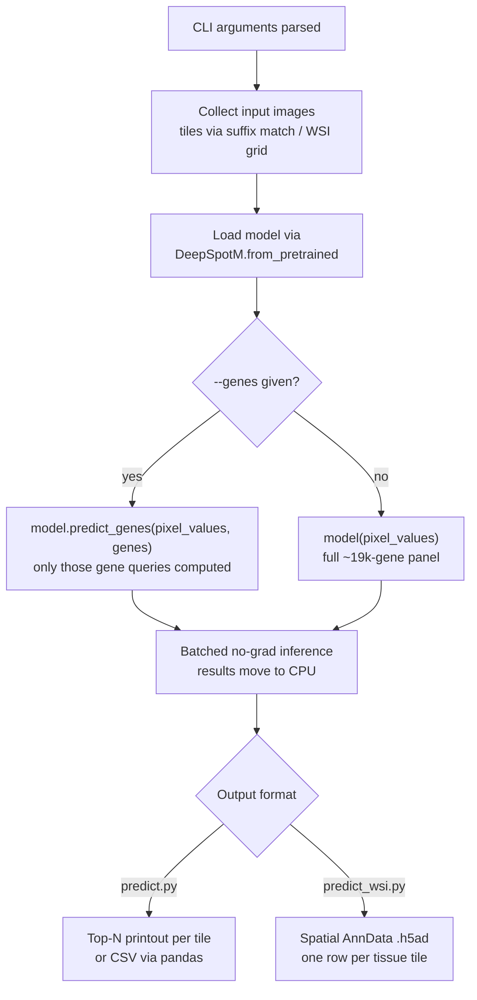
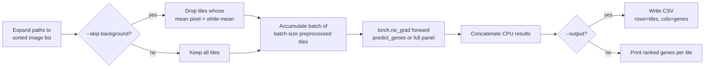
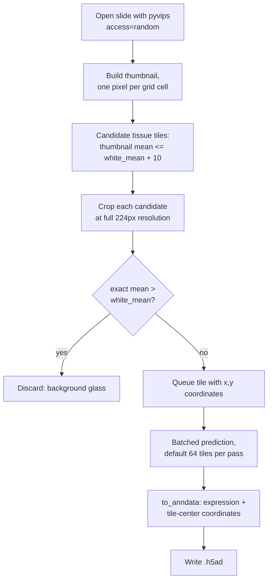

DeepSpot-M ships two ready-to-run prediction scripts under `examples/` that turn plain H&E histology images into predicted spatial gene expression — no Python coding required. `predict.py` scores pre-cut 224×224 image tiles, while `predict_wsi.py` takes an entire whole-slide image, tiles it for you, and writes results in a standard bioinformatics format. This page walks you through installing dependencies, choosing the right tool, understanding every command-line option, and interpreting the output.

## Two Tools, One Workflow

Both scripts are self-contained entry points built on the same underlying model. You never invoke them through a package command; you run them directly with `python examples/...` from the repository root. The key difference is the input scale: `predict.py` expects tiles already cut to 224×224 pixels, whereas `predict_wsi.py` accepts native whole-slide formats (`.svs`, `.ndpi`, `.mrxs`, and more) and performs the tiling itself on a 224-pixel grid at the slide's native (~20×) resolution.

| Aspect | `predict.py` | `predict_wsi.py` |
|---|---|---|
| Input | Single 224×224 tiles or folders of tiles | Whole-slide images (`.svs`, `.tif`, `.ndpi`, `.scn`, `.mrxs`, `.svslide`, `.bif`) |
| Tiling | You must cut tiles beforehand (any size is resized to 224×224) | Automatic, 224-px grid at native slide resolution |
| Extra dependencies | None beyond `deepspotm` | `pyvips` + `anndata` |
| Output | Ranked gene list printed to terminal, optional CSV | Spatial `.h5ad` AnnData per slide |
| Default batch size | 16 tiles | 64 tiles |
| Background filtering | Optional (`--skip-background` flag) | Always on (two-stage filter) |
| Typical use | Quick experiments on a handful of tiles | The standard "one slide in, virtual transcriptome out" workflow |


**Fig.** What happens inside each prediction: a 224×224 H&E tile is tokenized by a LoRA-adapted pathology backbone, and each gene query attends to the patch tokens through a cross-attention decoder to produce an expression value. The CLI tools are the thin user-facing wrapper around this process.

Sources: [predict.py](examples/predict.py#L1-L15), [predict_wsi.py](examples/predict_wsi.py#L1-L19), [README.md](README.md#L94-L121)

## Installation and Prerequisites

The core dependency installs with a single command and works on Python 3.10+:

```bash
pip install deepspotm
```

This is sufficient for `predict.py`. For `predict_wsi.py`, you additionally need `pyvips` (a fast image library backed by libvips) and `anndata` (the standard single-cell data format). There is a convenience extra:

```bash
pip install "deepspotm[wsi]"
```

If you want to run the scripts directly from a clone of this repository instead of the released package, install the development version with `pip install git+https://github.com/ratschlab/DeepSpotM.git`. Note that system-level libvips must be available for `pyvips` to import (e.g. `apt install libvips` on Debian/Ubuntu) — the script detects a missing dependency and prints a remediation hint rather than crashing with a traceback.

The relevant project layout is small: the two entry points live in `examples/`, while everything they import comes from the `src/deepspotm/` package.

```
examples/
├── predict.py          # CLI: pre-cut 224×224 tiles → terminal/CSV
└── predict_wsi.py      # CLI: whole slides → spatial .h5ad
src/deepspotm/
├── __init__.py         # exports DeepSpotM and helpers
├── model.py            # DeepSpotM class, from_pretrained(), predict_genes()
├── checkpoint.py       # checkpoint loading utilities
└── config.py           # locates the bundled gene vocabulary (tokens.csv)
```

Sources: [README.md](README.md#L60-L67), [predict_wsi.py](examples/predict_wsi.py#L170-L180), [config.py](src/deepspotm/config.py#L5-L18), [__init__.py](src/deepspotm/__init__.py#L1-L31)

## How Both Tools Work: The Shared Pipeline

Understanding one flow explains both tools. Internally they follow the same five-stage pipeline; only the first stage (input collection) and last stage (output formatting) differ. This is deliberate — the heavy lifting (model construction, weight loading, batching, inference) is identical code in both scripts.



Stage C deserves a closer look because it is where both tools get the model. `DeepSpotM.from_pretrained(repo, source=...)` accepts either a Hugging Face repo id or a local directory containing three files: `config.json` (saved hyperparameters), `model.safetensors` (the weights), and `tokens.csv` (the gene vocabulary). The vision backbone is built *offline* from bundled configuration — its weights come from the checkpoint, so no network access to the upstream backbone repository is needed. The call returns a tuple: the model already in eval mode with center-crop evaluation transforms, and an `image_processor` callable that turns PIL images into the tensor format the model expects.

> [!TIP]
> The `--source` flag selects which gene-embedding pathway the decoder uses (`evo2`, `orthrus`, `prott5`, `scgpt`, `apertus`). The published model is multi-source, so a source must always be active before inference — both CLIs default to `scgpt`, and if you build the model programmatically without specifying one, `from_pretrained` raises an error listing the available choices rather than guessing.

Sources: [predict.py](examples/predict.py#L148-L166), [predict_wsi.py](examples/predict_wsi.py#L200-L202), [model.py](src/deepspotm/model.py#L251-L331), [model.py](src/deepspotm/model.py#L318-L327)

## Predicting Pre-Cut Tiles with predict.py

`predict.py` is the fastest way to sanity-check the model. Point it at a single tile or a whole folder — folders are searched recursively by default, and any file with an image suffix (`.png`, `.jpg`, `.jpeg`, `.tif`, `.tiff`, `.bmp`, `.webp`) is picked up and deduplicated.

```bash
# one tile, print the 10 highest-expression genes
python examples/predict.py tile.png

# every tile in a folder, score three marker genes, write a CSV
python examples/predict.py tiles/ --genes EPCAM CD3D PTPRC --output preds.csv

# a different gene-embedding source, forced onto CPU
python examples/predict.py tile.png --source evo2 --device cpu
```

The step-by-step execution within the script looks like this:



Two behaviors matter for beginners. First, **without `--genes`** the script predicts the full panel and prints the `--top` highest-expression genes per tile, sorted descending — useful for exploring what a tile "looks like" molecularly. Second, **with `--genes`** the script calls `model.predict_genes()`, which maps your gene symbols to column indices and computes only those gene queries in the decoder. This is genuinely faster, not just cosmetic filtering: the cross-attention decoder builds fewer gene queries, so less compute happens per tile.

Sources: [predict.py](examples/predict.py#L8-L13), [predict.py](examples/predict.py#L101-L146), [predict.py](examples/predict.py#L180-L195), [model.py](src/deepspotm/model.py#L406-L420)

## Predicting Whole Slides with predict_wsi.py

This is the tool most users start from — the README's own recommendation. Give it a slide file or a folder of slides, and it produces one `.h5ad` per slide:

```bash
# one slide -> one .h5ad (full ~19k-gene panel)
python examples/predict_wsi.py slide.svs -o slide.h5ad

# a folder of slides -> one .h5ad each in out/, scoring three marker genes
python examples/predict_wsi.py slides/ -o out/ --genes BRAF CD37 COL1A1
```

The output behavior is filename-driven: if you pass exactly one slide and the `-o` argument ends in `.h5ad`, that exact filename is used; in any other case, `-o` is treated as a directory and each slide gets `<slide-name>.h5ad` inside it.

Whole-slide prediction introduces one genuinely clever piece of engineering: a **two-stage background filter**. Whole slides are mostly empty glass, and naively reading every 224×224 tile at full resolution would be slow. Instead, the script first builds a tiny one-pixel-per-tile thumbnail of the entire slide and flags candidate tissue tiles cheaply from that thumbnail; only flagged candidates are then cropped at full resolution and re-checked against the exact `--white-mean` threshold before being kept.



> [!TIP]
> The thumbnail filter intentionally uses a *looser* threshold (`white_mean + 10`) than the exact check, so no tissue tile is ever rejected in the cheap first pass — the strict `--white-mean` decision only happens at full resolution. If your slide comes back with zero tiles, the message tells you to *raise* `--white-mean` (e.g. to 230–240), because your tissue is darker than the default 220 cutoff allows.

Sources: [predict_wsi.py](examples/predict_wsi.py#L36-L64), [predict_wsi.py](examples/predict_wsi.py#L170-L195), [predict_wsi.py](examples/predict_wsi.py#L216-L220), [README.md](README.md#L94-L106)

## Shared Options Reference

Every option below works identically in both scripts (only the defaults for `--batch-size` differ, and `--top`/`--skip-background`/`--tile` are tool-specific). Run either script with `--help` for the inline reference including worked examples.

| Option | Default | What it does |
|---|---|---|
| `inputs` (positional) | required | One or more files/folders; folders are searched recursively by default |
| `--repo` | `ratschlab/DeepSpotM` | Hugging Face repo id **or** a local directory with `config.json` + `model.safetensors` + `tokens.csv` |
| `--source` | `scgpt` | Gene-embedding pathway: one of `evo2`, `orthrus`, `prott5`, `scgpt`, `apertus` |
| `--genes` | full panel | Score only these gene symbols; also faster (fewer decoder queries) |
| `--output` / `-o` | print to terminal (predict.py) / `.` (predict_wsi.py) | CSV file for tiles; `.h5ad` file or directory for slides |
| `--batch-size` | 16 / 64 | Tiles per forward pass — raise on GPUs with ample memory |
| `--white-mean` | `220.0` | Mean-pixel value above which a tile counts as background |
| `--skip-background` | off (predict.py only) | Apply the background filter to tile folders |
| `--tile` | `224` | Grid size in pixels (predict_wsi.py only) |
| `--top` | `10` | How many top genes to print per tile (predict.py only, ignored with `--genes`) |
| `--no-recursive` | off | Don't descend into sub-folders |
| `--device` | `cuda` if available, else `cpu` | Force `cuda` or `cpu` |

Sources: [predict.py](examples/predict.py#L41-L99), [predict_wsi.py](examples/predict_wsi.py#L126-L168)

## Understanding the Output

All predicted values are in **log1p-CPM** units — the log of counts-per-million plus one, the same scale used by the published TCGA virtual spatial transcriptomics atlas. Higher values mean more expressed; the scale is comparable across tiles and directly compatible with downstream scanpy/squidpy analyses.

The mapping from output columns to gene names is strictly ordered. When you omit `--genes`, output column `i` corresponds to `model.gene_names[i]` — the ~19k-gene panel loaded from `tokens.csv`. When you pass `--genes EPCAM CD3D PTPRC`, the output columns follow exactly the order you typed. The `.h5ad` output encodes everything a spatial analysis needs: `X` holds the expression matrix, `adata.obsm["spatial"]` holds tile-center pixel coordinates in the standard squidpy/scanpy convention, `obs` rows are named `<slide>_<x>_<y>`, and `adata.uns["deepspotm"]` records provenance (slide name, tile size, embedding source, and the expression unit).

| Consumer | Format | Columns / fields |
|---|---|---|
| Terminal (predict.py, no `--genes`) | Ranked list | Top-N gene names + values per tile |
| Terminal (predict.py, with `--genes`) | Inline scores | `gene=value` pairs in your given order |
| CSV (predict.py, `--output`) | pandas DataFrame | rows = tile filenames, columns = genes, index named `tile` |
| AnnData (predict_wsi.py) | `.h5ad` | `X` (log1p-CPM), `obsm["spatial"]`, `obs`, `var`, `uns["deepspotm"]` |

Sources: [predict.py](examples/predict.py#L182-L203), [predict_wsi.py](examples/predict_wsi.py#L106-L124), [model.py](src/deepspotm/model.py#L67-L70), [README.md](README.md#L85-L92)

## Troubleshooting and Exit Codes

Both scripts are designed to fail loudly but gracefully: they catch expected problems, print a one-line `error:` message to stderr, and return exit code 1 (0 on success). This makes them safe to embed in pipelines. The most common beginner pitfalls are already anticipated by the scripts' own error messages:

| Symptom | Cause | Fix |
|---|---|---|
| `error: unknown gene symbol(s): ...` | A `--genes` symbol isn't in the model's panel; validated against `tokens.csv` | Check spelling; list valid names via `model.gene_names` |
| `error: every tile was filtered as background` (predict.py) | `--white-mean` too low for pale scans, or folder genuinely empty | Lower the threshold or drop `--skip-background` |
| `skipped: no tissue tiles found` (predict_wsi.py) | Threshold rejects all tiles | *Raise* `--white-mean` (default 220) so darker tissue passes |
| `ImportError: pyvips / anndata` (predict_wsi.py) | WSI extras not installed | `pip install "deepspotm[wsi]"` and ensure libvips is on the system |
| No image files found | Extension not in the supported set, or `--no-recursive` hid files in sub-folders | Check suffixes; re-enable recursion |

Note the per-slide behavior of `predict_wsi.py`: an unknown gene or an all-background slide skips *that* slide, sets the final exit code to 1, and continues with the remaining slides — a folder of 50 slides with one bad file still produces 49 outputs.

Sources: [predict.py](examples/predict.py#L151-L155), [predict.py](examples/predict.py#L172-L179), [predict_wsi.py](examples/predict_wsi.py#L170-L195), [predict_wsi.py](examples/predict_wsi.py#L204-L226), [model.py](src/deepspotm/model.py#L393-L404)

## Where to Go Next

Once your first predictions run, the natural progression is:

- **See it end-to-end with visuals** — the [TCGA-SKCM Tutorial Notebook](4-tcga-skcm-tutorial-notebook) downloads a real whole-slide image, runs the same pipeline, and overlays predicted gene expression on the tissue.
- **Understand what the model is doing** — the [Architecture Overview](6-architecture-overview) explains the vision encoder and cross-attention decoder behind every prediction you just made, with the [Cross-Attention Gene Decoder](9-cross-attention-gene-decoder) covering why `--genes` is faster.
- **Go deeper on the machinery you just used** — [Pretrained Model Loading](13-pretrained-model-loading) dissects `from_pretrained`, [Gene Vocabulary and Output Mapping](12-gene-vocabulary-and-output-mapping) explains the `gene_names` column ordering, and [Selective Gene Prediction](16-selective-gene-prediction) covers the `predict_genes` path in detail.
- **Master the WSI pipeline** — [Whole-Slide Image Pipeline](17-whole-slide-image-pipeline) expands on the tiling and background filtering you saw here.

If you haven't installed the package yet, start with [Quick Start](2-quick-start).
