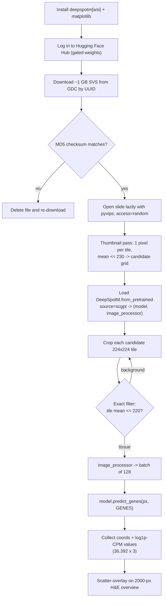
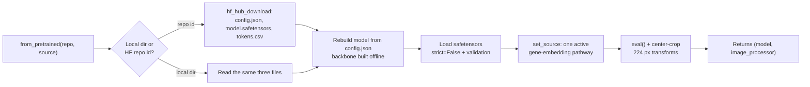

This page documents `examples/predict_tcga_skcm.ipynb`, the repository's hands-on walkthrough for running **DeepSpot-M end to end on a real whole-slide H&E image**. In five notebook cells you download an open-access melanoma slide from the TCGA portal, tile it into model-sized patches, predict three marker genes per tile in zero-shot mode, and render atlas-style spatial expression maps — exactly the workflow behind the published TCGA virtual spatial transcriptomics atlas.

Sources: [predict_tcga_skcm.ipynb](examples/predict_tcga_skcm.ipynb#L4-L46)

## What the Notebook Demonstrates

The tutorial operates on one open-access **TCGA-SKCM (skin cutaneous melanoma)** slide, `TCGA-D9-A3Z3-06Z-00-DX1`, and predicts three marker genes chosen to reveal the three tissue compartments a pathologist looks for:

| Gene | Marks |
|------|-------|
| BRAF | melanoma driver oncogene, tumour |
| CD37 | lymphocyte marker, tumour-infiltrating immune cells |
| COL1A1 | collagen gene, stroma |

The slide gives a concrete sense of scale: **99,960 × 65,991 pixels**, which becomes a 446 × 294 tile grid. A fast thumbnail pass nominates 45,751 candidate tissue tiles; the exact background filter keeps 36,392, and only those are scored by the model. One important caveat the notebook states up front: the published melanoma atlas used a model *finetuned* on melanoma spatial transcriptomics, while this tutorial uses the **base released model in zero-shot mode**, so the resulting maps are illustrative and softer than the atlas figures.

Sources: [predict_tcga_skcm.ipynb](examples/predict_tcga_skcm.ipynb#L4-L46)

Under the hood, DeepSpot-M tokenises each 224×224 H&E tile with a LoRA-adapted pathology vision foundation model, and each gene queries the patch tokens through a cross-attention gene decoder. Because genes are *queryable embeddings* rather than fixed output heads, one model covers the transcriptome — including genes it never saw during training.


The complete tutorial pipeline is:



Sources: [predict_tcga_skcm.ipynb](examples/predict_tcga_skcm.ipynb#L4-L46), [model.py](src/deepspotm/model.py#L407-L421)

## Prerequisites and Setup

The notebook's first markdown cell gives the full environment contract: install `pip install "deepspotm[wsi]" matplotlib`, where the `wsi` extra pulls in the whole-slide imaging stack defined in the package metadata. `pyvips` additionally needs the **system** `libvips` library built with OpenSlide support, and a **GPU is recommended** because the model processes tens of thousands of tiles.

Sources: [predict_tcga_skcm.ipynb](examples/predict_tcga_skcm.ipynb#L4-L46), [pyproject.toml](pyproject.toml#L58-L63)

| Package | Constraint | Role in this tutorial |
|---------|------------|----------------------|
| pyvips | >=2.2 | Lazy, random-access reading of the pyramidal `.svs` slide |
| anndata | >=0.10 | AnnData I/O for the broader WSI pipeline (shipped with the extra) |
| matplotlib | unpinned | Rendering the four-panel expression maps |

The model weights are **gated on the Hugging Face Hub**, so you must request access to `ratschlab/DeepSpotM` and authenticate once with `huggingface-cli login` before `from_pretrained` can download anything.

Sources: [predict_tcga_skcm.ipynb](examples/predict_tcga_skcm.ipynb#L4-L46), [pyproject.toml](pyproject.toml#L58-L63)

> [!TIP]
> Import order matters: the notebook imports `pyvips` **before** `torch` in its first code cell, because libvips/glib initialisation can fail if torch loads first. Preserve this ordering if you refactor the cells.

The setup cell then pins the tutorial's tunable constants in one place, making the experiment easy to adapt:

| Constant | Value | Purpose |
|----------|-------|---------|
| `GENES` | `["BRAF", "CD37", "COL1A1"]` | Marker genes scored per tile |
| `TILE` | `224` | Model input tile size in pixels |
| `WHITE_MEAN` | `220` | Exact background threshold (mean pixel value) |
| `BATCH` | `128` | Tiles per forward pass |
| `DEVICE` | `cuda` if available, else `cpu` | Compute device, printed at startup |

Sources: [predict_tcga_skcm.ipynb](examples/predict_tcga_skcm.ipynb#L63-L77)

## Step 1 — Download and Verify the Slide

The slide is fetched from the **GDC Data Portal** by file UUID without any authentication token, saved as `TCGA-D9-A3Z3-06Z-00-DX1.svs`, and skipped if already present so the cell is idempotent. Integrity is enforced via a hard-coded MD5 (`2fae5ac0b57505fb704efaa0d950846b`). Notably, the checksum is computed by hashing the file in **8 MB chunks** rather than loading the whole ~1 GB slide into memory — the notebook explicitly notes that reading it fully into RAM would spike memory more than the model itself uses. This is a pattern worth copying for any large-file verification step.

Sources: [predict_tcga_skcm.ipynb](examples/predict_tcga_skcm.ipynb#L105-L123)

## Step 2 — Locate Tissue Tiles

An `.svs` file is a **pyramidal** whole-slide image, so the notebook opens it lazily with `pyvips.Image.new_from_file(..., access="random")` and never materialises the full resolution array. Tissue detection is deliberately two-stage:

1. **Thumbnail pass (cheap, approximate).** A thumbnail with one pixel per tile is resized to the exact grid shape; tiles whose thumbnail mean is `<= WHITE_MEAN + 10` become candidates. The +10 margin keeps the pass loose.
2. **Exact pass (per tile).** Each candidate tile is cropped at full resolution via a small `read_tile(x, y)` helper, and the precise `mean > 220` filter is applied only then.

Sources: [predict_tcga_skcm.ipynb](examples/predict_tcga_skcm.ipynb#L131-L175)

> [!TIP]
> The two-stage filter exists to avoid paying full-resolution crop costs for obvious background: 45,751 candidates enter the loop but only 36,392 survive the exact check. If you retune `WHITE_MEAN`, remember the thumbnail pass uses `WHITE_MEAN + 10`, so the two thresholds drift together.

## Step 3 — Load the Pretrained Model

A single call loads everything the tutorial needs:

```python
model, image_processor = DeepSpotM.from_pretrained("ratschlab/DeepSpotM", source="scgpt")
model = model.to(DEVICE).eval()
assert all(g in set(model.gene_names) for g in GENES)
```

The `source="scgpt"` argument selects the gene-embedding pathway used by the decoder (`scgpt` is the package default, alongside `evo2`, `orthrus`, `prott5`, `apertus`). Internally, `from_pretrained` fetches three files from the Hub — `config.json` (hyper-parameters including `bio_dims`), `model.safetensors` (vision backbone + LoRA adapters + gene decoder), and `tokens.csv` (the gene vocabulary) — rebuilds the architecture offline (the upstream backbone weights come from the checkpoint, not from the backbone's own repo), loads the weights with validation, activates the chosen source, and switches the image transforms to **center-crop eval transforms at 224 px** before returning the `(model, image_processor)` pair.



Sources: [predict_tcga_skcm.ipynb](examples/predict_tcga_skcm.ipynb#L202-L204), [model.py](src/deepspotm/model.py#L255-L320), [image_encoder.py](src/deepspotm/image_encoder.py#L53-L58)

The final `assert` is the notebook's safety net: `model.gene_names` is the **ordered vocabulary** where output column *i* of the decoder corresponds to `gene_names[i]`, and the assertion fails fast if any of the three marker genes is absent from the panel before 36k tiles are wasted on a doomed run.

Sources: [predict_tcga_skcm.ipynb](examples/predict_tcga_skcm.ipynb#L202-L204), [model.py](src/deepspotm/model.py#L83-L90)

## Step 4 — Predict Gene Expression Tile by Tile

The prediction loop streams tiles through the model in batches of 128 and never holds the whole slide in memory. For each kept tile, the PIL image is passed through `image_processor` (the backbone's 224 px eval transform), stacked into a `(B, 3, 224, 224)` tensor, moved to the GPU, and scored with:

```python
with torch.no_grad():
    out = model.predict_genes(px, GENES).float().cpu().numpy()
```

The helper accumulates `(x, y)` coordinates alongside expression rows in lockstep, so after the loop `coords` and the concatenated `(36392, 3)` expression matrix are index-aligned — this alignment is exactly what the overlay step depends on. Values live in **log1p-CPM space**: higher means more expressed.

Sources: [predict_tcga_skcm.ipynb](examples/predict_tcga_skcm.ipynb#L202-L231)

The reason this is affordable is `predict_genes` itself. It maps gene symbols to decoder indices via `genes_to_indices` (raising a `KeyError` that lists any unknown symbols), then runs the cross-attention decoder over **only those gene queries** — asking for 3 genes is dramatically cheaper than the full panel of roughly 19k. The method also carries a built-in `@torch.no_grad()` decorator, so prediction calls are gradient-free even if you forget the context manager:

| Aspect | Full-panel forward | Selective `predict_genes` |
|--------|--------------------|---------------------------|
| Call | `out, _, _ = model(pixel_values)` | `out = model.predict_genes(pixel_values, GENES)` |
| Genes computed | Entire panel (~19k gene queries) | Only the requested gene queries |
| Output shape | `(B, n_genes)` | `(B, len(GENES))`, columns in `GENES` order |
| Unknown symbol handling | Silent index errors possible | `KeyError` naming the offending symbols |
| Gradient guard | Caller must wrap `torch.no_grad()` | Built-in `@torch.no_grad()` |
| Typical use | Top-N expression ranking, CSV dumps | Targeted marker panels, WSI sweeps |

Sources: [model.py](src/deepspotm/model.py#L407-L421), [model.py](src/deepspotm/model.py#L390-L405), [predict.py](examples/predict.py#L98-L140)

## Step 5 — Render the Spatial Expression Maps

The final cell produces the figure that motivates the whole tutorial. A 2000-pixel overview thumbnail of the slide provides the H&E backdrop; each scored tile is drawn at its **centre** (top-left coordinate + `TILE / 2`, scaled by the thumbnail factors `sx, sy`) with `matplotlib` scatter coloured by predicted expression (`cmap="viridis"`). The result is a four-panel figure — raw H&E plus one map per gene — titled "DeepSpot-M predicted expression, TCGA-D9-A3Z3 (SKCM)". The expected biology: **BRAF** lights up the tumour, **CD37** the immune infiltrate, and **COL1A1** the stroma, reproducing the three-compartment picture shown in the atlas.

Sources: [predict_tcga_skcm.ipynb](examples/predict_tcga_skcm.ipynb#L260-L279)

## Notebook vs. Command-Line Prediction

The repository ships a second entry point, `examples/predict.py`, which shares the same model APIs but targets a different workflow. Use this table to pick the right tool:

| Dimension | `predict_tcga_skcm.ipynb` (this tutorial) | `predict.py` (CLI) |
|-----------|-------------------------------------------|---------------------|
| Input | One whole-slide `.svs`, downloaded from GDC | Tile images or folders (PNG/JPG/TIFF/BMP/WEBP) |
| Scope | End-to-end: download → tile → predict → visualise | Prediction only, on images you already have |
| Dependencies | `deepspotm[wsi]` (pyvips) + matplotlib | Base install (Pillow suffices) |
| Gene selection | `GENES` list via `predict_genes` | `--genes`, or full panel with top-N printing |
| Background filter | Thumbnail pass + exact per-tile mean filter | Opt-in `--skip-background` with `--white-mean` |
| Batch size | 128 | 16 by default (`--batch-size`) |
| Output | Matplotlib spatial maps in-notebook | Stdout ranking and/or CSV via `--output` |
| Device | Auto `cuda`/`cpu` | `--device` override supported |

Sources: [predict.py](examples/predict.py#L1-L29), [predict.py](examples/predict.py#L31-L95)

## Troubleshooting

The notebook and the CLI both fail loudly at well-defined points. Match your symptom to the fix:

| Symptom | Root cause | Fix |
|---------|------------|-----|
| `AssertionError: checksum mismatch: ...` | Interrupted or corrupted ~1 GB download | Delete the `.svs` and re-run the download cell |
| `KeyError: N gene(s) not in the model panel` | Symbol absent from `tokens.csv` vocabulary | Check spelling; verify against `model.gene_names` first |
| `kept tissue tiles: 0` | Threshold too strict for the slide region | Raise `WHITE_MEAN` or inspect the thumbnail pass output |
| 401/403 errors from Hugging Face | Gated weights, not authenticated | Request access to the model repo, then `huggingface-cli login` |
| libvips/OpenSlide load failure | System library missing or built without OpenSlide | Install libvips with OpenSlide support (required by the `wsi` extra) |
| GLib initialisation crash at import | `torch` imported before `pyvips` | Keep the notebook's import order: pyvips first |

Sources: [predict_tcga_skcm.ipynb](examples/predict_tcga_skcm.ipynb#L105-L123), [model.py](src/deepspotm/model.py#L390-L405), [pyproject.toml](pyproject.toml#L58-L63)

## Where to Go Next

This notebook is the fourth stop in the Get Started track. A logical progression: run [Quick Start](2-quick-start) first if you haven't installed the package, then compare the tile-level workflow with [Command-Line Prediction Tools](3-command-line-prediction-tools). After finishing here, [Atlas and Dataset Access](5-atlas-and-dataset-access) explains where the finetuned atlas predictions (and the data behind them) live. To understand *why* `predict_genes` is cheap and how genes became queryable, continue into the Deep Dive with [Architecture Overview](6-architecture-overview), then [Selective Gene Prediction](16-selective-gene-prediction) and [Pretrained Model Loading](13-pretrained-model-loading) for the loading internals summarised above, and finally [Whole-Slide Image Pipeline](17-whole-slide-image-pipeline) for the production-grade version of the tiling and AnnData export shown here in tutorial form.
