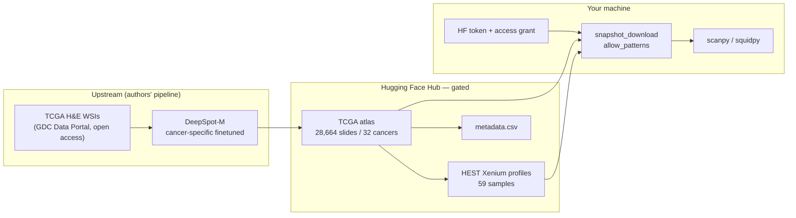
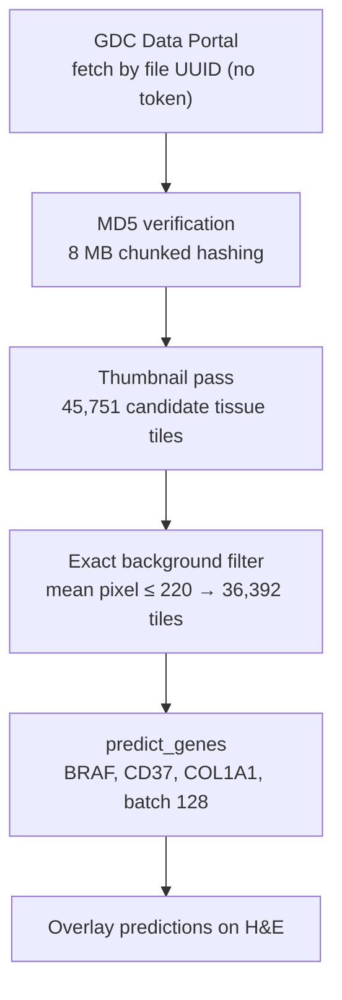

DeepSpot-M ships not only a model but also the transcriptome-scale predictions it produced. This page covers the two released prediction resources — the **TCGA virtual spatial transcriptomics atlas** and the **HEST Xenium virtual single-cell profiles** — their gated access workflow on the Hugging Face Hub, the on-disk AnnData schema, the provenance of the predictions, and how to generate atlas-compatible data from your own slides. Everything here is data access and provenance; model internals are deferred to [Architecture Overview](6-architecture-overview).

## The Released Datasets at a Glance

The project distributes two prediction resources, both hosted as gated Hugging Face datasets. The TCGA atlas is the pan-cancer bulk resource, while the HEST release extends the same prediction machinery to single-cell-resolution Xenium assays on 59 public HEST-1K samples.

| Property | TCGA Virtual Atlas | HEST Xenium Profiles |
|---|---|---|
| Hub repo id | `ratschlab/TCGA_virtual_spatial_transcriptomics_atlas` | `ratschlab/HEST_Xenium_virtual_spatial_transcriptomics` |
| Scale | 28,664 whole-slide images, 32 cancer types | 59 HEST-1K samples |
| Spots | 295.3 million spots from 10,865 patients | Single-cell resolution profiles |
| Payload | Predicted log1p-CPM expression over the full transcriptome per spot | Virtual single-cell Xenium profiles |
| Layout | `data/<cancer>/<FF\|FFPE>/<slide_id>.h5ad.gz` + `metadata.csv` | Per-sample profiles (see dataset card) |
| Access | Gated — request access + HF login | Hosted on the Hub alongside the atlas |

Sources: [README.md](README.md#L137-L171), [README.md](README.md#L173-L178)

## End-to-End Data Flow

The atlas is the result of applying DeepSpot-M — with cancer-specific finetuning — to open-access TCGA slides sourced from the GDC Data Portal, then publishing the per-spot predictions as compressed AnnData files on a gated Hub dataset. Your access path never touches the model: you authenticate once, then stream selected subsets with `snapshot_download` into scanpy/squidpy-ready files. A second path exists for producing identically formatted data from your own slides via the WSI example script.



The HEST branch in the diagram reflects that the Xenium release derives from the same prediction machinery rather than being a subset of the TCGA files — it is a separate Hub repo you download independently.

Sources: [README.md](README.md#L137-L171), [CITATION.cff](CITATION.cff#L4-L14)

## Gated Access: Authentication and Selective Download

The TCGA atlas is **gated**: before any download works you must request access on the dataset page, create an HF token, and authenticate. The README's canonical access pattern uses `huggingface_hub`'s `login` plus `snapshot_download` with `allow_patterns` to fetch only what you need — the full atlas is explicitly flagged as large, so selective patterns are the recommended default.

```python
from huggingface_hub import login, snapshot_download
login(token="YOUR_HF_TOKEN")

repo = "ratschlab/TCGA_virtual_spatial_transcriptomics_atlas"
snapshot_download(repo, repo_type="dataset", local_dir="TCGA_data",
                  allow_patterns="data/TCGA_SKCM/*")
```

The repository path structure makes pattern-based subsetting precise:

| Strategy | `allow_patterns` | What you get |
|---|---|---|
| One cancer cohort | `data/TCGA_SKCM/*` | All melanoma slides, both FF and FFPE |
| One preservation type, all cancers | `data/*/FFPE/*` | Every FFPE slide across all 32 cancer types |
| Fresh-frozen only | `data/*/FF/*` | Every fresh-frozen slide |
| Full atlas | *(no pattern)* | Everything — described as "large" |

Sources: [README.md](README.md#L149-L167)

## On-Disk Schema of the Atlas

Each sample is a **gzip-compressed AnnData** file following the pattern `data/<cancer>/<FF|FFPE>/<slide_id>.h5ad.gz`. The expression matrix `X` holds predicted **log1p-CPM** values over the full transcriptome, and a single top-level `metadata.csv` indexes every sample with its cancer type, slide type, and spot count. This mirrors the ~19k-gene panel the model emits, ordered by `model.gene_names` (see [Gene Vocabulary and Output Mapping](12-gene-vocabulary-and-output-mapping)).

| Schema element | Location | Content |
|---|---|---|
| Per-slide predictions | `data/<cancer>/<FF\|FFPE>/<slide_id>.h5ad.gz` | Compressed AnnData, one entry per spot |
| Expression matrix | `X` in each `.h5ad.gz` | Predicted log1p-CPM, full transcriptome (~19k genes) |
| Cohort index | `metadata.csv` | Cancer type, slide type (FF/FFPE), spot count per sample |
| Overlay example | Dataset card | Loading a sample and overlaying predicted genes on the H&E |

Sources: [README.md](README.md#L144-L149), [README.md](README.md#L169-L171)

> [!TIP]
> The `metadata.csv` index is your query layer for cohort construction — filter it locally by cancer type and slide type first, then translate the survivors into precise `allow_patterns` so you never download slides you will discard.

## Provenance: Finetuned Atlas vs Zero-Shot Tutorial

A critical caveat when comparing atlas files against your own predictions: the published atlas predictions for the **trained cancer types** (melanoma among them) were produced with **cancer-specific finetuned models**, while the tutorial notebook uses the base released model in **zero-shot mode** — so tutorial-derived maps look softer than the corresponding atlas. The tutorial deliberately reproduces the atlas example figure (BRAF tumour / CD37 immune infiltrate / COL1A1 stroma on slide `TCGA-D9-A3Z3-06Z-00-DX1`) to make this difference directly visible.

Sources: [README.md](README.md#L125-L135), [examples/predict_tcga_skcm.ipynb](examples/predict_tcga_skcm.ipynb#L20-L46)

## Fetching Upstream Slides from the GDC

When you want to regenerate or extend atlas-style predictions, the raw slides come from the **GDC Data Portal**, where the example slide is open-access and fetchable **by file UUID without a token**. The tutorial pairs each UUID with an MD5 checksum, hashing in 8 MB chunks so verifying a ~1 GB slide never spikes memory. For scale orientation: this slide is 99,960 × 65,991 px, yielding 45,751 candidate tiles from the thumbnail pass, of which 36,392 survive the exact background filter.



Sources: [examples/predict_tcga_skcm.ipynb](examples/predict_tcga_skcm.ipynb#L84-L123), [examples/predict_tcga_skcm.ipynb](examples/predict_tcga_skcm.ipynb#L29-L40)

## Generating Atlas-Compatible Data Yourself

The cleanest way to produce data in the atlas format is [`examples/predict_wsi.py`](examples/predict_wsi.py), which reads a slide, tiles it on a 224-px grid at native (~20x) resolution, drops background, predicts per tile, and writes a spatial AnnData — **the same format as the TCGA atlas**, ready for scanpy/squidpy. The provenance you would otherwise have to reconstruct is embedded directly in the output file.

| AnnData field | Written by `to_anndata` | Meaning |
|---|---|---|
| `X` | Predicted expression, float32 | log1p-CPM, full ~19k panel or `--genes` subset |
| `obs` | `x`, `y` columns | Tile origin pixel coordinates |
| `var` | Gene symbols | Panel ordered as `model.gene_names` |
| `obsm["spatial"]` | Tile centers | squidpy/scanpy spatial convention |
| `uns["deepspotm"]` | `slide`, `tile_px`, `source`, `expression="log1p-CPM"` | Full provenance record |

This symmetry is what makes the tutorial's overlay workflow applicable verbatim to atlas files or to your own outputs: both are ordinary AnnData with `obsm["spatial"]` coordinates.

Sources: [examples/predict_wsi.py](examples/predict_wsi.py#L1-L18), [examples/predict_wsi.py](examples/predict_wsi.py#L128-L146), [README.md](README.md#L99-L105)

## Licensing Constraints for Dataset Use

The project uses a **split license**: code under PolyForm Noncommercial 1.0.0, model weights under CC-BY-NC-SA-4.0. Because the atlas content consists of model outputs from those weights, the NonCommercial and ShareAlike obligations extend to what you build from it: attribution with citation of the paper, no commercial use of weights or their outputs, and ShareAlike terms if you transform or build upon them. The released work is explicitly research use only, not for clinical or diagnostic use; the backbone and gene-embedding sources are separately MIT or Apache-2.0 (see [Licensing and Research Use](20-licensing-and-research-use)).

Sources: [WEIGHTS_LICENSE.md](WEIGHTS_LICENSE.md#L1-L20), [README.md](README.md#L180-L189)

## Where This Fits in the Repository

The files relevant to dataset access concentrate in a few places — the two example scripts and notebook are the reference implementations for both consuming and producing atlas-format data:

```
examples/
├── predict_wsi.py            # slide → atlas-format .h5ad (producer)
├── predict_tcga_skcm.ipynb   # GDC slide → overlay figure (consumer workflow)
└── predict.py                # pre-cut 224x224 tiles → CSV / top genes
README.md                     # § TCGA virtual spatial transcriptomics atlas (access recipes)
WEIGHTS_LICENSE.md            # CC-BY-NC-SA-4.0 obligations on derived data
```


The figure above summarizes the model whose predictions populate the atlas — the cross-attention gene decoder and gene router hypernetwork shown here are detailed in [Cross-Attention Gene Decoder](9-cross-attention-gene-decoder) and [Gene Router Hypernetwork](10-gene-router-hypernetwork).

## Where to Go Next

If you came here after running the notebook, the natural continuation is to turn the same workflow loose on your own slides with [Command-Line Prediction Tools](3-command-line-prediction-tools) and understand the tiling machinery in [Whole-Slide Image Pipeline](17-whole-slide-image-pipeline). To control which genes your own atlas runs compute — and why the tutorial's three-gene queries are cheap — read [Selective Gene Prediction](16-selective-gene-prediction). For the full obligations attached to the data you just downloaded, continue to [Licensing and Research Use](20-licensing-and-research-use).