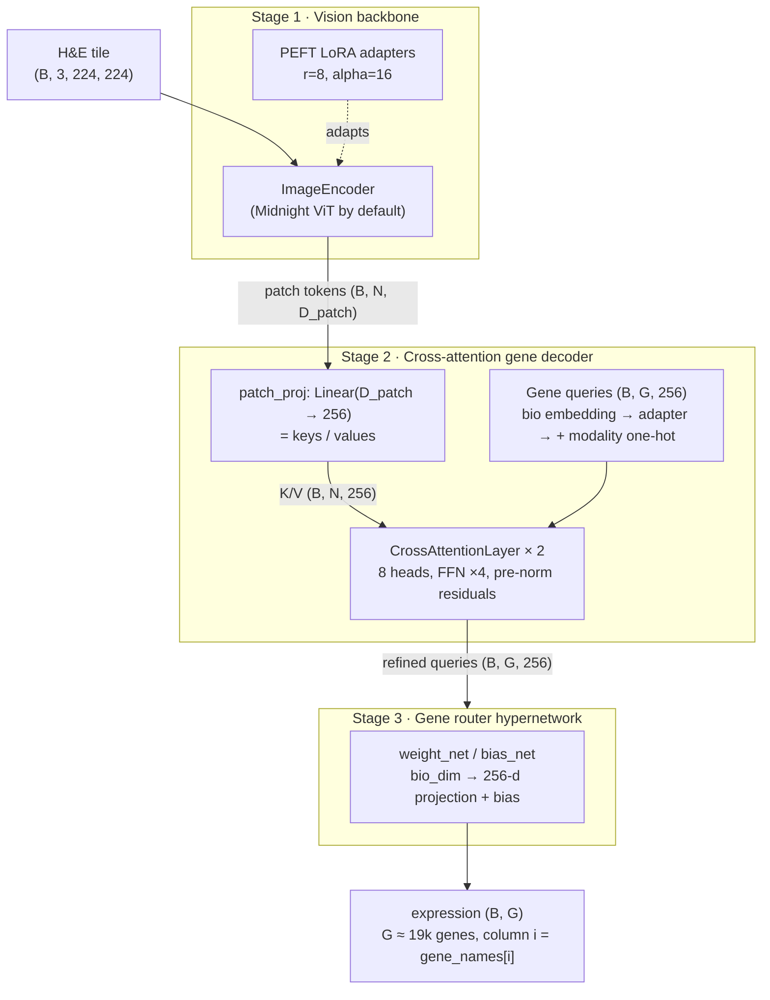

DeepSpot-M is a multimodal foundation model that maps a 224×224 H&E histology tile to transcriptome-wide spatial gene expression. This page gives you the system-level view: how the three architectural stages (vision encoding → cross-attention decoding → hypernetwork projection) compose into a single forward pass, which module owns which responsibility, and the design principles that make every component an ablation switch. Component internals (per-encoder details, LoRA mechanics, decoder math) live in the dedicated Deep Dive pages; this page stops at the boundaries between them.

## The Model in One Data Flow

The published model figure captures the complete forward path: a LoRA-adapted pathology backbone tokenizes the tile into spatial patch embeddings, gene queries attend to those patches through cross-attention, and a hypernetwork converts refined queries into per-gene expression values. Because genes are represented as *queryable embeddings* rather than fixed output columns, the same network predicts the full ~19k-gene panel and genes it never saw during training (zero-shot).


Fig. DeepSpot-M predicts transcriptome-wide spatial gene expression from histology [README](README.md#L29-L44)

The code-level data flow follows the same shape. Patch tokens are extracted from the backbone (bypassing CLS pooling), projected into a shared 256-d space to form the cross-attention keys/values, gene queries derived from biological embeddings form the queries, two cross-attention layers refine them, and a per-gene hypernetwork produces the final `(B, G)` expression vector:



The three stages map one-to-one onto the library's top-level components: `ImageEncoder` (with its PEFT LoRA wrapper), `CrossAttentionGeneDecoder`, and `GeneRouter`, all orchestrated by the `DeepSpotM` LightningModule.

Sources: [README.md](README.md#L29-L44), [model.py](src/deepspotm/model.py#L369-L384), [modules.py](src/deepspotm/modules.py#L713-L790)

## Module Map: Who Owns What

The repository is deliberately flat — eight source files under `src/deepspotm/`, each with a single architectural concern. Reading the file list is nearly reading the architecture:

```
src/deepspotm/
├── model.py           # DeepSpotM: orchestration, forward, source dispatch, loading
├── image_encoder.py   # ImageEncoder contract + 7-backbone registry
├── modules.py         # decoder, router, multi-source embeddings, vocabulary
├── checkpoint.py      # state-dict filtering & inference-time reconstruction
├── config.py          # bundled asset paths (tokens.csv, midnight_config.json)
├── utils.py           # image transforms (get_eval_transforms, normalize params)
└── assets/            # gene-embedding priors, tokens.csv, backbone configs
```

| Layer | Class(es) | File | Responsibility |
|---|---|---|---|
| Orchestration | `DeepSpotM` | [model.py](src/deepspotm/model.py#L11-L37) | Wires backbone + decoder; exposes `forward`, `predict_genes`, `set_source`, `from_pretrained` |
| Vision | `ImageEncoder` + 7 concrete encoders | [image_encoder.py](src/deepspotm/image_encoder.py#L24-L81) | Patch-token extraction behind a uniform contract |
| Gene queries | `MultiSourceGeneEmbedding` | [modules.py](src/deepspotm/modules.py#L148-L181) | Per-source bio embedding + adapter + modality encoding, runtime source dispatch |
| Decoding | `CrossAttentionGeneDecoder`, `CrossAttentionLayer` | [modules.py](src/deepspotm/modules.py#L473-L520) | Gene-queries-attend-to-patches refinement |
| Output head | `GeneRouter` (hypernetwork) | [modules.py](src/deepspotm/modules.py#L110-L145) | Per-gene projection weights → expression |
| Vocabulary | `StructureExpression` | [modules.py](src/deepspotm/modules.py#L17-L39) | Ordered gene panel from `tokens.csv`; label mapping |
| Persistence | `load_for_prediction`, state-dict filters | [checkpoint.py](src/deepspotm/checkpoint.py#L84-L131) | Cross-vocab and multi-source checkpoint reconstruction |

Sources: [model.py](src/deepspotm/model.py#L11-L37), [image_encoder.py](src/deepspotm/image_encoder.py#L24-L81), [modules.py](src/deepspotm/modules.py#L473-L520), [checkpoint.py](src/deepspotm/checkpoint.py#L84-L131)

## The Vision Stage: A Registry of Interchangeable Backbones

Every vision backbone in the codebase inherits from one abstract `ImageEncoder` class that fixes the contract the rest of the architecture depends on. The contract has four members: `forward_patch_tokens()` returns spatial tokens `(B, N, D)` with CLS/register prefixes stripped (with generic handling for timm and HuggingFace model families), the `patch_dim` property reports per-token dimensionality (which the decoder consumes to size its projection), `LORA_TARGET_MODULES` declares which linear layers LoRA should attach to, and `NORM_MEAN`/`NORM_STD` drive the paired image transforms.

Sources: [image_encoder.py](src/deepspotm/image_encoder.py#L24-L81)

Concrete backbones are registered in a name → class dict and built through a `build_encoder(name)` factory, so swapping the vision stage is a single string change (`encoder_model="MidnightEncoder"`). The shipped registry spans seven pathology-relevant encoders:

| Registry key | Source model | Patch dim | Pooled hidden dim | Default? |
|---|---|---|---|---|
| `MidnightEncoder` | kaiko-ai/midnight (HF AutoModel) | 1536 | 3072 (CLS + mean patch) | ✅ default |
| `UNI1Encoder` | MahmoodLab/UNI (ViT-L/16) | 1024 | 1024 (CLS) | — |
| `UNI2Encoder` | MahmoodLab/UNI2-h (ViT-G/14 + SwiGLU) | 1536 | 1536 (CLS) | — |
| `H0Encoder` / `H1Encoder` | H-optimus-0 / -1 (ViT-G/14 reg4) | 1536 | 1536 (CLS) | — |
| `H0miniEncoder` | bioptimus/H0-mini (CLS + mean patch) | 768 | 1536 | — |
| `ImageCLIPEncoder` | CLIP vision tower + projection | 768 | 512 | — |

Sources: [image_encoder.py](src/deepspotm/image_encoder.py#L348-L366), [image_encoder.py](src/deepspotm/image_encoder.py#L315-L343)

The default backbone deserves one architectural note: `MidnightEncoder` has a **three-way construction mode**. With `pretrained=True` it downloads upstream kaiko-ai/midnight weights; with `pretrained=False` it builds the architecture from a bundled `midnight_config.json` with random init — the mode used by `from_pretrained`, so the released checkpoint (which carries the fine-tuned backbone weights baked in) loads with no network access to the upstream repo. This is what makes the published model fully self-contained.

Sources: [image_encoder.py](src/deepspotm/image_encoder.py#L315-L343), [model.py](src/deepspotm/model.py#L249-L289)

### LoRA as part of the architecture, not a wrapper detail

By default (`use_lora=True`), the freshly built backbone is immediately wrapped by PEFT's `get_peft_model`, with rank 8, α = 2r, dropout 0.2, targeting the modules the encoder declares. The class docstring codifies this as a **save/load contract**: the LoRA-wrapped structure is the model — state-dict keys carry the `backbone.base_model.model.` prefix, and the inference path must keep the wrapping (never `merge_and_unload()`), because a reconstructed `DeepSpotM(use_lora=True)` expects prefixed keys. When LoRA is off, the backbone is frozen explicitly instead — the ablation alternative to adapter training.

Sources: [model.py](src/deepspotm/model.py#L11-L37), [model.py](src/deepspotm/model.py#L81-L95)

For the full prefix/reconstruction mechanics, continue to [LoRA Adaptation Contract](8-lora-adaptation-contract); per-backbone details are on [Pathology Vision Encoders](7-pathology-vision-encoders).

## The Decoding Stage: Genes as Queries, Not Outputs

The central architectural inversion of DeepSpotM is that **genes are decoder inputs, not output neurons**. A conventional expression-prediction head ends in `Linear(D, n_genes)`; here, each gene is a learned query vector that *attends to* the image's patch tokens, and the decoder is symmetric in batch and gene counts.

The decoder's forward pass is a fixed shape pipeline:

1. **Keys/values**: `patch_proj` maps patch tokens `(B, N, patch_dim)` → `(B, N, 256)`.
2. **Queries**: gene queries `(B, G, 256)` come from either the single-source path (`gene_embeddings` lookup + optional projection) or the multi-source path (active source's bio parameter → adapter → modality one-hot).
3. **Refinement**: `CrossAttentionLayer` × 2 — each gene query attends over all patches via `nn.MultiheadAttention`, followed by pre-norm residual + a 4×-expansion GELU FFN.
4. **Output**: per-gene head maps refined queries `(B, G, 256)` → `(B, G)` expression, plus mean-pooled gene features `(B, 256)` for downstream use.

Sources: [modules.py](src/deepspotm/modules.py#L473-L520), [modules.py](src/deepspotm/modules.py#L43-L62), [modules.py](src/deepspotm/modules.py#L713-L752)

Two consequences of the query design shape the rest of the API:

- **Selective prediction is free.** Passing `gene_indices` builds and cross-attends *only those queries*, so cost scales with `len(genes)` rather than the panel — this is exactly how `predict_genes(tile, ["EPCAM", "CD3D"])` becomes faster than a full forward.
- **Attention is interpretable per gene.** With `need_weights=True`, each layer returns `(B, heads, G, N)` attention; `get_gene_attention_maps` averages over heads of the last layer to give `(B, G, N_patches)` spatial maps — a per-gene localization of *where in the tile* that gene's evidence was found.

Sources: [modules.py](src/deepspotm/modules.py#L713-L729), [model.py](src/deepspotm/model.py#L397-L413), [model.py](src/deepspotm/model.py#L417-L454)

The full layer math and query-construction variants are detailed in [Cross-Attention Gene Decoder](9-cross-attention-gene-decoder); the `gene_indices` shortcut in [Selective Gene Prediction](16-selective-gene-prediction).

## The Gene Representation Stage: Priors + Hypernetwork

The last stage answers a question the query design raises: *which vector represents a gene, and how does a query become a scalar?* DeepSpotM answers both with biological priors from five foundation-model modalities.

### Multi-source gene embeddings

`MultiSourceGeneEmbedding` holds, per source: a trainable `(n_genes, bio_dim_i)` gene-token parameter initialized from the source's pre-computed embeddings, and a trainable adapter (`Linear(bio_dim_i → 256) + LayerNorm`) projecting it into the cross-attention query space. A frozen one-hot **modality encoding** (dna / rna / protein / single_cell / text) is added to every query so the shared attention always knows which modality of prior it is being asked about. Sources dispatch at *runtime* through an `active_source` attribute — the module is one object that behaves as eleven different gene vocabularies' worth of priors:

| Source | Modality |
|---|---|
| `evo2` | dna |
| `orthrus` | rna |
| `prott5`, `esm2` | protein |
| `scgpt`, `geneformer`, `geneformer_cancer` | single_cell |
| `apertus`, `genept_ada`, `genept_m3` | text |
| `string_network` | *(no modality mapping — requires `use_modality_encoding=False`)* |

Sources: [modules.py](src/deepspotm/modules.py#L148-L181), [modules.py](src/deepspotm/modules.py#L71-L92), [modules.py](src/deepspotm/modules.py#L458-L470)

> [!TIP]
> `active_source` is a plain Python attribute, deliberately **not** part of the state dict — it does not survive a checkpoint round-trip. Any freshly loaded multi-source model must call `set_source(name)` (or `from_pretrained(..., source=...)`) before its first forward, or the decoder raises at query construction.

### The router: weights generated per gene

Instead of a shared `Linear(256, 1)` output head, the default configuration uses `GeneRouter`, a hypernetwork whose two MLPs take a gene's biological embedding `(G, bio_dim)` and *generate* that gene's projection: a 256-d weight vector and a scalar bias. Expression is then `einsum('bgd,gd->bg', queries, proj) + bias`. Because the weights are a function of the embedding rather than a fixed parameter, providing embeddings for an unseen gene at inference makes it zero-shot predictable — there is simply no per-gene parameter to be missing.

Sources: [modules.py](src/deepspotm/modules.py#L110-L145), [modules.py](src/deepspotm/modules.py#L761-L785)

> [!TIP]
> In multi-source mode the router reads `current_bio.detach()` — the gradient reaches the bio parameter only through the adapter (query) pathway. The comment records why: without the detach, the bio tensor would be co-optimized by three consumers (adapter, router weight-net, router bias-net) simultaneously, which measurably destabilized validation Pearson correlation.

The router's internals and the "same embedding feeds adapter + router" invariant are expanded in [Gene Router Hypernetwork](10-gene-router-hypernetwork); the source/adapter/modality machinery in [Multi-Source Gene Embeddings](11-multi-source-gene-embeddings).

## Vocabulary as an Architectural Contract

Every shape above depends on `G`, and `G` is owned by `StructureExpression`: it reads `tokens.csv` (bundled via `config.py`), filters `token_type == 'gene'` rows, and fixes the ordered gene panel. `DeepSpotM.__init__` copies that ordering into `self.gene_names`, so **output column i is always `model.gene_names[i]`** — the mapping from prediction vector back to gene symbols never re-parses the CSV. The same class converts per-sample `{gene: value}` dicts into `(tensor, mask)` pairs for training, expecting upstream-normalized values (e.g. log1p CPM).

Sources: [modules.py](src/deepspotm/modules.py#L17-L39), [config.py](src/deepspotm/config.py#L1-L20), [model.py](src/deepspotm/model.py#L66-L77)

Crucially, the vocabulary is swappable at runtime: `swap_gene_vocabulary` rebuilds the vocab-shaped layers (`gene_embeddings`, query projection, router) against a new embedding tensor and gene list — the mechanism that lets a checkpoint trained on one panel serve another. This shapes the persistence layer too: `VOCAB_SPECIFIC_PREFIXES` names exactly those vocab-sized keys so they can be filtered out before loading a cross-vocabulary checkpoint.

Sources: [model.py](src/deepspotm/model.py#L126-L165), [checkpoint.py](src/deepspotm/checkpoint.py#L18-L22)

Details live in [Gene Vocabulary and Output Mapping](12-gene-vocabulary-and-output-mapping) and [Cross-Vocabulary Checkpoint Handling](14-cross-vocabulary-checkpoint-handling).

## Configuration Surface: Everything Is an Ablation Switch

The `DeepSpotM.__init__` signature is the architecture's honest spec: every design decision is a hyperparameter, and all of them are persisted via `save_hyperparameters` so checkpoints reconstruct their exact structure. The released model is the default column below:

| Hyperparameter | Default | Governs |
|---|---|---|
| `encoder_model` | `"MidnightEncoder"` | Vision backbone (registry key) |
| `use_lora` / `r` | `True` / `8` | PEFT wrapping (α = 2r, dropout 0.2) vs. frozen backbone |
| `use_cross_attention` | `True` | Query decoder vs. MLP fallback head |
| `gene_embed_dim` | `256` | Shared decoder width (`patch_proj`, queries, router output) |
| `cross_attn_layers` / `heads` | `2` / `8` | Decoder depth and attention breadth |
| `init_gene_embeddings` | `"xavier"` | `"xavier"` random init, one source name, or a list → multi-source mode |
| `use_router` | `True` | Hypernetwork head vs. shared `Linear(256, 1)` |
| `use_modality_encoding` | `True` | Frozen one-hot modality signal on queries |
| `token_path` | `None` | Custom vocabulary override |
| `backbone_pretrained` / `bio_dims` | `True` / `None` | Set by `from_pretrained`: offline architecture build + shape-only parameter allocation |

Sources: [model.py](src/deepspotm/model.py#L39-L117)

Two defaults are worth reading as architecture: setting `use_cross_attention=False` swaps the entire decoder for a plain `Linear(hidden_dim → 256) → GELU → Linear(256 → n_genes)` head over pooled backbone features — the non-query baseline this model was compared against. And passing `init_gene_embeddings` as a *list* is the switch that activates the multi-source stack (per-source bio params, adapters, routers); a single name builds the legacy single-source path. Note also that `bio_dims` lets checkpoint loading allocate decoder parameters purely from shapes recorded in `config.json`, without touching the raw gene-embedding `.pt` assets.

Sources: [model.py](src/deepspotm/model.py#L97-L117), [modules.py](src/deepspotm/modules.py#L522-L560)

## Persistence Architecture: Self-Contained Reconstruction

The loading layer is designed around one invariant: *a checkpoint must rebuild the model that produced it, without external assets or network access.* `from_pretrained` fetches only three files (`config.json`, `model.safetensors`, `tokens.csv`) from HuggingFace or a local directory, rebuilds the architecture from saved hyperparameters (with `backbone_pretrained=False`), and loads the baked-in weights — backbone, LoRA adapters, and decoder together. `load_for_inference(source=...)` is the memory-efficient variant: it overrides `init_gene_embeddings` to just the named source so only one ~gene-embedding bank and adapter are ever constructed, then `strict=False`-loads and silently drops the other four sources' tensors (~750 MB on disk across the five default sources).

Sources: [model.py](src/deepspotm/model.py#L249-L314), [model.py](src/deepspotm/model.py#L188-L247)

Loading drift is never silent: `check_state_dict_load` fails loudly if any missing/unexpected key falls outside an explicit allow-list, and `from_pretrained` filters only PEFT bookkeeping from its "missing" report. This persistence layer is intentionally thin here — the mechanics have their own pages: [Pretrained Model Loading](13-pretrained-model-loading), [Cross-Vocabulary Checkpoint Handling](14-cross-vocabulary-checkpoint-handling), [Memory-Efficient Source Loading](15-memory-efficient-source-loading).

Sources: [checkpoint.py](src/deepspotm/checkpoint.py#L56-L82), [model.py](src/deepspotm/model.py#L290-L314)

## Design Principles at a Glance

Four principles recur across every component above, and they explain most of the code's otherwise surprising structure:

1. **Genes as queries** — the decoder is gene-symmetric, which buys zero-shot genes, subsetting-as-acceleration, and per-gene attention maps from one design choice.
2. **Hypernetworked output** — per-gene weights are *generated* from biological embeddings, so capacity follows the prior rather than a parameter table.
3. **Runtime, not state-dict, dispatch** — source selection (`active_source`) and LoRA wrapping exist outside the persisted weights; the API makes setting them explicit and load-time code reconstructs them deterministically.
4. **Everything toggles, nothing drifts silently** — every architectural choice is an `__init__` hyperparameter; loading asserts full state-dict accounting and vocab-shaped layers are rebuilt, never shape-mismatched.

Sources: [model.py](src/deepspotm/model.py#L11-L37), [modules.py](src/deepspotm/modules.py#L110-L145), [modules.py](src/deepspotm/modules.py#L148-L181), [checkpoint.py](src/deepspotm/checkpoint.py#L56-L82)

## Where to Go Next

With the system map in place, the Deep Dive pages explore each stage in dependency order: start with the vision stage in [Pathology Vision Encoders](7-pathology-vision-encoders) and its adaptation mechanism in [LoRA Adaptation Contract](8-lora-adaptation-contract); then the head in [Cross-Attention Gene Decoder](9-cross-attention-gene-decoder), [Gene Router Hypernetwork](10-gene-router-hypernetwork), and [Multi-Source Gene Embeddings](11-multi-source-gene-embeddings). If you are here to run the released model rather than study it, jump directly to [Pretrained Model Loading](13-pretrained-model-loading) or the hands-on [TCGA-SKCM Tutorial Notebook](4-tcga-skcm-tutorial-notebook).