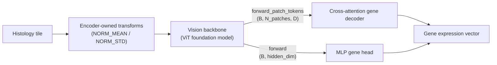
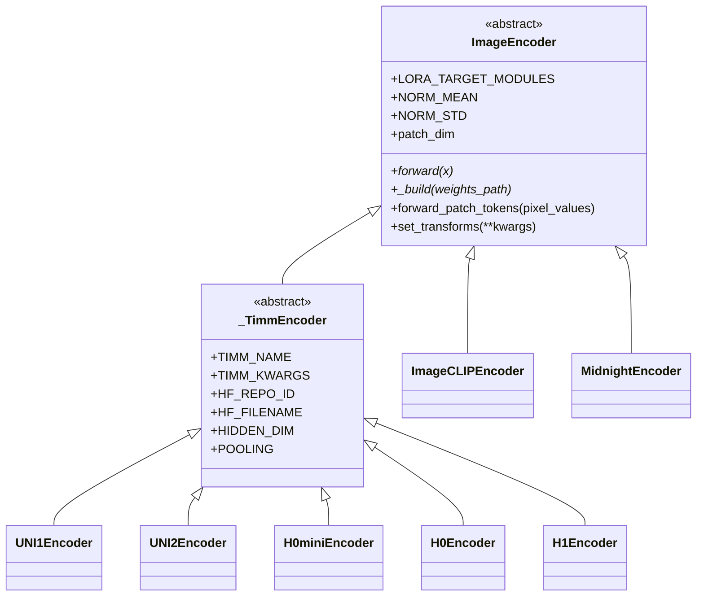
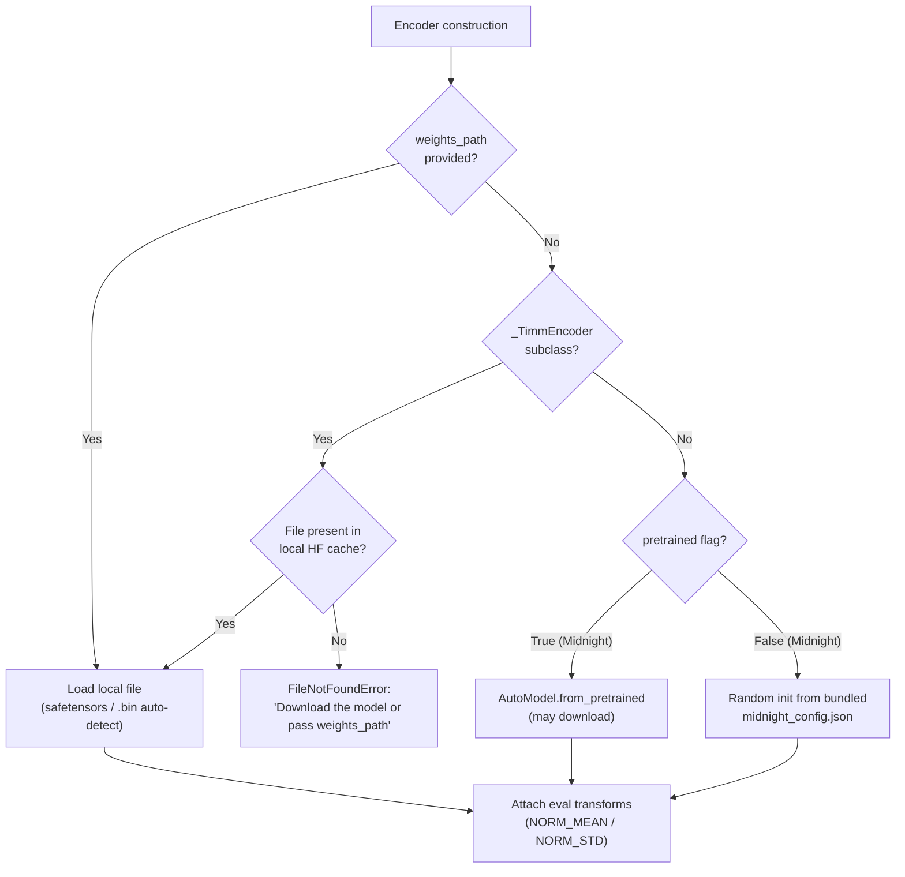
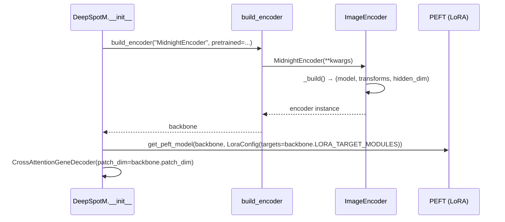

This page explains the vision encoder layer of DeepSpotM — the component that converts histology image tiles into the embeddings consumed by the gene prediction heads. It covers the encoder class hierarchy, the seven supported pathology foundation models, the two output pooling contracts, weight resolution behavior, and the exact integration points where `DeepSpotM` consumes the encoder. Deep dives into LoRA fine-tuning mechanics, the cross-attention decoder, and transform internals are deferred to their dedicated pages.

## Role in the Architecture

The vision encoder is the first stage of every DeepSpotM inference path. `DeepSpotM` instantiates it through a name-based factory, optionally wraps it in PEFT LoRA adapters, and then calls one of two methods depending on which gene prediction head is active: the spatial-token path (`forward_patch_tokens`) feeds the Cross-Attention Gene Decoder, while the pooled-vector path (`forward`) feeds a fallback MLP head. Each encoder also owns its own image transform pipeline, because every foundation model was pretrained with a different normalization scheme.

Which branch is taken is decided in `DeepSpotM.forward`: when `use_cross_attention=True` (the default) the backbone's spatial patch tokens feed the decoder; otherwise the pooled embedding feeds the MLP head. This dual-contract design is the central reason the encoder API exposes two differently-shaped outputs.

Sources: [model.py](src/deepspotm/model.py#L370-L391), [model.py](src/deepspotm/model.py#L97-L117)

## Class Hierarchy and the Encoder Contract

All encoders derive from the abstract `ImageEncoder` base class, which defines the interface every backbone must satisfy. Two intermediate strategies exist: `_TimmEncoder` factors out the shared build pipeline for timm-based vision transformers, while `ImageCLIPEncoder` and `MidnightEncoder` implement HuggingFace `transformers`-based construction directly.

The contract every encoder fulfills consists of these members:

| Member | Purpose |
|---|---|
| `_build(weights_path)` | Abstract: constructs the backbone, resolves weights, returns `(model, transforms, hidden_dim)` |
| `forward(pixel_values)` | Pooled embedding used by the fallback MLP gene head |
| `forward_patch_tokens(pixel_values)` | Spatial tokens `(B, N, D)` consumed by the cross-attention decoder |
| `patch_dim` (property) | Per-patch embedding dimension, auto-detected from the underlying model |
| `hidden_dim` | Pooled output dimension, returned by `_build` |
| `NORM_MEAN` / `NORM_STD` | Encoder-specific normalization applied by its transforms |
| `LORA_TARGET_MODULES` | Names of attention submodules PEFT should target during fine-tuning |
| `set_transforms(**kwargs)` | Rebuilds the transform pipeline without reloading model weights |

Sources: [image_encoder.py](src/deepspotm/image_encoder.py#L34-L105), [image_encoder.py](src/deepspotm/image_encoder.py#L108-L122)

> [!TIP]
> The `patch_dim` and `hidden_dim` split is deliberate: the cross-attention decoder sizes its queries with `patch_dim` (per-token, e.g. 1536 for Midnight), while the MLP fallback head sizes its input with `hidden_dim` (the pooled vector, e.g. 3072 for Midnight's concatenated CLS + mean-patch output). For encoders with compound pooling, these two values differ — swapping them silently misallocates decoder parameters.

## Supported Backbones

The module ships seven registered encoders spanning three weight-source families: Mahmood Lab pathology ViTs (UNI), Bioptimus pathology ViTs (H-optimus), a Kaiko AutoModel backbone (Midnight), and a CLIP vision tower. All operate on 224×224 tiles.

| Registry name | Backbone architecture | Upstream weights | `patch_dim` | `hidden_dim` | `forward()` pooling | Normalization |
|---|---|---|---|---|---|---|
| `UNI1Encoder` | `vit_large_patch16_224` | MahmoodLab/UNI | 1024 | 1024 | CLS only | ImageNet |
| `UNI2Encoder` | `vit_giant_patch14_224` + SwiGLU + 8 register tokens | MahmoodLab/UNI2-h | 1536 | 1536 | CLS only | ImageNet |
| `H0miniEncoder` | `vit_base_patch14_reg4_dinov2` | bioptimus/H0-mini | 768 | 1536 (768×2) | CLS + mean patch | Bioptimus |
| `H0Encoder` | `vit_giant_patch14_reg4_dinov2` | bioptimus/H-optimus-0 | 1536 | 1536 | CLS only | Bioptimus |
| `H1Encoder` | `vit_giant_patch14_reg4_dinov2` | bioptimus/H-optimus-1 | 1536 | 1536 | CLS only | Bioptimus |
| `MidnightEncoder` | HF `AutoModel` (Kaiko ViT) | kaiko-ai/midnight | 1536 | 3072 (1536×2) | CLS + mean patch | 0.5 / 0.5 |
| `ImageCLIPEncoder` | CLIP vision tower + projection | local path only | 768 | 512 | Projected pooler | Read from processor |

Sources: [image_encoder.py](src/deepspotm/image_encoder.py#L348-L356), [image_encoder.py](src/deepspotm/image_encoder.py#L156-L244), [image_encoder.py](src/deepspotm/image_encoder.py#L250-L343)

Normalization constants are module-level and shared by reference: `_IMAGENET_MEAN/_STD` for the UNI family, and `_BIOPTIMUS_MEAN/_STD` — the tissue-tuned statistics used by Bioptimus models — for the H-optimus family. This is why `NORM_MEAN`/`NORM_STD` live on the encoder class rather than in a global preprocessing config: mixing up a Bioptimus-normalized tile into a UNI encoder is the classic silent-degradation failure in pathology pipelines. `ImageCLIPEncoder` goes one step further and attempts to read mean/std from the checkpoint's bundled `AutoImageProcessor`, so fine-tuned CLIP variants with custom norms are handled automatically.

Sources: [image_encoder.py](src/deepspotm/image_encoder.py#L154-L159), [image_encoder.py](src/deepspotm/image_encoder.py#L276-L286), [utils.py](src/deepspotm/utils.py#L6-L23)

## Pooling Strategies: CLS-Only vs CLS + Mean-Patch

`_TimmEncoder` implements two pooling modes selected by the `POOLING` class attribute. In `cls_only` mode (the default), `forward()` simply delegates to the timm model's classification-free head, returning the CLS embedding. In `cls_plus_mean_patch` mode, the encoder calls `forward_features`, strips prefix tokens using the model's `num_prefix_tokens`, and returns `cat(CLS, patch_tokens.mean(dim=1))` — doubling the output width, which is reflected in `HIDDEN_DIM`.

This is how two encoders on architecturally similar ViTs diverge in output shape: `H0miniEncoder` (ViT-Base, `embed_dim` 768) exposes `hidden_dim = 768 * 2 = 1536` because it concatenates, while `H0Encoder`/`H1Encoder` (ViT-Giant) stay at the raw 1536 CLS width. `MidnightEncoder` implements the same concatenation pattern directly in its own `forward`, bypassing the `_TimmEncoder` machinery since it is built from `transformers.AutoModel`.

Sources: [image_encoder.py](src/deepspotm/image_encoder.py#L118-L151), [image_encoder.py](src/deepspotm/image_encoder.py#L202-L209), [image_encoder.py](src/deepspotm/image_encoder.py#L335-L339)

## Weight Resolution and the Offline-First Loading Contract

Weight lookup follows a deliberate precedence chain, implemented in two shared helpers. `_resolve_weights` prefers an explicit `weights_path` argument; failing that, it resolves the class's `HF_REPO_ID`/`HF_FILENAME` pair through `huggingface_hub.hf_hub_download` — critically, with `local_files_only=True`, so it only ever reads from the local HF cache and never initiates a network download. If neither source yields a file, it raises a `FileNotFoundError` with actionable guidance. `_load_state_dict` then auto-detects safetensors vs PyTorch `.bin` format and loads with `strict=True`.

The `pretrained=False` path is the key to the repository's offline-loading story. When set, `MidnightEncoder` builds the architecture from a bundled `midnight_config.json` with random initialization instead of touching the kaiko-ai/midnight repo — because the trained backbone weights are baked directly into DeepSpotM checkpoints and restored via `load_state_dict`. This is exactly the contract exercised by `DeepSpotM.from_pretrained`, which constructs the model with `backbone_pretrained=False` so that loading a published DeepSpotM model requires no network access to any upstream backbone repository. CLIP encoders are strict by contrast: `CLIPModel.from_pretrained(weights_path, local_files_only=True)` accepts only an explicit local path.

Sources: [image_encoder.py](src/deepspotm/image_encoder.py#L6-L31), [image_encoder.py](src/deepspotm/image_encoder.py#L306-L333), [model.py](src/deepspotm/model.py#L251-L275)

> [!TIP]
> Tim encoders never hit the network — `_resolve_weights` uses `local_files_only=True`. If a `UNI1Encoder(...)` construction fails with `FileNotFoundError`, pre-download the weights via `huggingface_hub` (or pass `weights_path=` explicitly); the error message names the expected file. This offline-first design makes CI and air-gapped inference reproducible.

## Spatial Patch-Token Extraction

`forward_patch_tokens` is the bridge to the cross-attention decoder, and its base implementation is written to handle two model families generically rather than requiring every subclass to re-implement token surgery. For timm models, it calls `forward_features` to get the full token sequence and slices off `num_prefix_tokens` (CLS plus register tokens). For HuggingFace AutoModel outputs, it reads `last_hidden_state` and strips one CLS token (respecting `config.use_cls_token`) plus any `config.num_register_tokens` in the DINOv2 style. Anything outside these two families raises, forcing the subclass to provide an override.

Two concrete overrides exist. `ImageCLIPEncoder.forward_patch_tokens` slices `[:, 1:, :]` to drop the CLS token from the vision tower's hidden states. `MidnightEncoder.forward_patch_tokens` performs the same single-CLS strip. The practical consequence: register-token-equipped models (UNI2-h with 8, H0-mini/H-optimus with 4) return only true spatial patch positions, so the downstream decoder's `N_patches` is uniform across encoders of the same tile grid.

Sources: [image_encoder.py](src/deepspotm/image_encoder.py#L70-L96), [image_encoder.py](src/deepspotm/image_encoder.py#L296-L298), [image_encoder.py](src/deepspotm/image_encoder.py#L341-L343)

## Factory API and Registry

Encoder selection is string-based. `ENCODER_REGISTRY` maps the seven class names to their implementations, and `build_encoder(name, **kwargs)` performs a validated lookup — raising a `ValueError` that lists available names on a miss. A companion function, `build_encoder_transforms(name, **kwargs)`, instantiates only the transform pipeline by reading the class-level `NORM_MEAN`/`NORM_STD` without constructing the model at all; this is useful for pre-processing tiles (e.g. in a WSI pipeline) on a machine where the backbone weights aren't present.

Sources: [image_encoder.py](src/deepspotm/image_encoder.py#L346-L379)

## Integration Points with DeepSpotM

`DeepSpotM` wires the encoder in at four well-defined seams, visible in `model.py`:

1. **Construction** — `build_encoder(encoder_model, pretrained=backbone_pretrained)` builds the backbone; the constructor default is `encoder_model="MidnightEncoder"`. If `use_lora=True`, PEFT wraps the encoder using the encoder's own `LORA_TARGET_MODULES` — `"qkv"` for timm ViTs, `"q_proj"/"k_proj"/"v_proj"` for CLIP, `"query"/"key"/"value"` for Midnight. Otherwise the backbone is frozen outright. (The full save/load contract for wrapped models is covered in [LoRA Adaptation Contract](8-lora-adaptation-contract).)
2. **Decoder sizing** — the cross-attention gene decoder receives `patch_dim=self.backbone.patch_dim`, so changing the encoder automatically re-scales decoder projection layers.
3. **Forward dispatch** — cross-attention mode calls `backbone.forward_patch_tokens(pixel_values)`; MLP mode calls `backbone(pixel_values)` for the pooled vector.
4. **Transform mutation** — `set_eval_transforms` reaches through the PEFT wrapper chain (`PeftModel` → `LoraModel` → encoder) explicitly to invoke `set_transforms`, so predict-time options like `center_crop=True` work on LoRA-wrapped models.

Sources: [model.py](src/deepspotm/model.py#L38-L95), [model.py](src/deepspotm/model.py#L97-L111), [model.py](src/deepspotm/model.py#L352-L365), [model.py](src/deepspotm/model.py#L378-L386), [image_encoder.py](src/deepspotm/image_encoder.py#L251-L254), [image_encoder.py](src/deepspotm/image_encoder.py#L301-L302)

## Extending the Encoder Zoo

Adding a new timm-based foundation model is declarative: subclass `_TimmEncoder`, set `TIMM_NAME` (plus `TIMM_KWARGS` if the architecture needs non-default timm arguments, as UNI2-h and H0-mini do with `SwiGLUPacked`/`SiLU`), point `HF_REPO_ID`/`HF_FILENAME` at the weights, declare `HIDDEN_DIM`, `NORM_MEAN`/`NORM_STD`, and optionally `POOLING`. If the model needs runtime-only timm imports, override `_build` to populate `TIMM_KWARGS` before delegating to `super()._build` — the pattern used to avoid importing timm at class-body evaluation time. For non-timm, non-standard-HF backbones, subclass `ImageEncoder` directly and override `_build`, `forward`, and `forward_patch_tokens`. Finally, register the class in `ENCODER_REGISTRY` so `build_encoder` can dispatch to it, and set `LORA_TARGET_MODULES` to match the new architecture's attention parameter names so LoRA fine-tuning binds correctly.

Sources: [image_encoder.py](src/deepspotm/image_encoder.py#L172-L199), [image_encoder.py](src/deepspotm/image_encoder.py#L202-L224), [image_encoder.py](src/deepspotm/image_encoder.py#L346-L366)

## Where to Go Next

The encoder layer connects to several sibling topics in this catalog. To understand what happens to the patch tokens after extraction, continue to [Cross-Attention Gene Decoder](9-cross-attention-gene-decoder). For the details of PEFT wrapping, adapter targeting, and the state-dict prefix contract mentioned above, see [LoRA Adaptation Contract](8-lora-adaptation-contract). For the transform pipeline internals (`get_eval_transforms`, resizing, center-crop behavior), read [Image Preprocessing Transforms](18-image-preprocessing-transforms). For end-to-end loading of a published DeepSpotM checkpoint — which builds the backbone offline via the `pretrained=False` contract — see [Pretrained Model Loading](13-pretrained-model-loading) and [Memory-Efficient Source Loading](15-memory-efficient-source-loading). To see encoders exercised from the command line, start with [Command-Line Prediction Tools](3-command-line-prediction-tools).