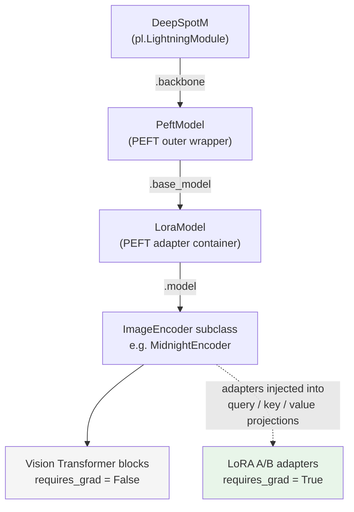
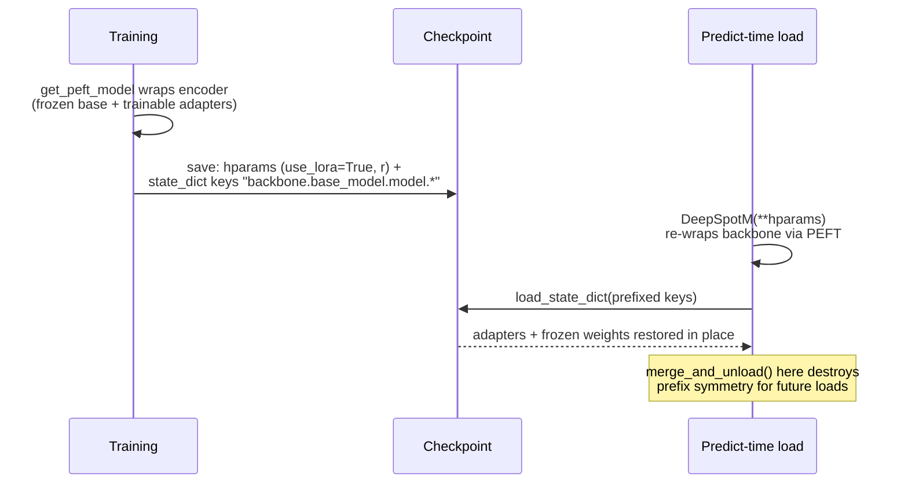

This page explains the binding agreement between DeepSpotM's frozen pathology vision backbones, their LoRA (Low-Rank Adaptation) adapters, and the checkpoint format that carries both. The "contract" is not a formal interface — it is a set of conventions about **wrapper topology, state-dict key prefixes, and trainability partitioning** that must hold simultaneously at training time and predict time. Break any one of them and loading fails silently or loudly, depending on which guard catches it first. This page documents the convention precisely so you can extend encoders, load checkpoints, or write custom inference code without violating it.

## Wrapper Topology: The Three-Layer Chain

DeepSpotM applies parameter-efficient fine-tuning through the HuggingFace **PEFT** library: `from peft import get_peft_model, LoraConfig` ([model.py](/src/deepspotm/model.py#L6)). When `use_lora=True` (the default), the vision backbone produced by `build_encoder` is not used directly. Instead, `get_peft_model(self.backbone, lora_config)` wraps it, producing a fixed three-layer containment chain: `PeftModel` → `LoraModel` → `ImageEncoder` subclass. Attribute access to the original encoder must traverse `backbone.base_model.model` — and every state-dict key for backbone weights acquires the `backbone.base_model.model.` prefix ([model.py](/src/deepspotm/model.py#L22-L36)).

The published DeepSpot-M model tokenizes H&E tiles with a **LoRA-adapted pathology foundation backbone (Midnight)** ([README.md](/README.md#L22-L32)), and the `DeepSpotM.__init__` default is `encoder_model="MidnightEncoder"` ([model.py](/src/deepspotm/model.py#L40)). The wrapper chain looks like this:



Sources: [model.py](/src/deepspotm/model.py#L6-L36), [image_encoder.py](/src/deepspotm/image_encoder.py#L34-L106), [README.md](/README.md#L22-L42)

## Adapter Injection Surface: `LoraConfig` Parameters

The LoRA configuration is constructed inline in `DeepSpotM.__init__` and exposes exactly one user-facing hyperparameter, the adapter rank `r` (default `8`, [model.py](/src/deepspotm/model.py#L54-L55)). Everything else is fixed by policy ([model.py](/src/deepspotm/model.py#L86-L93)):

| Parameter | Value | Role |
|---|---|---|
| `r` | `8` (hyperparameter) | LoRA rank — the only tunable knob, persisted via `save_hyperparameters` |
| `lora_alpha` | `r * 2` (i.e. `16` at default) | Scaling factor, locked at 2× rank |
| `lora_dropout` | `0.2` | Regularization on adapter activations |
| `target_modules` | `self.backbone.LORA_TARGET_MODULES` | Per-encoder injection points (see below) |
| Bias handling | PEFT default (`none`) | Frozen biases stay frozen |

Note that `target_modules` is read **from the encoder instance itself**, not hardcoded in `model.py`. This is the extensibility seam of the contract: each encoder family declares which leaf module names PEFT should instrument. The base `ImageEncoder` class defines the default `LORA_TARGET_MODULES = ["qkv"]`, matching fused query-key-value projections in timm ViT implementations ([image_encoder.py](/src/deepspotm/image_encoder.py#L36-L37)), and subclasses override it for their architecture's naming:

| Encoder | Architecture family | `LORA_TARGET_MODULES` | Source |
|---|---|---|---|
| `UNI1Encoder`, `UNI2Encoder`, `H0Encoder`, `H0miniEncoder`, `H1Encoder` | timm ViT (fused `qkv`) | `["qkv"]` (inherited) | [image_encoder.py](/src/deepspotm/image_encoder.py#L162-L244) |
| `ImageCLIPEncoder` | HF CLIP vision (separate projections) | `["q_proj", "k_proj", "v_proj"]` | [image_encoder.py](/src/deepspotm/image_encoder.py#L250-L254) |
| `MidnightEncoder` | HF AutoModel ViT (separate projections) | `["query", "key", "value"]` | [image_encoder.py](/src/deepspotm/image_encoder.py#L301-L304) |

The injected names are leaf-module attribute names resolved recursively by PEFT inside the wrapped encoder, so a new encoder subclass must either inherit the timm default or declare names matching its internal module tree. All seven encoders are registered in `ENCODER_REGISTRY` ([image_encoder.py](/src/deepspotm/image_encoder.py#L348-L366)) — for the full per-encoder normalization, pooling, and weight-resolution behavior, see [Pathology Vision Encoders](7-pathology-vision-encoders).

Sources: [model.py](/src/deepspotm/model.py#L54-L55), [model.py](/src/deepspotm/model.py#L86-L93), [image_encoder.py](/src/deepspotm/image_encoder.py#L36-L37), [image_encoder.py](/src/deepspotm/image_encoder.py#L250-L254), [image_encoder.py](/src/deepspotm/image_encoder.py#L301-L304)

## Trainability Partitioning

LoRA establishes a strict split of learnable parameters, and the code relies on **who performs the freezing** as part of the contract. When `use_lora=True`, `model.py` deliberately does *not* freeze anything itself — the comment documents that "PEFT's `get_peft_model` freezes the underlying base model automatically and marks only the LoRA adapter parameters trainable" ([model.py](/src/deepspotm/model.py#L81-L93)). When `use_lora=False`, the backbone is frozen explicitly via `freeze_backbone()` ([model.py](/src/deepspotm/model.py#L94-L95), [model.py](/src/deepspotm/model.py#L122-L124)), so either path yields a frozen vision backbone; LoRA simply swaps *which* few backbone-side parameters become trainable.

Consequently, a training run on a LoRA-wrapped model updates: (1) the LoRA A/B adapter matrices inside the backbone, and (2) the gene decoder (cross-attention, gene embeddings, optional router). The multi-billion-parameter foundation weights are never gradients-bearing. This is what allows the backbone's upstream weights — and later its adapted state — to travel together in one checkpoint.

Sources: [model.py](/src/deepspotm/model.py#L81-L95), [model.py](/src/deepspotm/model.py#L122-L124)

## The Save/Load Contract: Prefixed-Key Symmetry

This is the core of the contract, stated verbatim in the `DeepSpotM` class docstring ([model.py](/src/deepspotm/model.py#L22-L36)): **keep LoRA *wrapped* at predict time**. The state dict saved from training carries the `backbone.base_model.model.` prefix on frozen weights and sibling adapter keys beside them. The load path reconstructs the identical wrapper before any keys are matched:

1. `DeepSpotM.__init__` calls `save_hyperparameters(ignore=["kwargs"])` ([model.py](/src/deepspotm/model.py#L70)), persisting `use_lora=True` and `r` into the checkpoint's `hyper_parameters`.
2. Every checkpoint-based constructor — Lightning's `load_from_checkpoint` (used by `DeepSpotM.load_for_inference` and `load_for_prediction` in [checkpoint.py](/src/deepspotm/checkpoint.py#L160-L163)) — instantiates `DeepSpotM(**hparams)`, which re-runs the `get_peft_model` wrap.
3. Only then does `load_state_dict` run, and the freshly created `backbone.base_model.model.*` keys line up with the checkpoint's.

> [!TIP]
> The symmetry is the point: because the prefix exists on *both* sides of the round-trip, no key remapping is ever needed. Calling `model.backbone.merge_and_unload()` in the inference path does not fail immediately — it silently breaks the *load-side* round-trip, because a freshly constructed `DeepSpotM(use_lora=True)` expects the prefixed keys and would report them all as unexpected ([model.py](/src/deepspotm/model.py#L28-L36)).



The docstring enumerates the entry points that honor the contract: `forward` / `predict_genes` operate on the wrapped backbone, and `deepspotm.load_for_prediction` returns a wrapped model ([model.py](/src/deepspotm/model.py#L27-L33)). Both public prediction paths call `self.backbone.forward_patch_tokens(pixel_values)` / `self.backbone(pixel_values)` directly ([model.py](/src/deepspotm/model.py#L370-L391), [model.py](/src/deepspotm/model.py#L406-L420)), relying on PEFT's `__getattr__` delegation to reach the inner encoder's methods — `examples/predict.py` calls the same wrapped methods without any unwrapping step ([predict.py](/examples/predict.py#L121-L125)).

Sources: [model.py](/src/deepspotm/model.py#L22-L36), [model.py](/src/deepspotm/model.py#L70), [model.py](/src/deepspotm/model.py#L370-L420), [checkpoint.py](/src/deepspotm/checkpoint.py#L89-L182), [predict.py](/examples/predict.py#L121-L125)

## Runtime Traversal Rules Through the Wrapper

Code that must reach *through* the PEFT wrappers follows two sanctioned patterns. The first is **implicit delegation**: PEFT forwards unknown attributes to the inner model, so `self.backbone.patch_dim` at construction time ([model.py](/src/deepspotm/model.py#L98-L101)), `self.backbone.forward_patch_tokens(...)` in `forward` ([model.py](/src/deepspotm/model.py#L379)), and `model.backbone.transforms` in the loaders ([checkpoint.py](/src/deepspotm/checkpoint.py#L180-L182), [model.py](/src/deepspotm/model.py#L331)) all work without explicitly descending the chain.

The second pattern is **explicit traversal**, used where delegation failure would be silent. `set_eval_transforms` walks the chain by hand ([model.py](/src/deepspotm/model.py#L352-L365)):

```python
for attr in ("base_model", "model"):
    if hasattr(backbone, attr) and not hasattr(backbone, "set_transforms"):
        backbone = getattr(backbone, attr)
backbone.set_transforms(**build_kwargs)
```

The comment explains the defensive posture: `__getattr__` delegation *usually* works, but the code is explicit "so a future PEFT release that breaks the chain won't silently regress to no-op" ([model.py](/src/deepspotm/model.py#L358-L365)). When you write new code that must configure the inner encoder, follow the same rule of thumb: delegate for *reads* through well-tested attributes, but traverse explicitly when a silent failure would produce subtly wrong behavior (like predictions using train-time augmentation transforms instead of eval transforms).

Sources: [model.py](/src/deepspotm/model.py#L98-L101), [model.py](/src/deepspotm/model.py#L352-L365), [checkpoint.py](/src/deepspotm/checkpoint.py#L180-L182)

## Published Artifact Side: Baked Adapters and LoRA-Tolerant Validation

The contract extends to the published Hugging Face artifact. `DeepSpotM.from_pretrained` expects `config.json` + `model.safetensors` + `tokens.csv`, and the safetensors file carries "vision backbone + LoRA adapters + gene decoder" baked in ([model.py](/src/deepspotm/model.py#L251-L275)). This is why loading sets `hparams["backbone_pretrained"] = False`: the Midnight backbone is built offline from a bundled config with random init, then overwritten wholesale by the checkpoint — no network access to the upstream `kaiko-ai/midnight` repo is needed ([model.py](/src/deepspotm/model.py#L267-L270), [image_encoder.py](/src/deepspotm/image_encoder.py#L306-L315)).

The validation logic in `from_pretrained` is the LoRA-aware half of the contract ([model.py](/src/deepspotm/model.py#L303-L316)). It loads with `strict=False`, then inspects the `missing` keys with a namespace-aware filter: only keys starting with the substantive namespaces (`gene_decoder.`, `backbone.`) **and not containing "lora"** are treated as errors.

> [!TIP]
> The `"lora" not in k.lower()` clause exists because a clean safetensors export may omit PEFT bookkeeping buffers while keeping all adapter weights. The filter tolerates that benign absence while still raising a `RuntimeError` if genuinely substantive weights (frozen backbone or decoder) are missing — meaning "config and weights disagree." The same philosophy of explicit drift-surfacing governs `check_state_dict_load` in [checkpoint.py](/src/deepspotm/checkpoint.py#L57-L86).

Sources: [model.py](/src/deepspotm/model.py#L251-L331), [image_encoder.py](/src/deepspotm/image_encoder.py#L306-L315), [checkpoint.py](/src/deepspotm/checkpoint.py#L57-L86)

## Contract Violation Modes

The following table summarizes what happens when each clause of the contract is broken — most failures are *silent*, which is precisely why the contract is documented rather than left as tribal knowledge:

| Violation | Consequence | Detected by |
|---|---|---|
| `merge_and_unload()` before save/inference reuse | Prefixed keys no longer match; downstream `load_state_dict` treats everything as unexpected | Silent breakage of round-trip; surfaces only at next load ([model.py](/src/deepspotm/model.py#L28-L36)) |
| Overriding `LORA_TARGET_MODULES` with names absent from the module tree | PEFT injects no adapters; backbone trains nothing | Silent — no training of backbone-side parameters |
| Stripping `backbone.base_model.model.` prefixes from a checkpoint | All backbone keys become unexpected at load | Silent with `strict=False`; drift guards catch unfiltered paths ([checkpoint.py](/src/deepspotm/checkpoint.py#L57-L86)) |
| Constructing `DeepSpotM(use_lora=False)` for a LoRA checkpoint | Key sets structurally incompatible | Key drift at `load_state_dict` |
| Relying on PEFT delegation for *stateful* configuration | Future PEFT change silently no-ops | Only if you follow the explicit-traversal pattern ([model.py](/src/deepspotm/model.py#L358-L365)) |

## Where to Go Next

The contract sits between two neighbors in the component stack. Upstream, [Pathology Vision Encoders](7-pathology-vision-encoders) details the encoders whose `LORA_TARGET_MODULES` declarations you saw here, and [Architecture Overview](6-architecture-overview) places the adapted backbone within the full model. Downstream, the checkpoint machinery that enforces the load-side guarantees is covered in [Pretrained Model Loading](13-pretrained-model-loading) and [Cross-Vocabulary Checkpoint Handling](14-cross-vocabulary-checkpoint-handling); the loading path that rebuilds the wrapper from persisted hyperparameters is [Memory-Efficient Source Loading](15-memory-efficient-source-loading). To see the wrapped model consumed end-to-end, continue to the [TCGA-SKCM Tutorial Notebook](4-tcga-skcm-tutorial-notebook).