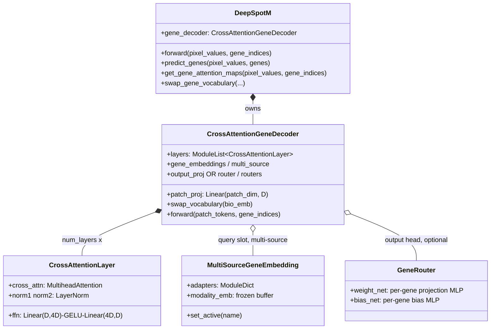
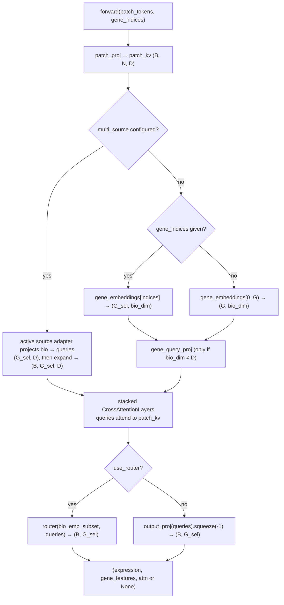

The Cross-Attention Gene Decoder is DeepSpotM's gene prediction head: it takes frozen pathology patch tokens from the vision backbone and, through stacked cross-attention blocks, lets one *query per gene* read out morphology-relevant evidence and project it into a predicted expression value. This page explains the decoder's two implementation levels — the reusable `CrossAttentionLayer` primitive and the composite `CrossAttentionGeneDecoder` — including its forward data flow, the three-element output contract, output-head selection, interpretability path, and in-place vocabulary retargeting. Details of the pluggable query sources and output heads are covered by their dedicated pages: [Gene Router Hypernetwork](10-gene-router-hypernetwork) and [Multi-Source Gene Embeddings](11-multi-source-gene-embeddings).

Sources: [modules.py](src/deepspotm/modules.py#L34-L38), [model.py](src/deepspotm/model.py#L98-L118)

## Architectural Role: From Patch Tokens to Gene Expression

Within `DeepSpotM`, the decoder sits at the end of the pipeline: the vision backbone (wrapped by LoRA — see [LoRA Adaptation Contract](8-lora-adaptation-contract)) exposes `forward_patch_tokens(pixel_values)`, and the model's `forward` passes those tokens straight into `self.gene_decoder`, returning the decoder's triple `(expression, pooled, attn_weights)` unchanged to the caller. When `use_cross_attention` is disabled (an ablation toggle), the entire decoder is replaced by a plain MLP head over pooled backbone features — which clarifies what the cross-attention path adds: per-gene, token-level readout instead of a single pooled-vector regression.

Sources: [model.py](src/deepspotm/model.py#L370-L391), [model.py](src/deepspotm/model.py#L107-L118)

The decoder performs three transformations: project patch tokens into the query space (K/V), refine gene queries against those keys/values via cross-attention, and map each refined query to a scalar expression value. Everything is built to operate in one shared width `D` (`gene_embed_dim`), so attention, layer norms, and the output head all live in the same dimensional space.

| Tensor | Shape | Producer | Role |
|---|---|---|---|
| `patch_tokens` | `(B, N, patch_dim)` | backbone `forward_patch_tokens` | decoder input |
| `patch_kv` | `(B, N, D)` | `patch_proj` (Linear) | attention keys/values |
| gene queries | `(B, G, D)` | query slot (embedding or adapter) | one row per gene |
| refined queries | `(B, G, D)` | stacked `CrossAttentionLayer`s | morphology-conditioned gene state |
| `expression` | `(B, G)` | output head | prediction |
| `gene_features` | `(B, D)` | mean-pool over G | aggregated slide representation |
| `attn_weights` | `list[(B, H, G, N)]` or `None` | attention layers | only when `need_weights=True` |

Sources: [modules.py](src/deepspotm/modules.py#L713-L731), [modules.py](src/deepspotm/modules.py#L787-L791)

## The CrossAttentionLayer Primitive

Each decoder layer is a standard **pre-norm cross-attention block**: multi-head attention where the *queries* are gene embeddings and the *keys/values* are patch tokens, followed by a residual + `LayerNorm`, then a 4×-expansion feed-forward network (`Linear(D→4D)` → GELU → dropout → `Linear(4D→D)`) with a second residual + norm. Two details matter for downstream consumers: `batch_first=True` so tensors arrive as `(B, seq, D)`, and `average_attn_weights=False` so per-head attention survives into the return value — the foundation of the interpretability path.

Sources: [modules.py](src/deepspotm/modules.py#L38-L62)

Because the patch keys/values `patch_kv` are computed once by `patch_proj` and reused by every layer, stacking layers (default: 2 in the shipped configuration) lets each gene query progressively narrow which patches it attends to, while the compute cost stays linear in layer count.

Sources: [modules.py](src/deepspotm/modules.py#L528-L534), [model.py](src/deepspotm/model.py#L44-L48)

## Composite Anatomy: CrossAttentionGeneDecoder

To read the composite class, it helps to see it as **three pluggable slots plus a fixed attention spine**: (1) a patch projection into attention space, (2) a gene-query source that produces `(G, D)` query templates, and (3) an output head that collapses each query to a scalar. The constructor wires these slots differently depending on `init_gene_embeddings`, with an early `return` cleanly separating the multi-source branch from the single-source branch.

Sources: [modules.py](src/deepspotm/modules.py#L474-L602)

The query source and output head are chosen independently but with one coupling: the router mode **requires** a biological embedding — `use_router=True` with `init_gene_embeddings="xavier"` raises a `ValueError`, because per-gene generated projections can only be derived from a real gene prior. The three construction modes are:

| Mode | `init_gene_embeddings` | Query source | Output head options |
|---|---|---|---|
| Random | `"xavier"` | `nn.Embedding(n_genes, D)`, xavier-uniform | shared `Linear(D, 1)` only |
| Single-source | one registry name (e.g. `"scgpt"`) | `nn.Embedding(n_genes, bio_dim)` initialized from the prior + bias-free `gene_query_proj` when `bio_dim ≠ D` | shared head **or** one `GeneRouter` reading a frozen bio buffer |
| Multi-source | list of names (e.g. `["evo2", "orthrus", …]`) | `MultiSourceGeneEmbedding`: per-source trainable bio parameter + adapter (+ optional frozen one-hot modality vector) | shared head **or** one `GeneRouter` **per source** (`routers: ModuleDict`) |

Sources: [modules.py](src/deepspotm/modules.py#L528-L602), [modules.py](src/deepspotm/modules.py#L108-L150)

In multi-source mode, per-source routers deliberately read `multi_source.current_bio` — the same trainable bio parameter that feeds the active adapter — preserving the single-source design invariant that "the same biological embedding feeds adapter (query init) and router (output hypernet)," now per dispatchable source. The embedding-source mechanics and modality encoding are documented in [Multi-Source Gene Embeddings](11-multi-source-gene-embeddings).

Sources: [modules.py](src/deepspotm/modules.py#L559-L583)

## Forward Data Flow

Prerequisite for the flowchart: the decoder's `forward` accepts `(patch_tokens, need_weights, gene_bio_embeddings, gene_indices)`. `patch_tokens` are `(B, N, patch_dim)`; `gene_indices` is an optional 1-D `LongTensor` that may arrive as a plain list (it is converted via `torch.as_tensor` and moved to the input device); `gene_bio_embeddings` is a zero-shot override available only on the single-source router path.

Sources: [modules.py](src/deepspotm/modules.py#L713-L736)

Both query branches converge on the same attention spine: queries are expanded to the batch dimension (`unsqueeze(0).expand(B, -1, -1)` — no memory copy), run through `num_layers` cross-attention blocks, and only then hit the output head. When `gene_indices` is provided, **only the selected gene queries are ever built and attended**, so compute scales with `len(gene_indices)` rather than the full panel — the property that powers [Selective Gene Prediction](16-selective-gene-prediction) end to end.

Sources: [modules.py](src/deepspotm/modules.py#L738-L758), [model.py](src/deepspotm/model.py#L370-L391)

> [!TIP]
> In multi-source mode, the adapter projection happens **before** the batch expansion: the `Linear(bio_dim_i → D)` runs on `(G, bio_dim_i)` rather than `(B, G, bio_dim_i)`, reducing projection cost from `B·G·bio_dim·D` to `G·bio_dim·D`. The code comments this explicitly as the reason the multi-source path orders projection-then-expand, unlike the naive single-source ordering.

> [!TIP]
> On the multi-source router path, the decoder passes `multi_source.current_bio.detach()` into the router. The detach is load-bearing gradient routing, not an optimization: it ensures the trainable bio parameters receive gradients **only** through the adapter (query) pathway. Without it, bio would be co-optimized simultaneously by the adapter, `router.weight_net`, and `router.bias_net` — dynamics the authors note previously degraded validation Pearson correlation.

Sources: [modules.py](src/deepspotm/modules.py#L422-L424), [modules.py](src/deepspotm/modules.py#L762-L777)

## The Output Contract: A Verified Three-Tuple

`forward` always returns `(expression, gene_features, attn_weights)` — a triple that downstream integrations unpack positionally. The contract tests state this explicitly: a tiny randomly-initialized decoder is constructed in CI precisely so the tuple's shapes and semantics can be asserted without downloading the gated checkpoint, and the test module's docstring records that **TIAToolbox unpacks exactly this three-tuple**, making the signature a compatibility surface, not an internal detail.

Sources: [tests/test_decoder.py](tests/test_decoder.py#L1-L8), [modules.py](src/deepspotm/modules.py#L787-L791)

| Element | Shape | Semantics | Default behavior |
|---|---|---|---|
| `expression` | `(B, G_sel)` | predicted expression; columns follow `gene_indices` order when subsetting | full panel `G` when no indices |
| `gene_features` | `(B, D)` | mean of refined gene queries over the G axis | always computed |
| `attn_weights` | `list[(B, H, G, N)]` per layer, or `None` | per-head attention maps | `None` unless `need_weights=True` |

Sources: [modules.py](src/deepspotm/modules.py#L787-L791), [tests/test_decoder.py](tests/test_decoder.py#L46-L54)

Two behaviors of `gene_indices` are pinned by dedicated tests. First, subsetting is *exact*: `decoder(patch_tokens, gene_indices=wanted)` returns columns identical (within float tolerance) to `full[:, wanted]` — proving that selecting indices computes the same values as slicing the full output, while skipping work for unselected genes. Second, **request order is output order**: reversing the requested index tensor reverses the output columns, so callers can request genes in any arbitrary order (e.g. matching an external panel's column layout) without post-hoc reordering.

Sources: [tests/test_decoder.py](tests/test_decoder.py#L57-L65), [tests/test_decoder.py](tests/test_decoder.py#L68-L77)

## Output Heads: Shared Projection vs. Gene Router

With `use_router=False`, the head is a single shared `nn.Linear(D, 1)` applied to every refined query — one weight vector for all genes. With `use_router=True` (the shipped default is enabled at the `DeepSpotM` level), each gene's projection vector and bias scalar are *generated on the fly* from its biological embedding via the router's two MLPs and applied with `einsum('bgd,gd->bg')`. This is what enables zero-shot prediction: the decoder's forward accepts a `gene_bio_embeddings` override on the single-source path, letting callers pass embeddings for genes **outside the trained vocabulary** — the shared head fundamentally cannot do this.

Sources: [modules.py](src/deepspotm/modules.py#L713-L729), [modules.py](src/deepspotm/modules.py#L760-L787), [model.py](src/deepspotm/model.py#L50-L52)

| Aspect | Shared `output_proj` | `GeneRouter` hypernetwork |
|---|---|---|
| Per-gene weights | one shared `Linear(D, 1)` | generated per gene from its bio embedding |
| Unseen genes | unsupported | supported via `gene_bio_embeddings` override |
| Construction requirement | any query init | requires a biological embedding source (not `"xavier"`) |
| Multi-source variant | single shared head | one router per source, dispatched on `active_source` |

Sources: [modules.py](src/deepspotm/modules.py#L559-L583), [modules.py](src/deepspotm/modules.py#L107-L150)

The router is documented in full on [Gene Router Hypernetwork](10-gene-router-hypernetwork); for this page the essential point is that the decoder treats it as a swappable head slot, and the dispatch logic in `forward` (multi-source `routers[active]` vs single-source `router`) is entirely internal to the decoder.

Sources: [modules.py](src/deepspotm/modules.py#L760-L787)

## Interpretability: Per-Gene Attention Over Patches

Requesting `need_weights=True` changes the return's third slot from `None` to a list of per-layer, per-head attention tensors of shape `(B, H, G, N)` — preserved intact because every `CrossAttentionLayer` sets `average_attn_weights=False`. The model-level helper `get_gene_attention_maps` builds on this: it temporarily forces eval mode, collects all layers' weights, takes the **last layer's** tensor and averages over heads to produce `(B, G, N_patches)` — each gene's spatial attention footprint over the input patches — optionally sliced by `gene_indices`. The method refuses to run when `use_cross_attention=False`, since the MLP fallback produces no attention.

Sources: [modules.py](src/deepspotm/modules.py#L52-L62), [model.py](src/deepspotm/model.py#L425-L454)

## In-Place Vocabulary Retargeting via `swap_vocabulary`

The decoder can be retargeted to a different gene panel **without reconstruction**: `swap_vocabulary(bio_emb, ...)` replaces the query embeddings and reconfigures the head, with surgical rules for what is rebuilt versus preserved. The guiding principle, stated in the code, is to *preserve trained weights whenever shapes still fit* — e.g. swapping human ProtT5 for mouse ProtT5 (both 1024-d) keeps the trained `gene_query_proj` and router verbatim, changing only the embedding table's contents. The `gene_embed_dim` property (derived from `patch_proj.out_features`) is what lets the swap logic infer `D` without storing it redundantly.

Sources: [modules.py](src/deepspotm/modules.py#L604-L614), [modules.py](src/deepspotm/modules.py#L656-L678)

| Component | Condition | Action on swap |
|---|---|---|
| `gene_embeddings` | always | rebuilt from the new `(n_genes_new, bio_dim_new)` tensor |
| `gene_query_proj` | `bio_dim_new == D` | set to `None` (passthrough) |
| `gene_query_proj` | `bio_dim_new` unchanged ≠ D | **kept** — trained projection preserved |
| `gene_query_proj` | `bio_dim_new` differs | rebuilt as bias-free `Linear` |
| `router` / `_router_bio_emb` | input dim matches | bio buffer updated; router weights **kept** |
| `router` | input dim differs, or switching on | rebuilt (`router_hidden_dim` inherited from the old router when unset) |
| head/router cross-switch | `use_router` flipped | the stale head (`output_proj` or router) is deleted cleanly |
| multi-source mode | `source` argument required | collapses to that source via `collapse_to_source`; other sources' routers dropped; `use_router`/`router_hidden_dim` arguments ignored |

Sources: [modules.py](src/deepspotm/modules.py#L639-L711)

The model-level wrapper `DeepSpotM.swap_gene_vocabulary` adds validation (embedding row count must match the token CSV's gene list, otherwise `ValueError`) and keeps `hparams` consistent so a subsequent checkpoint save/load round-trips the swapped configuration. Checkpoint-side handling of vocabulary changes is covered in [Cross-Vocabulary Checkpoint Handling](14-cross-vocabulary-checkpoint-handling).

Sources: [model.py](src/deepspotm/model.py#L124-L190)

## Configuration Reference

The decoder's architecture is fully exposed as `DeepSpotM` hyperparameters ("every component can be toggled on/off for ablation studies," per the class docstring), which are persisted into checkpoints and replayed on load.

| Hyperparameter | Default | Effect on the decoder |
|---|---|---|
| `use_cross_attention` | `True` | selects this decoder over the pooled-MLP fallback |
| `gene_embed_dim` | 256 | shared width `D` for patch projection, queries, attention, and head |
| `cross_attn_heads` | 8 | attention heads per layer |
| `cross_attn_layers` | 2 | number of stacked `CrossAttentionLayer`s |
| `cross_attn_dropout` | 0.1 | dropout in attention and the FFN |
| `init_gene_embeddings` | `"xavier"` | query-init mode: `"xavier"` / source name / list of names |
| `use_router` | `True` | hypernetwork head instead of shared `Linear(D, 1)` |
| `router_hidden_dim` | `None` → `2·D` | hidden width inside the router MLPs |
| `use_modality_encoding` | `True` | adds the frozen one-hot modality vector to queries (multi-source only) |
| `bio_dims` | `None` | per-source bio dims for checkpoint-driven reconstruction (skips `.pt` assets) |

Sources: [model.py](src/deepspotm/model.py#L43-L52), [model.py](src/deepspotm/model.py#L98-L118), [modules.py](src/deepspotm/modules.py#L546-L557)

Note the checkpoint-reconstruction subtlety: when `bio_dims` is provided (the `from_pretrained` path), the multi-source branch allocates zero-filled bio parameters by shape and lets `load_state_dict` overwrite them, so loading a published model never needs to open the raw gene-embedding asset files.

Sources: [modules.py](src/deepspotm/modules.py#L546-L557), [model.py](src/deepspotm/model.py#L300-L310)

## Where to Go Next

The decoder's query slot and output head are each deep enough to warrant their own treatment: continue with [Gene Router Hypernetwork](10-gene-router-hypernetwork) for the zero-shot output-head mathematics, and [Multi-Source Gene Embeddings](11-multi-source-gene-embeddings) for adapter and modality-encoding internals. To see `gene_indices` applied end-to-end at inference time — including the `predict_genes` convenience wrapper that maps gene symbols to indices and returns only the requested columns — read [Selective Gene Prediction](16-selective-gene-prediction); for the vocabulary side that defines `n_genes` and the gene→index mapping the decoder relies on, see [Gene Vocabulary and Output Mapping](12-gene-vocabulary-and-output-mapping).
