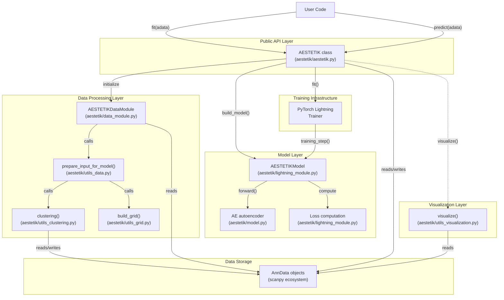
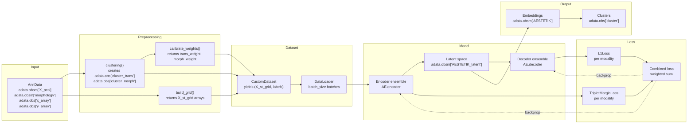
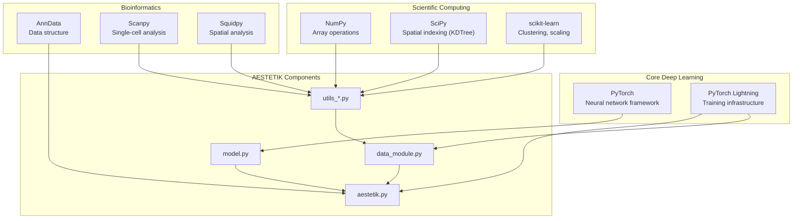

# Home

<details>
<summary>Relevant source files</summary>

The following files were used as context for generating this wiki page:

- [CITATION.cff](CITATION.cff)
- [LICENSE](LICENSE)
- [README.md](README.md)
- [figures/maynard_human_brain_analysis_151676_Transcriptomics_Morphology_AESTETIK.png](figures/maynard_human_brain_analysis_151676_Transcriptomics_Morphology_AESTETIK.png)
- [llms.txt](llms.txt)
- [pyproject.toml](pyproject.toml)

</details>


## Purpose and Scope

This wiki provides comprehensive technical documentation for AESTETIK (AutoEncoder for Spatial Transcriptomics Expression with Topology and Image Knowledge), a PyTorch Lightning-based framework for learning multi-modal representations from spatial transcriptomics data. This page introduces the system architecture, core concepts, and navigation to detailed documentation.

For installation instructions, see [Installation](#2.1). For a hands-on introduction, see [Quick Start Tutorial](#2.2). For complete API documentation, see [API Reference](#5).

**Sources**: [README.md:1-112](), [llms.txt:1-50]()

---

## What is AESTETIK?

AESTETIK is a convolutional autoencoder that jointly integrates three information sources to learn biologically meaningful spot representations for spatial transcriptomics:

| Information Source | Description | Input Format |
|-------------------|-------------|--------------|
| **Transcriptomics** | Gene expression profiles per spot | `adata.obsm[transcriptomics_key]` |
| **Morphology** | H&E image features per spot | `adata.obsm[morphology_key]` |
| **Topology** | Spatial neighborhood context | `adata.obs[['x_array', 'y_array']]` |

The model uses an ensemble autoencoder architecture with triplet contrastive learning to produce embeddings that capture biological complexity while preserving spatial organization. It integrates with the scanpy/anndata ecosystem and supports cross-sample integration through external alignment methods (Harmony, scVI, etc.).

**Sources**: [README.md:29-36](), [llms.txt:3-9](), [pyproject.toml:8]()

---

## Key Capabilities

### Multi-Modal Integration
- Processes transcriptomics and morphology modalities separately through the pipeline
- Automatically calibrates modality weights via [`calibrate_weights()`](aestetik/utils_data.py)
- Computes separate loss components per modality for balanced training

### Spatial Topology Awareness
- Constructs spatial grids around each spot using [`build_grid()`](aestetik/utils_grid.py)
- Preserves neighborhood relationships through CNN-based architecture
- Uses KDTree spatial indexing for efficient neighbor queries

### Ensemble Learning
- Employs multiple encoder/decoder networks per modality
- Aggregates predictions via median pooling for robustness
- Implemented in [`AE`](aestetik/model.py) class

### Cross-Sample Integration
- Supports batch processing of multiple samples
- Compatible with downstream integration methods (Harmony, scVI)
- Enables comparative analysis across patients/conditions

**Sources**: [README.md:17](), [README.md:31-36]()

---

## System Architecture Overview

The following diagram shows how the main components interact and which files implement each component:



**Diagram: System Component Organization and File Mapping**

This architecture follows a layered design:

1. **Public API Layer**: The `AESTETIK` class in [aestetik/aestetik.py]() provides `fit()`, `predict()`, and `fit_predict()` methods
2. **Data Processing Layer**: Handles clustering, grid construction, and weight calibration via utilities in [aestetik/utils_*.py]()
3. **Model Layer**: PyTorch Lightning module wrapping the ensemble autoencoder
4. **Training Infrastructure**: Leverages PyTorch Lightning's `Trainer` for training loop management
5. **Visualization Layer**: Analysis and plotting utilities in [aestetik/utils_visualization.py]()

All data flows through `AnnData` objects following scanpy conventions for interoperability.

**Sources**: [README.md:6-36](), Diagram 1 from high-level architecture, Diagram 6 from system integration

---

## Core Components

### Primary Classes

| Class | File | Purpose |
|-------|------|---------|
| `AESTETIK` | [aestetik/aestetik.py]() | Main orchestrator with scikit-learn-style API |
| `AESTETIKDataModule` | [aestetik/data_module.py]() | Lightning DataModule for batch preparation |
| `AESTETIKModel` | [aestetik/lightning_module.py]() | Lightning Module with training/validation logic |
| `AE` | [aestetik/model.py]() | Ensemble autoencoder architecture (encoder/decoder) |
| `CustomDataset` | [aestetik/data_module.py]() | PyTorch Dataset for spatial grids |

### Key Utility Functions

| Function | File | Purpose |
|----------|------|---------|
| `prepare_input_for_model()` | [aestetik/utils_data.py]() | Orchestrates preprocessing pipeline |
| `clustering()` | [aestetik/utils_clustering.py]() | Clusters transcriptomics/morphology features |
| `calibrate_weights()` | [aestetik/utils_data.py]() | Computes modality-specific weights |
| `build_grid()` | [aestetik/utils_grid.py]() | Constructs spatial neighborhood grids |
| `create_spot_grid()` | [aestetik/utils_grid.py]() | Builds grid for individual spots |
| `visualize()` | [aestetik/utils_visualization.py]() | Plotting and centroid visualization |

For detailed API documentation, see [AESTETIK Class](#5.1), [Data Pipeline Components](#5.2), [Model Architecture](#5.3), and [Utility Functions](#5.4).

**Sources**: Diagram 1 from high-level architecture, [README.md:31-36]()

---

## Data Flow Through AESTETIK

The following diagram shows how data flows through the system during training:



**Diagram: Data Transformation Pipeline with Code Entities**

### Key Data Locations in AnnData

| Location | Content | Created By |
|----------|---------|------------|
| `adata.obsm[transcriptomics_key]` | Input transcriptomics features | User preprocessing |
| `adata.obsm[morphology_key]` | Input morphology features | User preprocessing |
| `adata.obs['cluster_trans']` | Transcriptomics cluster labels | [`clustering()`](aestetik/utils_clustering.py) |
| `adata.obs['cluster_morph']` | Morphology cluster labels | [`clustering()`](aestetik/utils_clustering.py) |
| `adata.obsm['AESTETIK_latent']` | Latent space embeddings | [`predict()`](aestetik/aestetik.py) |
| `adata.obsm['AESTETIK']` | Final embeddings | [`predict()`](aestetik/aestetik.py) |
| `adata.obs['cluster']` | Predicted clusters | [`predict(cluster=True)`](aestetik/aestetik.py) |

For more details on data preparation, see [Preparing Your Data](#4.1). For the complete AnnData integration guide, see [AnnData Integration](#3.3).

**Sources**: Diagram 2 from training workflow, Diagram 4 from data processing pipeline, [README.md:36]()

---

## Technology Stack

AESTETIK builds on established scientific Python libraries:



**Diagram: External Dependencies and Internal Modules**

### Key Dependencies

- **PyTorch**: Neural network implementation ([aestetik/model.py]())
- **PyTorch Lightning**: Training loop, callbacks, distributed training ([aestetik/lightning_module.py]())
- **AnnData/Scanpy**: Data management and single-cell analysis integration
- **scikit-learn**: Clustering algorithms, preprocessing ([aestetik/utils_clustering.py]())
- **SciPy**: KDTree for spatial queries ([aestetik/utils_grid.py]())

For complete dependency information, see [requirements.txt]() and [environment.yaml](). For installation details, see [Installation](#2.1).

**Sources**: [README.md:38-64](), [pyproject.toml:1-47](), Diagram 6 from system integration

---

## Quick Navigation

### For New Users
- **Installation**: [Installation Guide](#2.1) - Set up AESTETIK with pip or conda
- **First Steps**: [Quick Start Tutorial](#2.2) - Learn basic workflow with examples
- **Concepts**: [Core Concepts](#3) - Understand multi-modal integration and spatial processing

### For Practitioners
- **Data Prep**: [Preparing Your Data](#4.1) - Format input data correctly
- **Training**: [Training Models](#4.2) - Configure and monitor training
- **Prediction**: [Making Predictions](#4.3) - Generate embeddings and perform cross-sample prediction
- **Analysis**: [Clustering and Analysis](#4.4) - Analyze spatial domains
- **Visualization**: [Visualization](#4.5) - Create plots and inspect results

### For Developers
- **Architecture**: [System Architecture](#6.1) - Deep dive into design patterns
- **Development**: [Development Setup](#6.2) - Set up development environment
- **Citation**: [Project Metadata and Citations](#6.3) - Academic attribution

### API Reference
- [`AESTETIK` class](#5.1) - Main API with `fit()`, `predict()`, `fit_predict()`
- [Data components](#5.2) - `AESTETIKDataModule`, `CustomDataset`, preprocessing functions
- [Model components](#5.3) - `AESTETIKModel`, `AE` architecture
- [Utilities](#5.4) - Clustering, grid building, visualization

**Sources**: Table of contents JSON provided

---

## Example Usage

```python
from aestetik import AESTETIK
import scanpy as sc

# Load spatial transcriptomics data
adata = sc.read_h5ad("spatial_data.h5ad")

# Initialize and train model
model = AESTETIK(
    transcriptomics_key="X_pca",
    morphology_key="morphology_pca",
    window_size=7,
    latent_dim=64
)
model.fit(adata)

# Generate embeddings and cluster
adata = model.predict(adata, cluster=True)

# Embeddings available at:
# - adata.obsm['AESTETIK_latent']  # Latent space
# - adata.obsm['AESTETIK']          # Final embeddings
# - adata.obs['cluster']            # Cluster assignments
```

For complete examples with visualizations, see [example/gettingStartedWithAESTETIK.ipynb]() and [Quick Start Tutorial](#2.2).

**Sources**: [README.md:65-74](), [llms.txt:37-45]()

---

## Project Information

### Repository and Installation
- **GitHub**: https://github.com/ratschlab/aestetik
- **PyPI**: `pip install aestetik`
- **License**: MIT License (see [LICENSE]())
- **Python**: 3.9+ required

### Citation
If you use AESTETIK in your research, please cite:

```bibtex
@article{nonchev2024representation,
  title={Representation learning for multi-modal spatially resolved transcriptomics data},
  author={Nonchev, Kalin and Andani, Sonali and Ficek-Pascual, Joanna and 
          Nowak, Marta and Sobottka, Bettina and Tumor Profiler Consortium and 
          Koelzer, Viktor Hendrik and Raetsch, Gunnar},
  journal={medRxiv},
  year={2024},
  doi={10.1101/2024.06.04.24308256}
}
```

For more citation information and a list of papers citing AESTETIK, see [Project Metadata and Citations](#6.3).

### Related Projects
- **DeepSpot**: Predicts spatial transcriptomics from H&E images using AESTETIK for cross-sample integration
- **DeepSpot2Cell**: Predicts virtual single-cell spatial transcriptomics from H&E images

**Sources**: [README.md:92-108](), [CITATION.cff:1-66](), [LICENSE:1-22](), [README.md:87-91]()

---

## Recent Updates

**Version 0.1.0 (June 2025)**
- Complete rewrite using PyTorch Lightning framework
- New `fit()`/`predict()` API following scikit-learn conventions
- Support for processing multiple samples simultaneously
- Improved modularity and code organization
- Cross-sample integration capabilities

For complete changelog, see [CHANGELOG.md]().

**Sources**: [README.md:20-27]()

---