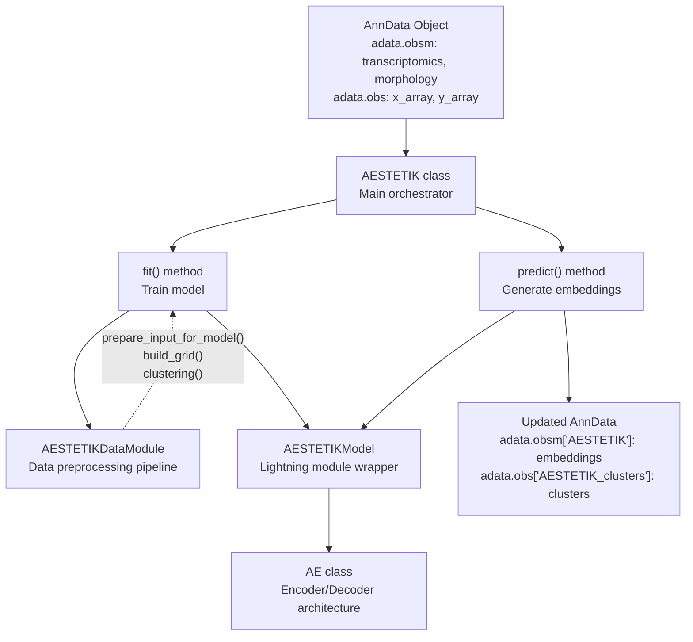
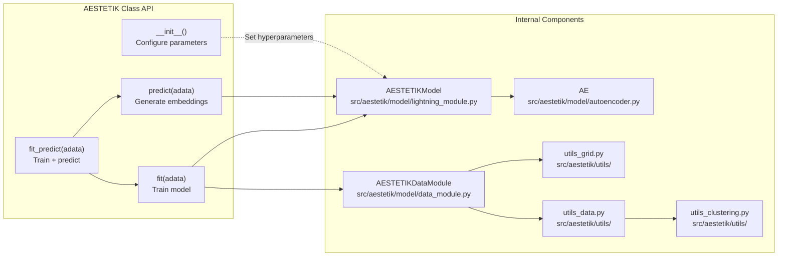
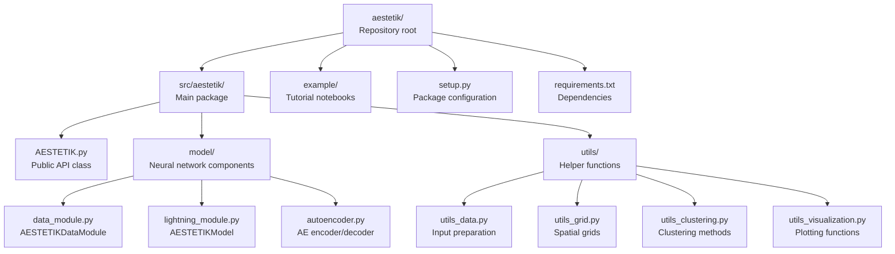
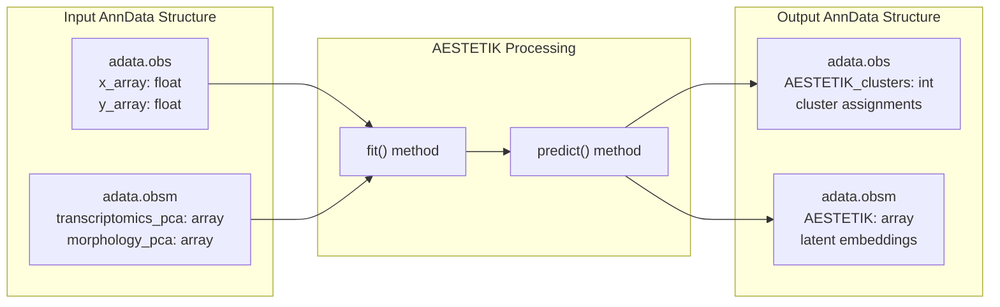

# Getting Started

<details>
<summary>Relevant source files</summary>

The following files were used as context for generating this wiki page:

- [MANIFEST.in](MANIFEST.in)
- [README.md](README.md)
- [figures/maynard_human_brain_analysis_151676_Transcriptomics_Morphology_AESTETIK.png](figures/maynard_human_brain_analysis_151676_Transcriptomics_Morphology_AESTETIK.png)
- [llms.txt](llms.txt)
- [setup.py](setup.py)

</details>


## Purpose and Scope

This page provides an entry point for new users to understand and begin using AESTETIK. It covers the conceptual workflow, basic API patterns, and installation overview. For detailed installation instructions, see [Installation](#2.1). For a hands-on tutorial with example code, see [Quick Start Tutorial](#2.2).

AESTETIK is a PyTorch Lightning-based autoencoder that learns multi-modal spot representations by jointly integrating transcriptomics and morphology information from spatial transcriptomics data. The system processes spatial neighborhoods through convolutional neural networks and uses contrastive learning to capture biological complexity.

**Sources:** [README.md:1-12](), [llms.txt:1-6]()

---

## Prerequisites

Before using AESTETIK, you should have:

| Requirement | Description |
|-------------|-------------|
| **Python version** | Python 3.9 or higher |
| **Data format** | AnnData objects with transcriptomics and morphology features |
| **Feature preprocessing** | PCA-reduced features stored in `adata.obsm` |
| **Spatial coordinates** | Spot coordinates stored in `adata.obs` |
| **Domain knowledge** | Basic familiarity with spatial transcriptomics and the scanpy/anndata ecosystem |

The system expects data following scanpy conventions, with features already dimensionality-reduced (typically via PCA) and stored in the AnnData object structure. For details on data preparation, see [Preparing Your Data](#4.1).

**Sources:** [README.md:60-63](), [setup.py:21]()

---

## AESTETIK Workflow Overview

The AESTETIK workflow consists of two primary phases: training (fit) and inference (predict). The system operates entirely through the `AESTETIK` class, which orchestrates all data processing, model training, and prediction steps.



**Workflow: AESTETIK Training and Prediction Pipeline**

The workflow follows these steps:

1. **Input preparation**: Load spatial transcriptomics data into an AnnData object with preprocessed features
2. **Training** (`fit` method): Train the model on the input data, which internally performs clustering, weight calibration, and grid construction
3. **Inference** (`predict` method): Generate latent space embeddings and optionally cluster them
4. **Output**: Results are stored in-place in the AnnData object following scanpy conventions

**Sources:** [README.md:29-36](), [llms.txt:37-45]()

---

## Core API Pattern

AESTETIK follows a scikit-learn-style API with `fit()`, `predict()`, and `fit_predict()` methods. The `AESTETIK` class is the sole public interface for users.

### Basic Usage Pattern

```python
from aestetik import AESTETIK

# Initialize the model
model = AESTETIK()

# Train on spatial transcriptomics data
model.fit(adata)

# Generate embeddings for the same or new data
model.predict(adata)

# Or combine both steps
model.fit_predict(adata)
```

**File References:**
- AESTETIK class definition: [src/aestetik/AESTETIK.py]()
- Example usage: [example/gettingStartedWithAESTETIK.ipynb]()

### Method-to-Component Mapping



**Diagram: AESTETIK API Methods and Internal Component Routing**

The `AESTETIK` class acts as a facade, delegating to specialized subsystems:
- **Data processing**: `AESTETIKDataModule` coordinates clustering (`utils_clustering.py`), weight calibration (`utils_data.py`), and spatial grid construction (`utils_grid.py`)
- **Model training**: `AESTETIKModel` wraps the `AE` autoencoder and manages the PyTorch Lightning training loop
- **Prediction**: Uses the trained model's encoder to generate latent space embeddings

**Sources:** [llms.txt:37-45](), [README.md:65-67]()

---

## Installation Options

AESTETIK can be installed through multiple methods depending on your environment and requirements.

### Quick Install via pip

```bash
pip install aestetik
```

This is the recommended method for most users. The package is available on PyPI and includes all Python dependencies.

### Conda Environment (Recommended for Development)

```bash
conda env create --file=environment.yaml
```

Creates a complete conda environment with all dependencies including `pyvips`, which may require system-level libraries.

### Offline Installation

```bash
git clone https://github.com/ratschlab/aestetik
cd aestetik
python setup.py install
```

Useful for systems without internet access or when modifying the source code.

### Critical Dependency: pyvips

AESTETIK requires `pyvips` for image processing. Due to system-level library dependencies, conda installation is recommended:

```bash
conda install conda-forge::pyvips
```

For detailed installation instructions, troubleshooting, and environment setup, see [Installation](#2.1).

**Sources:** [README.md:38-63](), [setup.py:1-22]()

---

## Package Structure Overview

Understanding the package structure helps navigate the codebase and locate relevant components.



**Diagram: AESTETIK Package Structure and Key Files**

| Directory/File | Purpose |
|----------------|---------|
| `src/aestetik/AESTETIK.py` | Main public API class - user entry point |
| `src/aestetik/model/` | PyTorch Lightning module, data module, and autoencoder architecture |
| `src/aestetik/utils/` | Data processing utilities (clustering, grid construction, visualization) |
| `example/` | Jupyter notebooks demonstrating usage patterns |
| `setup.py` | Package configuration and dependency specifications |

**Sources:** [setup.py:16-17](), [MANIFEST.in:1-2]()

---

## Data Flow: Input to Output

AESTETIK transforms AnnData objects by adding learned representations to specific fields following scanpy conventions.

### Input Requirements



**Diagram: AnnData Field Transformations Through AESTETIK Pipeline**

### Expected Fields

The system expects the following fields in input AnnData objects:

| Field | Type | Description |
|-------|------|-------------|
| `adata.obs['x_array']` | float | X spatial coordinates of spots |
| `adata.obs['y_array']` | float | Y spatial coordinates of spots |
| `adata.obsm[transcriptomics_key]` | ndarray | PCA-reduced transcriptomics features (default: `'transcriptomics_pca'`) |
| `adata.obsm[morphology_key]` | ndarray | PCA-reduced morphology features (default: `'morphology_pca'`) |

### Output Fields

After running `predict()`, the following fields are added:

| Field | Description |
|-------|-------------|
| `adata.obsm['AESTETIK']` | Latent space embeddings (latent_dim dimensions) |
| `adata.obs['AESTETIK_clusters']` | Cluster assignments (if `cluster=True`) |

For details on preparing input data and working with AnnData objects, see [Preparing Your Data](#4.1) and [AnnData Integration](#3.3).

**Sources:** Based on system architecture diagrams and typical scanpy/anndata conventions

---

## Next Steps

After completing installation, proceed to the following resources based on your needs:

### For Beginners

1. **[Quick Start Tutorial](#2.2)**: Follow the hands-on walkthrough using the example notebook [example/gettingStartedWithAESTETIK.ipynb]()
2. **[Core Concepts](#3)**: Understand fundamental concepts like multi-modal integration, spatial grids, and AnnData usage
3. **[Preparing Your Data](#4.1)**: Learn how to preprocess your spatial transcriptomics data for AESTETIK

### For Practical Usage

1. **[Training Models](#4.2)**: Complete guide to training including parameter selection
2. **[Making Predictions](#4.3)**: Generate embeddings and perform cross-sample prediction
3. **[Clustering and Analysis](#4.4)**: Analyze spatial domains using learned representations
4. **[Visualization](#4.5)**: Visualize training progress and results

### For Advanced Users

1. **[API Reference](#5)**: Complete documentation of all classes and methods
2. **[System Architecture](#6.1)**: Deep dive into internal component design
3. **[Developer Guide](#6)**: Information for contributors and developers extending AESTETIK

### Additional Resources

- **Example notebooks**: [example/gettingStartedWithAESTETIK.ipynb]() and [example/gettingStartedWithAESTETIKwithSimulatedData.ipynb]()
- **Paper preprint**: Available at https://www.medrxiv.org/content/10.1101/2024.06.04.24308256v1
- **Related projects**: [DeepSpot](https://github.com/ratschlab/DeepSpot) for H&E to transcriptomics prediction

**Sources:** [README.md:65-72](), [README.md:87-91]()

---