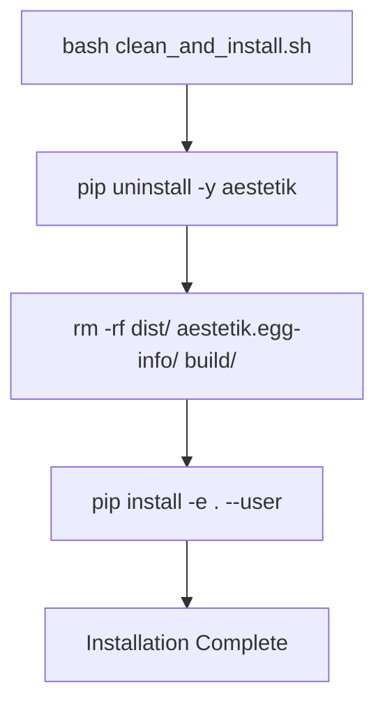
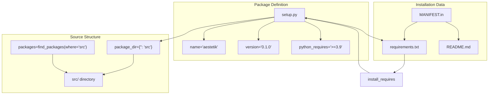
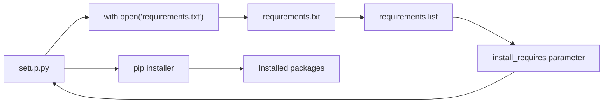

# Installation

<details>
<summary>Relevant source files</summary>

The following files were used as context for generating this wiki page:

- [MANIFEST.in](MANIFEST.in)
- [clean_and_install.sh](clean_and_install.sh)
- [requirements.txt](requirements.txt)
- [setup.py](setup.py)

</details>


## Purpose and Scope

This page provides detailed instructions for installing AESTETIK and its dependencies. It covers system requirements, installation methods for both users and developers, and verification steps to ensure successful setup.

For information about using AESTETIK after installation, see the [Quick Start Tutorial](#2.2). For development environment setup including testing frameworks, see [Development Setup](#6.2).

---

## System Requirements

AESTETIK requires the following system specifications:

| Component | Requirement |
|-----------|-------------|
| **Python Version** | >= 3.9 |
| **Operating System** | Linux, macOS, or Windows with WSL2 |
| **GPU** | Recommended (CUDA-compatible for PyTorch) |
| **RAM** | Minimum 8GB, 16GB+ recommended for large datasets |
| **Disk Space** | ~5GB for dependencies and model checkpoints |

**Sources:** [setup.py:21]()

---

## Installation Methods

### Standard Installation (Users)

For users who want to use AESTETIK as a tool:

```bash
# Clone the repository
git clone https://github.com/ratschlab/aestetik.git
cd aestetik

# Install in editable mode
pip install -e .
```

This command installs the package from the `src/` directory structure defined in [setup.py:16-17]() and makes AESTETIK available as a Python package.

**Sources:** [setup.py:1-22]()

### Development Installation

For developers contributing to AESTETIK, use the provided installation script:

```bash
# Run the clean installation script
bash clean_and_install.sh
```

This script performs the following operations:



**Installation Workflow**

The script removes any existing installation, cleans build artifacts, and installs AESTETIK in editable mode with user-level permissions.

**Sources:** [clean_and_install.sh:1-4]()

---

## Package Structure and Dependencies

### Package Configuration

AESTETIK is configured as a Python package with the following metadata:



**Package Configuration Structure**

**Sources:** [setup.py:1-22](), [MANIFEST.in:1-3]()

### Core Dependencies

AESTETIK requires the following dependencies, specified in [requirements.txt:1-16]():

| Category | Package | Version | Purpose |
|----------|---------|---------|---------|
| **Deep Learning** | `torch` | 2.0.0 | Core neural network framework |
| | `torchvision` | 0.15.1 | Image processing utilities |
| | `lightning` | 2.3.0 | Training orchestration and callbacks |
| **Scientific Computing** | `numpy` | 1.23.5 | Numerical computations |
| | `scipy` | 1.11.4 | Scientific algorithms |
| | `pandas` | 1.5.3 | Data manipulation |
| | `scikit-learn` | 1.2.2 | Machine learning utilities |
| **Spatial Biology** | `anndata` | 0.8.0 | Data structure for multi-modal data |
| | `scanpy` | 1.9.3 | Single-cell analysis tools |
| | `squidpy` | 1.2.2 | Spatial transcriptomics analysis |
| **Visualization** | `matplotlib` | 3.8.2 | Plotting library |
| | `plotnine` | latest | Grammar of graphics plotting |
| **Performance** | `numba` | 0.56.4 | JIT compilation for speed |
| | `llvmlite` | 0.39.1 | Low-level compilation support |
| | `dask-image` | 2022.9.0 | Distributed image processing |

**Sources:** [requirements.txt:1-16]()

### Dependency Resolution

The installation process resolves dependencies through the following mechanism:



**Dependency Resolution Flow**

The `setup.py` script reads [requirements.txt:1-16]() at lines [setup.py:4-5]() and passes the dependencies to setuptools via the `install_requires` parameter at [setup.py:20]().

**Sources:** [setup.py:4-5](), [setup.py:20](), [requirements.txt:1-16]()

---

## Post-Installation Verification

### Import Test

Verify successful installation by importing the package:

```python
# Test basic import
import aestetik
print(f"AESTETIK version: {aestetik.__version__}")

# Test main class availability
from aestetik import AESTETIK
print("AESTETIK class imported successfully")
```

### Dependency Verification

Check that all required dependencies are available:

```python
# Core deep learning
import torch
import lightning

# Spatial biology ecosystem
import anndata
import scanpy
import squidpy

# Verify PyTorch CUDA availability (if GPU present)
print(f"PyTorch version: {torch.__version__}")
print(f"CUDA available: {torch.cuda.is_available()}")
```

### Component Availability Test

Verify that all major components can be imported:

```python
# Data processing components
from aestetik.data_module import AESTETIKDataModule

# Model components
from aestetik.model import AESTETIKModel
from aestetik.ae import AE

# Utility modules
from aestetik import utils_data
from aestetik import utils_grid
from aestetik import utils_clustering
from aestetik import utils_visualization

print("All components imported successfully")
```

**Sources:** Based on system architecture from high-level diagrams

---

## Troubleshooting

### Common Installation Issues

#### Version Conflicts

**Problem:** Incompatible package versions, especially with PyTorch or NumPy.

**Solution:**
```bash
# Create a fresh virtual environment
python -m venv aestetik_env
source aestetik_env/bin/activate  # On Windows: aestetik_env\Scripts\activate

# Install with clean environment
pip install -e .
```

#### CUDA/GPU Issues

**Problem:** PyTorch not detecting GPU despite CUDA installation.

**Solution:** Verify PyTorch installation matches your CUDA version:
```bash
# Check CUDA version
nvidia-smi

# Reinstall PyTorch with correct CUDA version
# Example for CUDA 11.8
pip install torch==2.0.0 torchvision==0.15.1 --index-url https://download.pytorch.org/whl/cu118
```

#### Numba/LLVM Compilation Errors

**Problem:** `numba` or `llvmlite` fails to compile.

**Solution:**
```bash
# Install system-level LLVM dependencies (Ubuntu/Debian)
sudo apt-get install llvm-11-dev

# Reinstall numba and llvmlite
pip install --force-reinstall numba==0.56.4 llvmlite==0.39.1
```

#### Permission Errors

**Problem:** `Permission denied` errors during installation.

**Solution:** Use the user flag or virtual environment:
```bash
# Option 1: User installation
pip install -e . --user

# Option 2: Virtual environment (recommended)
python -m venv venv
source venv/bin/activate
pip install -e .
```

#### Import Errors After Installation

**Problem:** `ModuleNotFoundError` when importing AESTETIK.

**Solution:**
1. Verify installation:
   ```bash
   pip show aestetik
   ```

2. Check Python path:
   ```python
   import sys
   print(sys.path)
   ```

3. Reinstall using the clean script:
   ```bash
   bash clean_and_install.sh
   ```

**Sources:** [clean_and_install.sh:1-4]()

### Platform-Specific Notes

#### Windows (WSL2)

Windows users should use Windows Subsystem for Linux 2 (WSL2) for best compatibility with PyTorch and spatial analysis tools.

```bash
# In WSL2 terminal
sudo apt-get update
sudo apt-get install python3.9 python3-pip python3-venv
git clone https://github.com/ratschlab/aestetik.git
cd aestetik
pip install -e .
```

#### macOS (Apple Silicon)

For M1/M2 Macs, use the Apple Silicon optimized PyTorch:

```bash
# Install with Apple Silicon support
pip install torch==2.0.0 torchvision==0.15.1

# Then install AESTETIK
pip install -e .
```

**Sources:** [requirements.txt:1-2]()

---

## Installation Verification Checklist

Use this checklist to confirm successful installation:

- [ ] Python version is >= 3.9
- [ ] Repository cloned from GitHub
- [ ] `pip install -e .` completed without errors
- [ ] `import aestetik` works in Python
- [ ] All core dependencies import successfully
- [ ] PyTorch detects GPU (if available)
- [ ] Example notebooks can be opened (optional)

---

## Next Steps

After successful installation:

1. **Quick Start**: Follow the [Quick Start Tutorial](#2.2) to run your first AESTETIK workflow
2. **Prepare Data**: Learn about data preparation requirements in [Preparing Your Data](#4.1)
3. **Understand Concepts**: Review [Core Concepts](#3) to understand AESTETIK's approach to multi-modal spatial data

For detailed API documentation, see the [API Reference](#5) section.

**Sources:** [setup.py:1-22](), [requirements.txt:1-16](), [clean_and_install.sh:1-4](), [MANIFEST.in:1-3]()

---