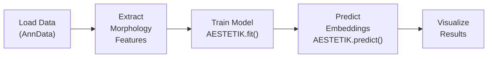
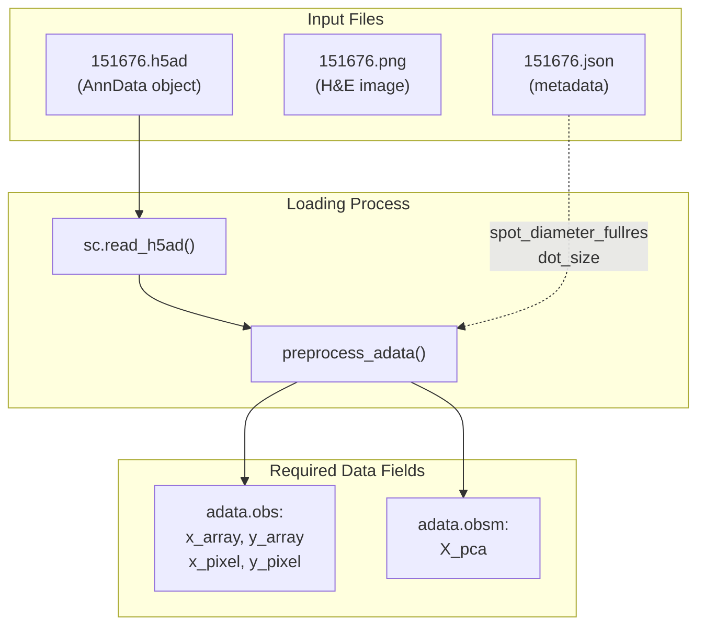
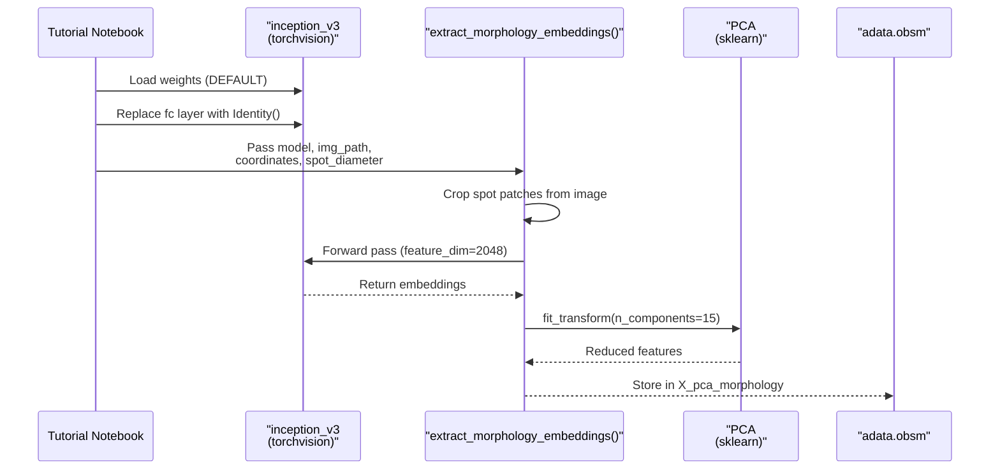
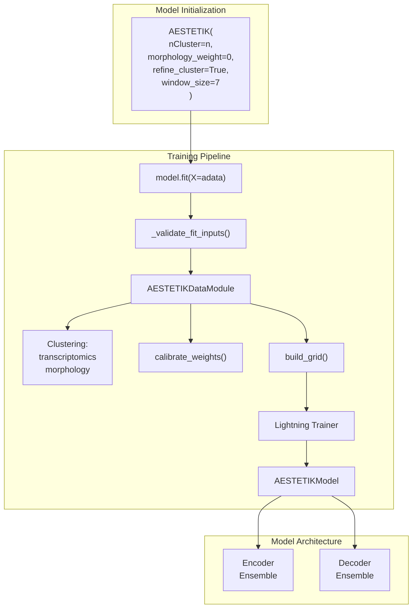
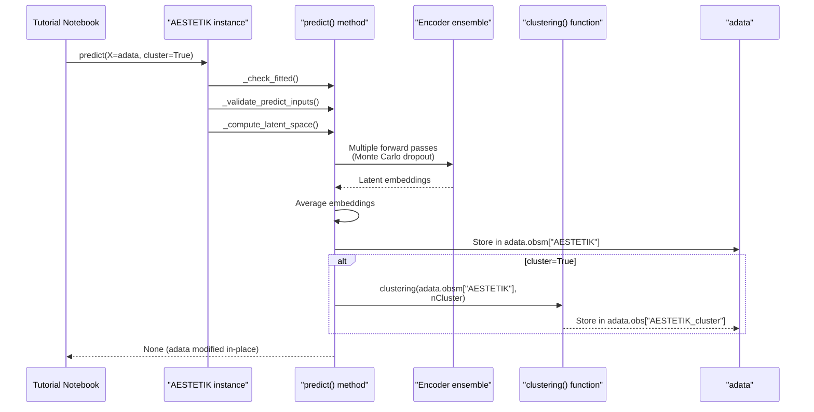
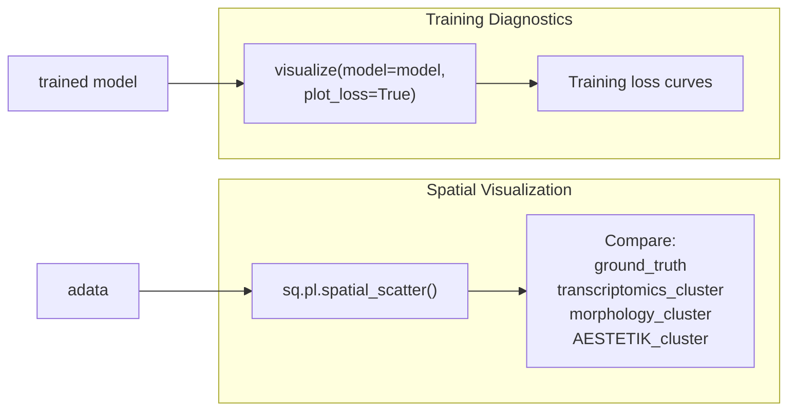
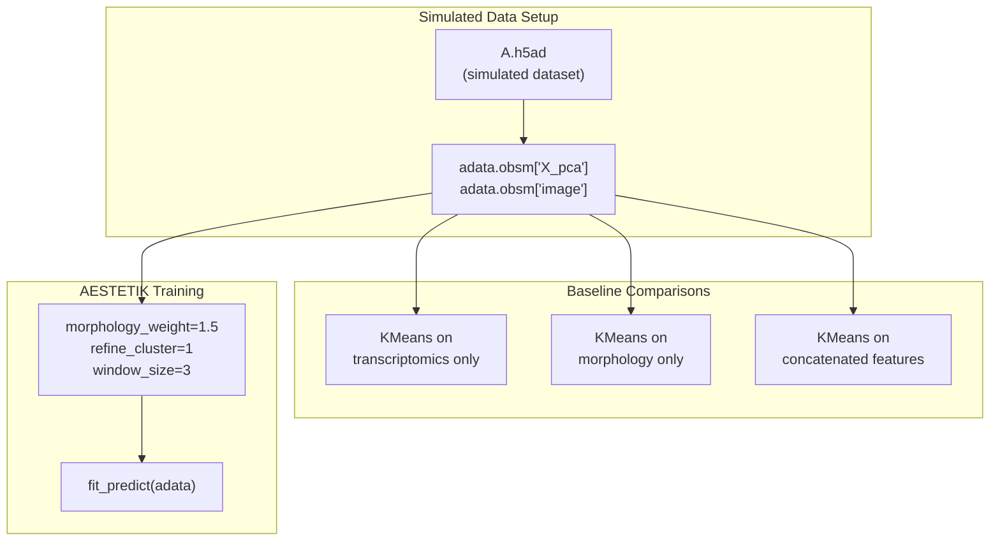
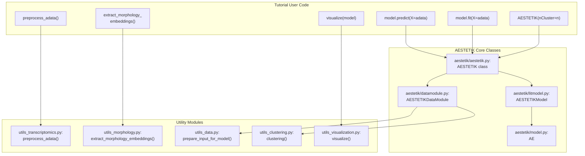
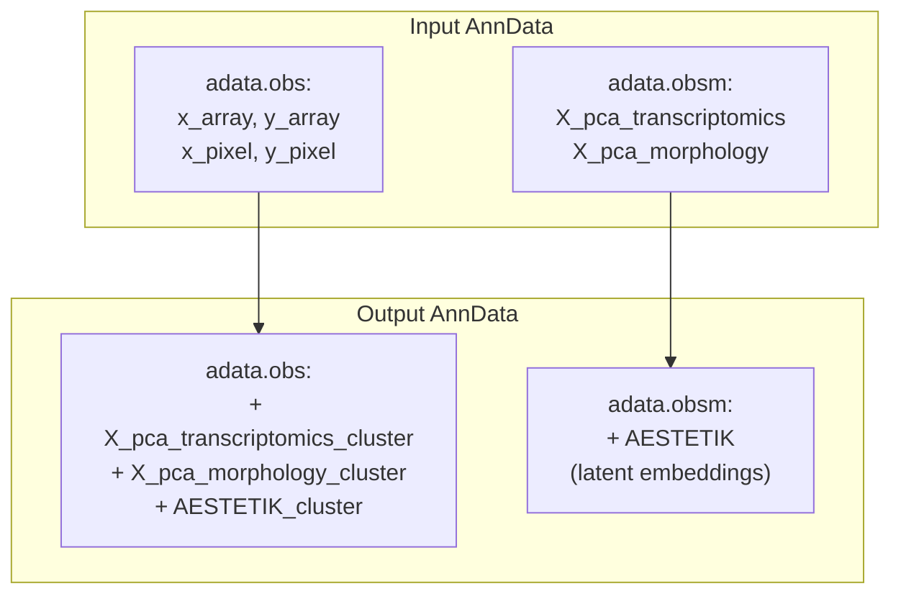

# Quick Start Tutorial

Relevant source files

The following files were used as context for generating this wiki page:

- [README.md](README.md)
- [example/gettingStartedWithAESTETIK.ipynb](example/gettingStartedWithAESTETIK.ipynb)
- [example/gettingStartedWithAESTETIKwithSimulatedData.ipynb](example/gettingStartedWithAESTETIKwithSimulatedData.ipynb)
- [figures/maynard_human_brain_analysis_151676_Transcriptomics_Morphology_AESTETIK.png](figures/maynard_human_brain_analysis_151676_Transcriptomics_Morphology_AESTETIK.png)
- [llms.txt](llms.txt)

## Purpose and Scope

This page provides a hands-on walkthrough of the basic AESTETIK workflow using the example notebooks provided in the repository. It demonstrates the complete pipeline from loading spatial transcriptomics data through model training to visualization of results.

For installation instructions, see [Installation](#2.1). For detailed parameter tuning and advanced workflows, see [Training Models](#4.2) and [Making Predictions](#4.3). For comprehensive API documentation, see [AESTETIK Class](#5.1).

---

## Tutorial Overview

The AESTETIK workflow consists of five primary stages executed through example notebooks. The tutorial uses the LIBD Human DLPFC dataset (sample 151676) to demonstrate multi-modal spatial transcriptomics analysis.

**Sources:** [example/gettingStartedWithAESTETIK.ipynb:10-14]()

---

## Tutorial Workflow

### Stage 1: Data Loading and Preprocessing

The tutorial begins by loading spatial transcriptomics data stored in AnnData format. The dataset requires specific spatial coordinates and preprocessed transcriptomics features.

The preprocessing step uses the `preprocess_adata()` utility function from the transcriptomics utilities module. This function ensures the AnnData object contains the required spatial coordinate fields (`x_array`, `y_array`, `x_pixel`, `y_pixel`) and performs dimensionality reduction to generate `X_pca` features.

**Key Data Requirements:**
| Field Location | Field Name | Description |
|---|---|---|
| `adata.obs` | `x_array`, `y_array` | Spatial coordinates on the array grid |
| `adata.obs` | `x_pixel`, `y_pixel` | Spatial coordinates in image pixel space |
| `adata.obsm` | `X_pca` | PCA-reduced transcriptomics features |
| metadata JSON | `spot_diameter_fullres` | Spot diameter in full resolution pixels |
| metadata JSON | `dot_size` | Visualization dot size parameter |

**Sources:** [example/gettingStartedWithAESTETIK.ipynb:100-155](), [aestetik/utils/utils_transcriptomics.py]()

---

### Stage 2: Morphology Feature Extraction

Morphology features are extracted from H&E images using a pre-trained CNN (Inception V3). The extraction process crops spot-level image patches and generates embeddings via the model's penultimate layer.

The extraction process is implemented in `extract_morphology_embeddings()` which performs the following operations:

1. Loads the H&E image using efficient image processing (pyvips)
2. Crops circular patches centered at each spot's pixel coordinates
3. Applies preprocessing transformations (resize, normalize)
4. Extracts features using the CNN's penultimate layer (2048 dimensions)
5. Applies PCA to reduce dimensions to match transcriptomics features (typically 15 components)

After extraction, the notebook stores features in two modality-specific keys:

| Key in `adata.obsm` | Content | Shape |
|---|---|---|
| `X_pca_transcriptomics` | Transcriptomics PCA features | n_spots × 15 |
| `X_pca_morphology` | Morphology CNN+PCA features | n_spots × 15 |

**Sources:** [example/gettingStartedWithAESTETIK.ipynb:194-260](), [aestetik/utils/utils_morphology.py]()

---

### Stage 3: Model Training

Model training is orchestrated through the `AESTETIK` class, which initializes the model architecture and invokes the PyTorch Lightning training loop.

**Key Parameters in Tutorial:**

| Parameter | Value | Purpose |
|---|---|---|
| `nCluster` | Number of ground truth clusters | Determines number of expected spatial domains |
| `morphology_weight` | 0 | Controls morphology contribution (0 = transcriptomics only) |
| `refine_cluster` | True | Enables spatial cluster refinement |
| `window_size` | 7 | Spatial grid size (7×7 neighborhood) |

The `fit()` method performs the following sequence:

1. **Input Validation:** Checks for required fields in `adata.obsm` (`X_pca_transcriptomics`, `X_pca_morphology`) and `adata.obs` (spatial coordinates)
2. **Data Module Setup:** Instantiates `AESTETIKDataModule` which prepares training data
3. **Clustering:** Clusters both modalities separately to generate triplet loss labels
4. **Weight Calibration:** Automatically adjusts modality weights based on cluster quality
5. **Grid Construction:** Builds spatial grids for each spot using KDTree neighbor queries
6. **Model Building:** Constructs the autoencoder architecture
7. **Training Loop:** Executes PyTorch Lightning training with the configured trainer

**Sources:** [example/gettingStartedWithAESTETIK.ipynb:283-320](), [aestetik/aestetik.py:fit()]()

---

### Stage 4: Predictions and Clustering

After training, the `predict()` method generates latent space embeddings and optionally performs clustering on the learned representations.

**Output Data Structure:**

The `predict()` method modifies the input AnnData object in-place, adding the following fields:

| Field Location | Field Name | Content |
|---|---|---|
| `adata.obsm` | `AESTETIK` | Latent space embeddings (n_spots × latent_dim) |
| `adata.obs` | `AESTETIK_cluster` | Cluster assignments (categorical) |
| `adata.obs` | `X_pca_transcriptomics_cluster` | Transcriptomics-only clusters (from preprocessing) |
| `adata.obs` | `X_pca_morphology_cluster` | Morphology-only clusters (from preprocessing) |

The method uses stochastic forward passes (Monte Carlo dropout) to compute robust embeddings by averaging multiple predictions per spot. The clustering step applies the method specified during initialization (default: Mclust) to the learned representations.

**Sources:** [example/gettingStartedWithAESTETIK.ipynb:334-364](), [aestetik/aestetik.py:predict()]()

---

### Stage 5: Visualization

The tutorial demonstrates two visualization approaches: spatial scatter plots for cluster comparison and training loss plots for model diagnostics.

**Spatial Cluster Visualization:**

The tutorial uses `sq.pl.spatial_scatter()` from squidpy to visualize cluster assignments in spatial context. This allows comparison of:
- Ground truth annotations (if available)
- Single-modality clusters (transcriptomics-only, morphology-only)
- Multi-modal AESTETIK clusters

**Training Loss Visualization:**

The `visualize()` utility function plots training metrics stored during the Lightning training loop, including:
- Total loss over epochs
- Reconstruction loss components (transcriptomics, morphology)
- Triplet loss components (transcriptomics, morphology)

**Sources:** [example/gettingStartedWithAESTETIK.ipynb:367-398](), [aestetik/utils/utils_visualization.py]()

---

## Alternative Tutorial: Simulated Data

The repository provides a second tutorial demonstrating AESTETIK on simulated spatial transcriptomics data. This tutorial is useful for understanding expected performance when modalities are complementary.

**Key Differences from Main Tutorial:**

| Aspect | Main Tutorial | Simulated Data Tutorial |
|---|---|---|
| Dataset | LIBD Human DLPFC (151676) | Synthetic spatial transcriptomics |
| Morphology weight | 0 (transcriptomics-only) | 1.5 (morphology important) |
| Window size | 7×7 | 3×3 |
| Comparisons | Ground truth vs AESTETIK | KMeans vs AESTETIK on all modality combinations |
| API usage | Separate `fit()` + `predict()` | Combined `fit_predict()` |

The simulated data tutorial demonstrates how to use `fit_predict()`, which combines training and prediction in a single call. This method is equivalent to calling `fit()` followed by `predict()`.

**Sources:** [example/gettingStartedWithAESTETIKwithSimulatedData.ipynb:1-296]()

---

## Complete Workflow Code Structure

The following diagram maps tutorial steps to concrete code entities in the AESTETIK codebase:

**Sources:** [example/gettingStartedWithAESTETIK.ipynb](), [aestetik/aestetik.py](), [aestetik/datamodule.py](), [aestetik/litmodel.py]()

---

## Expected Outputs

After completing the tutorial, the AnnData object contains the following new fields:

These outputs can be used for downstream analysis including:
- UMAP visualization of learned representations
- Differential expression analysis between AESTETIK clusters
- Spatial domain characterization
- Cross-sample integration (see [Making Predictions](#4.3))

**Sources:** [example/gettingStartedWithAESTETIK.ipynb:353-378](), [README.md:65-74]()

---