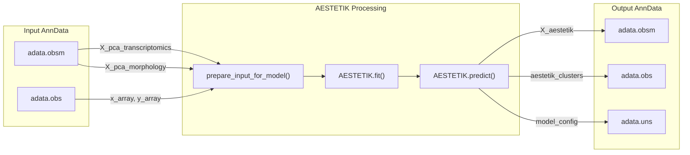
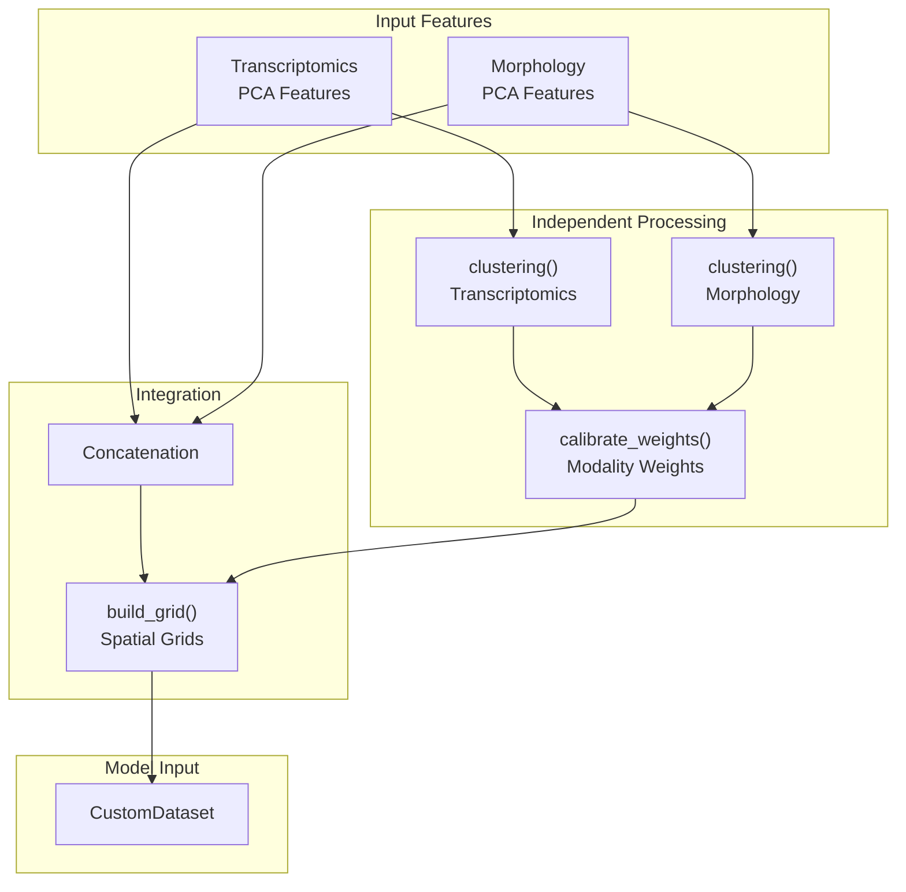
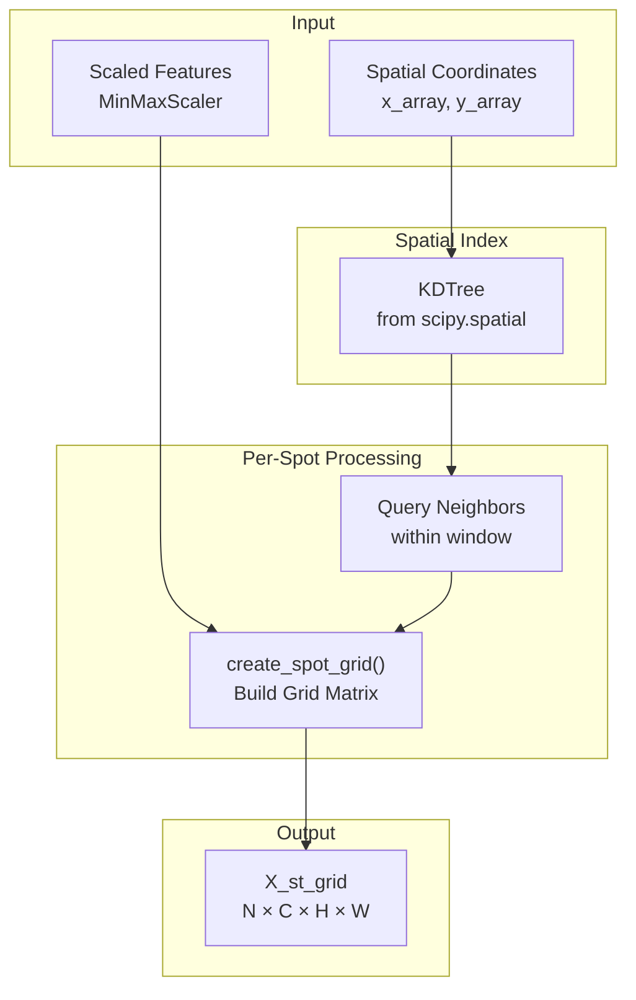
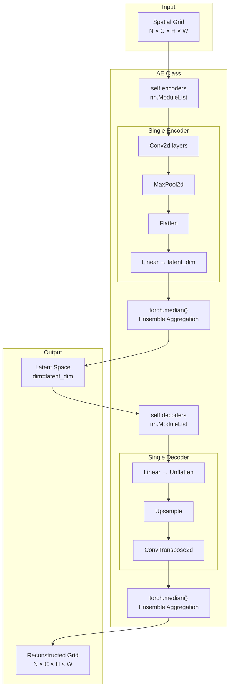
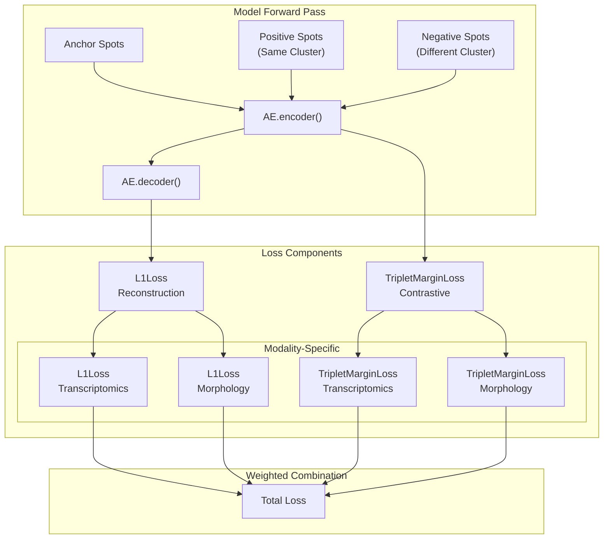
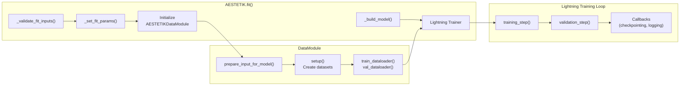
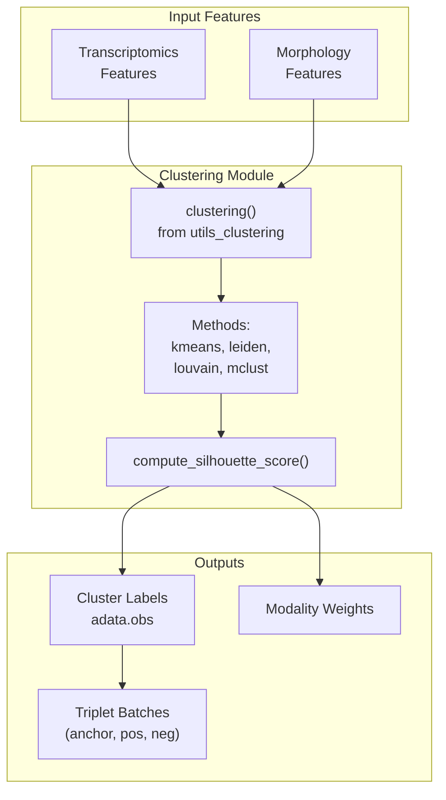
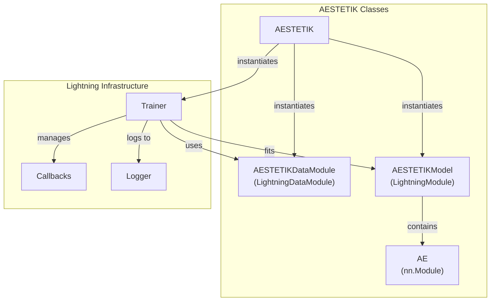
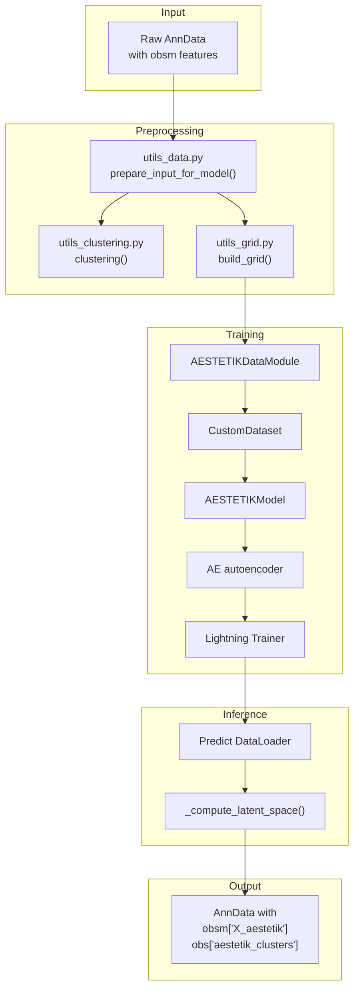

# Core Concepts

<details>
<summary>Relevant source files</summary>

The following files were used as context for generating this wiki page:

- [.codeboarding/on_boarding.md](.codeboarding/on_boarding.md)
- [README.md](README.md)
- [figures/maynard_human_brain_analysis_151676_Transcriptomics_Morphology_AESTETIK.png](figures/maynard_human_brain_analysis_151676_Transcriptomics_Morphology_AESTETIK.png)
- [llms.txt](llms.txt)

</details>


This page explains the fundamental concepts and terminology that underpin AESTETIK's approach to multi-modal spatial transcriptomics analysis. Understanding these concepts is essential for effectively using AESTETIK and interpreting its results.

For detailed implementation guidance, see the [User Guide](#4). For complete API documentation, see [API Reference](#5). For architectural details, see [System Architecture](#6.1).

---

## Overview

AESTETIK operates on three core principles:

1. **Multi-modal integration**: Combines transcriptomics and morphology features into unified representations
2. **Spatial awareness**: Incorporates neighborhood topology through spatial grid construction
3. **Contrastive learning**: Uses clustering-guided triplet loss to learn biologically meaningful embeddings

The system follows a data flow from raw `AnnData` objects through preprocessing, model training, and inference, ultimately producing learned embeddings stored back in the `AnnData` structure.

**Sources**: [README.md:29-36](), [llms.txt:1-13]()

---

## Data Representation

### The AnnData Object

AESTETIK uses the `AnnData` format as its universal data container, following conventions established by the scanpy/squidpy ecosystem. All inputs and outputs flow through `AnnData` objects.

| AnnData Slot | Purpose | Example Key |
|--------------|---------|-------------|
| `adata.obsm` | Stores feature matrices | `"X_pca_transcriptomics"`, `"X_pca_morphology"`, `"X_aestetik"` |
| `adata.obs` | Stores per-spot metadata | `"x_array"`, `"y_array"`, `"aestetik_clusters"` |
| `adata.obsp` | Stores spot-to-spot relationships | `"spatial_connectivities"` |
| `adata.uns` | Stores unstructured metadata | Model configuration, training parameters |

The system expects preprocessed features (typically PCA-reduced) to be present in `adata.obsm` before training.

**Diagram: AnnData Slots and AESTETIK Data Flow**



**Sources**: [src/aestetik/AESTETIK.py](), [src/aestetik/utils/utils_data.py]()

---

## Multi-Modal Data Integration

AESTETIK processes two distinct data modalities:

### Modality Types

1. **Transcriptomics**: Gene expression features, typically PCA-reduced to 20-50 components
2. **Morphology**: Tissue appearance features extracted from H&E images, also PCA-reduced

Each modality is processed independently through:
- Separate clustering (via `utils_clustering.py`)
- Separate weight calibration (via `calibrate_weights()`)
- Separate loss computation (transcriptomics and morphology components)

**Diagram: Modality Processing Pipeline**



### Weight Calibration

The `calibrate_weights()` function computes modality-specific weights based on cluster quality metrics (silhouette scores). This addresses scenarios where one modality provides poor clustering signal.

**Weight Computation Logic**:
```
if transcriptomics_silhouette > morphology_silhouette:
    transcriptomics_weight = 1.0
    morphology_weight = morphology_silhouette / transcriptomics_silhouette
else:
    morphology_weight = 1.0
    transcriptomics_weight = transcriptomics_silhouette / morphology_silhouette
```

These weights are applied during loss computation to balance modality contributions.

**Sources**: [src/aestetik/utils/utils_data.py](), [src/aestetik/utils/utils_clustering.py]()

For detailed coverage, see [Multi-Modal Data Integration](#3.1).

---

## Spatial Grid Construction

AESTETIK represents each spot's spatial context using a grid-based approach. Instead of processing spots in isolation, the system constructs a spatial grid around each spot containing features from neighboring spots.

### Grid Construction Process

**Diagram: Grid Construction Components**



### Grid Structure

Each grid has shape `(window_size, window_size, n_features)`:
- **window_size**: Defines the spatial extent (default: 10)
- **n_features**: Combined transcriptomics + morphology dimensions
- **Centering**: The target spot is placed at the grid center
- **Padding**: Empty positions are zero-padded when insufficient neighbors exist

The `build_grid()` function in [src/aestetik/utils/utils_grid.py]() handles this construction, using parallel processing for efficiency.

**Grid Tensor Transformation**:
```
Raw grid: (window_size, window_size, n_features)
         ↓
Transposed: (n_features, window_size, window_size)
         ↓
Batched: (batch_size, n_features, window_size, window_size)
```

This format is compatible with PyTorch's convolutional layers expecting `(N, C, H, W)` tensors.

**Sources**: [src/aestetik/utils/utils_grid.py](), [src/aestetik/utils/utils_data.py]()

For detailed coverage, see [Spatial Grid Processing](#3.2).

---

## Ensemble Autoencoder Architecture

AESTETIK employs an ensemble autoencoder design with median aggregation for robustness.

### Architecture Components

**Diagram: Model Architecture and Code Entities**



### Ensemble Strategy

The `AE` class in [src/aestetik/models/model.py]() implements:
- **num_ensembles** independent encoder/decoder pairs (default: 3)
- **Median aggregation**: Robust to outliers compared to mean
- **Dropout regularization**: Applied during both training and inference for stochasticity

Each ensemble member processes the same input independently, and outputs are aggregated element-wise using median.

**Sources**: [src/aestetik/models/model.py]()

---

## Loss Function Components

AESTETIK's loss function combines reconstruction and contrastive learning objectives.

### Loss Architecture

**Diagram: Loss Computation Flow**



### Loss Formula

The total loss is computed as:

```
total_loss = (rec_alpha * reconstruction_loss) + (triplet_alpha * triplet_loss)

reconstruction_loss = L1(decoded, input)
triplet_loss = max(0, margin + d(anchor, positive) - d(anchor, negative))
```

Where:
- **rec_alpha**: Reconstruction loss weight (default: 1.0)
- **triplet_alpha**: Triplet loss weight (default: 1.0)
- **margin**: Triplet margin parameter (default: 1.0)
- **d()**: Distance function (L2 norm in latent space)

Each component is computed separately for transcriptomics and morphology modalities, then combined with calibrated weights.

**Sources**: [src/aestetik/metrics/loss_function.py](), [src/aestetik/modules/aestetik_module.py]()

---

## Training and Inference Workflow

### Training Phase

The `AESTETIK.fit()` method orchestrates the training workflow:

**Diagram: Training Workflow Components**



**Key Methods**:
- `_validate_fit_inputs()`: Checks for required feature keys in `adata.obsm`
- `_set_fit_params()`: Configures model hyperparameters
- `AESTETIKDataModule.setup()`: Prepares train/validation datasets
- `AESTETIKModel.training_step()`: Computes loss for one batch

**Sources**: [src/aestetik/AESTETIK.py](), [src/aestetik/data_modules/data_module.py](), [src/aestetik/modules/aestetik_module.py]()

### Inference Phase

The `AESTETIK.predict()` method generates embeddings:

**Diagram: Inference Workflow Components**

```mermaid
graph LR
    subgraph "AESTETIK.predict()"
        check_fitted["_check_fitted()"]
        validate_pred["_validate_predict_inputs()"]
        calibrate["_calibrate_predict_inputs()"]
        compute_latent["_compute_latent_space()"]
    end
    
    subgraph "Latent Computation"
        create_loader["_create_predict_dataloader()"]
        predict_step["AESTETIKModel.predict_step()"]
        aggregate["Average over<br/>num_repeats"]
    end
    
    subgraph "Post-processing"
        store_obsm["Store in<br/>adata.obsm['X_aestetik']"]
        clustering_opt["Optional:<br/>_postprocess_predictions()"]
        store_obs["Store clusters in<br/>adata.obs"]
    end
    
    check_fitted --> validate_pred
    validate_pred --> calibrate
    calibrate --> compute_latent
    
    compute_latent --> create_loader
    create_loader --> predict_step
    predict_step --> aggregate
    
    aggregate --> store_obsm
    store_obsm --> clustering_opt
    clustering_opt --> store_obs
```



**Key Features**:
- **Stochastic forward passes**: `num_repeats` parameter controls Monte Carlo dropout sampling
- **Cross-sample prediction**: Can apply a trained model to new samples
- **In-place modification**: Results stored directly in input `adata` object

**Sources**: [src/aestetik/AESTETIK.py](), [src/aestetik/modules/aestetik_module.py]()

---

## Clustering and Triplet Mining

### Clustering Role

Clustering serves two purposes in AESTETIK:

1. **Triplet mining**: Cluster labels guide selection of positive/negative pairs for contrastive learning
2. **Weight calibration**: Cluster quality (silhouette scores) determines modality weights

**Diagram: Clustering in the Pipeline**



### Triplet Batch Construction

The `CustomDataset` class in [src/aestetik/dataloader.py]() constructs triplets:

**Triplet Selection Logic**:
1. **Anchor**: A randomly selected spot
2. **Positive**: A spot from the same cluster as anchor
3. **Negative**: A spot from a different cluster than anchor

This happens independently for transcriptomics and morphology modalities, using their respective cluster labels.

**Sources**: [src/aestetik/utils/utils_clustering.py](), [src/aestetik/dataloader.py]()

---

## PyTorch Lightning Integration

AESTETIK leverages PyTorch Lightning for training infrastructure.

### Component Mapping

| Lightning Component | AESTETIK Implementation | Purpose |
|---------------------|-------------------------|---------|
| `LightningModule` | `AESTETIKModel` | Defines training/validation/test steps |
| `LightningDataModule` | `AESTETIKDataModule` | Manages data loading and preprocessing |
| `Trainer` | Instantiated in `AESTETIK.fit()` | Orchestrates training loop |
| `Callback` | Lightning's built-in callbacks | Checkpointing, logging, early stopping |

**Diagram: Lightning Integration**



### Training Step Implementation

The `AESTETIKModel.training_step()` method ([src/aestetik/modules/aestetik_module.py]()) follows Lightning's interface:

```python
def training_step(self, batch, batch_idx):
    # Unpack batch
    anchor, positive, negative = batch
    
    # Forward pass
    encoded_anchor, decoded_anchor = self.model(anchor)
    
    # Compute losses
    loss = self.compute_loss(...)
    
    # Log metrics
    self.log('train_loss', loss)
    
    return loss
```

Lightning handles:
- Optimizer stepping
- Gradient accumulation
- Distributed training
- Checkpointing
- Logging

**Sources**: [src/aestetik/modules/aestetik_module.py](), [src/aestetik/AESTETIK.py]()

---

## Data Flow Summary

**End-to-End Data Flow Diagram**



**Key Data Transformations**:
1. **PCA features** → Clustering labels + Scaled features
2. **Scaled features + Spatial coords** → Spatial grids
3. **Spatial grids + Labels** → Triplet batches
4. **Triplet batches** → Latent embeddings
5. **Latent embeddings** → Cluster assignments

**Sources**: All pipeline components referenced above

---

## Next Steps

- For details on multi-modal integration strategies, see [Multi-Modal Data Integration](#3.1)
- For details on spatial grid algorithms, see [Spatial Grid Processing](#3.2)  
- For details on AnnData conventions, see [AnnData Integration](#3.3)
- For practical usage examples, see [User Guide](#4)
- For complete API documentation, see [API Reference](#5)

---