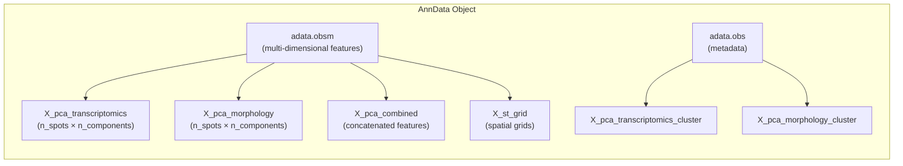
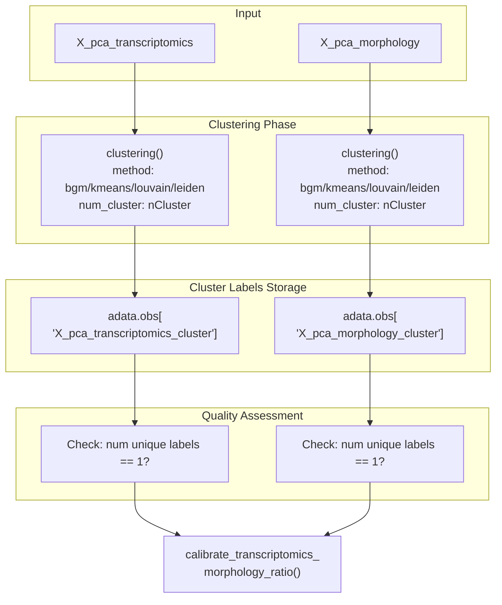
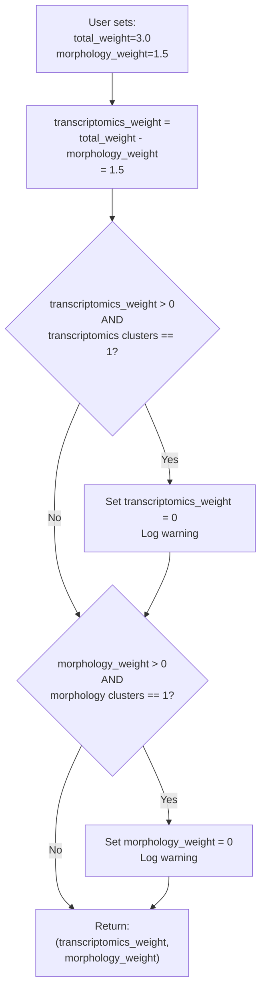
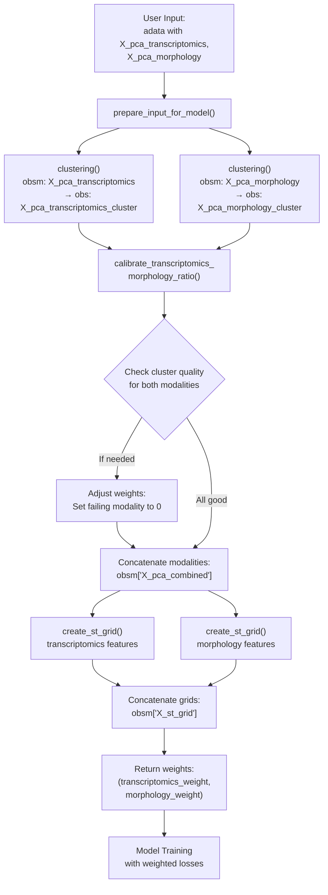

# Multi-Modal Data Integration

<details>
<summary>Relevant source files</summary>

The following files were used as context for generating this wiki page:

- [README.md](README.md)
- [example/gettingStartedWithAESTETIK.ipynb](example/gettingStartedWithAESTETIK.ipynb)
- [example/gettingStartedWithAESTETIKwithSimulatedData.ipynb](example/gettingStartedWithAESTETIKwithSimulatedData.ipynb)
- [figures/maynard_human_brain_analysis_151676_Transcriptomics_Morphology_AESTETIK.png](figures/maynard_human_brain_analysis_151676_Transcriptomics_Morphology_AESTETIK.png)
- [llms.txt](llms.txt)
- [src/aestetik/utils/utils_data.py](src/aestetik/utils/utils_data.py)

</details>


## Purpose and Scope

This page explains how AESTETIK integrates two distinct data modalities—**transcriptomics** and **morphology**—into a unified representation learning framework. It covers the storage conventions, independent processing pipelines, weight calibration mechanisms, and how these modalities are combined for model training.

For information about how spatial grids are constructed from these modalities, see [Spatial Grid Processing](#3.2). For details on AnnData object structure and ecosystem integration, see [AnnData Integration](#3.3). For the complete API reference on training with multi-modal data, see [AESTETIK Class](#5.1).

---

## Overview of Multi-Modal Integration

AESTETIK processes two complementary information sources:

| Modality | Data Type | Typical Source | Dimensionality |
|----------|-----------|----------------|----------------|
| **Transcriptomics** | Gene expression measurements | RNA counts per spot | PCA-reduced features (e.g., 15-50 components) |
| **Morphology** | Tissue appearance features | H&E stained images | Deep learning embeddings (e.g., InceptionV3, ResNet) + PCA |

These modalities are processed **independently** during preprocessing, then **weighted and combined** for model input. The key design principle is that each modality may capture different aspects of the biological state, and their combination provides a more complete representation.

**Sources:** [README.md:29-36](), [example/gettingStartedWithAESTETIK.ipynb:10-14]()

---

## Data Modality Storage

### AnnData Storage Conventions

AESTETIK expects multi-modal features to be stored in the `obsm` (observations-measurements) attribute of AnnData objects:



**Default key names** (configurable via parameters):
- `used_obsm_transcriptomics`: `"X_pca_transcriptomics"` (default)
- `used_obsm_morphology`: `"X_pca_morphology"` (default)
- `used_obsm_combined`: `"X_pca_combined"` (default)

**Sources:** [src/aestetik/utils/utils_data.py:15-27](), [example/gettingStartedWithAESTETIK.ipynb:242-258]()

### Transcriptomics Data

Transcriptomics features typically come from:

1. **Preprocessing pipeline**: Normalization → highly variable gene selection → PCA
2. **Storage**: `adata.obsm["X_pca_transcriptomics"]`
3. **Typical dimensionality**: 15-50 principal components

Example from getting started notebook:

```python
# After scanpy preprocessing (normalize, hvg, PCA)
adata.obsm["X_pca_transcriptomics"] = adata.obsm["X_pca"][:, 0:n_components]
```

**Sources:** [example/gettingStartedWithAESTETIK.ipynb:242-246](), [example/gettingStartedWithAESTETIKwithSimulatedData.ipynb:205-206]()

### Morphology Data

Morphology features are extracted from H&E stained tissue images:

1. **Feature extraction**: Pre-trained CNN (e.g., InceptionV3) applied to spot neighborhoods
2. **Dimensionality reduction**: PCA applied to CNN embeddings
3. **Storage**: `adata.obsm["X_pca_morphology"]`

Example extraction workflow:

```python
from aestetik.utils.utils_morphology import extract_morphology_embeddings

features_inception_v3 = extract_morphology_embeddings(
    img_path, morphology_model,
    x_pixel=adata.obs.y_pixel, 
    y_pixel=adata.obs.x_pixel, 
    spot_diameter=spot_diameter_fullres,
    n_components=n_components,
    feature_dim=2048,  # InceptionV3 output
    apply_pca=True
)
adata.obsm["X_pca_morphology"] = features_inception_v3[:, 0:n_components]
```

**Sources:** [example/gettingStartedWithAESTETIK.ipynb:188-258]()

---

## Independent Modality Processing

### Separate Clustering for Triplet Loss

Each modality undergoes **independent clustering** to generate labels for the triplet loss component. This ensures that the model learns to separate spots based on both transcriptomics and morphology similarity.



The clustering is performed in [src/aestetik/utils/utils_data.py:35-51]():

```python
clustering(
    adata=adata,
    num_cluster=nCluster,
    used_obsm=used_obsm_transcriptomics,
    used_obs_batch=used_obs_batch,
    method=clustering_method,
    n_neighbors=n_neighbors,
    refine_cluster=0  # No spatial refinement at this stage
)

clustering(
    adata=adata,
    num_cluster=nCluster,
    used_obsm=used_obsm_morphology,
    used_obs_batch=used_obs_batch,
    method=clustering_method,
    n_neighbors=n_neighbors,
    refine_cluster=0
)
```

**Sources:** [src/aestetik/utils/utils_data.py:33-51]()

### Cluster Quality Assessment

After clustering, the system checks whether each modality produced meaningful cluster assignments. If a modality fails to separate spots (i.e., all spots assigned to a single cluster), that modality's weight is automatically set to zero.

**Sources:** [src/aestetik/utils/utils_data.py:91-111]()

---

## Weight Calibration Mechanism

### Weight Parameters

AESTETIK uses two weight parameters to control modality contributions:

| Parameter | Type | Default | Description |
|-----------|------|---------|-------------|
| `total_weight` | float | 3.0 | Total weight budget for both modalities |
| `morphology_weight` | float | 1.5 | Portion of total_weight allocated to morphology |
| `transcriptomics_weight` | float | computed | Automatically computed as `total_weight - morphology_weight` |

### Automatic Calibration Logic

The `calibrate_transcriptomics_morphology_ratio()` function adjusts weights based on clustering quality:



**Implementation:** [src/aestetik/utils/utils_data.py:91-111]()

```python
def calibrate_transcriptomics_morphology_ratio(
    adata: anndata, 
    nCluster: Union[int, float], 
    used_obsm_transcriptomics: str, 
    used_obsm_morphology: str, 
    total_weight: float, 
    morphology_weight: float) -> Tuple[float, float]:
    
    transcriptomics_weight = total_weight - morphology_weight

    if (transcriptomics_weight > 0 and
        adata.obs[f"{used_obsm_transcriptomics}_cluster"].unique().size == 1):
        logging.info(
            f"obsm {used_obsm_transcriptomics} resulted in 1 cluster "
            f"instead of {nCluster}. transcriptomics_weight will be set to 0.")
        transcriptomics_weight = 0

    if (morphology_weight > 0 and
        adata.obs[f"{used_obsm_morphology}_cluster"].unique().size == 1):
        logging.info(
            f"obsm {used_obsm_morphology} resulted in 1 cluster "
            f"instead of {nCluster}. morphology_weight will be set to 0.")
        morphology_weight = 0

    return transcriptomics_weight, morphology_weight
```

**Sources:** [src/aestetik/utils/utils_data.py:91-112]()

### Example Scenarios

| Scenario | Initial Weights | Cluster Counts | Final Weights | Behavior |
|----------|----------------|----------------|---------------|----------|
| Both modalities work | T=1.5, M=1.5 | T=7, M=6 | T=1.5, M=1.5 | Normal operation |
| Morphology fails | T=1.5, M=1.5 | T=7, M=1 | T=1.5, M=0 | Transcriptomics-only |
| Transcriptomics fails | T=1.5, M=1.5 | T=1, M=6 | T=0, M=1.5 | Morphology-only |
| User sets M=0 | T=3.0, M=0 | T=7, M=N/A | T=3.0, M=0 | Intentional transcriptomics-only |

**Sources:** [example/gettingStartedWithAESTETIK.ipynb:278-294]()

---

## Modality Combination

### Feature Concatenation

After independent clustering and weight calibration, the modalities are concatenated for spatial grid construction:

```python
adata.obsm[used_obsm_combined] = np.concatenate(
    (adata.obsm[used_obsm_transcriptomics], 
     adata.obsm[used_obsm_morphology]), 
    axis=1
)
```

This creates a combined feature matrix where each spot is represented by `[transcriptomics_features | morphology_features]`.

**Sources:** [src/aestetik/utils/utils_data.py:62-63]()

### Grid Building

The combined features are used to build spatial grids (see [Spatial Grid Processing](#3.2) for details):

```python
build_grid(adata,
           used_obsm_transcriptomics=used_obsm_transcriptomics,
           used_obsm_morphology=used_obsm_morphology,
           window_size=window_size,
           n_jobs=n_jobs,
           used_obs_batch=used_obs_batch)
```

This function:
1. Creates separate grids for transcriptomics features [src/aestetik/utils/utils_data.py:80-82]()
2. Creates separate grids for morphology features [src/aestetik/utils/utils_data.py:84-86]()
3. Concatenates them into `adata.obsm["X_st_grid"]` [src/aestetik/utils/utils_data.py:88-89]()

**Sources:** [src/aestetik/utils/utils_data.py:74-89]()

### Separate Loss Computation

During model training, losses are computed **separately for each modality** and weighted according to the calibrated weights. This allows the model to learn from both modalities while respecting their relative information content:

- **Triplet Loss**: Computed separately for transcriptomics and morphology cluster labels
- **Reconstruction Loss**: Computed separately for transcriptomics and morphology grid channels
- **Total Loss**: Weighted sum based on `transcriptomics_weight` and `morphology_weight`

This modality-specific loss computation is detailed in the model architecture documentation (see [Model Architecture](#5.3)).

**Sources:** [README.md:31-36]()

---

## Complete Multi-Modal Processing Pipeline



**Entry point:** [src/aestetik/utils/utils_data.py:14-72]()

**Sources:** [src/aestetik/utils/utils_data.py:14-112]()

---

## Usage Example

### Setting Up Multi-Modal Data

```python
import scanpy as sc
from aestetik.utils.utils_morphology import extract_morphology_embeddings
from aestetik import AESTETIK

# Load and preprocess transcriptomics
adata = sc.read_h5ad("sample.h5ad")
sc.pp.normalize_total(adata)
sc.pp.log1p(adata)
sc.pp.highly_variable_genes(adata)
sc.pp.pca(adata, n_comps=50)

# Set transcriptomics modality
n_components = 15
adata.obsm["X_pca_transcriptomics"] = adata.obsm["X_pca"][:, 0:n_components]

# Extract morphology features from H&E image
morphology_features = extract_morphology_embeddings(
    img_path="sample_image.png",
    morphology_model=inception_v3_model,
    x_pixel=adata.obs.y_pixel,
    y_pixel=adata.obs.x_pixel,
    spot_diameter=spot_diameter_fullres,
    n_components=n_components,
    apply_pca=True
)

# Set morphology modality
adata.obsm["X_pca_morphology"] = morphology_features[:, 0:n_components]
```

### Training with Controlled Modality Weights

```python
# Balanced contribution (default)
model = AESTETIK(
    nCluster=7,
    morphology_weight=1.5,  # 1.5 out of 3.0 total
    total_weight=3.0
)

# Transcriptomics-only (no morphology)
model = AESTETIK(
    nCluster=7,
    morphology_weight=0.0,
    total_weight=3.0
)

# Higher morphology contribution
model = AESTETIK(
    nCluster=7,
    morphology_weight=2.0,  # 2.0 out of 3.0 total
    total_weight=3.0
)

model.fit(adata)
```

**Sources:** [example/gettingStartedWithAESTETIK.ipynb:200-320](), [example/gettingStartedWithAESTETIKwithSimulatedData.ipynb:205-235]()

---

## Key Design Principles

1. **Modality Independence**: Each modality is processed independently during preprocessing to ensure neither dominates early-stage feature learning.

2. **Automatic Failure Handling**: If a modality fails to produce meaningful clusters, its weight is automatically zeroed to prevent degrading performance.

3. **Configurable Weighting**: Users can control the relative contribution of each modality through the `morphology_weight` parameter.

4. **Concatenative Fusion**: Modalities are combined through concatenation rather than other fusion strategies, preserving all information for the model to learn optimal integration.

5. **Separate Loss Components**: Loss functions are computed separately for each modality, allowing fine-grained control over multi-modal learning.

**Sources:** [src/aestetik/utils/utils_data.py:14-112](), [README.md:29-36]()

---