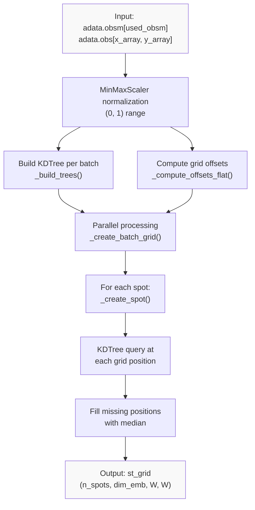
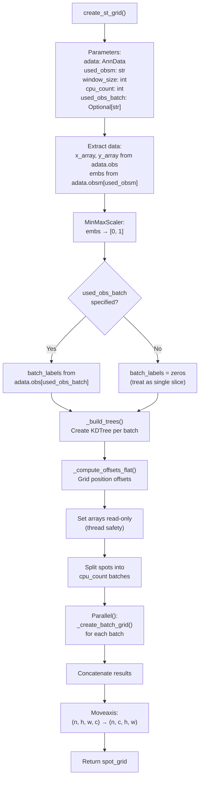
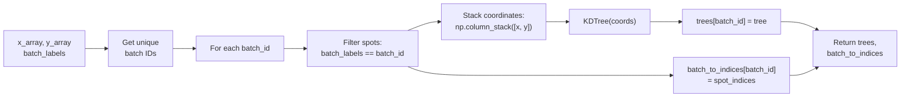
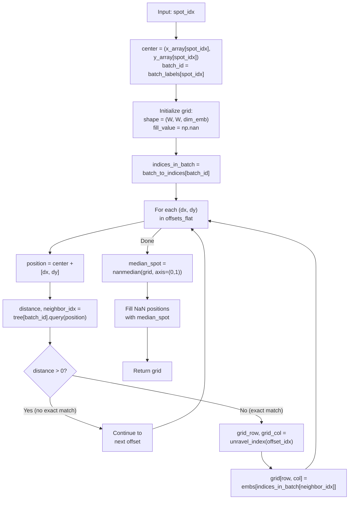
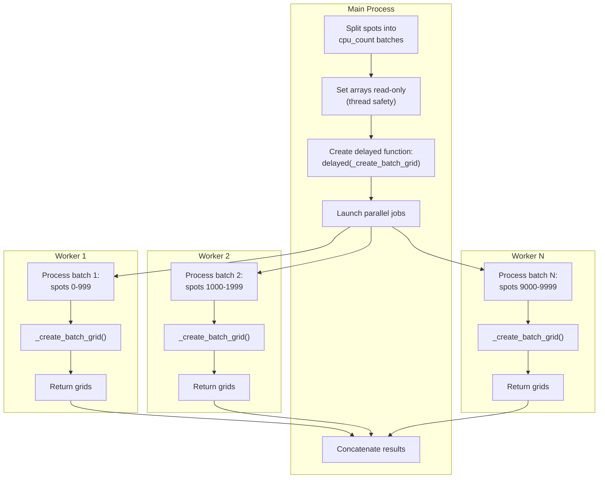
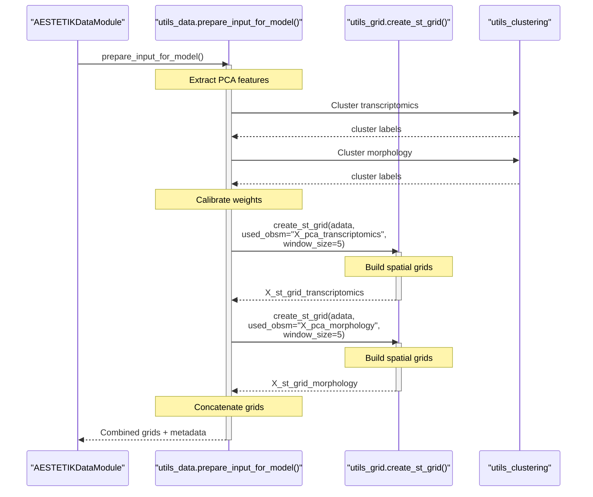
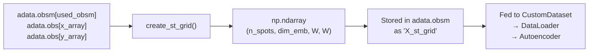

# Spatial Grid Processing

<details>
<summary>Relevant source files</summary>

The following files were used as context for generating this wiki page:

- [README.md](README.md)
- [figures/maynard_human_brain_analysis_151676_Transcriptomics_Morphology_AESTETIK.png](figures/maynard_human_brain_analysis_151676_Transcriptomics_Morphology_AESTETIK.png)
- [llms.txt](llms.txt)
- [src/aestetik/utils/utils_grid.py](src/aestetik/utils/utils_grid.py)

</details>


## Purpose and Scope

This document explains the spatial grid construction system in AESTETIK. Spatial grids transform spot-level feature vectors into structured spatial neighborhoods that capture local topology for convolutional processing. This system is a critical component of AESTETIK's multi-modal integration approach.

For information about how spatial grids are used within the broader data pipeline, see [Data Pipeline Components](#5.2). For details on the multi-modal integration that occurs before grid construction, see [Multi-Modal Data Integration](#3.1).

---

## Overview

AESTETIK uses convolutional autoencoders to learn representations from spatial transcriptomics data. Standard neural networks process feature vectors, but spatial transcriptomics data has an additional dimension: the physical location of each spot in tissue. Spatial grid processing bridges this gap by constructing structured 2D grids around each spot that encode neighborhood topology.

### What is a Spatial Grid?

A spatial grid is a fixed-size window (e.g., 5×5 or 7×7) centered on each spot. Each position in the grid contains feature values from the nearest neighboring spot at that spatial location. If no spot exists at a grid position, the position is filled with a representative value (median).

**Input**: Spot-level features (e.g., PCA-reduced transcriptomics or morphology) and spatial coordinates  
**Output**: 3D tensor per spot with shape `(num_features, window_size, window_size)`  
**Purpose**: Enable convolutional operations that leverage spatial topology

Sources: [src/aestetik/utils/utils_grid.py:54-108](), [README.md:29-36]()

---

## Grid Construction Workflow

The following diagram shows the complete grid construction process for a single modality (transcriptomics or morphology):



Sources: [src/aestetik/utils/utils_grid.py:54-108]()

---

## Main Function: create_st_grid

The entry point for spatial grid construction is `create_st_grid()`:



Sources: [src/aestetik/utils/utils_grid.py:54-108]()

### Parameters

| Parameter | Type | Description |
|-----------|------|-------------|
| `adata` | `anndata.AnnData` | AnnData object containing spatial data |
| `used_obsm` | `str` | Key in `adata.obsm` containing features (e.g., `"X_pca_transcriptomics"`) |
| `window_size` | `int` | Size of spatial grid (e.g., 5 for 5×5 grid) |
| `cpu_count` | `int` | Number of parallel jobs for processing |
| `used_obs_batch` | `Optional[str]` | Key in `adata.obs` for batch labels (tissue slices) |

### Return Value

Returns `np.ndarray` with shape `(num_spots, dim_emb, window_size, window_size)` where:
- `num_spots`: Total number of spots across all batches
- `dim_emb`: Feature dimensionality (e.g., number of PCA components)
- `window_size`: Grid dimensions

Sources: [src/aestetik/utils/utils_grid.py:54-65]()

---

## Spatial Indexing with KDTree

### Building Trees per Batch

The `_build_trees()` function creates a separate KDTree for each batch (tissue slice). This ensures that grid queries only find neighbors within the same tissue section.



**Data Structures**:
- `trees`: `Dict[int, KDTree]` - Mapping from batch ID to spatial index
- `batch_to_indices`: `Dict[int, np.ndarray]` - Mapping from batch ID to global spot indices

This separation is critical for multi-sample processing: spots from different tissue sections should not contribute to each other's grids, even if they have similar coordinates.

Sources: [src/aestetik/utils/utils_grid.py:110-123]()

---

## Grid Construction for Individual Spots

### The _create_spot Function

For each spot, `_create_spot()` constructs a grid by querying the KDTree at regular spatial offsets:



Sources: [src/aestetik/utils/utils_grid.py:148-182]()

### Grid Offset Computation

The `_compute_offsets_flat()` function generates all grid positions relative to the center spot:

| Window Size | Half | Range | Total Positions |
|-------------|------|-------|-----------------|
| 5 | 2 | -2 to 2 | 25 |
| 7 | 3 | -3 to 3 | 49 |
| 9 | 4 | -4 to 4 | 81 |

For a 5×5 grid centered at spot (10, 10), the function generates positions:
```
(8, 8), (8, 9), (8, 10), (8, 11), (8, 12),
(9, 8), (9, 9), (9, 10), (9, 11), (9, 12),
...
(12, 8), (12, 9), (12, 10), (12, 11), (12, 12)
```

Sources: [src/aestetik/utils/utils_grid.py:184-188]()

---

## Missing Value Imputation

Not all grid positions have corresponding spots in the tissue. AESTETIK fills missing positions with the median feature values from the populated positions in that grid:


This imputation strategy:
- Uses the local neighborhood context (median of existing neighbors)
- Preserves feature-wise statistics
- Avoids introducing artifacts from global statistics

Sources: [src/aestetik/utils/utils_grid.py:178-180]()

---

## Parallel Processing

Grid construction is computationally intensive (querying KDTree for every position of every spot). AESTETIK uses `joblib.Parallel` to distribute work:



**Key implementation details**:
- `batch_indices = np.array_split(range(n_spots), cpu_count)` divides spots evenly
- `prefer="threads"` uses thread-based parallelism (more efficient for numpy operations)
- Arrays are marked read-only with `setflags(write=False)` for thread safety
- `delayed()` creates deferred function calls executed in parallel

Sources: [src/aestetik/utils/utils_grid.py:85-106]()

---

## Feature Normalization

Before grid construction, features are normalized using `MinMaxScaler` to the range [0, 1]:

```python
embs = MinMaxScaler(feature_range=(0, 1)).fit_transform(embs)
```

**Rationale**:
- Ensures all features have comparable scales
- Prevents features with larger magnitudes from dominating
- Stabilizes convolutional operations in the autoencoder
- Makes median imputation more meaningful across features

Sources: [src/aestetik/utils/utils_grid.py:65]()

---

## Output Format and Axis Transformation

The grid construction produces output with shape `(num_spots, window_size, window_size, dim_emb)`, but PyTorch convolutions expect channels-first format `(batch, channels, height, width)`. The final step transforms the axes:

```python
spot_grid = np.moveaxis(spot_grid, 3, 1)  
# (num_spots, window_size, window_size, dim_emb) → (num_spots, dim_emb, window_size, window_size)
```

This matches the expected input format for the convolutional autoencoder.

Sources: [src/aestetik/utils/utils_grid.py:107-108]()

---

## Integration with Data Pipeline

The spatial grid construction integrates into the broader AESTETIK data processing pipeline:



**Key points**:
1. Grid construction occurs **after** clustering (needed for triplet loss labels)
2. Grids are built **separately** for transcriptomics and morphology
3. Both modalities use the **same spatial coordinates** (`x_array`, `y_array`)
4. Grids are later **concatenated** along the channel dimension
5. The combined grid becomes input to the autoencoder

Sources: [src/aestetik/utils/utils_grid.py:54-108](), High-level diagrams (Diagram 4)

---

## Code Entity Reference

### Main Functions

| Function | Location | Purpose |
|----------|----------|---------|
| `create_st_grid()` | [utils_grid.py:54-108]() | Main entry point for grid construction |
| `_build_trees()` | [utils_grid.py:110-123]() | Build KDTree spatial indices per batch |
| `_create_batch_grid()` | [utils_grid.py:125-146]() | Process a batch of spots in parallel |
| `_create_spot()` | [utils_grid.py:148-182]() | Create grid for a single spot |
| `_compute_offsets_flat()` | [utils_grid.py:184-188]() | Generate grid position offsets |

### Data Flow



Sources: [src/aestetik/utils/utils_grid.py:1-188]()

---

## Performance Considerations

### Computational Complexity

For `N` spots, window size `W`, and feature dimension `D`:
- **KDTree construction**: O(N log N) per batch
- **Grid queries**: O(W² log N) per spot
- **Total**: O(N × W² log N)

### Memory Usage

Each grid requires `W × W × D × dtype_size` bytes. For a typical configuration:
- Window size: 5×5 = 25 positions
- Features: 50 dimensions
- Data type: float32 (4 bytes)
- **Per spot**: 25 × 50 × 4 = 5,000 bytes ≈ 5 KB
- **For 10,000 spots**: 50 MB

### Optimization Strategies

1. **Parallel processing**: Distributes work across CPU cores
2. **Read-only arrays**: Prevents memory copying in threads
3. **KDTree indexing**: O(log N) queries vs O(N) linear search
4. **Batch-wise separation**: Reduces search space for multi-sample data

Sources: [src/aestetik/utils/utils_grid.py:91-105]()

---

## Thread Safety

The implementation ensures thread safety through immutability:

```python
x_array.setflags(write=False)
y_array.setflags(write=False)
embs.setflags(write=False)
batch_labels.setflags(write=False)
offsets_flat.setflags(write=False)
```

This prevents race conditions when multiple threads access the same arrays during parallel processing.

Sources: [src/aestetik/utils/utils_grid.py:85-89]()

---