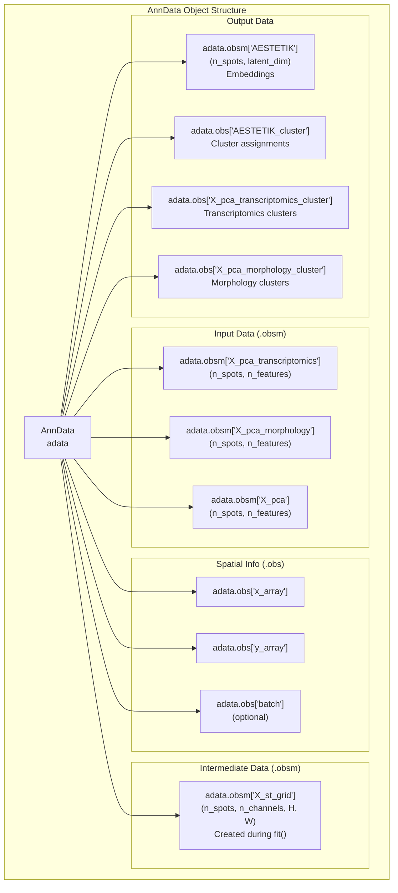
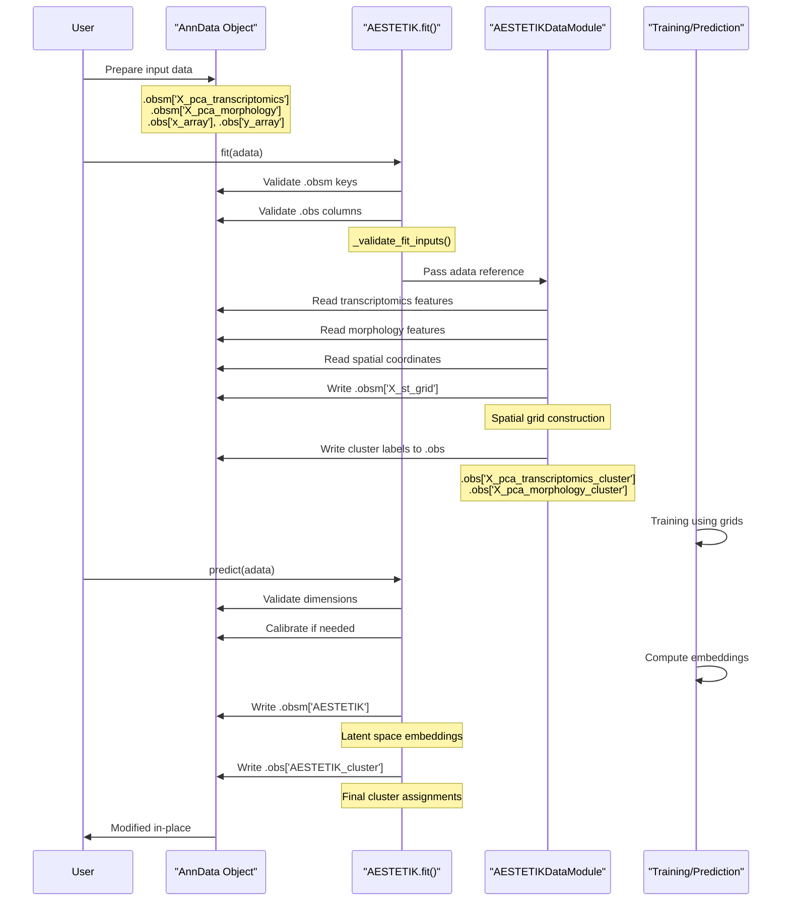
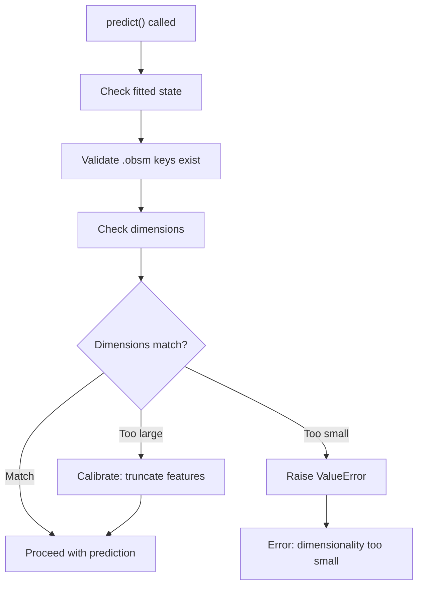
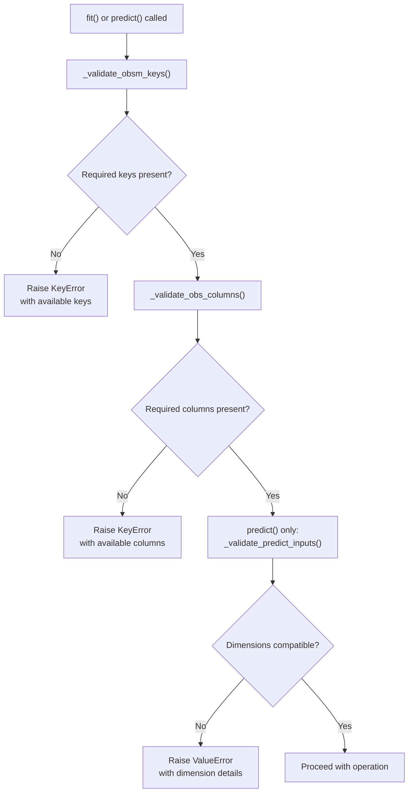

# AnnData Integration

<details>
<summary>Relevant source files</summary>

The following files were used as context for generating this wiki page:

- [example/gettingStartedWithAESTETIK.ipynb](example/gettingStartedWithAESTETIK.ipynb)
- [example/gettingStartedWithAESTETIKwithSimulatedData.ipynb](example/gettingStartedWithAESTETIKwithSimulatedData.ipynb)
- [src/aestetik/AESTETIK.py](src/aestetik/AESTETIK.py)

</details>


## Purpose and Scope

This page explains how AESTETIK uses `AnnData` objects as its primary data container and integrates with the scanpy/squidpy ecosystem. It covers the required structure of input data, how AESTETIK reads and writes to AnnData attributes, and the conventions followed for ecosystem compatibility.

For practical guidance on preparing your data, see [Preparing Your Data](#4.1). For API details about the main AESTETIK class methods, see [AESTETIK Class](#5.1).

---

## The AnnData Object

`AnnData` (Annotated Data) is the standard data structure for storing single-cell and spatial transcriptomics data in Python. AESTETIK adopts this format for several reasons:

- **Ecosystem Compatibility**: Direct integration with scanpy, squidpy, and other spatial analysis tools
- **Structured Storage**: Separate namespaces for different data types (observations, features, embeddings)
- **In-Place Modification**: AESTETIK modifies AnnData objects in-place, following scanpy conventions
- **Metadata Management**: Built-in support for observation-level and feature-level annotations

All AESTETIK methods (`fit()`, `predict()`, `fit_predict()`) accept and modify `anndata.AnnData` objects.

**Sources**: [src/aestetik/AESTETIK.py:1-2](), [src/aestetik/AESTETIK.py:179-187](), [src/aestetik/AESTETIK.py:240-247]()

---

## Data Structure Requirements

### Required `.obsm` Keys

The `.obsm` attribute stores multidimensional arrays associated with observations (spots). AESTETIK requires specific keys for input features:

| Key | Required For | Expected Shape | Description |
|-----|--------------|----------------|-------------|
| `used_obsm_transcriptomics` | `fit()`, `predict()` | `(n_spots, n_features)` | Transcriptomics features (typically PCA components) |
| `used_obsm_morphology` | `fit()`, `predict()` | `(n_spots, n_features)` | Morphology features (typically PCA components) |
| `used_obsm_combined` | `fit()` only | `(n_spots, n_features)` | Combined features for weight calibration |

The default key names are:
- `"X_pca_transcriptomics"` for transcriptomics
- `"X_pca_morphology"` for morphology
- `"X_pca"` for combined features

These can be customized via method parameters.

**Sources**: [src/aestetik/AESTETIK.py:181-183](), [src/aestetik/AESTETIK.py:242-244](), [example/gettingStartedWithAESTETIK.ipynb:243](), [example/gettingStartedWithAESTETIK.ipynb:256]()

### Required `.obs` Columns

The `.obs` attribute stores observation-level metadata. AESTETIK requires spatial coordinates:

| Column | Type | Description |
|--------|------|-------------|
| `x_array` | numeric | X coordinate in array space |
| `y_array` | numeric | Y coordinate in array space |

Optional columns:
- `used_obs_batch`: Sample/batch identifier for multi-sample datasets

**Sources**: [src/aestetik/AESTETIK.py:343](), [src/aestetik/AESTETIK.py:350](), [example/gettingStartedWithAESTETIK.ipynb:164-167]()

### Data Organization Pattern



**Sources**: [src/aestetik/AESTETIK.py:342-343](), [src/aestetik/AESTETIK.py:443](), [src/aestetik/AESTETIK.py:511](), [example/gettingStartedWithAESTETIK.ipynb:363]()

---

## Data Flow Through AESTETIK

The following diagram shows how data flows through the AESTETIK pipeline via AnnData:



**Sources**: [src/aestetik/AESTETIK.py:179-238](), [src/aestetik/AESTETIK.py:240-283](), [src/aestetik/AESTETIK.py:337-393](), [src/aestetik/AESTETIK.py:505-521]()

---

## Input Conventions

### Transcriptomics Features

AESTETIK expects pre-processed transcriptomics data stored in `.obsm`:

```python
# Typical workflow (using scanpy)
sc.pp.normalize_total(adata)
sc.pp.log1p(adata)
sc.pp.highly_variable_genes(adata)
sc.pp.pca(adata)

# Store for AESTETIK
adata.obsm["X_pca_transcriptomics"] = adata.obsm["X_pca"][:, :n_components]
```

The key is specified via the `used_obsm_transcriptomics` parameter (default: `"X_pca_transcriptomics"`).

**Sources**: [src/aestetik/AESTETIK.py:181-182](), [example/gettingStartedWithAESTETIK.ipynb:243]()

### Morphology Features

Morphology features are typically extracted from histology images and dimensionality-reduced:

```python
# Extract features using CNN (e.g., Inception V3)
features = extract_morphology_embeddings(...)

# Apply PCA and store
adata.obsm["X_pca_morphology"] = features[:, :n_components]
```

The key is specified via the `used_obsm_morphology` parameter (default: `"X_pca_morphology"`).

**Sources**: [src/aestetik/AESTETIK.py:182-183](), [example/gettingStartedWithAESTETIK.ipynb:215-225](), [example/gettingStartedWithAESTETIK.ipynb:256]()

### Spatial Coordinates

Array coordinates must be present in `.obs`:

```python
# Example: Visium data
adata.obs["x_array"] = adata.obs["array_row"]
adata.obs["y_array"] = adata.obs["array_col"]
```

These are used for spatial grid construction and spatial cluster refinement.

**Sources**: [src/aestetik/AESTETIK.py:343](), [src/aestetik/AESTETIK.py:387-393]()

### Dimension Validation

During `predict()`, AESTETIK validates that feature dimensions match the model trained during `fit()`:



**Sources**: [src/aestetik/AESTETIK.py:345-367](), [src/aestetik/AESTETIK.py:410-426]()

---

## Output Conventions

### Embeddings

AESTETIK writes learned representations to `.obsm` using a configurable key:

| Key | Default | Shape | Description |
|-----|---------|-------|-------------|
| `save_emb` | `"AESTETIK"` | `(n_spots, latent_dim)` | Latent space embeddings |

```python
model.predict(adata, save_emb="AESTETIK")
# Result: adata.obsm["AESTETIK"] contains embeddings
```

These embeddings can be used with standard scanpy/squidpy functions:

```python
sc.pp.neighbors(adata, use_rep="AESTETIK")
sc.tl.umap(adata)
sq.pl.spatial_scatter(adata, color="AESTETIK_cluster")
```

**Sources**: [src/aestetik/AESTETIK.py:263](), [src/aestetik/AESTETIK.py:511](), [example/gettingStartedWithAESTETIK.ipynb:363]()

### Cluster Assignments

When `cluster=True` (default), AESTETIK writes cluster labels to `.obs`:

| Column | Description | Created By |
|--------|-------------|------------|
| `{save_emb}_cluster` | Final cluster assignments | `predict()` with clustering |
| `X_pca_transcriptomics_cluster` | Transcriptomics-only clusters | Internal during `fit()` |
| `X_pca_morphology_cluster` | Morphology-only clusters | Internal during `fit()` |

```python
model.predict(adata, save_emb="AESTETIK", cluster=True)
# Result: adata.obs["AESTETIK_cluster"] contains cluster labels
```

**Sources**: [src/aestetik/AESTETIK.py:265-266](), [src/aestetik/AESTETIK.py:513-520](), [example/gettingStartedWithAESTETIK.ipynb:375-378]()

### Spatial Grids

During `fit()`, AESTETIK constructs and stores spatial grids:

```python
# Internal: created by build_grid()
adata.obsm["X_st_grid"]  # Shape: (n_spots, n_channels, window_size, window_size)
```

This intermediate representation is reused during `fit_predict()` to avoid recomputation.

**Sources**: [src/aestetik/AESTETIK.py:443](), [src/aestetik/AESTETIK.py:435-441]()

---

## Integration with Scanpy/Squidpy Ecosystem

AESTETIK follows scanpy/squidpy conventions to ensure seamless integration:

### Naming Conventions

| Convention | AESTETIK Implementation |
|------------|------------------------|
| Embeddings in `.obsm` | `adata.obsm["AESTETIK"]` |
| Cluster labels in `.obs` | `adata.obs["AESTETIK_cluster"]` |
| Suffix pattern | `{base_key}_cluster` for derived clusters |

### In-Place Modification

AESTETIK modifies AnnData objects in-place, similar to scanpy:

```python
# Scanpy pattern
sc.pp.neighbors(adata)  # Modifies adata.obsp, adata.uns

# AESTETIK pattern
model.fit(adata)        # Modifies adata.obsm, adata.obs
model.predict(adata)    # Modifies adata.obsm, adata.obs
```

Both `fit()` and `predict()` return `None`; results are stored directly in the input object.

**Sources**: [src/aestetik/AESTETIK.py:187](), [src/aestetik/AESTETIK.py:247](), [src/aestetik/AESTETIK.py:511]()

### Visualization Compatibility

AESTETIK outputs are immediately compatible with squidpy plotting functions:

```python
# After AESTETIK prediction
sq.pl.spatial_scatter(adata, color=["ground_truth", "AESTETIK_cluster"])
```

**Sources**: [example/gettingStartedWithAESTETIK.ipynb:375-378](), [example/gettingStartedWithAESTETIKwithSimulatedData.ipynb:269-276]()

### Multi-Sample Support

AESTETIK supports multi-sample datasets through the `used_obs_batch` parameter:

```python
# For multi-sample data
adata.obs["sample_id"] = ["sample1", "sample1", "sample2", ...]

model.fit(adata, used_obs_batch="sample_id")
model.predict(adata, used_obs_batch="sample_id")
```

This ensures proper handling during spatial grid construction and clustering.

**Sources**: [src/aestetik/AESTETIK.py:201](), [src/aestetik/AESTETIK.py:244](), [src/aestetik/AESTETIK.py:289]()

---

## Validation and Calibration

### Input Validation

AESTETIK performs comprehensive validation before processing:



**Sources**: [src/aestetik/AESTETIK.py:337-393]()

### Key Validation

The validation checks ensure all required keys exist:

```python
# From _validate_obsm_keys()
missing = [key for key in required_keys if key not in X.obsm]
if missing:
    raise KeyError(
        f"Required keys {missing} must be present in X.obsm. "
        f"Available keys: {list(X.obsm.keys())}"
    )
```

**Sources**: [src/aestetik/AESTETIK.py:373-382]()

### Dimension Calibration

During `predict()`, AESTETIK automatically calibrates feature dimensions if they're too large:

```python
# From _calibrate_predict_inputs()
if X.obsm[used_obsm_transcriptomics].shape[1] > target_dim:
    logging.info(f"Cut down transcriptomics dimensionality")
    X.obsm[used_obsm_transcriptomics] = X.obsm[used_obsm_transcriptomics][:, :target_dim]
```

This allows flexibility when predicting on datasets with more features than the training data.

**Sources**: [src/aestetik/AESTETIK.py:410-426]()

### Error Messages

Validation errors provide detailed information for debugging:

```python
# Example error message
ValueError: Dimensionality of obsm transcriptomics or morphology features is too small.
Transcriptomics dim: 10, Morphology dim: 8, Total: 18,
Required: transcriptomics >= 15, morphology >= 15
```

**Sources**: [src/aestetik/AESTETIK.py:359-366]()

---

## Summary

The integration between AESTETIK and AnnData provides:

- **Seamless Ecosystem Integration**: Full compatibility with scanpy/squidpy workflows
- **Structured Data Management**: Clear separation of input features, intermediate results, and outputs
- **In-Place Modification**: Memory-efficient operation following scanpy conventions
- **Robust Validation**: Comprehensive checks with informative error messages
- **Flexible Configuration**: Customizable key names and batch handling

This design ensures AESTETIK can be easily incorporated into existing spatial transcriptomics analysis pipelines.

**Sources**: [src/aestetik/AESTETIK.py:1-545](), [example/gettingStartedWithAESTETIK.ipynb:1-422]()

---