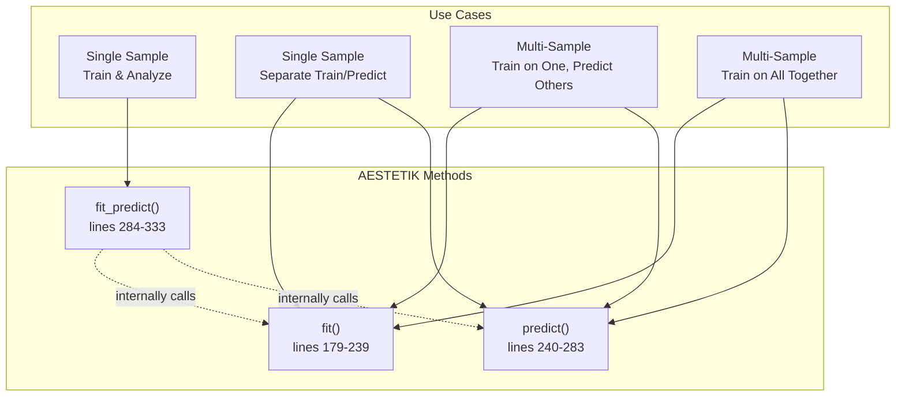
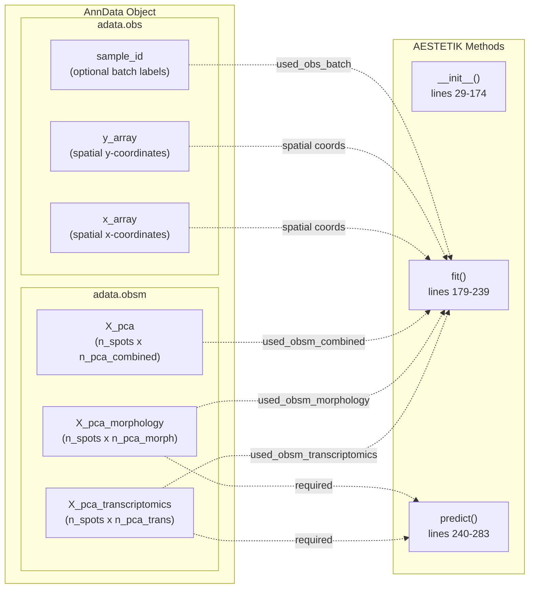
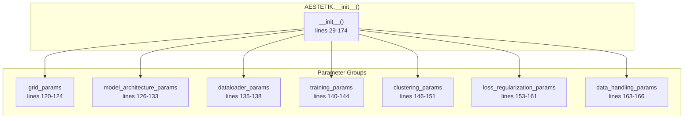

# User Guide

<details>
<summary>Relevant source files</summary>

The following files were used as context for generating this wiki page:

- [README.md](README.md)
- [figures/maynard_human_brain_analysis_151676_Transcriptomics_Morphology_AESTETIK.png](figures/maynard_human_brain_analysis_151676_Transcriptomics_Morphology_AESTETIK.png)
- [llms.txt](llms.txt)
- [src/aestetik/AESTETIK.py](src/aestetik/AESTETIK.py)

</details>


This guide provides practical instructions for common AESTETIK workflows and tasks. It covers the essential usage patterns, parameter configuration, and best practices for analyzing spatial transcriptomics data with AESTETIK.

**Scope**: This guide focuses on *how* to use AESTETIK effectively for typical analysis tasks. For installation instructions, see [Installation](#2.1). For conceptual background on multi-modal integration and spatial processing, see [Core Concepts](#3). For detailed API documentation, see [API Reference](#5).

**Organization**: Detailed task-specific guides are available in subsections:
- [Preparing Your Data](#4.1) - Data preprocessing and formatting requirements
- [Training Models](#4.2) - Model training procedures and parameter tuning
- [Making Predictions](#4.3) - Generating embeddings and cross-sample prediction
- [Clustering and Analysis](#4.4) - Downstream clustering and spatial domain analysis
- [Visualization](#4.5) - Plotting training progress, embeddings, and spatial patterns

---

## Understanding AESTETIK Workflows

AESTETIK provides three primary API methods for different analysis scenarios. The following diagram maps the typical user workflows to the corresponding code methods.

**Workflow-to-API Mapping**



Sources: [src/aestetik/AESTETIK.py:179-333]()

The method selection depends on your analysis goals:

| Workflow | Method(s) | When to Use |
|----------|-----------|-------------|
| **Quick single-sample analysis** | `fit_predict()` | You want to train and analyze one sample in a single call |
| **Train then analyze later** | `fit()` → `predict()` | You want to inspect training results before prediction, or train once and predict multiple times |
| **Cross-sample prediction** | `fit()` on sample A → `predict()` on sample B | You want to apply a model trained on one sample to new samples |
| **Multi-sample integration** | `fit()` on concatenated samples | You want to learn representations across multiple samples simultaneously |

---

## Working with AnnData Objects

AESTETIK operates on `anndata.AnnData` objects following scanpy/squidpy conventions. Understanding the required data structure is essential for proper usage.

**Required AnnData Structure**



Sources: [src/aestetik/AESTETIK.py:179-239](), [src/aestetik/AESTETIK.py:337-393]()

### Input Requirements

**Before using AESTETIK**, your `AnnData` object must contain:

1. **Spatial coordinates** in `adata.obs`:
   - `x_array`: x-coordinates for each spot
   - `y_array`: y-coordinates for each spot
   
   These are validated by `_validate_obs_columns()` [src/aestetik/AESTETIK.py:384-393]()

2. **Reduced-dimension features** in `adata.obsm`:
   - Transcriptomics PCA: typically 30-50 principal components
   - Morphology PCA: typically 30-50 principal components
   - (Optional) Combined PCA: concatenated features for `fit()` only
   
   These are validated by `_validate_obsm_keys()` [src/aestetik/AESTETIK.py:373-382]()

3. **(Optional) Batch labels** in `adata.obs`:
   - Column name specified via `used_obs_batch` parameter
   - Used for multi-sample integration

See [Preparing Your Data](#4.1) for detailed preprocessing instructions.

### Output Storage

AESTETIK modifies the input `AnnData` object in-place, following scanpy conventions:

| Data Type | Storage Location | Key Name | Set By |
|-----------|------------------|----------|--------|
| Learned embeddings | `adata.obsm` | `"AESTETIK"` (configurable via `save_emb`) | `predict()` |
| Cluster assignments | `adata.obs` | `"clustering_{method}"` | `predict()` with `cluster=True` |
| Refined clusters | `adata.obs` | `"refined_clustering_{method}"` | `predict()` with `refine_cluster=True` |
| Spatial grids | `adata.obsm` | `"X_st_grid"` | Internal data processing |

Sources: [src/aestetik/AESTETIK.py:505-521]()

---

## Basic Usage Patterns

### Pattern 1: Single-Sample Analysis with fit_predict()

The simplest workflow for analyzing a single spatial transcriptomics sample:

```python
from aestetik import AESTETIK

# Initialize model with key parameters
model = AESTETIK(
    nCluster=7,                    # Target number of spatial domains
    morphology_weight=0.5,         # Balance between modalities
    window_size=7,                 # Spatial neighborhood size
    latent_dim=16,                 # Embedding dimensionality
    max_epochs=100                 # Training duration
)

# Train and predict in one call
model.fit_predict(
    adata,
    used_obsm_transcriptomics="X_pca_transcriptomics",
    used_obsm_morphology="X_pca_morphology",
    used_obsm_combined="X_pca",
    cluster=True                   # Perform clustering on embeddings
)

# Results stored in adata
embeddings = adata.obsm["AESTETIK"]
clusters = adata.obs["clustering_bgm"]
```

The `fit_predict()` method [src/aestetik/AESTETIK.py:284-333]() internally calls `fit()` followed by `predict()`, providing a streamlined interface for single-sample analysis.

Sources: [src/aestetik/AESTETIK.py:284-333]()

### Pattern 2: Separate Training and Prediction

When you need more control over the training and prediction phases:

```python
# Step 1: Train the model
model = AESTETIK(nCluster=7, morphology_weight=0.5)
model.fit(
    adata_train,
    validation_split=0.2,           # Use 20% for validation
    early_stopping_params={
        'patience': 10
    }
)

# Inspect training history
import matplotlib.pyplot as plt
plt.plot(model.losses['train'])
plt.plot(model.losses['val'])

# Step 2: Generate predictions with uncertainty estimation
model.predict(
    adata_train,
    num_repeats=1000,               # Monte Carlo samples for uncertainty
    cluster=True
)
```

This pattern allows you to:
- Monitor training progress via `model.losses`
- Use validation data for early stopping
- Apply the trained model multiple times with different parameters

Sources: [src/aestetik/AESTETIK.py:179-239](), [src/aestetik/AESTETIK.py:240-283]()

### Pattern 3: Cross-Sample Prediction

Train on one sample and apply to others (transfer learning):

```python
# Train on sample A
model = AESTETIK(nCluster=7, morphology_weight=0.5)
model.fit(adata_sample_A)

# Predict on sample B (must have compatible feature dimensions)
model.predict(adata_sample_B, cluster=True)

# Predict on sample C
model.predict(adata_sample_C, cluster=True)
```

**Important**: The prediction samples must have:
- Same or greater feature dimensions as training data
- Compatible spatial coordinates format
- Same data preprocessing pipeline

The `_calibrate_predict_inputs()` method [src/aestetik/AESTETIK.py:410-425]() automatically trims excess dimensions if prediction data has more features than training data.

Sources: [src/aestetik/AESTETIK.py:410-425](), [src/aestetik/AESTETIK.py:345-367]()

### Pattern 4: Multi-Sample Batch Integration

Process multiple samples together with batch correction:

```python
import anndata as ad

# Concatenate multiple samples
adata_combined = ad.concat(
    [adata_sample1, adata_sample2, adata_sample3],
    label="sample_id"
)

# Train with batch awareness
model = AESTETIK(nCluster=10, morphology_weight=0.5)
model.fit(
    adata_combined,
    used_obs_batch="sample_id"      # Batch-aware processing
)

model.predict(
    adata_combined,
    used_obs_batch="sample_id",
    cluster=True
)
```

The `used_obs_batch` parameter enables batch-aware spatial grid construction and clustering, preventing artificial batch-driven patterns.

Sources: [src/aestetik/AESTETIK.py:179-239]()

---

## Model Configuration

The `AESTETIK` class initialization [src/aestetik/AESTETIK.py:29-174]() accepts numerous parameters. This section groups them by purpose.

**Parameter Organization in Code**



Sources: [src/aestetik/AESTETIK.py:120-166]()

### Core Configuration Parameters

| Parameter Group | Key Parameters | Purpose | Typical Values |
|-----------------|----------------|---------|----------------|
| **Clustering** | `nCluster`<br/>`clustering_method` | Define target spatial domains | `5-15`<br/>`"bgm"`, `"leiden"` |
| **Modality Weighting** | `morphology_weight`<br/>`total_weight` | Balance transcriptomics vs morphology | `0.3-0.7`<br/>`3` |
| **Spatial Processing** | `window_size` | Neighborhood size for spatial grids | `5`, `7`, `9` (odd only) |
| **Model Architecture** | `latent_dim`<br/>`c_hid`<br/>`n_ensemble` | Embedding size and model capacity | `16-64`<br/>`32-128`<br/>`3-5` |
| **Training** | `max_epochs`<br/>`lr`<br/>`batch_size` | Training duration and optimization | `50-200`<br/>`0.001`<br/>`auto` |
| **Loss Function** | `rec_alpha`<br/>`triplet_alpha` | Weight reconstruction vs contrastive loss | `1.0`<br/>`1.0` |
| **Regularization** | `p`<br/>`weight_decay` | Dropout and L2 regularization | `0.2-0.4`<br/>`1e-6` |

Sources: [src/aestetik/AESTETIK.py:29-116]()

### Parameter Selection Guidelines

**For small datasets (< 1000 spots)**:
- Reduce `latent_dim` to 8-12
- Reduce `c_hid` to 32
- Use `window_size=5`
- Increase regularization: `p=0.4`

**For large datasets (> 5000 spots)**:
- Increase `batch_size` to 4096 or 8192
- Consider `n_jobs=-1` for parallel processing
- May increase `latent_dim` to 32-64

**For morphology-dominated tissue**:
- Increase `morphology_weight` to 0.6-0.8
- The `total_weight` parameter ensures combined weight equals 3.0

**For transcriptomics-dominated analysis**:
- Decrease `morphology_weight` to 0.2-0.4

**For noisy data**:
- Increase dropout `p` to 0.4-0.5
- Increase `n_ensemble` to 5-7 for robustness
- Enable validation: `validation_split=0.2`

Sources: [src/aestetik/AESTETIK.py:29-116]()

### Advanced Configuration

**Ensemble configuration**:
```python
model = AESTETIK(
    n_ensemble_encoder=5,      # Override n_ensemble for encoder only
    n_ensemble_decoder=3,      # Different ensemble size for decoder
    # ...
)
```

**Multi-triplet loss configuration**:
```python
model = AESTETIK(
    multi_triplet_loss=True,   # Use multiple triplets per anchor
    n_repeats=2,               # Repeats per class in triplet sampling
    # ...
)
```

**Parallel processing**:
```python
model = AESTETIK(
    n_jobs=-1,                 # Use all CPU cores for grid building
    num_workers=4,             # DataLoader workers for training
    # ...
)
```

Sources: [src/aestetik/AESTETIK.py:92-116](), [src/aestetik/AESTETIK.py:135-166]()

---

## Validation and Early Stopping

AESTETIK supports validation splits and early stopping through PyTorch Lightning callbacks.

**Validation Configuration**

```python
model = AESTETIK(nCluster=7, morphology_weight=0.5)

model.fit(
    adata,
    validation_split=0.2,           # Hold out 20% for validation
    early_stopping_params={
        'patience': 10,             # Stop if no improvement for 10 epochs
        'min_delta': 0.001          # Minimum change to count as improvement
    }
)

# Access training history
train_losses = model.losses['train']
val_losses = model.losses['val']
```

The validation split is implemented in `AESTETIKDataModule` and uses stratified sampling based on cluster labels to ensure representative validation sets.

**Callback Management**

The `_create_callbacks()` method [src/aestetik/AESTETIK.py:449-467]() automatically configures:

| Callback | Purpose | When Active |
|----------|---------|-------------|
| `LossHistoryCallback` | Records training/validation losses | Always |
| `EarlyStopping` | Stops training when validation loss plateaus | When `validation_split > 0` |
| `ModelCheckpoint` | Saves best model based on validation loss | When `validation_split > 0` |

Sources: [src/aestetik/AESTETIK.py:449-484](), [src/aestetik/AESTETIK.py:204-239]()

---

## Prediction and Uncertainty Quantification

The `predict()` method generates embeddings with optional uncertainty estimation through Monte Carlo dropout.

**Monte Carlo Prediction**

```python
# Standard prediction (deterministic)
model.predict(adata, num_repeats=1, cluster=False)
embeddings = adata.obsm["AESTETIK"]

# Uncertainty-aware prediction
model.predict(adata, num_repeats=1000, cluster=False)
embeddings_with_uncertainty = adata.obsm["AESTETIK"]
```

The `num_repeats` parameter controls how many stochastic forward passes are performed:
- `num_repeats=1`: Fast, deterministic prediction (dropout disabled)
- `num_repeats=100-1000`: Uncertainty quantification via dropout sampling
- Results are averaged across repeats

This is implemented in the prediction loop within `_compute_latent_space()` [src/aestetik/AESTETIK.py:489-503]().

**Prediction Flow**

```mermaid
sequenceDiagram
    participant User
    participant predict["predict()<br/>lines 240-283"]
    participant check["_check_fitted()<br/>lines 369-371"]
    participant validate["_validate_predict_inputs()<br/>lines 345-367"]
    participant compute["_compute_latent_space()<br/>lines 489-503"]
    participant postprocess["_postprocess_predictions()<br/>lines 505-521"]
    participant adata["AnnData Object"]
    
    User->>predict: "predict(adata, num_repeats, cluster)"
    predict->>check: "verify model trained"
    predict->>validate: "check input compatibility"
    validate->>validate: "_calibrate_predict_inputs()"
    predict->>compute: "generate embeddings"
    compute->>compute: "loop num_repeats times"
    compute-->>predict: "averaged latent space"
    predict->>postprocess: "store results"
    postprocess->>adata: "adata.obsm[save_emb] = embeddings"
    
    alt cluster=True
        postprocess->>postprocess: "clustering(adata)"
        postprocess->>adata: "adata.obs[clustering_*] = labels"
    end
    
    postprocess-->>User: "None (adata modified)"
```

Sources: [src/aestetik/AESTETIK.py:240-283](), [src/aestetik/AESTETIK.py:489-521]()

---

## Common Issues and Solutions

### Dimension Mismatch Errors

**Problem**: `ValueError` about dimensionality being too small when calling `predict()` on new data.

**Cause**: The prediction data has fewer PCA components than the training data required.

**Solution**: Ensure prediction data has at least as many features as training data:
```python
# Check required dimensions
print(f"Required transcriptomics dims: {model.grid_params['obsm_transcriptomics_dim']}")
print(f"Required total dims: {model.grid_params['num_input_channels']}")

# Adjust your PCA accordingly
from sklearn.decomposition import PCA
pca = PCA(n_components=model.grid_params['obsm_transcriptomics_dim'])
adata.obsm["X_pca_transcriptomics"] = pca.fit_transform(...)
```

Sources: [src/aestetik/AESTETIK.py:352-366]()

### Window Size Errors

**Problem**: `ValueError: window_size should be an odd integer`

**Cause**: The `window_size` parameter must be odd for proper spatial grid centering.

**Solution**: Use odd values: `window_size=5`, `7`, `9`, or `11`.

Sources: [src/aestetik/AESTETIK.py:117-118]()

### Memory Issues with Large Datasets

**Problem**: Out-of-memory errors during training or prediction.

**Solutions**:
```python
# 1. Reduce batch size
model = AESTETIK(batch_size=1024)  # Default is min(8192, n_spots)

# 2. Reduce model capacity
model = AESTETIK(
    c_hid=32,           # Default: 64
    n_ensemble=3,       # Reduce from 5
)

# 3. Reduce window size
model = AESTETIK(window_size=5)  # Default: 7

# 4. Use fewer workers
model = AESTETIK(num_workers=0)  # Disable multiprocessing
```

Sources: [src/aestetik/AESTETIK.py:29-116](), [src/aestetik/AESTETIK.py:401-402]()

### Cross-Sample Prediction Failures

**Problem**: Predictions on new samples produce poor results or errors.

**Causes and Solutions**:

1. **Different preprocessing**: Ensure identical preprocessing pipelines
   ```python
   # Use same scalers, PCA, etc. for all samples
   scaler.fit(adata_train.X)
   adata_train.X = scaler.transform(adata_train.X)
   adata_test.X = scaler.transform(adata_test.X)  # Same scaler
   ```

2. **Different feature dimensions**: Use `_calibrate_predict_inputs()` which auto-trims
   - This happens automatically in `predict()` [src/aestetik/AESTETIK.py:410-425]()

3. **Batch effects**: Include batch labels
   ```python
   model.predict(adata_new, used_obs_batch="sample_id")
   ```

Sources: [src/aestetik/AESTETIK.py:345-367](), [src/aestetik/AESTETIK.py:410-425]()

---

## Best Practices

### Data Preprocessing
1. **Normalize** transcriptomics data before PCA (e.g., `scanpy.pp.normalize_total()`)
2. **Scale** morphology features to comparable ranges with transcriptomics
3. **Use consistent PCA dimensions** (30-50 components typically sufficient)
4. **Validate spatial coordinates** are in consistent units across samples

See [Preparing Your Data](#4.1) for detailed preprocessing workflows.

### Parameter Tuning
1. **Start with defaults** and adjust based on results
2. **Use validation split** (0.1-0.2) to monitor overfitting
3. **Adjust morphology_weight** based on tissue type and available image quality
4. **Increase latent_dim** if clusters appear over-merged
5. **Increase window_size** for tissues with large spatial domains

See [Training Models](#4.2) for parameter tuning strategies.

### Performance Optimization
1. **Set batch_size explicitly** for large datasets (4096-8192)
2. **Use n_jobs=-1** for parallel grid construction on multi-core systems
3. **Profile with smaller max_epochs** first (10-20) before full training
4. **Consider num_workers=0** if data loading causes memory issues

### Reproducibility
1. **Set random_seed** consistently across experiments
2. **Document all parameters** used for each analysis
3. **Save trained models** using PyTorch Lightning's checkpoint system
4. **Version control** preprocessing scripts alongside model configurations

---

## Next Steps

This guide covered the essential workflows and usage patterns for AESTETIK. For task-specific details:

- **Data Preparation**: [Preparing Your Data](#4.1) - Detailed preprocessing steps
- **Training**: [Training Models](#4.2) - Advanced training configurations and monitoring
- **Prediction**: [Making Predictions](#4.3) - Cross-sample prediction strategies
- **Clustering**: [Clustering and Analysis](#4.4) - Spatial domain identification and refinement
- **Visualization**: [Visualization](#4.5) - Plotting utilities and interpretation

For complete API documentation, see [API Reference](#5). For extending or modifying AESTETIK, see [Developer Guide](#6).

Sources: [src/aestetik/AESTETIK.py:1-545](), [README.md:1-112]()

---