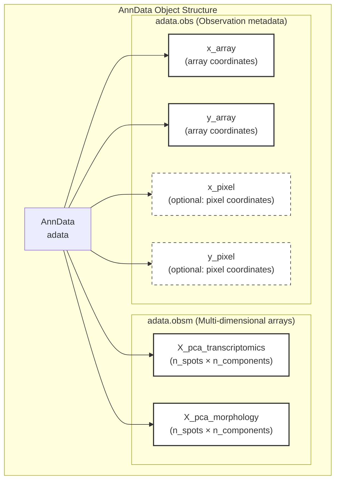
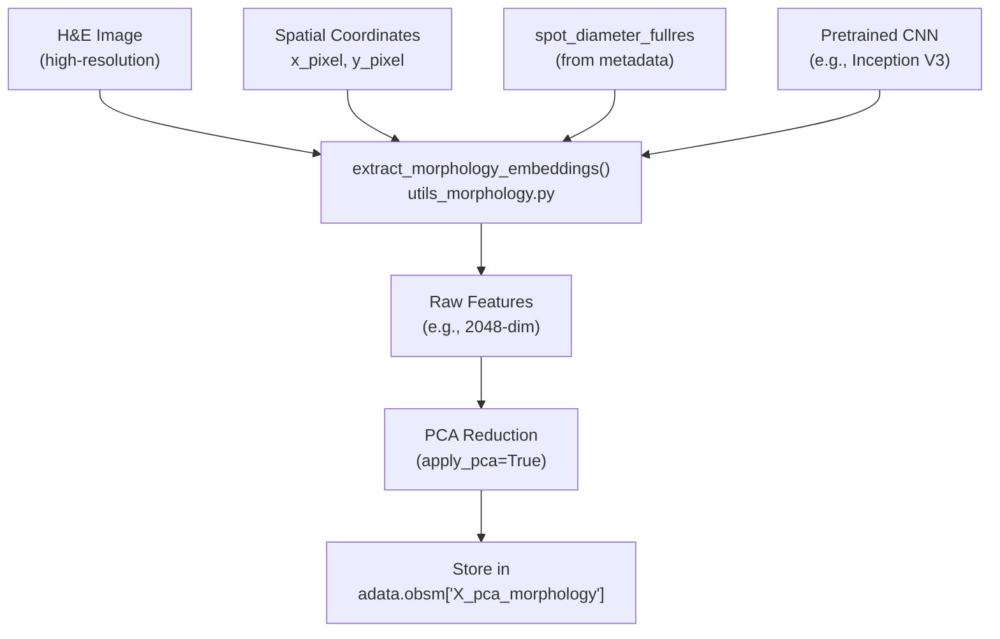
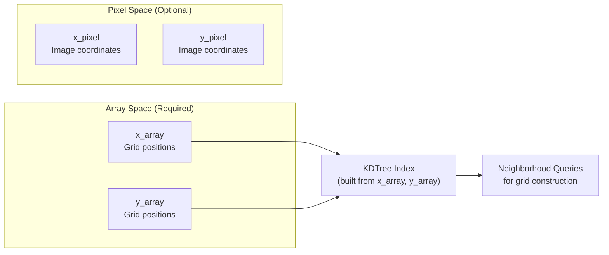
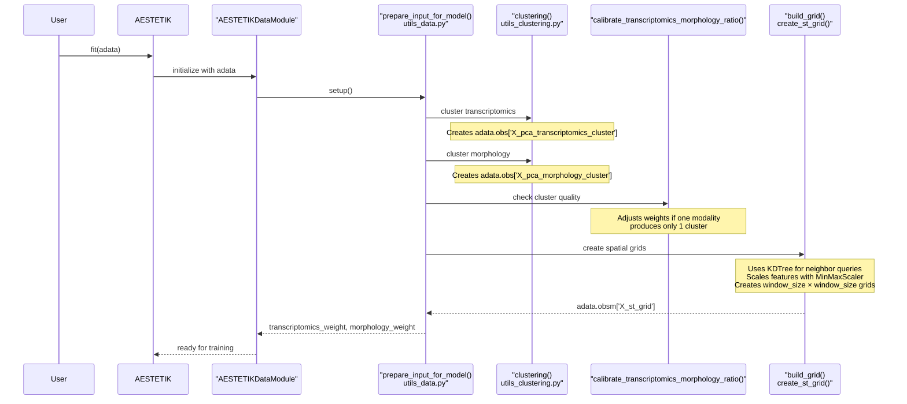
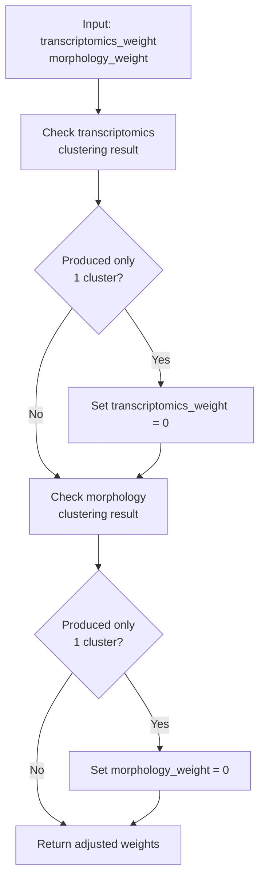

# Preparing Your Data

<details>
<summary>Relevant source files</summary>

The following files were used as context for generating this wiki page:

- [example/gettingStartedWithAESTETIK.ipynb](example/gettingStartedWithAESTETIK.ipynb)
- [example/gettingStartedWithAESTETIKwithSimulatedData.ipynb](example/gettingStartedWithAESTETIKwithSimulatedData.ipynb)
- [src/aestetik/data_modules/data_module.py](src/aestetik/data_modules/data_module.py)
- [src/aestetik/utils/utils_data.py](src/aestetik/utils/utils_data.py)

</details>


This page describes how to prepare spatial transcriptomics data for AESTETIK training and prediction. It covers the required AnnData structure, preprocessing steps for both transcriptomics and morphology modalities, and spatial coordinate requirements.

For information about training models after data preparation, see [Training Models](#4.2). For API-level details about data processing functions, see [Data Pipeline Components](#5.2).

---

## Overview of Data Requirements

AESTETIK operates on `AnnData` objects that contain two modalities (transcriptomics and morphology) along with spatial coordinates. The system expects specific keys in the AnnData structure and performs additional preprocessing during model fitting.

### Required AnnData Structure



**Sources:** [example/gettingStartedWithAESTETIK.ipynb:164-167](), [example/gettingStartedWithAESTETIK.ipynb:242-258]()

| Field | Location | Type | Required | Description |
|-------|----------|------|----------|-------------|
| `X_pca_transcriptomics` | `adata.obsm` | `numpy.ndarray` | Yes | PCA-reduced transcriptomics features (typically 15-50 components) |
| `X_pca_morphology` | `adata.obsm` | `numpy.ndarray` | Yes | PCA-reduced morphology features (typically 15-50 components) |
| `x_array` | `adata.obs` | `numeric` | Yes | Spatial x-coordinates in array space |
| `y_array` | `adata.obs` | `numeric` | Yes | Spatial y-coordinates in array space |
| `x_pixel` | `adata.obs` | `numeric` | Optional | Spatial x-coordinates in pixel space (for visualization) |
| `y_pixel` | `adata.obs` | `numeric` | Optional | Spatial y-coordinates in pixel space (for visualization) |

**Sources:** [example/gettingStartedWithAESTETIK.ipynb:164-167](), [example/gettingStartedWithAESTETIKwithSimulatedData.ipynb:101-105]()

---

## Transcriptomics Data Preparation

### Preprocessing Pipeline

The transcriptomics modality must be reduced to PCA components before passing to AESTETIK. The recommended preprocessing pipeline uses scanpy utilities:


**Sources:** [example/gettingStartedWithAESTETIK.ipynb:150-154](), [example/gettingStartedWithAESTETIK.ipynb:66-68]()

### Step-by-Step Process

1. **Load raw data** into an AnnData object using scanpy:
   ```python
   import scanpy as sc
   adata = sc.read_h5ad("path/to/data.h5ad")
   ```

2. **Preprocess transcriptomics** using the provided utility:
   ```python
   from aestetik.utils.utils_transcriptomics import preprocess_adata
   adata = preprocess_adata(adata)
   ```
   
   This function performs standard scanpy preprocessing including normalization, log transformation, highly variable gene selection, scaling, and PCA computation.

3. **Extract PCA components** and store with the required key:
   ```python
   n_components = 15  # Typical range: 15-50
   adata.obsm["X_pca_transcriptomics"] = adata.obsm["X_pca"][:, 0:n_components]
   ```

**Sources:** [example/gettingStartedWithAESTETIK.ipynb:137-154](), [example/gettingStartedWithAESTETIK.ipynb:242-245]()

### Component Selection Guidelines

| Dataset Size | Recommended Components | Reasoning |
|--------------|----------------------|-----------|
| < 1,000 spots | 15-20 | Avoid overfitting with limited samples |
| 1,000-5,000 spots | 15-30 | Standard range for most datasets |
| > 5,000 spots | 30-50 | Capture more variation in larger datasets |

The number of components for transcriptomics and morphology should typically match to maintain modality balance.

**Sources:** [example/gettingStartedWithAESTETIK.ipynb:122-124]()

---

## Morphology Data Preparation

### Feature Extraction Workflow



**Sources:** [example/gettingStartedWithAESTETIK.ipynb:215-224]()

### Detailed Extraction Process

1. **Load pretrained model** (example using Inception V3):
   ```python
   from torchvision.models import inception_v3, Inception_V3_Weights
   from torchvision import transforms
   import torch
   
   weights = Inception_V3_Weights.DEFAULT
   morphology_model = inception_v3(weights=weights)
   morphology_model.fc = torch.nn.Identity()  # Remove classification head
   morphology_model.eval()
   
   device = torch.device("cuda") if torch.cuda.is_available() else torch.device("cpu")
   ```

2. **Define preprocessing transforms**:
   ```python
   preprocess = transforms.Compose([
       transforms.ToTensor(),
       weights.transforms(antialias=True),
   ])
   ```

3. **Extract features using the utility function**:
   ```python
   from aestetik.utils.utils_morphology import extract_morphology_embeddings
   
   features = extract_morphology_embeddings(
       img_path="path/to/image.png",
       morphology_model=morphology_model,
       x_pixel=adata.obs.y_pixel,  # Note: x/y may be swapped depending on coordinate system
       y_pixel=adata.obs.x_pixel,
       spot_diameter=spot_diameter_fullres,
       device=device,
       n_components=15,
       feature_dim=2048,
       preprocess=preprocess,
       apply_pca=True
   )
   ```

4. **Store in AnnData**:
   ```python
   adata.obsm["X_pca_morphology"] = features[:, 0:n_components]
   ```

**Sources:** [example/gettingStartedWithAESTETIK.ipynb:202-224](), [example/gettingStartedWithAESTETIK.ipynb:255-258]()

### Alternative Feature Extractors

While Inception V3 is demonstrated in the examples, AESTETIK is agnostic to the feature extraction method. Alternative approaches include:

| Model | Feature Dimension | Use Case |
|-------|------------------|----------|
| ResNet-50 | 2048 | Standard histology images |
| Vision Transformer (ViT) | 768-1024 | High-detail tissue structures |
| Custom CNN | Variable | Domain-specific architectures |

The key requirement is that features are extracted per spot and reduced to PCA components before training.

**Sources:** [example/gettingStartedWithAESTETIK.ipynb:202-213]()

---

## Spatial Coordinates

### Coordinate System Requirements

AESTETIK requires spatial coordinates to construct neighborhood grids. The coordinates must be stored in `adata.obs`:



**Sources:** [example/gettingStartedWithAESTETIK.ipynb:164-167]()

### Array vs Pixel Coordinates

- **Array coordinates** (`x_array`, `y_array`): Logical positions on the capture grid. These are used for spatial neighborhood construction during training.
- **Pixel coordinates** (`x_pixel`, `y_pixel`): Physical positions on the H&E image. These are used for morphology feature extraction and visualization.

**Example coordinate setup:**
```python
# Array coordinates are typically integers representing grid positions
adata.obs["x_array"] = array_col  # e.g., 0, 1, 2, ...
adata.obs["y_array"] = array_row  # e.g., 0, 1, 2, ...

# Pixel coordinates are continuous values
adata.obs["x_pixel"] = pixel_x  # e.g., 1234.5, 2456.7, ...
adata.obs["y_pixel"] = pixel_y  # e.g., 3456.8, 4567.9, ...
```

**Sources:** [example/gettingStartedWithAESTETIK.ipynb:164-167](), [example/gettingStartedWithAESTETIKwithSimulatedData.ipynb:101-105]()

---

## Internal Preprocessing During Training

When you call `model.fit(adata)`, AESTETIK performs additional preprocessing internally. Understanding this pipeline helps in debugging and parameter selection.

### Data Processing Pipeline



**Sources:** [src/aestetik/utils/utils_data.py:14-72](), [src/aestetik/data_modules/data_module.py:96-114]()

### Automatic Clustering

The system performs initial clustering on both modalities to generate triplet loss labels:

1. **Clustering method**: Determined by `clustering_method` parameter (options: `"bgm"`, `"kmeans"`, `"louvain"`, `"leiden"`)
2. **Target clusters**: Specified by `nCluster` parameter
3. **Output**: 
   - `adata.obs["X_pca_transcriptomics_cluster"]`
   - `adata.obs["X_pca_morphology_cluster"]`

These clusters are used to construct triplets during training (anchor, positive, negative samples from the same/different clusters).

**Sources:** [src/aestetik/utils/utils_data.py:33-51]()

### Weight Calibration

The `calibrate_transcriptomics_morphology_ratio` function automatically adjusts modality weights if clustering fails:



This prevents the model from using a modality that provides no discriminative information.

**Sources:** [src/aestetik/utils/utils_data.py:91-112]()

### Spatial Grid Construction

The `build_grid` function creates spatially-aware input tensors:

| Step | Function | Purpose |
|------|----------|---------|
| 1 | `MinMaxScaler` | Normalize features to [0, 1] range |
| 2 | `KDTree` | Build spatial index from `x_array`, `y_array` |
| 3 | `create_st_grid()` | For each spot, query neighbors and construct grid |
| 4 | Concatenation | Combine transcriptomics and morphology grids |

The output `adata.obsm["X_st_grid"]` has shape `(n_spots, n_channels, window_size, window_size)` where `n_channels = n_components_transcriptomics + n_components_morphology`.

**Sources:** [src/aestetik/utils/utils_data.py:74-90](), [src/aestetik/utils/utils_data.py:65-70]()

---

## Data Validation Checklist

Before training, verify your data meets all requirements:

### Pre-Training Validation

| Check | How to Verify | Expected Result |
|-------|---------------|-----------------|
| AnnData structure | `print(adata)` | Shows `obsm` and `obs` keys |
| Transcriptomics PCA | `adata.obsm["X_pca_transcriptomics"].shape` | `(n_spots, n_components)` |
| Morphology PCA | `adata.obsm["X_pca_morphology"].shape` | `(n_spots, n_components)` |
| Spatial coordinates | `adata.obs[["x_array", "y_array"]].head()` | Numeric values present |
| No NaN values | `np.isnan(adata.obsm["X_pca_transcriptomics"]).sum()` | `0` |
| Matching dimensions | Components match between modalities | Same number recommended |
| Coordinate range | Check min/max of `x_array`, `y_array` | Reasonable spatial extent |

### Quick Validation Script

```python
import numpy as np

def validate_adata(adata):
    """Validate AnnData object before AESTETIK training."""
    checks = []
    
    # Check required obsm keys
    checks.append(("X_pca_transcriptomics in obsm", 
                   "X_pca_transcriptomics" in adata.obsm))
    checks.append(("X_pca_morphology in obsm", 
                   "X_pca_morphology" in adata.obsm))
    
    # Check required obs keys
    checks.append(("x_array in obs", "x_array" in adata.obs))
    checks.append(("y_array in obs", "y_array" in adata.obs))
    
    # Check for NaN values
    if "X_pca_transcriptomics" in adata.obsm:
        checks.append(("No NaN in transcriptomics", 
                       not np.isnan(adata.obsm["X_pca_transcriptomics"]).any()))
    if "X_pca_morphology" in adata.obsm:
        checks.append(("No NaN in morphology", 
                       not np.isnan(adata.obsm["X_pca_morphology"]).any()))
    
    # Check shape consistency
    if "X_pca_transcriptomics" in adata.obsm and "X_pca_morphology" in adata.obsm:
        checks.append(("Same number of spots", 
                       adata.obsm["X_pca_transcriptomics"].shape[0] == 
                       adata.obsm["X_pca_morphology"].shape[0]))
    
    # Print results
    print("Data Validation Results:")
    print("-" * 50)
    for check_name, passed in checks:
        status = "✓ PASS" if passed else "✗ FAIL"
        print(f"{status}: {check_name}")
    
    all_passed = all(passed for _, passed in checks)
    print("-" * 50)
    print(f"Overall: {'All checks passed' if all_passed else 'Some checks failed'}")
    
    return all_passed
```

**Sources:** [example/gettingStartedWithAESTETIK.ipynb:137-258](), [example/gettingStartedWithAESTETIKwithSimulatedData.ipynb:61-93]()

---

## Example: Complete Data Preparation

This example demonstrates the full data preparation workflow:

```python
import scanpy as sc
import torch
from torchvision.models import inception_v3, Inception_V3_Weights
from torchvision import transforms
from aestetik.utils.utils_transcriptomics import preprocess_adata
from aestetik.utils.utils_morphology import extract_morphology_embeddings

# 1. Load raw data
adata = sc.read_h5ad("path/to/data.h5ad")

# 2. Preprocess transcriptomics
adata = preprocess_adata(adata)
n_components = 15
adata.obsm["X_pca_transcriptomics"] = adata.obsm["X_pca"][:, 0:n_components]

# 3. Extract morphology features
weights = Inception_V3_Weights.DEFAULT
morphology_model = inception_v3(weights=weights)
morphology_model.fc = torch.nn.Identity()
morphology_model.eval()

device = torch.device("cuda") if torch.cuda.is_available() else torch.device("cpu")

preprocess = transforms.Compose([
    transforms.ToTensor(),
    weights.transforms(antialias=True),
])

features = extract_morphology_embeddings(
    img_path="path/to/image.png",
    morphology_model=morphology_model,
    x_pixel=adata.obs.y_pixel,
    y_pixel=adata.obs.x_pixel,
    spot_diameter=spot_diameter_fullres,
    device=device,
    n_components=n_components,
    feature_dim=2048,
    preprocess=preprocess,
    apply_pca=True
)

adata.obsm["X_pca_morphology"] = features[:, 0:n_components]

# 4. Validate
validate_adata(adata)

# 5. Ready for training
from aestetik import AESTETIK
model = AESTETIK(nCluster=7)
model.fit(adata)
```

**Sources:** [example/gettingStartedWithAESTETIK.ipynb:137-320]()

---

## Common Issues and Solutions

| Issue | Symptoms | Solution |
|-------|----------|----------|
| Missing obsm keys | `KeyError` during fit | Ensure both `X_pca_transcriptomics` and `X_pca_morphology` exist |
| NaN values | Training loss becomes NaN | Check for NaN in input features and spatial coordinates |
| Single cluster warning | "will be set to 0" in logs | Normal if one modality is not informative; weight is auto-adjusted |
| Dimension mismatch | Shape errors during grid construction | Ensure components match between modalities |
| Memory errors | OOM during grid construction | Reduce `window_size` or `n_jobs` parameters |
| Slow feature extraction | Morphology embedding takes too long | Use GPU (`device="cuda"`), reduce image resolution, or batch process |

**Sources:** [src/aestetik/utils/utils_data.py:100-111]()

---