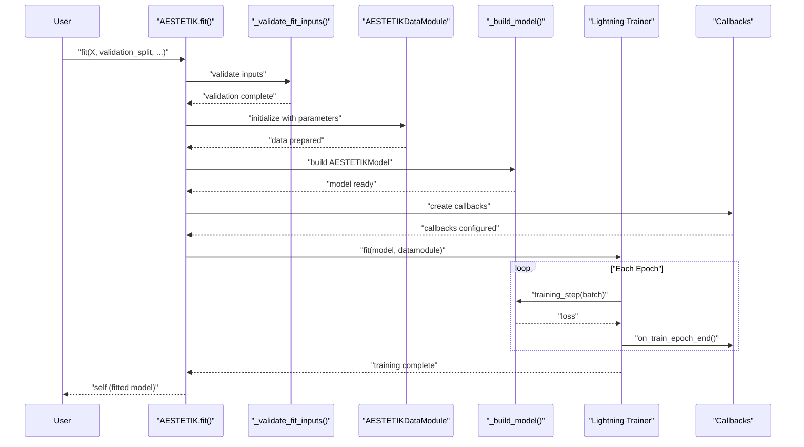
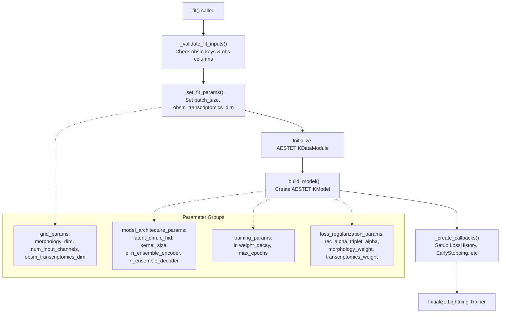
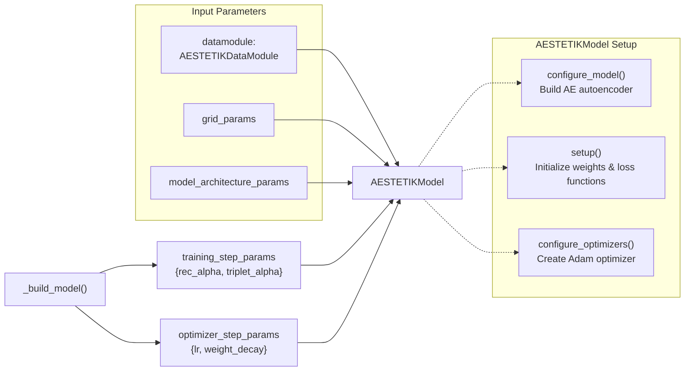
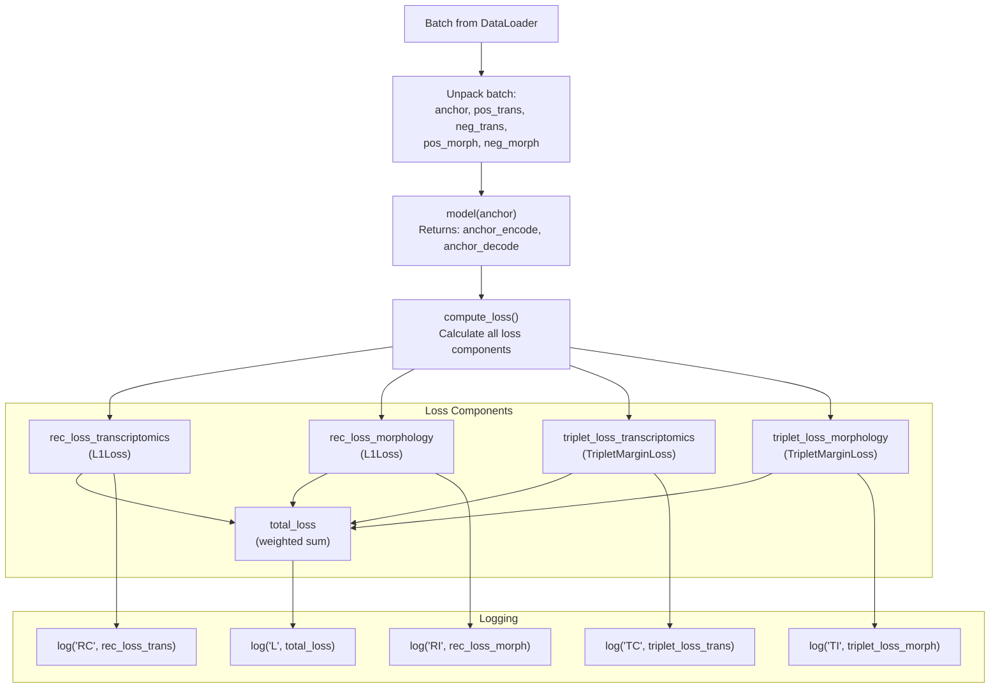
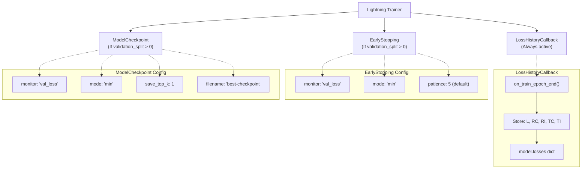
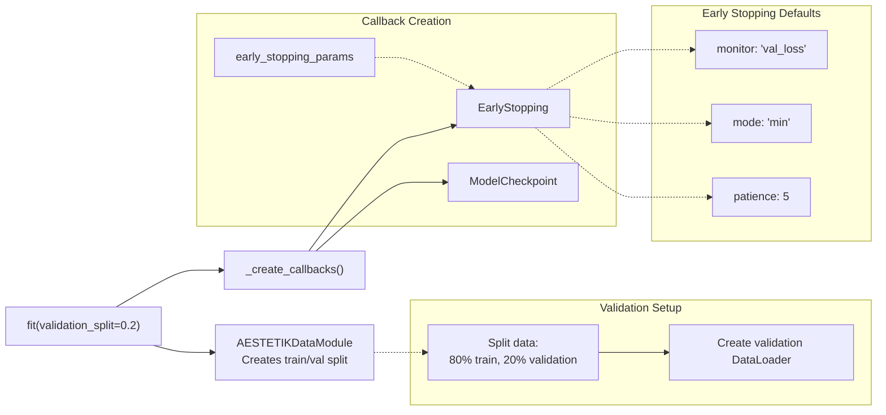
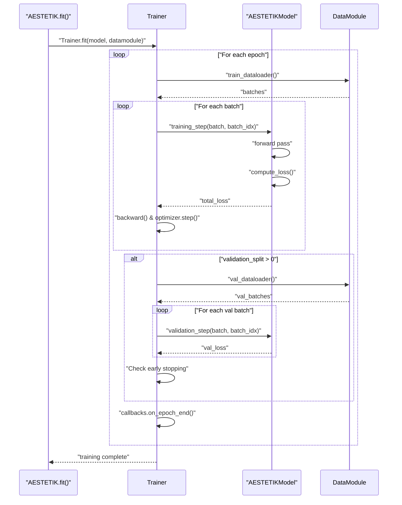

# Training Models

<details>
<summary>Relevant source files</summary>

The following files were used as context for generating this wiki page:

- [example/gettingStartedWithAESTETIK.ipynb](example/gettingStartedWithAESTETIK.ipynb)
- [example/gettingStartedWithAESTETIKwithSimulatedData.ipynb](example/gettingStartedWithAESTETIKwithSimulatedData.ipynb)
- [src/aestetik/AESTETIK.py](src/aestetik/AESTETIK.py)
- [src/aestetik/modules/aestetik_module.py](src/aestetik/modules/aestetik_module.py)

</details>


## Purpose and Scope

This guide covers the complete training workflow for AESTETIK models, including model initialization, data preparation, loss computation, and training monitoring. It explains how to use the `fit()` method to train models on spatial transcriptomics data with both transcriptomics and morphology modalities.

For information about preparing data before training, see [Preparing Your Data](#4.1). For generating predictions with trained models, see [Making Predictions](#4.3). For complete API documentation, see [AESTETIK Class](#5.1).

---

## Training Workflow Overview

The training process in AESTETIK follows a structured pipeline orchestrated by PyTorch Lightning. The `AESTETIK.fit()` method coordinates all training steps, from data validation through model optimization.

### High-Level Training Sequence



**Sources:** [src/aestetik/AESTETIK.py:179-238]()

---

## The fit() Method

The `fit()` method is the primary entry point for training AESTETIK models. It handles the entire training pipeline from validation through optimization.

### Method Signature and Parameters

| Parameter | Type | Default | Description |
|-----------|------|---------|-------------|
| `X` | `anndata.AnnData` | Required | AnnData object containing spatial transcriptomics data |
| `used_obsm_transcriptomics` | `str` | `"X_pca_transcriptomics"` | Key in `X.obsm` for transcriptomics features |
| `used_obsm_morphology` | `str` | `"X_pca_morphology"` | Key in `X.obsm` for morphology features |
| `used_obsm_combined` | `str` | `"X_pca"` | Key in `X.obsm` for combined features |
| `used_obs_batch` | `Optional[str]` | `None` | Key in `X.obs` for batch/sample labels |
| `validation_split` | `float` | `0.0` | Proportion of data to use for validation (0.0-1.0) |
| `early_stopping_params` | `Optional[dict]` | `None` | Parameters for early stopping callback |

### Required Data Structure

Before calling `fit()`, the AnnData object must contain:

| Location | Key | Content | Required |
|----------|-----|---------|----------|
| `X.obsm` | `used_obsm_transcriptomics` | Transcriptomics PCA features | Yes |
| `X.obsm` | `used_obsm_morphology` | Morphology PCA features | Yes |
| `X.obs` | `"x_array"` | Spatial x-coordinates | Yes |
| `X.obs` | `"y_array"` | Spatial y-coordinates | Yes |

**Sources:** [src/aestetik/AESTETIK.py:179-209](), [src/aestetik/AESTETIK.py:337-343]()

---

## Training Initialization Process

The initialization phase prepares all components required for training, including parameter validation, batch size configuration, and model construction.

### Initialization Workflow



### Automatic Batch Size Configuration

If `batch_size` is not specified during initialization, it is automatically set during the fit process:

```python
# From _set_fit_params()
if self.dataloader_params["batch_size"] is None:
    self.dataloader_params["batch_size"] = min(2 ** 13, len(X))
```

This ensures the batch size is at most 8192 or the dataset size, whichever is smaller.

**Sources:** [src/aestetik/AESTETIK.py:210-227](), [src/aestetik/AESTETIK.py:398-404](), [src/aestetik/AESTETIK.py:525-541]()

---

## Model Architecture Construction

The `_build_model()` method constructs the `AESTETIKModel` Lightning module, which wraps the core autoencoder architecture.

### Model Building Components



### Model Configuration Process

The `AESTETIKModel.configure_model()` method is called automatically by Lightning to build the actual autoencoder:

| Step | Action | Code Location |
|------|--------|---------------|
| 1. Get grid dimensions | Extract from `X.obsm["X_st_grid"]` | [src/aestetik/modules/aestetik_module.py:84-86]() |
| 2. Update grid_params | Set `morphology_dim` and `num_input_channels` | [src/aestetik/modules/aestetik_module.py:85-86]() |
| 3. Build AE model | Initialize ensemble encoder/decoder | [src/aestetik/modules/aestetik_module.py:88-89]() |
| 4. Set model_built flag | Prevent re-initialization | [src/aestetik/modules/aestetik_module.py:90]() |

**Sources:** [src/aestetik/AESTETIK.py:525-541](), [src/aestetik/modules/aestetik_module.py:80-91](), [src/aestetik/modules/aestetik_module.py:14-55]()

---

## Training Loop Execution

Once initialized, the Lightning `Trainer` manages the training loop, calling `training_step()` for each batch.

### Training Step Data Flow



### training_step() Implementation

The `training_step()` method in `AESTETIKModel` performs the following operations:

1. **Unpack batch**: Extract anchor, positive samples, and negative samples for both modalities
2. **Forward pass**: Run anchor through the encoder and decoder
3. **Compute loss**: Calculate reconstruction and triplet losses for both modalities
4. **Log metrics**: Record all loss components for monitoring
5. **Return total loss**: Used for backpropagation

```python
# Batch structure: (anchor, pos_trans_list, neg_trans_list, pos_morph_list, neg_morph_list)
# Each list contains multiple samples for multi-triplet loss computation
```

**Sources:** [src/aestetik/modules/aestetik_module.py:93-117](), [example/gettingStartedWithAESTETIK.ipynb:318-320]()

---

## Loss Computation Details

AESTETIK uses a multi-component loss function that combines reconstruction and contrastive learning objectives for both modalities.

### Loss Function Components

| Loss Type | Purpose | Weight Parameter | Loss Function |
|-----------|---------|------------------|---------------|
| Reconstruction (Transcriptomics) | Reconstruct transcriptomics features | `rec_alpha` × `transcriptomics_weight` | L1Loss |
| Reconstruction (Morphology) | Reconstruct morphology features | `rec_alpha` × `morphology_weight` | L1Loss |
| Triplet (Transcriptomics) | Separate transcriptomics clusters | `triplet_alpha` × `transcriptomics_weight` | TripletMarginLoss |
| Triplet (Morphology) | Separate morphology clusters | `triplet_alpha` × `morphology_weight` | TripletMarginLoss |

### Loss Weighting Formula

```
total_loss = (rec_alpha × transcriptomics_weight × rec_loss_trans) +
             (rec_alpha × morphology_weight × rec_loss_morph) +
             (triplet_alpha × transcriptomics_weight × triplet_loss_trans) +
             (triplet_alpha × morphology_weight × triplet_loss_morph)
```

### Loss Function Initialization

Loss functions are initialized in the `setup()` method:

```python
self.loss = {
    "triplet_loss": nn.TripletMarginLoss(),
    "rec_loss": nn.L1Loss()
}
```

The modality weights are calibrated automatically during data preparation based on clustering quality, then normalized to sum to `total_weight` (default: 3).

**Sources:** [src/aestetik/modules/aestetik_module.py:74-77](), [src/aestetik/modules/aestetik_module.py:99-111](), [src/aestetik/AESTETIK.py:153-161]()

---

## Monitoring and Callbacks

AESTETIK provides several mechanisms for monitoring training progress and implementing training controls.

### Callback System Architecture



### Accessing Training Losses

After training, loss history is available through the model:

```python
model.fit(X=adata)
losses = model.losses  # Dictionary with keys: 'L', 'RC', 'RI', 'TC', 'TI'
```

### Loss Metric Keys

| Key | Full Name | Description |
|-----|-----------|-------------|
| `L` | Total Loss | Weighted sum of all loss components |
| `RC` | Reconstruction (Transcriptomics) | L1 loss for transcriptomics reconstruction |
| `RI` | Reconstruction (Morphology) | L1 loss for morphology reconstruction |
| `TC` | Triplet (Transcriptomics) | Triplet margin loss for transcriptomics |
| `TI` | Triplet (Morphology) | Triplet margin loss for morphology |

**Sources:** [src/aestetik/AESTETIK.py:231-238](), [src/aestetik/AESTETIK.py:449-467](), [src/aestetik/modules/aestetik_module.py:112-116]()

---

## Validation and Early Stopping

When `validation_split > 0.0`, AESTETIK automatically enables validation monitoring and optional early stopping.

### Validation Configuration



### Configuring Early Stopping

The `early_stopping_params` dictionary accepts the following keys:

| Parameter | Type | Default | Description |
|-----------|------|---------|-------------|
| `patience` | `int` | `5` | Number of epochs with no improvement before stopping |
| `min_delta` | `float` | `0.0` | Minimum change in monitored metric to qualify as improvement |

**Note:** The `monitor` and `mode` parameters are fixed to `"val_loss"` and `"min"` respectively and cannot be overridden.

### validation_step() Behavior

The validation step differs from training in one key aspect: dropout is still active (model in training mode) but gradients are disabled:

```python
def validation_step(self, batch, batch_idx):
    self.model.train()  # Keep dropout active for stochastic validation
    with torch.no_grad():  # Disable gradient computation
        # Compute losses without backpropagation
```

This provides validation estimates that account for model stochasticity.

**Sources:** [src/aestetik/AESTETIK.py:203-208](), [src/aestetik/AESTETIK.py:449-484](), [src/aestetik/modules/aestetik_module.py:119-140]()

---

## Trainer Configuration

The Lightning `Trainer` is configured with specific parameters optimized for AESTETIK's training regime.

### Trainer Initialization Parameters

```python
self.trainer = Trainer(
    max_epochs=self.training_params["max_epochs"],
    callbacks=callbacks,
    num_sanity_val_steps=0
)
```

| Parameter | Value | Explanation |
|-----------|-------|-------------|
| `max_epochs` | From `training_params` | Maximum training epochs (default: 100) |
| `callbacks` | List | LossHistoryCallback + optional EarlyStopping/ModelCheckpoint |
| `num_sanity_val_steps` | `0` | Disables sanity validation checks to avoid unnecessary computation |

### Training Execution Flow



**Sources:** [src/aestetik/AESTETIK.py:234-237]()

---

## Optimizer Configuration

AESTETIK uses the Adam optimizer with AMSGrad variant for stable training.

### Optimizer Setup

```python
def configure_optimizers(self):
    optimizer = torch.optim.Adam(
        self.model.parameters(),
        amsgrad=True,
        lr=self.hparams["optimizer_params"]["lr"],
        weight_decay=self.hparams["optimizer_params"]["weight_decay"]
    )
    return optimizer
```

### Optimizer Parameters

| Parameter | Default Value | Description |
|-----------|---------------|-------------|
| `lr` | `0.001` | Learning rate for gradient descent |
| `weight_decay` | `1e-6` | L2 regularization coefficient |
| `amsgrad` | `True` | Use AMSGrad variant for more stable convergence |

The AMSGrad variant maintains the maximum of squared gradients, which can help with convergence in non-convex optimization problems.

**Sources:** [src/aestetik/modules/aestetik_module.py:163-168](), [src/aestetik/AESTETIK.py:84-85](), [src/aestetik/AESTETIK.py:109]()

---

## Practical Training Examples

### Basic Training Example

```python
from aestetik import AESTETIK
import scanpy as sc

# Load and prepare data
adata = sc.read_h5ad("data.h5ad")

# Initialize model
model = AESTETIK(
    nCluster=7,
    morphology_weight=0.5,
    max_epochs=50
)

# Train model
model.fit(X=adata)

# Access training losses
losses = model.losses
print(f"Final total loss: {losses['L'][-1]}")
```

### Training with Validation and Early Stopping

```python
# Train with validation split
model.fit(
    X=adata,
    validation_split=0.2,
    early_stopping_params={
        'patience': 10,
        'min_delta': 0.001
    }
)
```

### Training with Custom Modality Keys

```python
# Use custom keys for multi-sample data
model.fit(
    X=adata,
    used_obsm_transcriptomics="custom_trans_pca",
    used_obsm_morphology="custom_morph_pca",
    used_obs_batch="sample_id"  # For batch-aware processing
)
```

### Monitoring Training Progress

```python
from aestetik.utils.utils_visualization import visualize

# Train model
model.fit(X=adata, validation_split=0.15)

# Visualize training loss curves
visualize(model=model, plot_loss=True)
```

**Sources:** [example/gettingStartedWithAESTETIK.ipynb:289-320](), [example/gettingStartedWithAESTETIK.ipynb:396-398]()

---

## Common Training Parameters

### Model Architecture Parameters

| Parameter | Default | Range | Impact |
|-----------|---------|-------|--------|
| `window_size` | `7` | Odd integers ≥ 3 | Size of spatial neighborhood grid |
| `latent_dim` | `16` | 8-64 typical | Dimensionality of learned representations |
| `c_hid` | `64` | 32-128 typical | Hidden channel dimension in CNN |
| `kernel_size` | `3` | 1 to window_size-1 | Convolution kernel size |
| `p` | `0.3` | 0.0-0.5 | Dropout probability for regularization |
| `n_ensemble` | `3` | 1-10 | Number of ensemble encoders/decoders |

### Loss Parameters

| Parameter | Default | Range | Impact |
|-----------|---------|-------|--------|
| `morphology_weight` | Required | 0.0-3.0 | Weight for morphology modality |
| `rec_alpha` | `1.0` | 0.1-10.0 | Scaling factor for reconstruction loss |
| `triplet_alpha` | `1.0` | 0.1-10.0 | Scaling factor for triplet loss |
| `total_weight` | `3.0` | 1.0-5.0 | Total weight (transcriptomics + morphology) |

### Training Control Parameters

| Parameter | Default | Range | Impact |
|-----------|---------|-------|--------|
| `max_epochs` | `100` | 10-1000 | Maximum training epochs |
| `lr` | `0.001` | 1e-5 to 1e-2 | Learning rate |
| `batch_size` | Auto | 32-8192 | Batch size (auto: min(8192, n_spots)) |
| `weight_decay` | `1e-6` | 1e-8 to 1e-4 | L2 regularization strength |

**Sources:** [src/aestetik/AESTETIK.py:29-116](), [src/aestetik/AESTETIK.py:126-166]()

---

## Training Output and Artifacts

### Model State After Training

After `fit()` completes, the `AESTETIK` object contains:

| Attribute | Type | Description |
|-----------|------|-------------|
| `lit_aestetik_model` | `AESTETIKModel` | Trained Lightning module |
| `trainer` | `Trainer` | Lightning Trainer instance |
| `losses` | `dict` | Loss history for each metric |

### Using the Trained Model

```python
# Check if model is fitted
if model.trainer is not None:
    print("Model is trained and ready for prediction")

# Access loss history
for metric, values in model.losses.items():
    print(f"{metric}: {len(values)} epochs recorded")

# Generate predictions
model.predict(X=adata, cluster=True)
```

### Training State Validation

The `_check_fitted()` method ensures the model is trained before prediction:

```python
def _check_fitted(self):
    if self.trainer is None or self.lit_aestetik_model is None:
        raise RuntimeError(
            "The model has not been fitted yet. Call 'fit' before 'predict'."
        )
```

**Sources:** [src/aestetik/AESTETIK.py:170-171](), [src/aestetik/AESTETIK.py:369-371](), [src/aestetik/AESTETIK.py:238]()

---