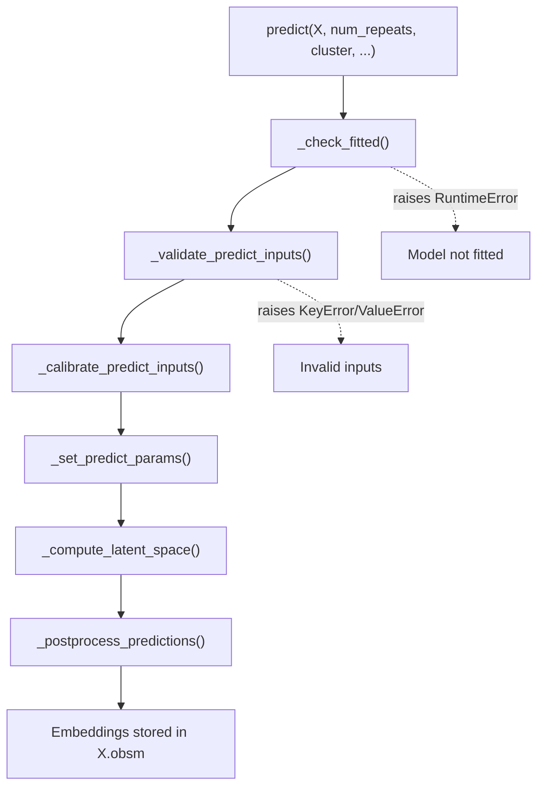
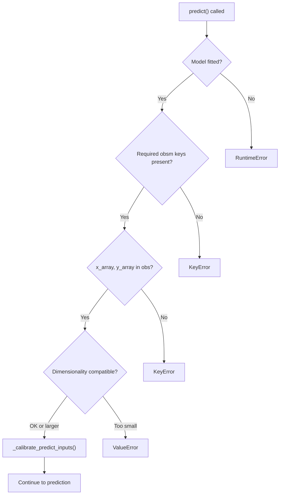
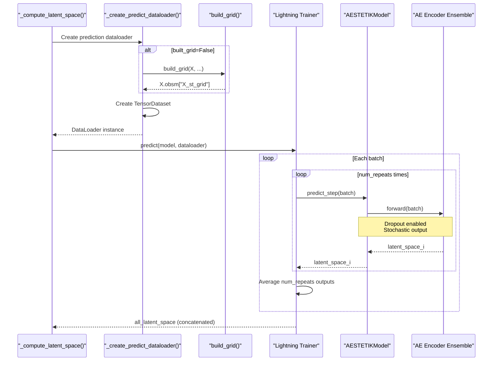
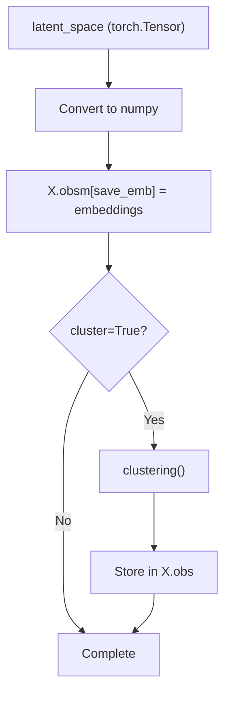
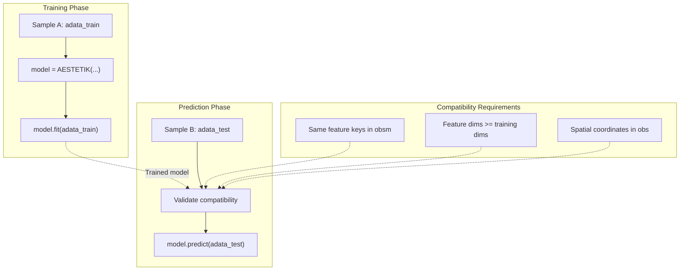
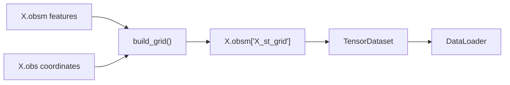
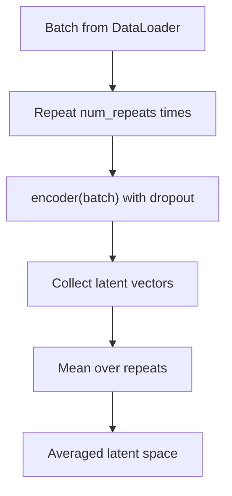

# Making Predictions

<details>
<summary>Relevant source files</summary>

The following files were used as context for generating this wiki page:

- [CHANGELOG.md](CHANGELOG.md)
- [example/gettingStartedWithAESTETIK.ipynb](example/gettingStartedWithAESTETIK.ipynb)
- [example/gettingStartedWithAESTETIKwithSimulatedData.ipynb](example/gettingStartedWithAESTETIKwithSimulatedData.ipynb)
- [src/aestetik/AESTETIK.py](src/aestetik/AESTETIK.py)

</details>


## Purpose and Scope

This page describes how to generate latent space embeddings from a trained AESTETIK model and optionally perform clustering on those embeddings. It covers the `predict()` and `fit_predict()` methods, cross-sample prediction capabilities, input validation, and output formatting.

For information about training models, see [Training Models](#4.2). For information about analyzing and visualizing the predicted embeddings and clusters, see [Clustering and Analysis](#4.4) and [Visualization](#4.5). For detailed API specifications, see [AESTETIK Class](#5.1).

---

## Overview

AESTETIK provides two methods for generating predictions:

| Method | Use Case | When to Use |
|--------|----------|-------------|
| `predict()` | Generate embeddings from a trained model | Cross-sample prediction, applying pre-trained model to new data |
| `fit_predict()` | Train and immediately predict | Single-sample workflow, convenience method |

Both methods:
- Compute latent space representations via stochastic forward passes (Monte Carlo dropout)
- Store embeddings in `adata.obsm`
- Optionally perform clustering and store results in `adata.obs`
- Support multi-sample datasets via batch labels

Sources: [src/aestetik/AESTETIK.py:240-332]()

---

## Prediction Methods

### The predict() Method

The `predict()` method generates embeddings from an already-fitted model. This is the primary method for cross-sample prediction.



**Method signature:**
```python
def predict(
    X: anndata.AnnData,
    used_obsm_transcriptomics: str = "X_pca_transcriptomics",
    used_obsm_morphology: str = "X_pca_morphology",
    used_obs_batch: Optional[str] = None,
    save_emb: str = "AESTETIK",
    num_repeats: int = 1000,
    cluster: bool = True
) -> None
```

**Key parameters:**
- `X`: AnnData object containing the data to predict on (can be different from training data)
- `num_repeats`: Number of stochastic forward passes (Monte Carlo dropout) to average
- `cluster`: Whether to perform clustering after computing embeddings
- `save_emb`: Key for storing embeddings in `X.obsm`

Sources: [src/aestetik/AESTETIK.py:240-282]()

### The fit_predict() Method

The `fit_predict()` method combines training and prediction in a single call. It is a convenience method for single-sample workflows.

```python
def fit_predict(
    X: anndata.AnnData,
    used_obsm_transcriptomics: str = "X_pca_transcriptomics",
    used_obsm_morphology: str = "X_pca_morphology",
    used_obsm_combined: str = "X_pca",
    used_obs_batch: Optional[str] = None,
    validation_split: float = 0.0,
    save_emb: str = "AESTETIK",
    num_repeats: int = 1000,
    cluster: bool = True
) -> None
```

**Implementation detail:** This method internally calls `fit()` followed by `_compute_latent_space()` with `built_grid=True` to avoid rebuilding the spatial grid.

Sources: [src/aestetik/AESTETIK.py:284-332]()

---

## Prediction Workflow

### High-Level Prediction Pipeline

```mermaid
graph LR
    subgraph "Input Validation"
        A["Check Model Fitted"]
        B["Validate obsm Keys"]
        C["Validate obs Columns"]
        D["Check Dimensionality"]
    end
    
    subgraph "Input Calibration"
        E["Calibrate Transcriptomics Dims"]
        F["Calibrate Morphology Dims"]
    end
    
    subgraph "Latent Space Computation"
        G["Build Spatial Grid"]
        H["Create DataLoader"]
        I["Stochastic Forward Passes"]
        J["Average Embeddings"]
    end
    
    subgraph "Post-Processing"
        K["Store in obsm"]
        L["Optional Clustering"]
        M["Store in obs"]
    end
    
    A --> B
    B --> C
    C --> D
    D --> E
    E --> F
    F --> G
    G --> H
    H --> I
    I --> J
    J --> K
    K --> L
    L --> M
```



Sources: [src/aestetik/AESTETIK.py:240-282](), [src/aestetik/AESTETIK.py:489-520]()

### Input Validation and Calibration

The prediction workflow begins with strict validation to ensure compatibility between the input data and the trained model.

**Validation checks:**



**Validation methods:**
- `_check_fitted()`: Ensures `self.trainer` and `self.lit_aestetik_model` are not None
- `_validate_predict_inputs()`: Checks for required keys and dimensionality
- `_calibrate_predict_inputs()`: Truncates oversized features to match training dimensions

**Calibration example:**
```python
# If prediction data has more features than training data used
# Transcriptomics: trained with 15 dims, prediction has 20 dims
# System automatically truncates to 15 dims
X.obsm[used_obsm_transcriptomics] = X.obsm[used_obsm_transcriptomics][:, :15]
```

Sources: [src/aestetik/AESTETIK.py:369-425]()

### Latent Space Computation

The core prediction operation uses **Monte Carlo dropout** to generate robust embeddings by averaging multiple stochastic forward passes.



**Key implementation details:**

| Component | File Location | Role |
|-----------|---------------|------|
| `_compute_latent_space()` | [src/aestetik/AESTETIK.py:489-503]() | Orchestrates latent space computation |
| `_create_predict_dataloader()` | [src/aestetik/AESTETIK.py:428-447]() | Builds DataLoader from spatial grids |
| `build_grid()` | [src/aestetik/utils/utils_data.py]() | Constructs spatial grids if not cached |
| `AESTETIKModel.predict_step()` | [src/aestetik/modules/aestetik_module.py]() | Performs stochastic forward pass |

**num_repeats parameter:**
- Default: 1000 forward passes per batch
- Higher values: More stable embeddings but slower computation
- Set via `_set_predict_params()` which updates `self.lit_aestetik_model.predict_params["num_repeats"]`

Sources: [src/aestetik/AESTETIK.py:406-447](), [src/aestetik/AESTETIK.py:489-503]()

### Post-Processing

After computing latent space embeddings, the `_postprocess_predictions()` method stores results and optionally performs clustering.



**Output locations:**

| Data | Storage Location | Key Name | Format |
|------|------------------|----------|--------|
| Embeddings | `X.obsm` | `save_emb` (default: "AESTETIK") | numpy array (n_spots, latent_dim) |
| Cluster labels | `X.obs` | `{save_emb}_cluster` | categorical |
| Refined clusters | `X.obs` | `{save_emb}_cluster_refined` | categorical |

**Clustering invocation:**
```python
if cluster:
    clustering(
        X,
        used_obsm=save_emb,
        num_cluster=self.clustering_params["nCluster"],
        method=self.clustering_params["clustering_method"],
        refine_cluster=self.clustering_params["refine_cluster"],
        n_neighbors=self.clustering_params["n_neighbors"],
        used_obs_batch=used_obs_batch
    )
```

Sources: [src/aestetik/AESTETIK.py:505-520]()

---

## Cross-Sample Prediction

A key capability of AESTETIK is **cross-sample prediction**: training on one spatial transcriptomics sample and applying the model to different samples.

### When to Use Cross-Sample Prediction

| Scenario | Approach |
|----------|----------|
| Training and prediction on same sample | Use `fit_predict()` |
| Applying model to new samples | Use `fit()` then `predict()` |
| Batch correction across samples | Use `used_obs_batch` parameter |
| Transfer learning | Train on annotated sample, predict on unlabeled samples |

### Cross-Sample Prediction Workflow



### Compatibility Requirements

For cross-sample prediction to work, the test data must meet specific requirements:

**Required AnnData structure:**

| Component | Requirement | Validation Method |
|-----------|-------------|-------------------|
| `obsm` keys | `used_obsm_transcriptomics` and `used_obsm_morphology` must exist | `_validate_obsm_keys()` |
| `obs` columns | `x_array` and `y_array` must exist | `_validate_obs_columns()` |
| Feature dimensions | Must be ≥ training dimensions | `_validate_predict_inputs()` |

**Automatic calibration:**
- If test data has more features than training data, features are automatically truncated
- Transcriptomics truncated to `grid_params["obsm_transcriptomics_dim"]`
- Morphology truncated to `grid_params["num_input_channels"] - grid_params["obsm_transcriptomics_dim"]`

### Multi-Sample Datasets

AESTETIK supports predictions on multi-sample datasets using batch labels:

```python
# adata contains multiple samples with batch column
model.predict(
    X=adata,
    used_obs_batch="sample_id",  # Column identifying samples
    cluster=True
)
```

When `used_obs_batch` is provided:
- Spatial grids are built separately per sample
- Clustering can account for batch effects
- Results are stored for all samples simultaneously

Sources: [src/aestetik/AESTETIK.py:345-425](), [CHANGELOG.md:36-38]()

---

## Parameters

### Core Prediction Parameters

| Parameter | Type | Default | Description |
|-----------|------|---------|-------------|
| `X` | `anndata.AnnData` | Required | Input data with features in `obsm` and coordinates in `obs` |
| `num_repeats` | `int` | 1000 | Number of stochastic forward passes for Monte Carlo dropout |
| `cluster` | `bool` | True | Whether to perform clustering after computing embeddings |
| `save_emb` | `str` | "AESTETIK" | Key for storing embeddings in `X.obsm` |

### Feature Keys

| Parameter | Type | Default | Description |
|-----------|------|---------|-------------|
| `used_obsm_transcriptomics` | `str` | "X_pca_transcriptomics" | Key for transcriptomics features in `X.obsm` |
| `used_obsm_morphology` | `str` | "X_pca_morphology" | Key for morphology features in `X.obsm` |
| `used_obs_batch` | `Optional[str]` | None | Column name in `X.obs` for sample identifiers |

### Additional Parameters (fit_predict only)

| Parameter | Type | Default | Description |
|-----------|------|---------|-------------|
| `used_obsm_combined` | `str` | "X_pca" | Key for combined features (used during training) |
| `validation_split` | `float` | 0.0 | Proportion of data for validation during training |

Sources: [src/aestetik/AESTETIK.py:240-332]()

---

## Output Format

### Embeddings in obsm

Embeddings are stored as numpy arrays in `X.obsm[save_emb]`:

```python
# After prediction
embeddings = adata.obsm["AESTETIK"]  # Shape: (n_spots, latent_dim)

# latent_dim is specified during model initialization (default: 16)
# Each row corresponds to one spot's latent representation
```

### Clustering Results in obs

If `cluster=True`, clustering results are stored in `X.obs`:

| Column Name | Format | Description |
|-------------|--------|-------------|
| `{save_emb}_cluster` | categorical | Initial cluster assignments |
| `{save_emb}_cluster_refined` | categorical | Spatially refined clusters (if `refine_cluster=True`) |

**Additional metadata columns:**

For multi-modal clustering, the system also stores intermediate clustering results:
- `X_pca_transcriptomics_cluster`: Clusters from transcriptomics modality only
- `X_pca_morphology_cluster`: Clusters from morphology modality only

Sources: [src/aestetik/AESTETIK.py:505-520](), [example/gettingStartedWithAESTETIK.ipynb:363]()

---

## Examples

### Example 1: Basic Prediction

```python
# After training (see Training Models page)
model = AESTETIK(nCluster=7, morphology_weight=1.5)
model.fit(X=adata_train)

# Generate embeddings and cluster
model.predict(X=adata_train, cluster=True)

# Access results
embeddings = adata_train.obsm["AESTETIK"]
clusters = adata_train.obs["AESTETIK_cluster"]
```

Sources: [example/gettingStartedWithAESTETIK.ipynb:341]()

### Example 2: Cross-Sample Prediction

```python
# Train on sample A
model = AESTETIK(nCluster=5, morphology_weight=1.0)
model.fit(X=adata_sample_a)

# Predict on sample B (different tissue section)
# Must have same feature keys and >= dimensions
model.predict(
    X=adata_sample_b,
    num_repeats=2000,  # More repeats for stability
    cluster=True
)

# Results stored in adata_sample_b
embeddings_b = adata_sample_b.obsm["AESTETIK"]
```

Sources: [CHANGELOG.md:36-38]()

### Example 3: Multi-Sample Dataset

```python
# Dataset with multiple samples identified by 'sample_id' column
model = AESTETIK(nCluster=6, morphology_weight=1.2)
model.fit(X=adata_multi, used_obs_batch="sample_id")

# Predict on the same or different multi-sample dataset
model.predict(
    X=adata_multi,
    used_obs_batch="sample_id",
    save_emb="AESTETIK_multi",
    cluster=True
)
```

Sources: [src/aestetik/AESTETIK.py:244](), [src/aestetik/AESTETIK.py:262]()

### Example 4: Custom Feature Keys

```python
# Use custom keys for features
model.predict(
    X=adata,
    used_obsm_transcriptomics="my_transcriptomics_pca",
    used_obsm_morphology="my_morphology_features",
    save_emb="custom_embeddings",
    cluster=False  # Skip clustering, just get embeddings
)

# Access embeddings
embeddings = adata.obsm["custom_embeddings"]
```

### Example 5: fit_predict Convenience Method

```python
# Train and predict in one call
model = AESTETIK(nCluster=5, morphology_weight=0)
model.fit_predict(
    X=adata,
    num_repeats=1500,
    cluster=True
)

# Results immediately available
clusters = adata.obs["AESTETIK_cluster"]
```

Sources: [example/gettingStartedWithAESTETIKwithSimulatedData.ipynb:244]()

---

## Technical Details

### Spatial Grid Construction During Prediction

When `built_grid=False` (cross-sample prediction), the system must construct spatial grids:



**Grid construction parameters:**
- `window_size`: Taken from `grid_params["morphology_dim"]` (set during initialization)
- `n_jobs`: Parallelization level from `data_handling_params["n_jobs"]`

Sources: [src/aestetik/AESTETIK.py:428-447]()

### DataLoader Configuration

Prediction uses the same DataLoader configuration as training:

| Parameter | Source | Description |
|-----------|--------|-------------|
| `batch_size` | `dataloader_params["batch_size"]` | Batch size for prediction |
| `num_workers` | `dataloader_params["num_workers"]` | Parallel data loading workers |
| `shuffle` | False (fixed) | No shuffling during prediction |

Sources: [src/aestetik/AESTETIK.py:445-447]()

### Stochastic Forward Passes Implementation

The actual stochastic forward passes are implemented in the `AESTETIKModel.predict_step()` method:



The averaging provides robustness against dropout randomness and produces more stable embeddings.

Sources: [src/aestetik/AESTETIK.py:406-408](), [src/aestetik/AESTETIK.py:500-503]()

---

## Common Issues and Solutions

| Issue | Cause | Solution |
|-------|-------|----------|
| `RuntimeError: Model not fitted` | Calling `predict()` before `fit()` | Call `fit()` first or use `fit_predict()` |
| `KeyError: Required keys missing` | Missing feature keys in test data | Ensure same keys used for training exist in test data |
| `ValueError: Dimensionality too small` | Test data has fewer features than training | Provide data with at least as many features as training |
| Memory error with large datasets | Too many `num_repeats` or large `batch_size` | Reduce `num_repeats` or `batch_size` |
| Predictions differ from training sample | Natural variation with Monte Carlo dropout | Increase `num_repeats` for more stable results |

Sources: [src/aestetik/AESTETIK.py:369-425]()

---