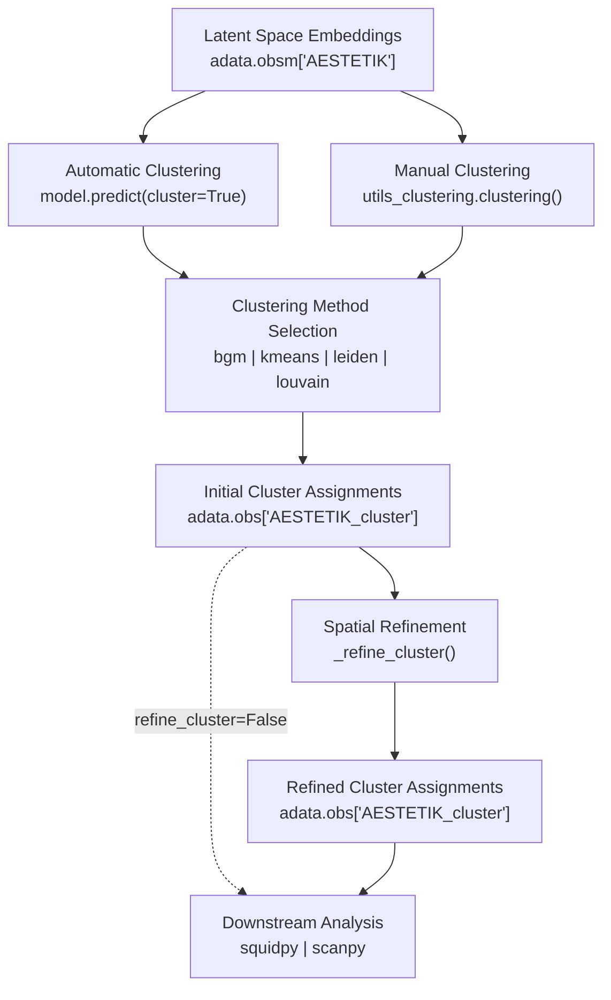
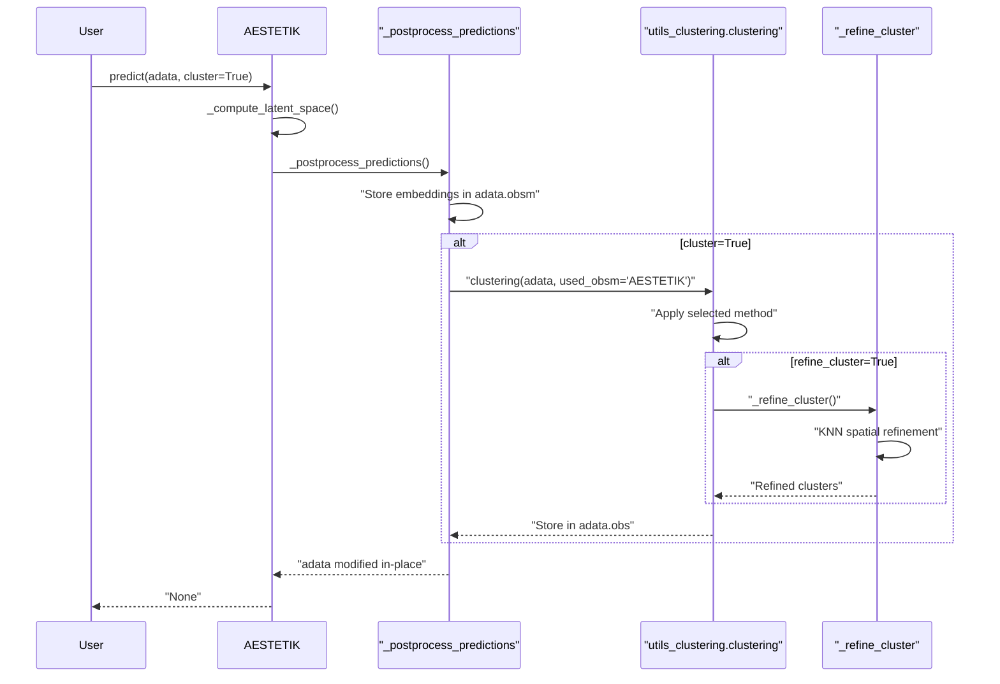
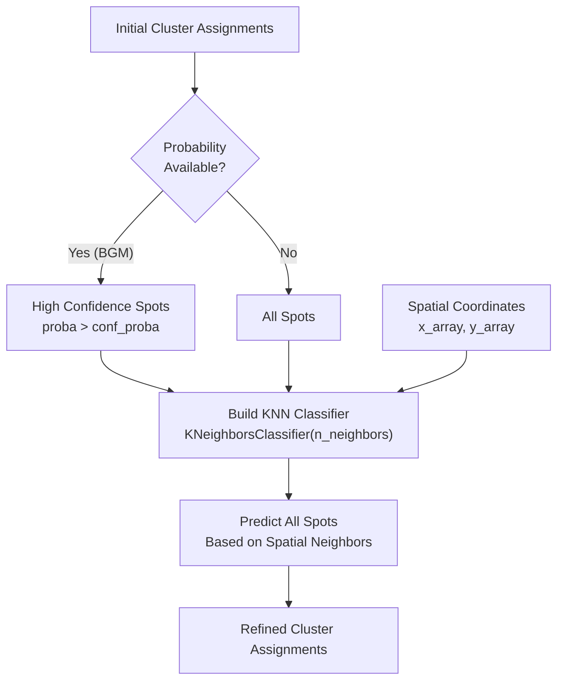
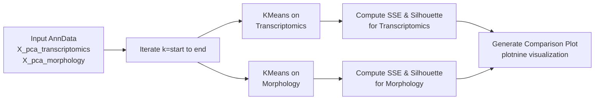
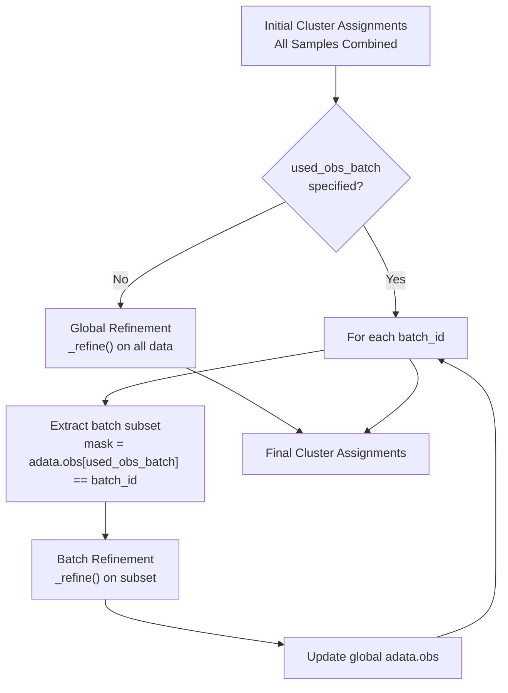

# Clustering and Analysis

<details>
<summary>Relevant source files</summary>

The following files were used as context for generating this wiki page:

- [example/gettingStartedWithAESTETIK.ipynb](example/gettingStartedWithAESTETIK.ipynb)
- [example/gettingStartedWithAESTETIKwithSimulatedData.ipynb](example/gettingStartedWithAESTETIKwithSimulatedData.ipynb)
- [src/aestetik/AESTETIK.py](src/aestetik/AESTETIK.py)
- [src/aestetik/utils/utils_clustering.py](src/aestetik/utils/utils_clustering.py)

</details>


This page provides a practical guide to clustering embeddings generated by AESTETIK and analyzing the resulting spatial domains. It covers the automatic clustering features integrated into the prediction workflow, manual clustering approaches, available clustering methods, spatial refinement techniques, and methods for determining optimal cluster numbers.

For information about generating embeddings before clustering, see [Making Predictions](#4.3). For visualizing clustering results, see [Visualization](#4.5). For detailed API reference of clustering utilities, see [Utility Functions](#5.4).

## Overview of Clustering Workflow

AESTETIK provides two primary approaches for clustering spatial transcriptomics data:

1. **Automatic Clustering**: Integrated into the `predict()` or `fit_predict()` methods
2. **Manual Clustering**: Using standalone utility functions for custom workflows



Sources: [src/aestetik/AESTETIK.py:240-283](), [src/aestetik/utils/utils_clustering.py:140-211]()

## Automatic Clustering During Prediction

The simplest way to perform clustering is through the `cluster` parameter in the `predict()` method. This automatically clusters the latent space embeddings after they are computed.

### Basic Usage

```python
# Compute embeddings and cluster in one step
model.predict(X=adata, cluster=True)

# Access results
embeddings = adata.obsm["AESTETIK"]           # Latent space embeddings
clusters = adata.obs["AESTETIK_cluster"]      # Cluster assignments
```

### Parameter Flow

| Parameter | Initialization Location | Effect |
|-----------|------------------------|---------|
| `nCluster` | `AESTETIK.__init__()` | Number of clusters or resolution parameter |
| `clustering_method` | `AESTETIK.__init__()` | Algorithm: "bgm", "kmeans", "leiden", "louvain" |
| `refine_cluster` | `AESTETIK.__init__()` | Whether to apply spatial refinement |
| `n_neighbors` | `AESTETIK.__init__()` | Number of neighbors for spatial refinement |
| `cluster` | `predict()` method | Whether to perform clustering at all |

The clustering is triggered by the `_postprocess_predictions()` method:



Sources: [src/aestetik/AESTETIK.py:505-521](), [src/aestetik/utils/utils_clustering.py:140-211]()

## Clustering Methods

AESTETIK supports four clustering algorithms, each suited for different analysis scenarios.

### Method Comparison

| Method | Type | `nCluster` Parameter | Best For | Output Probability |
|--------|------|---------------------|----------|-------------------|
| **bgm** | Bayesian Gaussian Mixture | Integer (number of components) | Uncertainty quantification, soft clustering | Yes |
| **kmeans** | K-Means | Integer (number of clusters) | Fast, well-separated clusters | No |
| **leiden** | Community Detection | Float (resolution) or Integer (target clusters) | Graph-based, biological relevance | No |
| **louvain** | Community Detection | Float (resolution) or Integer (target clusters) | Graph-based, modularity optimization | No |

### Bayesian Gaussian Mixture (BGM)

The default method using `BayesianGaussianMixture` from scikit-learn. Provides probabilistic cluster assignments and is robust to cluster shape variations.

**Implementation Details:**
- Uses tied covariance matrices across components
- 1000 max iterations with 10 random initializations
- Stores cluster probabilities in `adata.obs[f"{used_obsm}_cluster_proba"]`

**Configuration:**
```python
model = AESTETIK(
    nCluster=7,                    # Number of mixture components
    clustering_method="bgm",
    refine_cluster=True
)
```

Sources: [src/aestetik/utils/utils_clustering.py:188-201]()

### K-Means

Fast and deterministic clustering using `KMeans` with 100 initializations for stability.

**Configuration:**
```python
model = AESTETIK(
    nCluster=5,                    # Number of clusters
    clustering_method="kmeans",
    refine_cluster=True
)
```

Sources: [src/aestetik/utils/utils_clustering.py:183-187]()

### Leiden and Louvain

Graph-based community detection methods from scanpy. These methods build a k-nearest neighbor graph (k=50) and optimize for community structure.

**Resolution-Based Clustering:**
```python
# Use resolution parameter directly
model = AESTETIK(
    nCluster=1.0,                  # Resolution parameter (float)
    clustering_method="leiden"
)
```

**Target Cluster Count:**
```python
# Automatically search for resolution that yields target count
model = AESTETIK(
    nCluster=7,                    # Desired number of clusters (int)
    clustering_method="leiden"
)
# Uses search_res() to find appropriate resolution
```

The `search_res()` function performs binary search to find the resolution parameter that produces the desired number of clusters:

Sources: [src/aestetik/utils/utils_clustering.py:83-137](), [src/aestetik/utils/utils_clustering.py:154-182]()

## Spatial Cluster Refinement

Spatial refinement uses the physical coordinates of spots to improve clustering coherence. This is particularly important for spatial transcriptomics where neighboring spots are more likely to belong to the same biological domain.

### Refinement Algorithm



### Key Parameters

| Parameter | Default | Description |
|-----------|---------|-------------|
| `refine_cluster` | `True` | Enable spatial refinement |
| `n_neighbors` | 10 | Number of spatial neighbors to consider |
| `conf_proba` | 0.9 | Minimum probability threshold for training set (BGM only) |

### Implementation Details

The refinement process is handled by `_refine_cluster()` which:

1. **Probability-Based Training** (BGM only): Uses only high-confidence spots (probability > 0.9) to train the KNN classifier
2. **Spatial Feature Space**: Uses `x_array` and `y_array` coordinates as features
3. **KNN Prediction**: Classifies all spots based on majority vote of spatial neighbors
4. **Batch-Aware**: Applies refinement separately within each batch if `used_obs_batch` is specified

**Example with Refinement:**
```python
# Enable spatial refinement with custom parameters
model = AESTETIK(
    nCluster=7,
    clustering_method="bgm",
    refine_cluster=True,
    n_neighbors=15              # Use 15 spatial neighbors
)

model.fit_predict(adata)
```

Sources: [src/aestetik/utils/utils_clustering.py:203-275]()

## Determining Optimal Cluster Numbers

AESTETIK provides utilities to help determine the appropriate number of clusters for your data.

### Using find_optimal_n_clusters()

This function evaluates clustering quality across a range of cluster numbers using two metrics:

1. **Silhouette Score**: Measures cluster separation quality (higher is better)
2. **Sum of Squared Errors (SSE)**: Measures within-cluster variance (lower is better)

Both metrics are computed separately for transcriptomics and morphology modalities.

**Usage:**
```python
from aestetik.utils.utils_clustering import find_optimal_n_clusters

# Test cluster numbers from 2 to 10
find_optimal_n_clusters(
    adata, 
    start=2, 
    end=10, 
    suggested_n=7  # Optional reference line
)
```

**Output:**
- Two-panel plot showing silhouette scores and SSE across cluster numbers
- Separate lines for transcriptomics and morphology modalities
- Normalized SSE values for easier comparison
- Optional vertical line at `suggested_n` for reference



**Interpretation Guidelines:**
- **Silhouette Score Peak**: Indicates well-separated clusters
- **SSE Elbow**: Point where SSE decrease slows significantly
- **Modality Agreement**: Look for cluster numbers where both modalities show good metrics
- **Biological Relevance**: Consider known tissue structure when choosing final number

Sources: [src/aestetik/utils/utils_clustering.py:18-80]()

## Working with Clustering Results

After clustering, results are stored in the AnnData object following scanpy conventions.

### Output Structure

| Location | Key | Content |
|----------|-----|---------|
| `adata.obsm` | `"AESTETIK"` | Latent space embeddings (n_spots × latent_dim) |
| `adata.obs` | `"AESTETIK_cluster"` | Cluster assignments as strings |
| `adata.obs` | `"AESTETIK_cluster_proba"` | Cluster probabilities (BGM only) |

### Example Analysis Workflow

```python
# 1. Perform clustering
model = AESTETIK(nCluster=7, clustering_method="bgm", refine_cluster=True)
model.fit_predict(adata)

# 2. Access results
embeddings = adata.obsm["AESTETIK"]
clusters = adata.obs["AESTETIK_cluster"]
probabilities = adata.obs["AESTETIK_cluster_proba"]  # If using BGM

# 3. Compute UMAP on embeddings
import scanpy as sc
sc.pp.neighbors(adata, use_rep="AESTETIK")
sc.tl.umap(adata)

# 4. Visualize in embedding space
sc.pl.umap(adata, color=["AESTETIK_cluster", "ground_truth"])

# 5. Visualize in spatial context
import squidpy as sq
sq.pl.spatial_scatter(adata, color="AESTETIK_cluster")

# 6. Identify uncertain spots (BGM only)
uncertain_spots = adata[adata.obs["AESTETIK_cluster_proba"] < 0.8]
```

Sources: [example/gettingStartedWithAESTETIK.ipynb:329-398](), [example/gettingStartedWithAESTETIKwithSimulatedData.ipynb:244-296]()

## Batch-Aware Clustering

When working with multi-sample datasets, AESTETIK can perform batch-aware clustering that respects sample boundaries during spatial refinement.

### Configuration

```python
# Train on multi-sample dataset
model = AESTETIK(
    nCluster=7,
    clustering_method="bgm",
    refine_cluster=True,
    n_neighbors=10
)

# Specify batch column during prediction
model.predict(
    adata,
    cluster=True,
    used_obs_batch="sample_id"  # Column in adata.obs with sample labels
)
```

### Batch-Aware Refinement Process



**Key Benefits:**
1. **Independent Spatial Refinement**: Each sample's spatial structure is respected
2. **Prevents Cross-Sample Contamination**: Spatial neighbors only considered within same sample
3. **Consistent Cluster Labels**: Cluster identities maintained across samples

**Implementation:**
- The `_refine_cluster()` function checks for `used_obs_batch` parameter
- When provided, loops through unique batch values
- Applies `_refine()` independently to each batch subset
- Updates cluster assignments back to original AnnData object

Sources: [src/aestetik/utils/utils_clustering.py:212-247](), [src/aestetik/AESTETIK.py:505-521]()

## Manual Clustering Workflow

For advanced users who need more control, the clustering functions can be called directly.

### Direct Function Call

```python
from aestetik.utils.utils_clustering import clustering

# Cluster pre-computed embeddings
clustering(
    adata,
    used_obsm="AESTETIK",          # Key in adata.obsm
    num_cluster=7,
    method="bgm",
    refine_cluster=True,
    n_neighbors=10,
    used_obs_batch=None
)

# Results stored in adata.obs["AESTETIK_cluster"]
```

### Custom Clustering Parameters

```python
# Example: Higher confidence threshold for BGM refinement
clustering(
    adata,
    used_obsm="custom_embedding",
    num_cluster=5,
    method="bgm",
    refine_cluster=True,
    n_neighbors=15,
    conf_proba=0.95,               # More stringent confidence
    used_obs_batch="sample_id"
)
```

### Resolution Search Parameters

For leiden/louvain methods with target cluster counts:

```python
# Custom resolution search range
clustering(
    adata,
    used_obsm="AESTETIK",
    num_cluster=8,                 # Target cluster count
    method="leiden",
    refine_cluster=True,
    start=0.1,                     # Minimum resolution to try
    end=5.0,                       # Maximum resolution to try
    increment=0.05                 # Step size
)
```

Sources: [src/aestetik/utils/utils_clustering.py:140-211]()

## Integration with Downstream Analysis

AESTETIK clustering results integrate seamlessly with scanpy and squidpy workflows.

### Spatial Statistics

```python
import squidpy as sq

# Compute spatial autocorrelation of clusters
sq.gr.spatial_autocorr(
    adata,
    mode="moran",
    genes=adata.obs["AESTETIK_cluster"].unique()
)

# Compute neighborhood enrichment
sq.gr.nhood_enrichment(adata, cluster_key="AESTETIK_cluster")

# Compute co-occurrence scores
sq.gr.co_occurrence(
    adata,
    cluster_key="AESTETIK_cluster"
)
```

### Differential Expression by Cluster

```python
import scanpy as sc

# Find marker genes for each cluster
sc.tl.rank_genes_groups(
    adata,
    groupby="AESTETIK_cluster",
    method="wilcoxon"
)

# Plot top markers
sc.pl.rank_genes_groups(adata, n_genes=10)
```

### Cluster Quality Assessment

```python
from sklearn.metrics import silhouette_score, adjusted_rand_score

# Silhouette score on embeddings
silhouette = silhouette_score(
    adata.obsm["AESTETIK"],
    adata.obs["AESTETIK_cluster"]
)

# Compare to ground truth (if available)
if "ground_truth" in adata.obs:
    ari = adjusted_rand_score(
        adata.obs["ground_truth"],
        adata.obs["AESTETIK_cluster"]
    )
```

Sources: [example/gettingStartedWithAESTETIK.ipynb:363-398](), [example/gettingStartedWithAESTETIKwithSimulatedData.ipynb:254-296]()

---