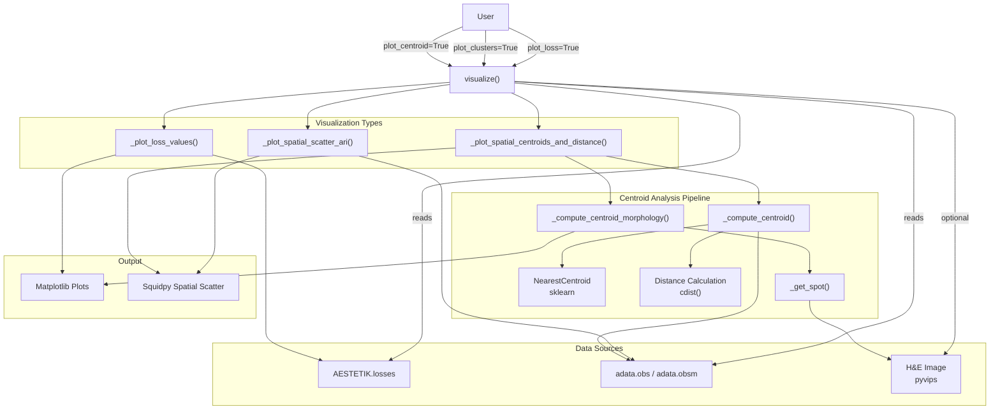
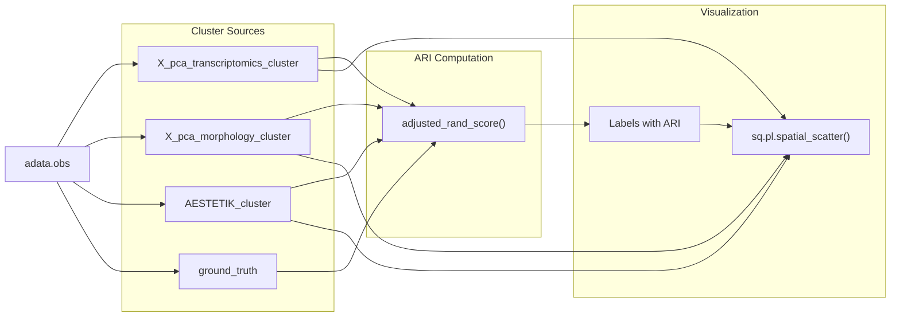
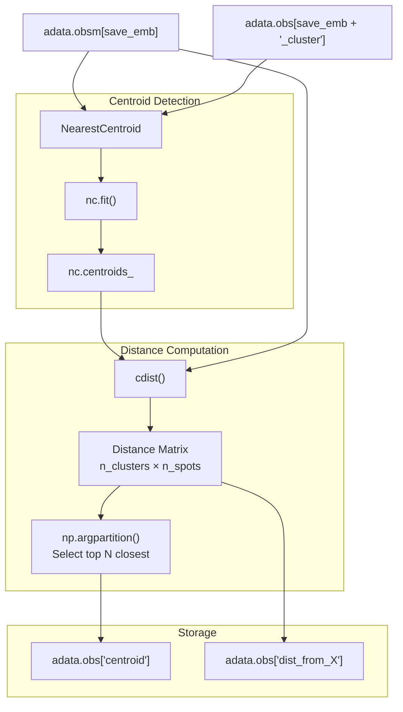
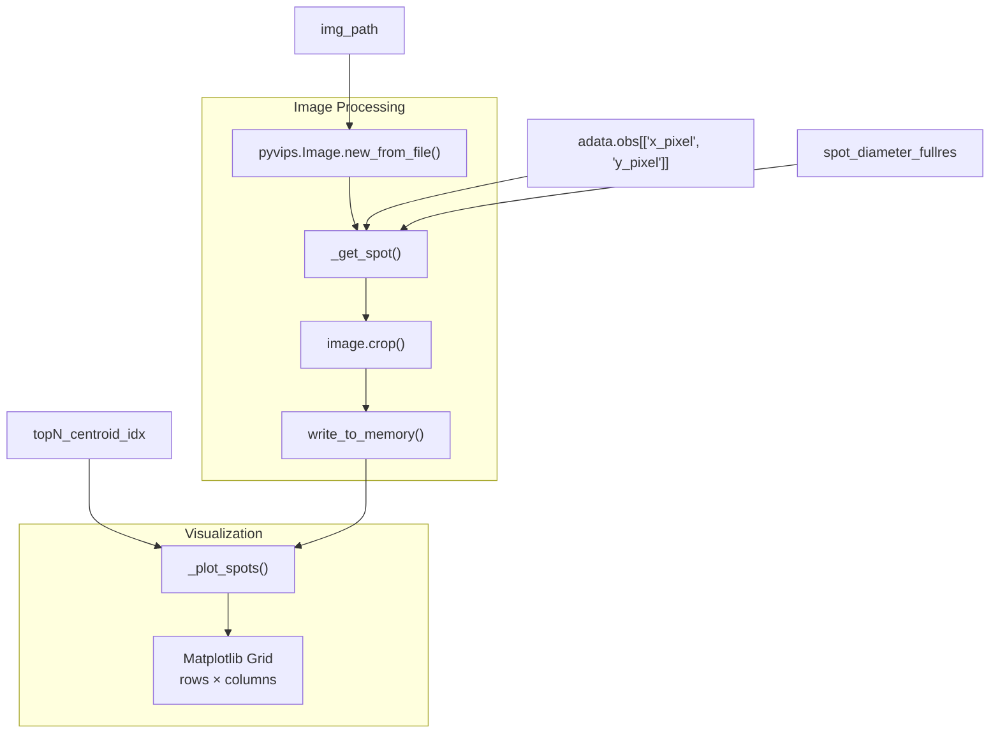

# Visualization

<details>
<summary>Relevant source files</summary>

The following files were used as context for generating this wiki page:

- [example/gettingStartedWithAESTETIK.ipynb](example/gettingStartedWithAESTETIK.ipynb)
- [example/gettingStartedWithAESTETIKwithSimulatedData.ipynb](example/gettingStartedWithAESTETIKwithSimulatedData.ipynb)
- [src/aestetik/utils/utils_visualization.py](src/aestetik/utils/utils_visualization.py)

</details>


## Purpose and Scope

This page covers visualization capabilities in AESTETIK for analyzing model training, spatial clusters, embeddings, and representative spots. For information about the underlying model architecture, see [Model Architecture](#5.3). For details on clustering algorithms, see [Clustering and Analysis](#4.4).

## Overview

AESTETIK provides visualization tools through two primary mechanisms:

1. **Native visualization function**: [`visualize()`](src/aestetik/utils/utils_visualization.py:30-102) in `utils_visualization.py`
2. **Ecosystem integration**: Direct compatibility with `scanpy` and `squidpy` plotting functions

The `visualize()` function serves as a unified interface for common visualization tasks, while the ecosystem integration allows users to leverage the full power of established spatial transcriptomics visualization libraries.

**Sources**: [src/aestetik/utils/utils_visualization.py:1-256](), [example/gettingStartedWithAESTETIK.ipynb:396-397]()

## Visualization Workflow



**Sources**: [src/aestetik/utils/utils_visualization.py:30-102]()

## Training Progress Visualization

### Loss Plots

The `visualize()` function tracks and visualizes training loss across iterations using the model's stored loss history. This helps assess convergence and diagnose training issues.

| Parameter | Type | Description |
|-----------|------|-------------|
| `model` | `AESTETIK` | Fitted AESTETIK model containing loss history |
| `plot_loss` | `bool` | Set to `True` to display loss plot |

**Usage Example**:
```python
from aestetik.utils.utils_visualization import visualize

visualize(model=model, plot_loss=True)
```

The function accesses [`model.losses`](src/aestetik/utils/utils_visualization.py:81) and generates a line plot showing loss values over training iterations using [`_plot_loss_values()`](src/aestetik/utils/utils_visualization.py:107-111).

**Sources**: [src/aestetik/utils/utils_visualization.py:80-81](), [src/aestetik/utils/utils_visualization.py:107-111](), [example/gettingStartedWithAESTETIK.ipynb:396-397]()

## Spatial Cluster Visualization

### Cluster Comparison with ARI

The cluster visualization functionality compares spatial clustering results across different modalities and computes Adjusted Rand Index (ARI) scores against ground truth labels when available.



The [`_plot_spatial_scatter_ari()`](src/aestetik/utils/utils_visualization.py:129-161) function:
1. Collects cluster labels from specified obsm keys
2. Computes ARI scores using [`adjusted_rand_score()`](src/aestetik/utils/utils_visualization.py:145-147)
3. Generates spatial scatter plots via [`sq.pl.spatial_scatter()`](src/aestetik/utils/utils_visualization.py:155-161)

| Parameter | Type | Default | Description |
|-----------|------|---------|-------------|
| `adata` | `anndata.AnnData` | Required | AnnData object with cluster labels |
| `plot_clusters` | `bool` | `False` | Enable cluster visualization |
| `used_obsm_transcriptomics` | `str` | `"X_pca_transcriptomics"` | Key for transcriptomics data |
| `used_obsm_morphology` | `str` | `"X_pca_morphology"` | Key for morphology data |
| `img_alpha` | `float` | `0.6` | Image opacity (0-1) |
| `dot_size` | `int` | `5` | Size of spatial spots |
| `ncols` | `int` | `5` | Number of columns in plot grid |

**Sources**: [src/aestetik/utils/utils_visualization.py:82-89](), [src/aestetik/utils/utils_visualization.py:129-161]()

## Centroid Analysis and Visualization

### Centroid Computation

AESTETIK identifies representative spots (centroids) for each cluster in the learned embedding space using scikit-learn's [`NearestCentroid`](src/aestetik/utils/utils_visualization.py:202) classifier.



The [`_compute_centroid()`](src/aestetik/utils/utils_visualization.py:198-217) function:

1. Fits a [`NearestCentroid`](src/aestetik/utils/utils_visualization.py:202) classifier on embeddings
2. Computes distances from all spots to each centroid using [`cdist()`](src/aestetik/utils/utils_visualization.py:205)
3. Identifies top N closest spots per cluster using [`np.argpartition()`](src/aestetik/utils/utils_visualization.py:209)
4. Stores centroid labels in [`adata.obs["centroid"]`](src/aestetik/utils/utils_visualization.py:207)
5. Stores normalized distances in columns like `dist_from_0`, `dist_from_1`, etc. [(lines 214-216)](src/aestetik/utils/utils_visualization.py:214-216)

**Sources**: [src/aestetik/utils/utils_visualization.py:198-217]()

### Spatial Centroid Visualization

The [`_plot_spatial_centroids_and_distance()`](src/aestetik/utils/utils_visualization.py:114-126) function visualizes:
- Cluster assignments
- Identified centroids
- Distance gradients from each cluster centroid

This uses [`sq.pl.spatial_scatter()`](src/aestetik/utils/utils_visualization.py:120-126) to display the cluster column, centroid column, and all distance columns in a multi-panel plot.

**Sources**: [src/aestetik/utils/utils_visualization.py:114-126]()

### Morphology Spot Extraction

For centroids, AESTETIK can extract and display the corresponding H&E image patches using PyVips for efficient large image handling.



The image extraction pipeline [(lines 186-193)](src/aestetik/utils/utils_visualization.py:186-193):
1. Opens the full-resolution image using [`pyvips.Image.new_from_file()`](src/aestetik/utils/utils_visualization.py:165)
2. Crops a square region centered on each spot using [`image.crop()`](src/aestetik/utils/utils_visualization.py:189)
3. Converts to numpy array via [`write_to_memory()`](src/aestetik/utils/utils_visualization.py:190-192)

The [`_plot_spots()`](src/aestetik/utils/utils_visualization.py:163-181) function arranges extracted spots in a grid, showing up to 10 columns per row.

| Parameter | Type | Description |
|-----------|------|-------------|
| `img_path` | `str` | Path to full-resolution H&E image |
| `spot_diameter_fullres` | `int` | Spot diameter in pixels at full resolution |
| `plot_centroid` | `bool` | Enable centroid visualization |
| `topN` | `int` | Number of representative spots per cluster (default: 5) |

**Sources**: [src/aestetik/utils/utils_visualization.py:163-193](), [src/aestetik/utils/utils_visualization.py:219-233]()

## Integration with Scanpy/Squidpy

AESTETIK embeddings and cluster assignments are stored following scanpy conventions, enabling direct use with ecosystem visualization tools.

### Storage Conventions

| AnnData Location | Content | Key |
|------------------|---------|-----|
| `adata.obsm["AESTETIK"]` | Latent embeddings | User-configurable via `save_emb` parameter |
| `adata.obs["AESTETIK_cluster"]` | Cluster assignments | `{save_emb}_cluster` |
| `adata.obs["X_pca_transcriptomics_cluster"]` | Pre-training transcriptomics clusters | From data preparation |
| `adata.obs["X_pca_morphology_cluster"]` | Pre-training morphology clusters | From data preparation |

### Scanpy Visualization Examples

```python
# UMAP visualization
sc.pp.neighbors(adata, use_rep="AESTETIK")
sc.tl.umap(adata)
sc.pl.umap(adata, color=["ground_truth", "AESTETIK_cluster"])
```

The notebooks demonstrate this pattern at [example/gettingStartedWithAESTETIKwithSimulatedData.ipynb:254-259]().

### Squidpy Spatial Visualization

```python
# Spatial scatter plots
sq.pl.spatial_scatter(
    adata, 
    color=["ground_truth", 
           "X_pca_transcriptomics_cluster",
           "X_pca_morphology_cluster",
           "AESTETIK_cluster"], 
    size=dot_size
)
```

Example usage at [example/gettingStartedWithAESTETIK.ipynb:375-378]() and [example/gettingStartedWithAESTETIKwithSimulatedData.ipynb:269-275]().

**Sources**: [example/gettingStartedWithAESTETIK.ipynb:375-378](), [example/gettingStartedWithAESTETIKwithSimulatedData.ipynb:254-275]()

## Parameter Reference

### Core `visualize()` Parameters

| Parameter | Type | Default | Required When | Description |
|-----------|------|---------|---------------|-------------|
| `model` | `AESTETIK` | - | Always | Fitted AESTETIK model instance |
| `adata` | `anndata.AnnData` | `None` | `plot_clusters=True` or `plot_centroid=True` | AnnData object with results |
| `img_path` | `str` | `None` | `plot_centroid=True` | Path to H&E image for morphology extraction |
| `spot_diameter_fullres` | `int` | `None` | `plot_centroid=True` | Spot diameter in pixels |
| `save_emb` | `str` | `"AESTETIK"` | - | Key prefix for embeddings and clusters in AnnData |
| `plot_loss` | `bool` | `False` | - | Display training loss plot |
| `plot_clusters` | `bool` | `False` | - | Display spatial cluster comparison |
| `plot_centroid` | `bool` | `False` | - | Display centroids and morphology |

### Display Parameters

| Parameter | Type | Default | Description |
|-----------|------|---------|-------------|
| `img_alpha` | `float` | `0.6` | Opacity for background H&E image (0.0-1.0) |
| `dot_size` | `int` | `5` | Size of spots in spatial scatter plots |
| `ncols` | `int` | `5` | Number of columns in multi-panel plots |
| `used_obsm_transcriptomics` | `str` | `"X_pca_transcriptomics"` | obsm key for transcriptomics features |
| `used_obsm_morphology` | `str` | `"X_pca_morphology"` | obsm key for morphology features |

**Sources**: [src/aestetik/utils/utils_visualization.py:30-72]()

## Input Validation

The [`_validate_visualize_inputs()`](src/aestetik/utils/utils_visualization.py:238-255) function enforces requirements:

- `adata` must be provided when `plot_clusters=True` or `plot_centroid=True`
- Multiple clusters required when `plot_centroid=True` [(line 253-254)](src/aestetik/utils/utils_visualization.py:253-254)
- `img_path` and `spot_diameter_fullres` required when `plot_centroid=True` [(line 255)](src/aestetik/utils/utils_visualization.py:255)

Error messages clearly indicate missing dependencies and suggest corrective actions.

**Sources**: [src/aestetik/utils/utils_visualization.py:238-255]()

## Complete Usage Example

```python
from aestetik import AESTETIK
from aestetik.utils.utils_visualization import visualize

# After training and prediction
model = AESTETIK(nCluster=7)
model.fit(adata)
model.predict(adata, cluster=True)

# Comprehensive visualization
visualize(
    model=model,
    adata=adata,
    img_path="path/to/image.png",
    spot_diameter_fullres=180,
    plot_loss=True,           # Training convergence
    plot_clusters=True,       # Spatial comparison with ARI
    plot_centroid=True,       # Representative spots
    img_alpha=0.6,
    dot_size=5,
    ncols=5
)
```

This produces:
1. Training loss curve over iterations
2. Spatial scatter plots comparing all clustering approaches with ARI scores
3. Centroid locations and distance gradients  
4. H&E image patches for top representative spots per cluster

**Sources**: [example/gettingStartedWithAESTETIK.ipynb:396-397](), [src/aestetik/utils/utils_visualization.py:30-102]()

---