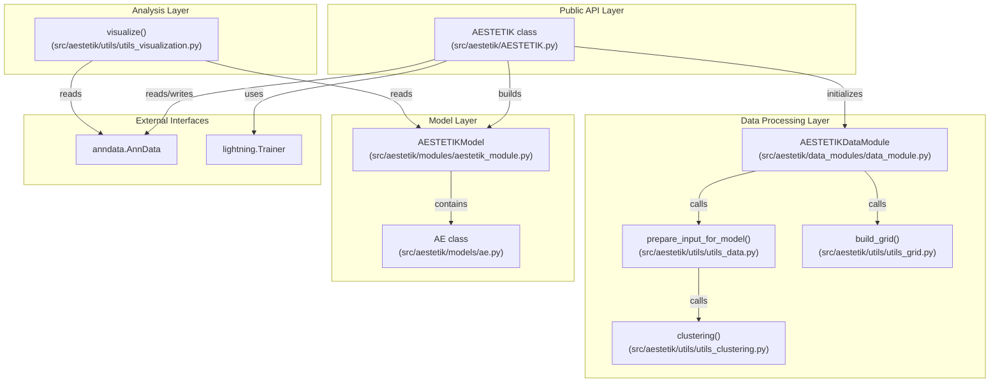
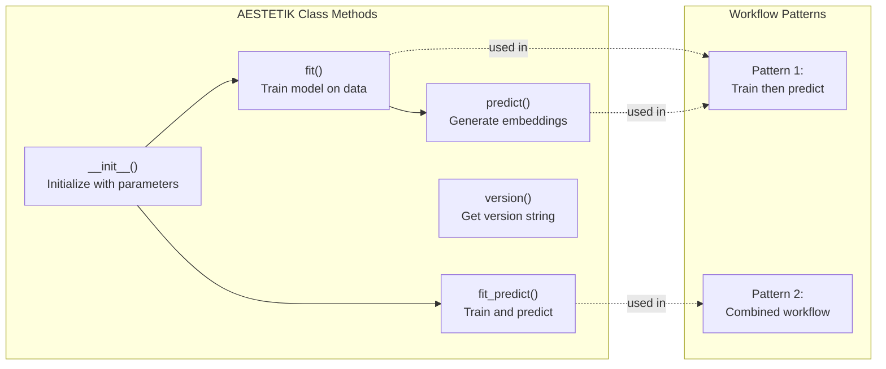
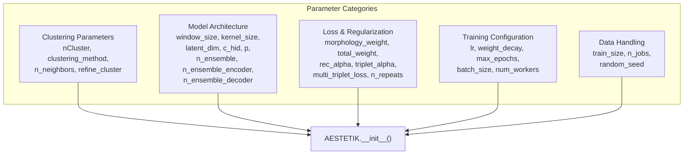
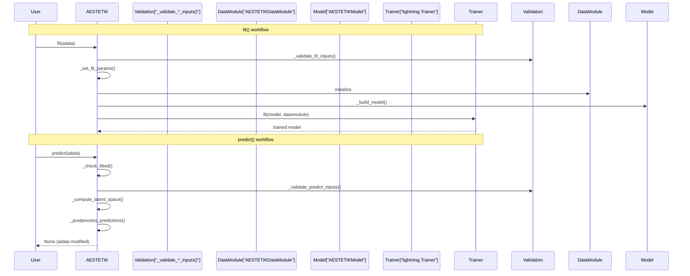
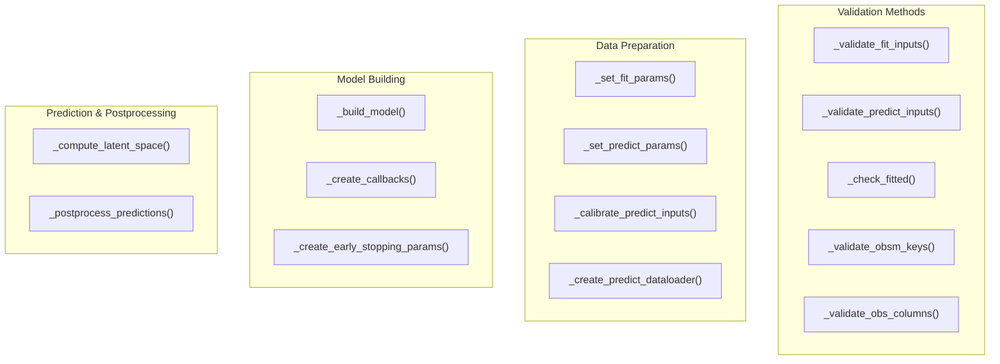
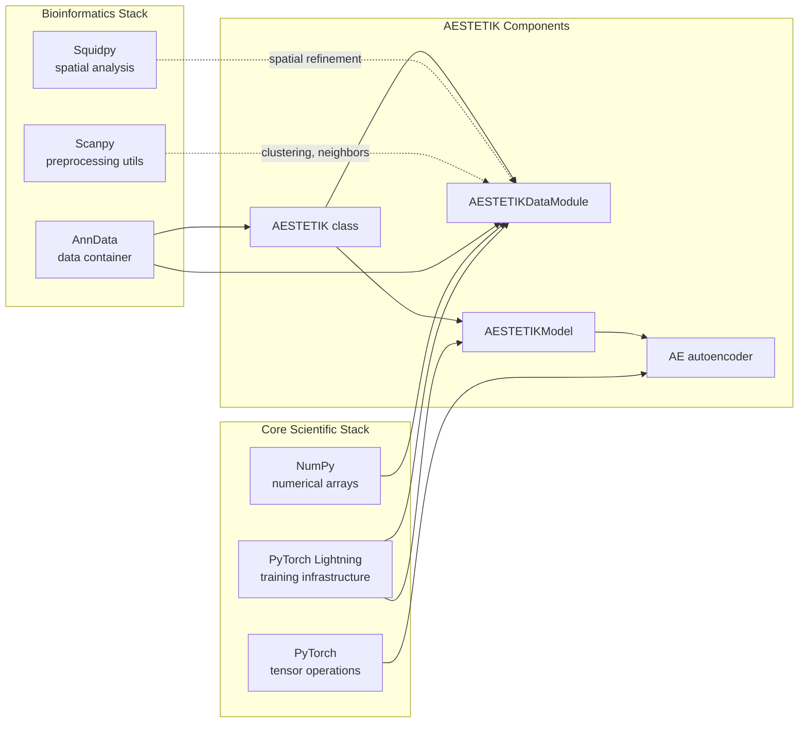

# API Reference

<details>
<summary>Relevant source files</summary>

The following files were used as context for generating this wiki page:

- [CHANGELOG.md](CHANGELOG.md)
- [src/aestetik/AESTETIK.py](src/aestetik/AESTETIK.py)

</details>


This section provides comprehensive reference documentation for all public APIs and classes in AESTETIK. The API is organized into four major components: the main orchestrator class, data pipeline components, model architecture classes, and utility functions.

**Scope**: This page covers the high-level organization of the AESTETIK API and common usage patterns. For detailed documentation on specific classes and functions, see the respective subsections:
- For the main `AESTETIK` class and its methods (`fit()`, `predict()`, `fit_predict()`), see [AESTETIK Class](#5.1)
- For data loading and preprocessing components, see [Data Pipeline Components](#5.2)
- For neural network architecture and Lightning integration, see [Model Architecture](#5.3)
- For clustering, visualization, and other utilities, see [Utility Functions](#5.4)

For conceptual explanations of how these components work together, see [Core Concepts](#3). For practical usage examples, see [User Guide](#4).

---

## API Organization

The AESTETIK API is structured in layers, with the `AESTETIK` class serving as the main public interface that orchestrates underlying components.

### Component Hierarchy



**Sources**: [src/aestetik/AESTETIK.py:1-545]()

### Module Overview

| Module | Primary Classes/Functions | Purpose | Reference |
|--------|--------------------------|---------|-----------|
| `src/aestetik/AESTETIK.py` | `AESTETIK` | Main orchestrator for training and prediction | [AESTETIK Class](#5.1) |
| `src/aestetik/data_modules/data_module.py` | `AESTETIKDataModule` | PyTorch Lightning DataModule for data loading | [Data Pipeline Components](#5.2) |
| `src/aestetik/utils/utils_data.py` | `prepare_input_for_model()`, `calibrate_weights()` | Input preprocessing and weight calibration | [Data Pipeline Components](#5.2) |
| `src/aestetik/utils/utils_grid.py` | `build_grid()`, `create_spot_grid()` | Spatial grid construction | [Data Pipeline Components](#5.2) |
| `src/aestetik/utils/utils_clustering.py` | `clustering()` | Clustering algorithms for transcriptomics and morphology | [Utility Functions](#5.4) |
| `src/aestetik/modules/aestetik_module.py` | `AESTETIKModel` | PyTorch Lightning module wrapper | [Model Architecture](#5.3) |
| `src/aestetik/models/ae.py` | `AE` | Autoencoder architecture | [Model Architecture](#5.3) |
| `src/aestetik/utils/utils_visualization.py` | `visualize()` | Plotting and visualization functions | [Utility Functions](#5.4) |

**Sources**: [src/aestetik/AESTETIK.py:1-545]()

---

## Main Entry Point

The `AESTETIK` class provides the primary user-facing API. All interactions with the library typically go through this class.

### Core Methods



**Sources**: [src/aestetik/AESTETIK.py:24-545]()

### Method Signatures Summary

| Method | Parameters | Returns | Modifies AnnData | Purpose |
|--------|------------|---------|------------------|---------|
| `__init__()` | 26 configuration parameters | `AESTETIK` instance | No | Initialize model configuration |
| `fit()` | `X: AnnData`, obsm keys, validation split, early stopping | `None` | No | Train model on provided data |
| `predict()` | `X: AnnData`, obsm keys, num_repeats, cluster flag | `None` | Yes (adds to `obsm`, `obs`) | Generate embeddings and optionally cluster |
| `fit_predict()` | Combined parameters from fit and predict | `None` | Yes (adds to `obsm`, `obs`) | Train and predict in single call |
| `version()` | None | `str` | No | Return version string |

**Sources**: [src/aestetik/AESTETIK.py:29-545]()

### Instantiation Parameters

The `AESTETIK` class constructor accepts parameters organized into several categories:



**Sources**: [src/aestetik/AESTETIK.py:29-173]()

#### Parameter Storage Structure

Parameters are internally organized into dictionaries for modular access:

| Internal Dictionary | Parameters Stored | Used By |
|---------------------|------------------|---------|
| `grid_params` | `morphology_dim`, `num_input_channels`, `obsm_transcriptomics_dim` | Grid construction, model input layer |
| `model_architecture_params` | `latent_dim`, `c_hid`, `kernel_size`, `p`, `n_ensemble_encoder`, `n_ensemble_decoder` | `AE` architecture initialization |
| `dataloader_params` | `batch_size`, `num_workers` | PyTorch DataLoader configuration |
| `training_params` | `lr`, `weight_decay`, `max_epochs` | Optimizer and Trainer configuration |
| `clustering_params` | `nCluster`, `clustering_method`, `n_neighbors`, `refine_cluster` | Clustering operations |
| `loss_regularization_params` | `multi_triplet_loss`, `rec_alpha`, `triplet_alpha`, `n_repeats`, `morphology_weight`, `transcriptomics_weight`, `total_weight` | Loss computation |
| `data_handling_params` | `n_jobs`, `train_size` | Data preprocessing |

**Sources**: [src/aestetik/AESTETIK.py:120-166]()

---

## Data Flow Through API Methods

The following diagram shows how data flows through the public API methods and which components are invoked at each stage.



**Sources**: [src/aestetik/AESTETIK.py:179-332]()

---

## AnnData Interface Conventions

AESTETIK follows `scanpy` ecosystem conventions for reading and writing to `AnnData` objects.

### Required Input Fields

| AnnData Location | Default Key | Alternative Keys | Data Type | Description |
|------------------|-------------|------------------|-----------|-------------|
| `adata.obsm` | `"X_pca_transcriptomics"` | User-specified via `used_obsm_transcriptomics` | `np.ndarray` | PCA-reduced transcriptomics features |
| `adata.obsm` | `"X_pca_morphology"` | User-specified via `used_obsm_morphology` | `np.ndarray` | PCA-reduced morphology features |
| `adata.obsm` | `"X_pca"` | User-specified via `used_obsm_combined` | `np.ndarray` | Combined features (used in `fit()` only) |
| `adata.obs` | `"x_array"` | Fixed | `float` | X spatial coordinates |
| `adata.obs` | `"y_array"` | Fixed | `float` | Y spatial coordinates |
| `adata.obs` | User-specified | Via `used_obs_batch` parameter | `str` or `int` | Sample/batch labels (optional) |

**Sources**: [src/aestetik/AESTETIK.py:181-205](), [src/aestetik/AESTETIK.py:240-266]()

### Output Fields Written by API

| Method | AnnData Location | Default Key | Data Type | Description |
|--------|------------------|-------------|-----------|-------------|
| `fit()` | Various internal | N/A | N/A | No direct modifications to input `adata` |
| `predict()` | `adata.obsm` | `"AESTETIK"` (configurable via `save_emb`) | `np.ndarray` | Latent space embeddings |
| `predict()` | `adata.obs` | `"AESTETIK_cluster"` | `str` or `int` | Cluster assignments (if `cluster=True`) |
| `predict()` | `adata.obsm` | `"X_st_grid"` | `np.ndarray` | Spatial grids (temporary, used during computation) |

**Sources**: [src/aestetik/AESTETIK.py:505-520]()

---

## Private Method Categories

The `AESTETIK` class contains numerous private methods (prefixed with `_`) that handle internal operations. These are not part of the public API but are documented here for completeness.



**Sources**: [src/aestetik/AESTETIK.py:337-541]()

### Validation Methods

| Method | Purpose | Raises |
|--------|---------|--------|
| `_validate_fit_inputs()` | Validate presence of required obsm keys and obs columns for training | `KeyError` |
| `_validate_predict_inputs()` | Validate inputs and check dimensionality compatibility with fitted model | `KeyError`, `ValueError` |
| `_check_fitted()` | Verify that model has been fitted before prediction | `RuntimeError` |
| `_validate_obsm_keys()` | Generic validator for checking obsm key existence | `KeyError` |
| `_validate_obs_columns()` | Generic validator for checking obs column existence | `KeyError` |

**Sources**: [src/aestetik/AESTETIK.py:337-393]()

---

## Integration with External Libraries

AESTETIK builds on several established scientific Python libraries. Understanding these integration points is essential for advanced usage.

### Library Dependencies and Roles



**Sources**: [src/aestetik/AESTETIK.py:1-22]()

### PyTorch Lightning Integration Points

| AESTETIK Component | Lightning Component | Integration Method |
|--------------------|---------------------|-------------------|
| `AESTETIKDataModule` | `LightningDataModule` | Inherits from base class |
| `AESTETIKModel` | `LightningModule` | Inherits from base class |
| `AESTETIK.fit()` | `Trainer.fit()` | Instantiates and calls `Trainer` |
| `AESTETIK.predict()` | `Trainer.predict()` | Uses existing `Trainer` instance |
| Callback system | `LossHistoryCallback`, `EarlyStopping`, `ModelCheckpoint` | Registered via `callbacks` parameter |

**Sources**: [src/aestetik/AESTETIK.py:6-12](), [src/aestetik/AESTETIK.py:229-238](), [src/aestetik/AESTETIK.py:449-467]()

---

## Common Parameter Patterns

Several parameters appear across multiple methods and components. Understanding their consistent usage simplifies API navigation.

### Cross-Method Parameters

| Parameter | Appears In | Data Type | Purpose | Default |
|-----------|------------|-----------|---------|---------|
| `used_obsm_transcriptomics` | `fit()`, `predict()`, `fit_predict()` | `str` | Key for transcriptomics features in `adata.obsm` | `"X_pca_transcriptomics"` |
| `used_obsm_morphology` | `fit()`, `predict()`, `fit_predict()` | `str` | Key for morphology features in `adata.obsm` | `"X_pca_morphology"` |
| `used_obsm_combined` | `fit()`, `fit_predict()` | `str` | Key for combined features in `adata.obsm` | `"X_pca"` |
| `used_obs_batch` | `fit()`, `predict()`, `fit_predict()` | `Optional[str]` | Key for batch/sample labels in `adata.obs` | `None` |
| `validation_split` | `fit()`, `fit_predict()` | `float` | Proportion of data for validation | `0.0` |
| `num_repeats` | `predict()`, `fit_predict()` | `int` | Number of stochastic forward passes | `1000` |
| `cluster` | `predict()`, `fit_predict()` | `bool` | Whether to perform clustering | `True` |
| `save_emb` | `predict()`, `fit_predict()` | `str` | Key for saving embeddings in `adata.obsm` | `"AESTETIK"` |

**Sources**: [src/aestetik/AESTETIK.py:179-332]()

### Parameter Validation Rules

The API enforces several validation rules on parameters:

| Validation | Applied To | Condition | Error Type |
|------------|------------|-----------|------------|
| Odd integer check | `window_size` | Must be odd | `ValueError` |
| Fitted model check | `predict()` calls | Must call `fit()` first | `RuntimeError` |
| Dimensionality check | `predict()` inputs | Feature dimensions must be ≥ fitted dimensions | `ValueError` |
| Key existence | All `used_obsm_*` parameters | Must exist in `adata.obsm` | `KeyError` |
| Column existence | `x_array`, `y_array` | Must exist in `adata.obs` | `KeyError` |

**Sources**: [src/aestetik/AESTETIK.py:117-118](), [src/aestetik/AESTETIK.py:369-371](), [src/aestetik/AESTETIK.py:337-393]()

---

## Version Information

The API includes version tracking for reproducibility and citation purposes.

```python
AESTETIK.version()  # Returns: "16.06.2025:1"
```

**Sources**: [src/aestetik/AESTETIK.py:543-545]()

---

## Detailed Component Documentation

For in-depth documentation on specific components, consult the following subsections:

- **[AESTETIK Class](#5.1)**: Complete reference for the main class including all methods, parameter descriptions, usage examples, and return value specifications
- **[Data Pipeline Components](#5.2)**: Reference for `AESTETIKDataModule`, `prepare_input_for_model()`, `build_grid()`, and related data processing utilities
- **[Model Architecture](#5.3)**: Reference for `AESTETIKModel` Lightning module and `AE` autoencoder architecture including layer specifications and loss functions
- **[Utility Functions](#5.4)**: Reference for clustering algorithms, visualization functions, and other utility modules

**Sources**: [src/aestetik/AESTETIK.py:1-545]()

---