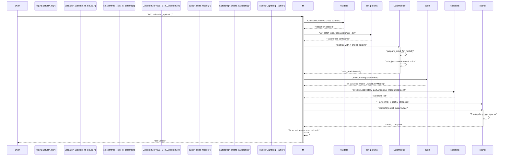
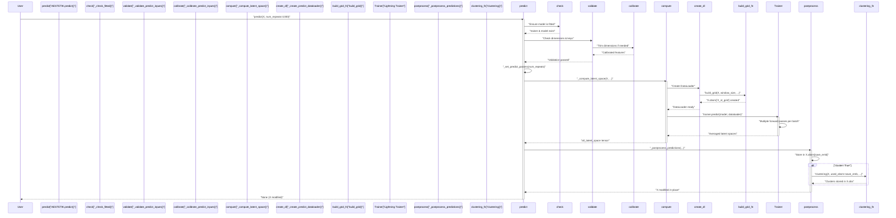
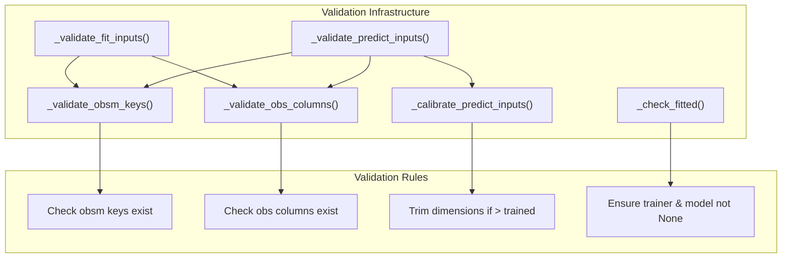
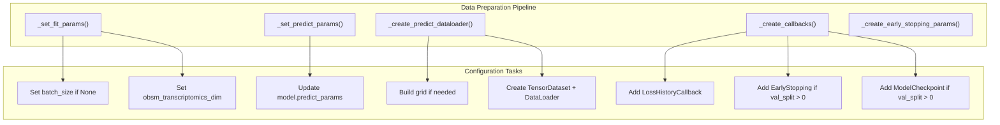
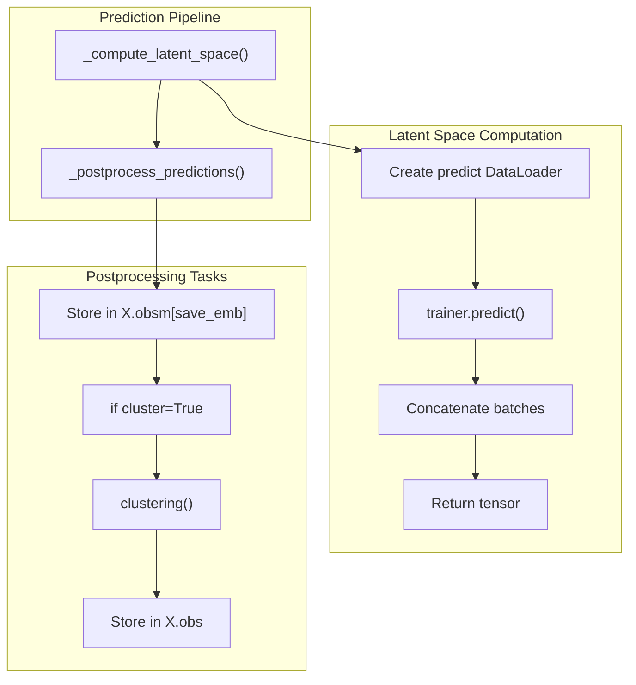
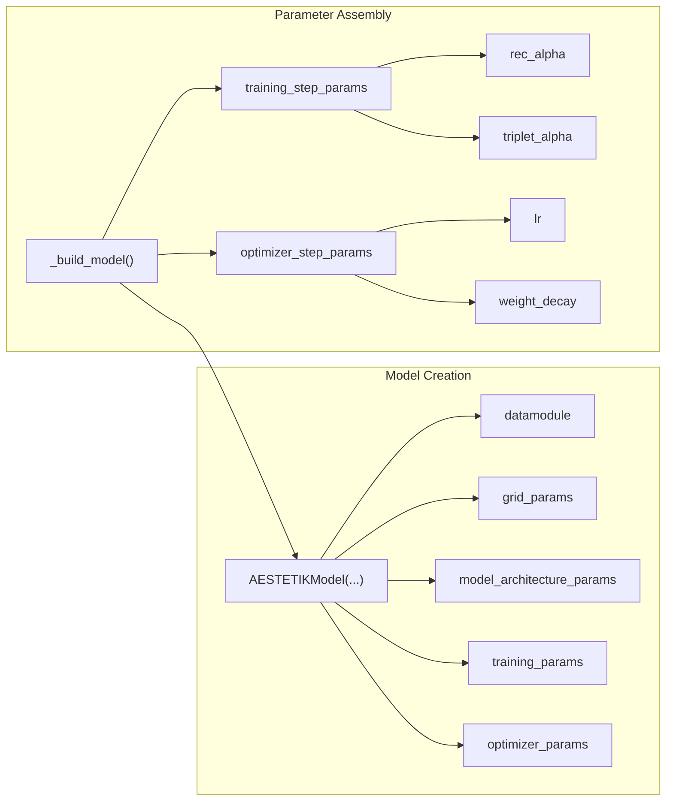
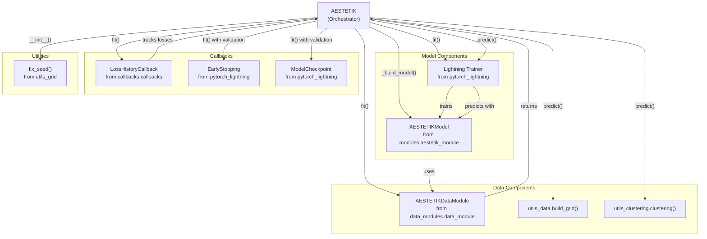

# AESTETIK Class

<details>
<summary>Relevant source files</summary>

The following files were used as context for generating this wiki page:

- [.codeboarding/AESTETIK_API_Orchestration.md](.codeboarding/AESTETIK_API_Orchestration.md)
- [CHANGELOG.md](CHANGELOG.md)
- [src/aestetik/AESTETIK.py](src/aestetik/AESTETIK.py)

</details>


## Purpose and Scope

The `AESTETIK` class serves as the primary user-facing orchestrator for the entire AESTETIK library. It provides a scikit-learn-style API with `fit()`, `predict()`, and `fit_predict()` methods to train multi-modal autoencoders on spatial transcriptomics data and generate embeddings for downstream analysis. This class manages the complete workflow from data validation through model training to prediction and clustering, delegating to specialized subsystems while maintaining a clean, high-level interface.

For detailed information about the underlying model architecture, see [Model Architecture](#5.3). For data processing components, see [Data Pipeline Components](#5.2). For utility functions including visualization, see [Utility Functions](#5.4).

**Sources:** [src/aestetik/AESTETIK.py:1-545]()

---

## Class Overview

### Location and Dependencies

The `AESTETIK` class is defined in [src/aestetik/AESTETIK.py:24-545]() and imports:

| Dependency | Purpose |
|------------|---------|
| `anndata.AnnData` | Primary data container for spatial transcriptomics |
| `lightning.pytorch.Trainer` | PyTorch Lightning training infrastructure |
| `AESTETIKDataModule` | Data loading and preprocessing |
| `AESTETIKModel` | Lightning module wrapping the autoencoder |
| `LossHistoryCallback`, `EarlyStopping`, `ModelCheckpoint` | Training callbacks |
| `clustering` from `utils_clustering` | Post-prediction clustering |
| `build_grid` from `utils_data` | Spatial grid construction |
| `fix_seed` from `utils_grid` | Reproducibility utilities |

**Sources:** [src/aestetik/AESTETIK.py:1-22]()

---

## Initialization and Parameter Organization

### Constructor Signature

The `AESTETIK` class is initialized with [src/aestetik/AESTETIK.py:29-57]():

```python
def __init__(
    self,
    nCluster: Union[int, float],
    morphology_weight: float,
    total_weight: float = 3,
    rec_alpha: float = 1,
    triplet_alpha: float = 1,
    train_size: Optional[float] = None,
    window_size: int = 7,
    kernel_size: int = 3,
    latent_dim: int = 16,
    c_hid: int = 64,
    lr: float = 0.001,
    p: float = 0.3,
    max_epochs: int = 100,
    multi_triplet_loss: bool = True,
    n_repeats: int = 1,
    clustering_method: Literal["bgm", "kmeans", "louvain", "leiden"] = "bgm",
    batch_size: Optional[int] = None,
    n_ensemble: int = 3,
    n_ensemble_encoder: Optional[int] = None,
    n_ensemble_decoder: Optional[int] = None,
    random_seed: int = 2023,
    n_neighbors: int = 10,
    weight_decay: float = 1e-6,
    refine_cluster: bool = True,
    n_jobs: int = 1,
    num_workers: int = 0
)
```

### Internal Parameter Organization

Parameters are organized into six thematic dictionaries [src/aestetik/AESTETIK.py:120-166]():

```mermaid
graph TB
    subgraph "Parameter Dictionaries"
        Init["__init__ parameters"]
        
        GridParams["grid_params"]
        ModelParams["model_architecture_params"]
        DataLoaderParams["dataloader_params"]
        TrainingParams["training_params"]
        ClusteringParams["clustering_params"]
        LossParams["loss_regularization_params"]
        DataHandlingParams["data_handling_params"]
    end
    
    subgraph "Grid Configuration"
        GridParams --> MorphDim["morphology_dim: window_size"]
        GridParams --> NumChan["num_input_channels: None (set at fit)"]
        GridParams --> TransDim["obsm_transcriptomics_dim: None (set at fit)"]
    end
    
    subgraph "Model Architecture"
        ModelParams --> LatentDim["latent_dim"]
        ModelParams --> CHid["c_hid"]
        ModelParams --> KernelSize["kernel_size"]
        ModelParams --> Dropout["p (dropout)"]
        ModelParams --> NEnsEnc["n_ensemble_encoder"]
        ModelParams --> NEnsDec["n_ensemble_decoder"]
    end
    
    subgraph "Data Loading"
        DataLoaderParams --> BatchSize["batch_size"]
        DataLoaderParams --> NumWorkers["num_workers"]
    end
    
    subgraph "Training Configuration"
        TrainingParams --> LR["lr"]
        TrainingParams --> WeightDecay["weight_decay"]
        TrainingParams --> MaxEpochs["max_epochs"]
    end
    
    subgraph "Clustering Configuration"
        ClusteringParams --> NCluster["nCluster"]
        ClusteringParams --> Method["clustering_method"]
        ClusteringParams --> NNeighbors["n_neighbors"]
        ClusteringParams --> RefineCluster["refine_cluster"]
    end
    
    subgraph "Loss Configuration"
        LossParams --> MultiTriplet["multi_triplet_loss"]
        LossParams --> RecAlpha["rec_alpha"]
        LossParams --> TripletAlpha["triplet_alpha"]
        LossParams --> NRepeats["n_repeats"]
        LossParams --> MorphWeight["morphology_weight"]
        LossParams --> TransWeight["transcriptomics_weight: None (calibrated)"]
        LossParams --> TotalWeight["total_weight"]
    end
    
    subgraph "Data Handling"
        DataHandlingParams --> NJobs["n_jobs"]
        DataHandlingParams --> TrainSize["train_size"]
    end
    
    Init --> GridParams
    Init --> ModelParams
    Init --> DataLoaderParams
    Init --> TrainingParams
    Init --> ClusteringParams
    Init --> LossParams
    Init --> DataHandlingParams
```



**Key Design Principles:**

- **Deferred Initialization:** `num_input_channels` and `obsm_transcriptomics_dim` are set during `fit()` based on actual data dimensions
- **Adaptive Batch Size:** If `batch_size=None`, automatically set to `min(2**13, len(X))` at fit time
- **Ensemble Flexibility:** `n_ensemble` sets both encoder and decoder ensemble sizes unless overridden individually
- **Kernel Size Validation:** Automatically adjusted to `max(1, window_size - 1)` if provided `kernel_size >= window_size`

**Sources:** [src/aestetik/AESTETIK.py:29-173]()

---

## Public API Methods

### fit() - Model Training

Trains the autoencoder model on spatial transcriptomics data [src/aestetik/AESTETIK.py:179-238]().

**Method Signature:**

```python
def fit(
    self, 
    X: anndata.AnnData,
    used_obsm_transcriptomics: str = "X_pca_transcriptomics",
    used_obsm_morphology: str = "X_pca_morphology",
    used_obsm_combined: str = "X_pca",
    used_obs_batch: Optional[str] = None,
    validation_split: float = 0.0,
    early_stopping_params: Optional[dict] = None
) -> None
```

**Parameters:**

| Parameter | Type | Default | Purpose |
|-----------|------|---------|---------|
| `X` | `anndata.AnnData` | Required | Input data with PCA features in `obsm` and spatial coordinates in `obs` |
| `used_obsm_transcriptomics` | `str` | `"X_pca_transcriptomics"` | Key for transcriptomics features in `X.obsm` |
| `used_obsm_morphology` | `str` | `"X_pca_morphology"` | Key for morphology features in `X.obsm` |
| `used_obsm_combined` | `str` | `"X_pca"` | Key for combined features in `X.obsm` |
| `used_obs_batch` | `Optional[str]` | `None` | Key for batch/sample labels in `X.obs` |
| `validation_split` | `float` | `0.0` | Proportion of data for validation (0.0 to 1.0) |
| `early_stopping_params` | `Optional[dict]` | `None` | Parameters for early stopping (`min_delta`, `patience`) |

**Required Data Format:**

The input `AnnData` object must contain:
- `X.obsm[used_obsm_transcriptomics]`: Transcriptomics PCA features (shape: `n_spots × n_pca_components`)
- `X.obsm[used_obsm_morphology]`: Morphology PCA features (shape: `n_spots × n_pca_components`)
- `X.obs["x_array"]`: Spatial x-coordinates
- `X.obs["y_array"]`: Spatial y-coordinates

**Workflow Diagram:**



**Side Effects:**

- Sets `self.lit_aestetik_model` to the trained `AESTETIKModel` instance
- Sets `self.trainer` to the Lightning `Trainer` instance
- Sets `self.losses` with training history from `LossHistoryCallback`
- Updates `self.grid_params["obsm_transcriptomics_dim"]` based on actual data
- Updates `self.dataloader_params["batch_size"]` if it was `None`

**Sources:** [src/aestetik/AESTETIK.py:179-238](), [src/aestetik/AESTETIK.py:337-367](), [src/aestetik/AESTETIK.py:398-408]()

---

### predict() - Generate Embeddings

Computes latent space embeddings for spots and optionally performs clustering [src/aestetik/AESTETIK.py:240-282]().

**Method Signature:**

```python
def predict(
    self,
    X: anndata.AnnData,
    used_obsm_transcriptomics: str = "X_pca_transcriptomics",
    used_obsm_morphology: str = "X_pca_morphology",
    used_obs_batch: Optional[str] = None,
    save_emb: str = "AESTETIK",
    num_repeats: int = 1000,
    cluster: bool = True
) -> None
```

**Parameters:**

| Parameter | Type | Default | Purpose |
|-----------|------|---------|---------|
| `X` | `anndata.AnnData` | Required | Input data (can be different from training data) |
| `used_obsm_transcriptomics` | `str` | `"X_pca_transcriptomics"` | Key for transcriptomics features |
| `used_obsm_morphology` | `str` | `"X_pca_morphology"` | Key for morphology features |
| `used_obs_batch` | `Optional[str]` | `None` | Key for batch labels |
| `save_emb` | `str` | `"AESTETIK"` | Key for storing embeddings in `X.obsm` |
| `num_repeats` | `int` | `1000` | Number of stochastic forward passes (Monte Carlo dropout) |
| `cluster` | `bool` | `True` | Whether to perform clustering on embeddings |

**Pre-Conditions:**

- `fit()` must have been called successfully (checked via `_check_fitted()`)
- Input dimensions must be compatible with trained model (validated via `_validate_predict_inputs()`)
- If dimensions exceed training dimensions, they are automatically trimmed via `_calibrate_predict_inputs()`

**Workflow Diagram:**



**Outputs (Modified In-Place):**

- `X.obsm[save_emb]`: Latent space embeddings (shape: `n_spots × latent_dim`)
- If `cluster=True`:
  - `X.obs["cluster"]`: Cluster assignments
  - `X.obs["cluster_refined"]`: Spatially refined cluster assignments (if `refine_cluster=True`)

**Cross-Sample Prediction:**

The `predict()` method supports cross-sample prediction, allowing you to train on one sample and predict on another. The method automatically:
1. Validates dimensional compatibility
2. Calibrates input dimensions by trimming if necessary
3. Reconstructs spatial grids for the new data

**Sources:** [src/aestetik/AESTETIK.py:240-282](), [src/aestetik/AESTETIK.py:345-426](), [src/aestetik/AESTETIK.py:489-520]()

---

### fit_predict() - Combined Training and Prediction

Convenience method that calls `fit()` followed by `predict()` on the same data [src/aestetik/AESTETIK.py:284-332]().

**Method Signature:**

```python
def fit_predict(
    self,
    X: anndata.AnnData,
    used_obsm_transcriptomics: str = "X_pca_transcriptomics",
    used_obsm_morphology: str = "X_pca_morphology",
    used_obsm_combined: str = "X_pca",
    used_obs_batch: Optional[str] = None,
    validation_split: float = 0.0,
    save_emb: str = "AESTETIK",
    num_repeats: int = 1000,
    cluster: bool = True
) -> None
```

**Key Optimization:**

Unlike calling `fit()` and then `predict()` separately, `fit_predict()` avoids rebuilding spatial grids by setting `built_grid=True` in the internal `_compute_latent_space()` call [src/aestetik/AESTETIK.py:326-327](). The spatial grids are already available in `X.obsm["X_st_grid"]` from the data module's preprocessing during `fit()`.

**Typical Usage Pattern:**

```python
# Single-step training and clustering
model = AESTETIK(nCluster=10, morphology_weight=1.0)
model.fit_predict(adata, num_repeats=1000)
# adata.obsm["AESTETIK"] now contains embeddings
# adata.obs["cluster"] now contains cluster assignments
```

**Sources:** [src/aestetik/AESTETIK.py:284-332]()

---

## Internal State Management

### State Tracking Attributes

The `AESTETIK` class maintains the following instance attributes [src/aestetik/AESTETIK.py:169-171]():

| Attribute | Type | Purpose |
|-----------|------|---------|
| `lit_aestetik_model` | `Optional[AESTETIKModel]` | Trained Lightning module (set during `fit()`) |
| `trainer` | `Optional[Trainer]` | Lightning Trainer instance (set during `fit()`) |
| `losses` | - | Training loss history (set after `fit()`) |
| `random_seed` | `int` | Seed for reproducibility |

### State Validation

The `_check_fitted()` method [src/aestetik/AESTETIK.py:369-371]() ensures the model has been trained before prediction:

```python
def _check_fitted(self) -> None:
    if self.trainer is None or self.lit_aestetik_model is None:
        raise RuntimeError("The model has not been fitted yet. Call 'fit' before 'predict'.")
```

**Sources:** [src/aestetik/AESTETIK.py:169-173](), [src/aestetik/AESTETIK.py:369-371]()

---

## Private Method Organization

### Validation Methods



**Method Descriptions:**

| Method | Lines | Purpose |
|--------|-------|---------|
| `_validate_fit_inputs()` | [337-343]() | Validates required obsm keys and obs columns for training |
| `_validate_predict_inputs()` | [345-367]() | Validates dimensions and compatibility with trained model |
| `_check_fitted()` | [369-371]() | Ensures model has been trained before prediction |
| `_validate_obsm_keys()` | [373-382]() | Generic validation for required keys in `X.obsm` |
| `_validate_obs_columns()` | [384-393]() | Generic validation for required columns in `X.obs` |
| `_calibrate_predict_inputs()` | [410-425]() | Trims input dimensions to match trained model |

**Sources:** [src/aestetik/AESTETIK.py:335-426]()

---

### Data Preparation Methods



**Method Descriptions:**

| Method | Lines | Purpose |
|--------|-------|---------|
| `_set_fit_params()` | [398-404]() | Configures batch size and records transcriptomics dimensionality |
| `_set_predict_params()` | [406-408]() | Updates model's `num_repeats` for stochastic prediction |
| `_calibrate_predict_inputs()` | [410-425]() | Trims feature dimensions to match training configuration |
| `_create_predict_dataloader()` | [428-447]() | Builds spatial grids and creates DataLoader for prediction |
| `_create_callbacks()` | [449-467]() | Assembles callbacks for training monitoring |
| `_create_early_stopping_params()` | [469-484]() | Configures early stopping with validation |

**Key Design Note:**

The `_create_predict_dataloader()` method accepts a `built_grid` parameter [src/aestetik/AESTETIK.py:433](). When `True`, it skips calling `build_grid()`, assuming `X.obsm["X_st_grid"]` already exists. This optimization is used by `fit_predict()` to avoid redundant computation.

**Sources:** [src/aestetik/AESTETIK.py:395-484]()

---

### Prediction and Postprocessing Methods



**Method Descriptions:**

| Method | Lines | Purpose |
|--------|-------|---------|
| `_compute_latent_space()` | [489-503]() | Computes embeddings via stochastic forward passes |
| `_postprocess_predictions()` | [505-520]() | Stores embeddings and performs optional clustering |

**Stochastic Prediction Detail:**

The `num_repeats` parameter controls Monte Carlo dropout averaging. The model is run multiple times with dropout enabled during inference, and the latent representations are averaged. This is handled by the `AESTETIKModel.predict_step()` method, but orchestrated through the parameter set by `_set_predict_params()`.

**Sources:** [src/aestetik/AESTETIK.py:486-520]()

---

### Model Construction



The `_build_model()` method [src/aestetik/AESTETIK.py:525-541]() constructs the `AESTETIKModel` Lightning module by:

1. Extracting relevant parameters from internal dictionaries
2. Creating `training_step_params` with `rec_alpha` and `triplet_alpha`
3. Creating `optimizer_step_params` with `lr` and `weight_decay`
4. Instantiating `AESTETIKModel` with all configuration dictionaries

**Key Insight:** The `datamodule` is passed to the model constructor because it contains essential information about modality weights and loss configuration that was computed during data preprocessing.

**Sources:** [src/aestetik/AESTETIK.py:522-541]()

---

## Integration with Other Components

### Component Communication Diagram



### Key Integration Points

**Data Module Integration:**

The `AESTETIK` class delegates all data preprocessing to `AESTETIKDataModule` [src/aestetik/AESTETIK.py:217-227]():

```python
datamodule = AESTETIKDataModule(X,
    used_obsm_transcriptomics=used_obsm_transcriptomics,
    used_obsm_morphology=used_obsm_morphology,
    used_obsm_combined=used_obsm_combined,
    used_obs_batch=used_obs_batch,
    dataloader_params=self.dataloader_params,
    clustering_params=self.clustering_params,
    grid_params=self.grid_params,
    loss_regularization_params=self.loss_regularization_params,
    data_handling_params=self.data_handling_params,
    validation_split=validation_split)
```

The data module handles:
- Clustering both modalities to generate triplet loss labels
- Calibrating modality weights based on cluster quality
- Building spatial grids for all spots
- Creating train/validation splits
- Providing DataLoaders to the trainer

**Lightning Integration:**

The `AESTETIK` class uses PyTorch Lightning's `Trainer` for all model training and inference [src/aestetik/AESTETIK.py:234-237]():

```python
self.trainer = Trainer(max_epochs=self.training_params["max_epochs"],
                       callbacks=callbacks,
                       num_sanity_val_steps=0)
self.trainer.fit(self.lit_aestetik_model, datamodule=datamodule)
```

For prediction [src/aestetik/AESTETIK.py:500-502]():

```python
all_latent_space = self.trainer.predict(self.lit_aestetik_model,
                                        dataloaders=predict_dataloader)
```

**Callback Integration:**

Three types of callbacks are managed:

1. **LossHistoryCallback** (always used): Tracks training and validation losses [src/aestetik/AESTETIK.py:454-455]()
2. **EarlyStopping** (when `validation_split > 0`): Monitors `val_loss` [src/aestetik/AESTETIK.py:459]()
3. **ModelCheckpoint** (when `validation_split > 0`): Saves best model [src/aestetik/AESTETIK.py:460-465]()

**Sources:** [src/aestetik/AESTETIK.py:217-238](), [src/aestetik/AESTETIK.py:449-467](), [src/aestetik/AESTETIK.py:500-502](), [src/aestetik/AESTETIK.py:525-541]()

---

## Parameter Passing Flow

The following table shows how initialization parameters flow through the system:

| Parameter Group | Destination Component | Usage |
|----------------|----------------------|-------|
| `grid_params` | `AESTETIKDataModule` | Controls spatial grid construction via `utils_grid` |
| `grid_params` | `AESTETIKModel` | Defines input shape for autoencoder |
| `model_architecture_params` | `AESTETIKModel` | Configures encoder/decoder architecture |
| `dataloader_params` | `AESTETIKDataModule` | Configures DataLoader (batch size, workers) |
| `training_params` | `Lightning Trainer` | Sets `max_epochs` |
| `training_params` (lr, weight_decay) | `AESTETIKModel` optimizer | Configures Adam optimizer |
| `clustering_params` | `AESTETIKDataModule` | Initial clustering for triplet loss labels |
| `clustering_params` | `utils_clustering.clustering()` | Post-prediction clustering |
| `loss_regularization_params` | `AESTETIKDataModule` | Weight calibration and loss configuration |
| `loss_regularization_params` | `AESTETIKModel` | Computes weighted multi-component loss |
| `data_handling_params` | `AESTETIKDataModule` | Parallel grid construction, train/val split |

**Sources:** [src/aestetik/AESTETIK.py:120-166](), [src/aestetik/AESTETIK.py:217-227](), [src/aestetik/AESTETIK.py:525-541]()

---

## Version Management

The class provides a static method for version tracking [src/aestetik/AESTETIK.py:543-545]():

```python
@staticmethod
def version():
    return "16.06.2025:1"
```

This version identifier follows the format `DD.MM.YYYY:incrementalVersion`.

**Sources:** [src/aestetik/AESTETIK.py:543-545]()

---

## API Evolution

### Removed Methods (June 2025)

The following methods were removed to simplify the API:

| Old Method | Replacement | Notes |
|------------|-------------|-------|
| `summary()` | N/A | Removed |
| `prepare_input_for_model()` | Integrated into `fit()` | Now handled by `AESTETIKDataModule` |
| `train()` | `fit()` | Renamed for sklearn compatibility |
| `compute_spot()` | `predict()` | Renamed for sklearn compatibility |
| `vizualize()` | `visualize()` | Fixed typo and moved to `utils_visualization.py` |

### Removed Initialization Parameters

The following parameters are no longer passed to `__init__()` but instead to the methods that use them:

- `adata`: Now passed to `fit()` and `predict()`
- `device`: Auto-detected by PyTorch Lightning
- `used_obsm_transcriptomics`, `used_obsm_morphology`, `used_obsm_combined`: Now passed to `fit()` and `predict()`
- `save_emb`: Now passed to `predict()` and `fit_predict()`
- `img_path`, `spot_diameter_fullres`: Removed (visualization now in separate module)

**Rationale:** This change enables:
- **Cross-sample training and prediction:** Train on one sample, predict on another
- **Multi-sample support:** Train and predict across multiple samples
- **Cleaner separation of concerns:** Model configuration separate from data and runtime parameters

**Sources:** [CHANGELOG.md:1-39]()

---