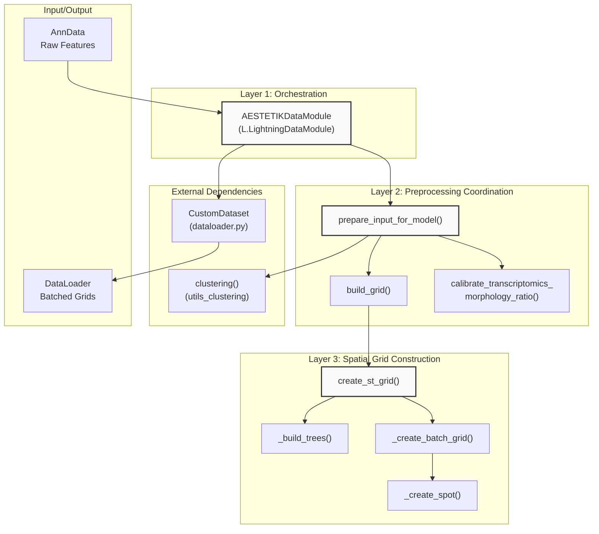
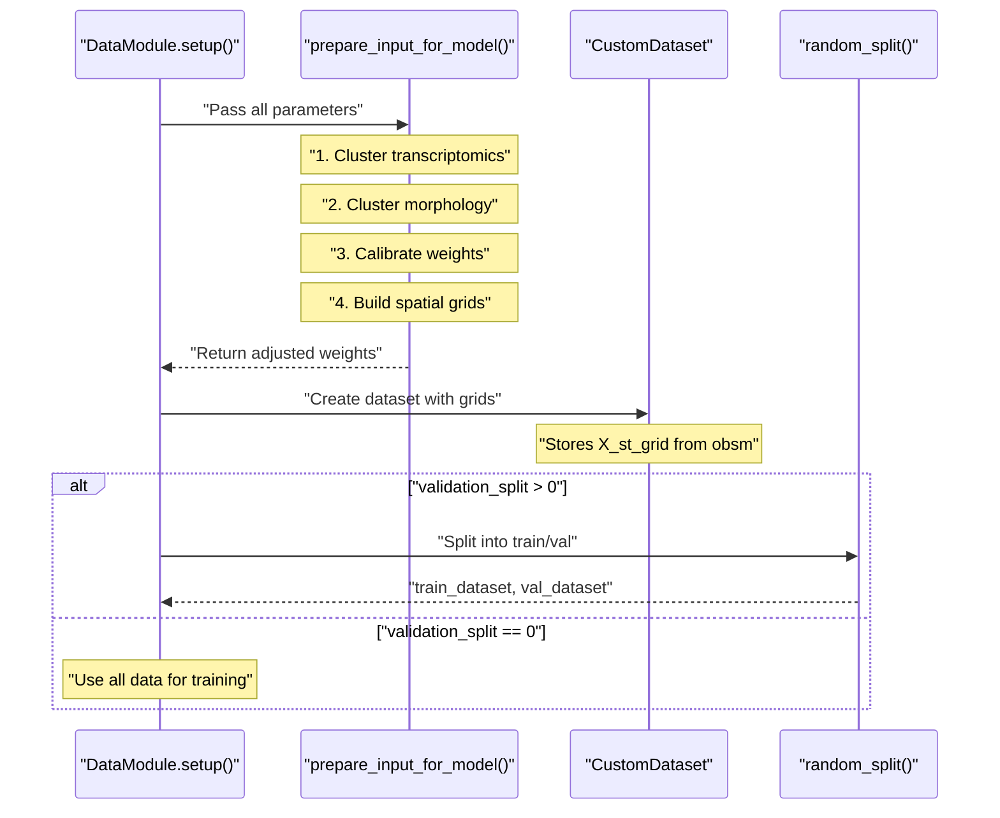
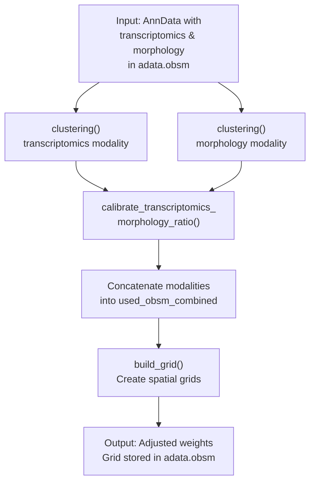
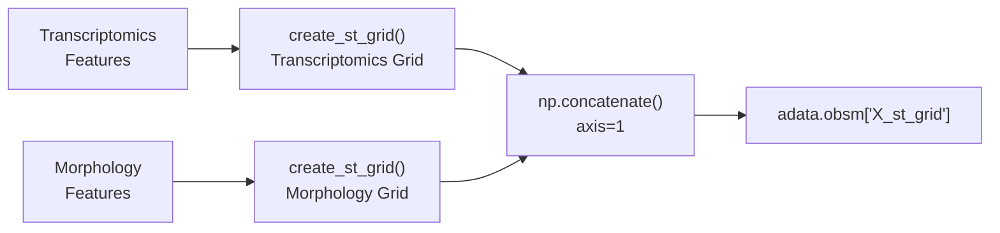
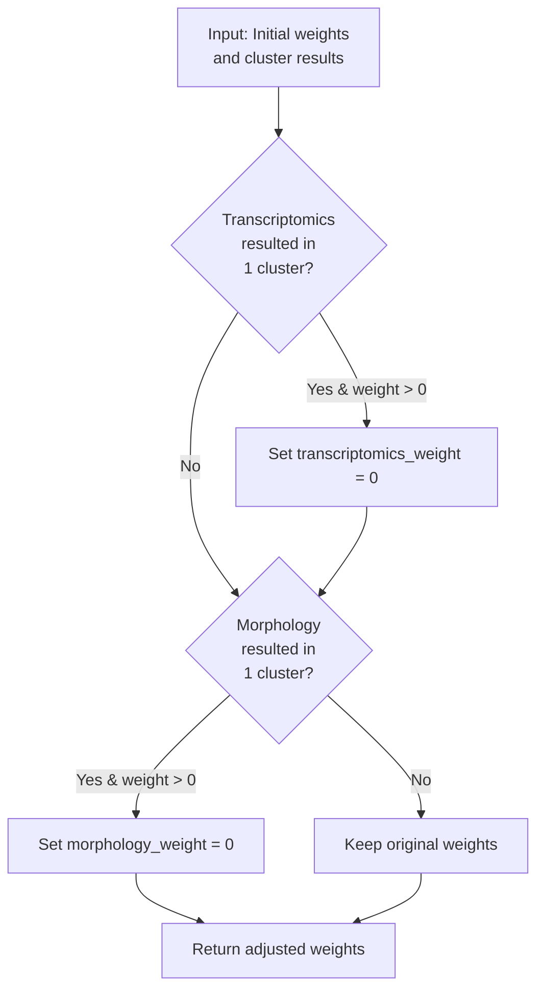
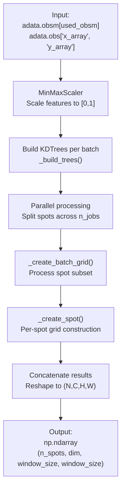
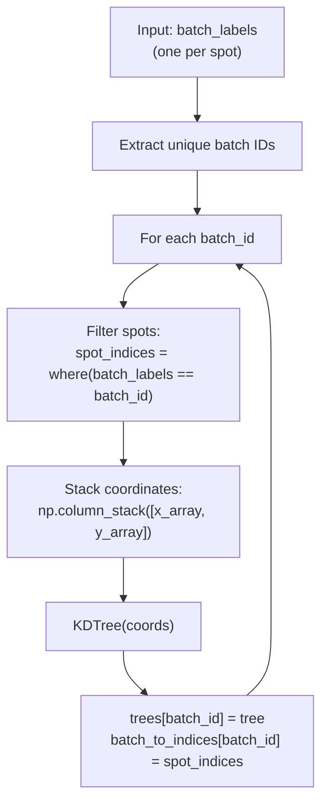
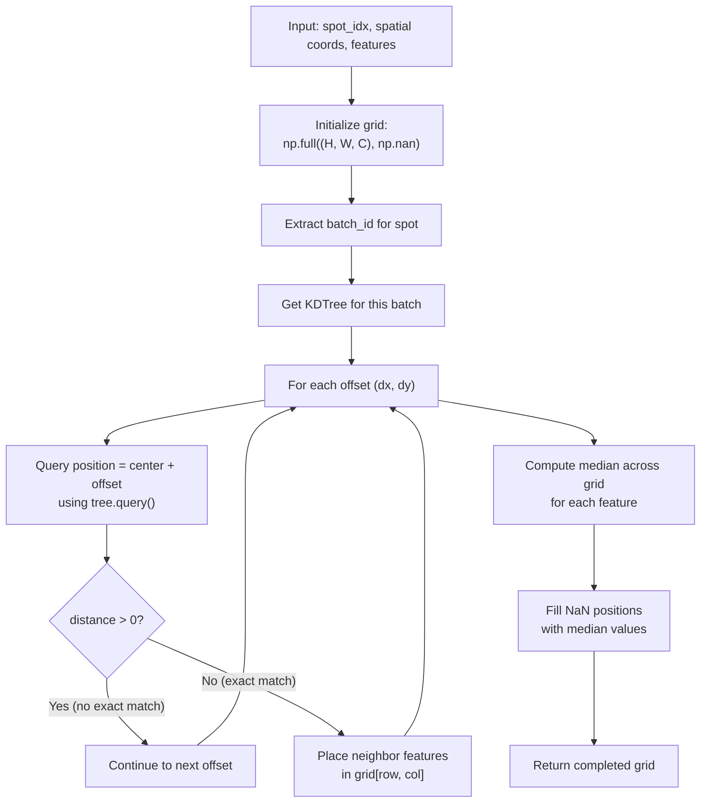
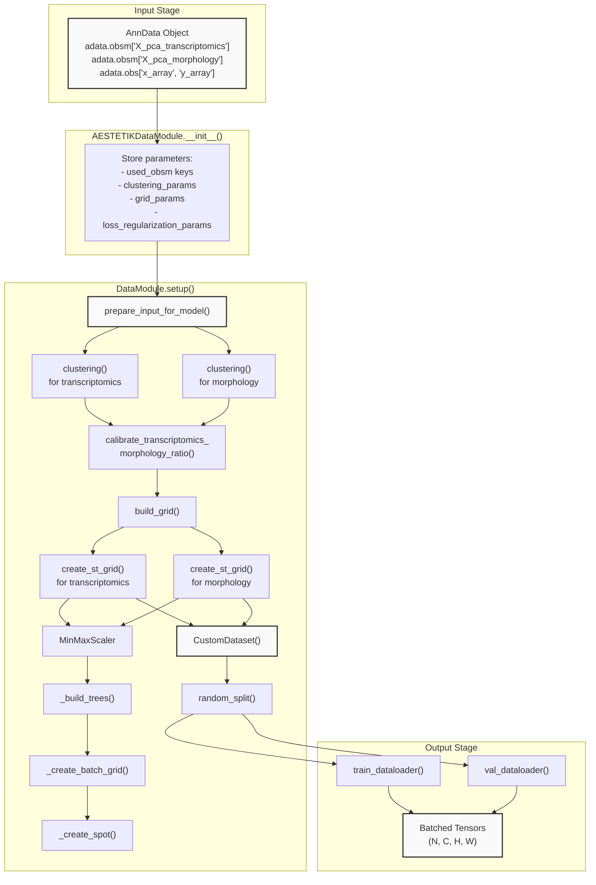

# Data Pipeline Components

<details>
<summary>Relevant source files</summary>

The following files were used as context for generating this wiki page:

- [src/aestetik/data_modules/data_module.py](src/aestetik/data_modules/data_module.py)
- [src/aestetik/utils/utils_data.py](src/aestetik/utils/utils_data.py)
- [src/aestetik/utils/utils_grid.py](src/aestetik/utils/utils_grid.py)

</details>


## Purpose and Scope

This page provides technical reference documentation for the data pipeline components that prepare spatial transcriptomics data for model training. The pipeline transforms raw AnnData objects into batched spatial grid tensors suitable for the autoencoder architecture.

This document covers:
- `AESTETIKDataModule`: PyTorch Lightning DataModule for data orchestration
- Data preparation utilities in `utils_data.py`: clustering, weight calibration, and preprocessing coordination
- Spatial grid construction in `utils_grid.py`: KDTree-based neighborhood feature extraction

For information about the main AESTETIK orchestrator class that initializes these components, see [AESTETIK Class](#5.1). For details about the model architecture that consumes the prepared data, see [Model Architecture](#5.3). For clustering algorithms used in preprocessing, see [Utility Functions](#5.4).

---

## Component Overview

The data pipeline consists of three primary layers that transform raw spatial omics data into training-ready batches:



**Sources**: [src/aestetik/data_modules/data_module.py:1-159](), [src/aestetik/utils/utils_data.py:1-112](), [src/aestetik/utils/utils_grid.py:1-188]()

---

## AESTETIKDataModule Class

### Class Definition

`AESTETIKDataModule` is a PyTorch Lightning DataModule that orchestrates the complete data preparation pipeline and provides dataloaders for training and validation.

**File Location**: [src/aestetik/data_modules/data_module.py:12-159]()

### Initialization Parameters

The class is initialized with structured parameter dictionaries:

| Parameter | Type | Description |
|-----------|------|-------------|
| `adata` | `anndata.AnnData` | Input AnnData object containing transcriptomics and morphology features |
| `validation_split` | `float` | Proportion of data for validation (0.0 to 1.0) |
| `used_obsm_transcriptomics` | `str` | Key in `adata.obsm` for transcriptomics features (e.g., PCA) |
| `used_obsm_morphology` | `str` | Key in `adata.obsm` for morphology features |
| `used_obsm_combined` | `str` | Key to store concatenated features |
| `used_obs_batch` | `Optional[str]` | Key in `adata.obs` for batch labels (for multi-sample data) |
| `dataloader_params` | `dict` | Contains `batch_size`, `num_workers` |
| `clustering_params` | `dict` | Contains `nCluster`, `clustering_method`, `n_neighbors` |
| `grid_params` | `dict` | Contains `morphology_dim` (window size) |
| `loss_regularization_params` | `dict` | Contains `multi_triplet_loss`, `n_repeats`, `morphology_weight`, `transcriptomics_weight`, `total_weight` |
| `data_handling_params` | `dict` | Contains `n_jobs`, `train_size` |

**Sources**: [src/aestetik/data_modules/data_module.py:13-93]()

### Key Methods

#### setup()

The `setup()` method triggers the complete preprocessing pipeline:



**Sources**: [src/aestetik/data_modules/data_module.py:96-134]()

**Key Operations**:
1. Calls `prepare_input_for_model()` with all configuration parameters [line 98-108]()
2. Receives calibrated `transcriptomics_weight` and `morphology_weight` [line 98]()
3. Creates `CustomDataset` instance with processed data [line 109-114]()
4. Splits dataset into training and validation sets if `validation_split > 0` [line 116-134]()

#### train_dataloader()

Returns a PyTorch DataLoader for training data:

```python
# Returns: torch.utils.data.DataLoader
# Configuration: uses self.dataloader_params (batch_size, num_workers)
# Shuffle: True
```

**Sources**: [src/aestetik/data_modules/data_module.py:137-140]()

#### val_dataloader()

Returns a PyTorch DataLoader for validation data, or empty iterator if no validation split:

```python
# Returns: torch.utils.data.DataLoader or empty iterator
# Configuration: uses self.dataloader_params
# Shuffle: False
```

**Sources**: [src/aestetik/data_modules/data_module.py:142-145]()

#### _validate_params()

Validates that all required parameter keys are present in the configuration dictionaries:

| Dictionary | Required Keys |
|------------|---------------|
| `dataloader_params` | `batch_size`, `num_workers` |
| `clustering_params` | `nCluster`, `clustering_method`, `n_neighbors` |
| `grid_params` | `morphology_dim` |
| `loss_regularization_params` | `multi_triplet_loss`, `n_repeats`, `morphology_weight`, `transcriptomics_weight` |
| `data_handling_params` | `n_jobs`, `train_size` |

**Sources**: [src/aestetik/data_modules/data_module.py:147-159]()

---

## Data Preparation Functions (utils_data.py)

### prepare_input_for_model()

**Function Signature**: [src/aestetik/utils/utils_data.py:14-72]()

The main preprocessing orchestrator that coordinates clustering, weight calibration, and grid construction.

**Preprocessing Pipeline**:



**Sources**: [src/aestetik/utils/utils_data.py:14-72]()

**Parameters**:
- `adata`: AnnData object to preprocess
- `nCluster`: Number of clusters (int) or resolution (float)
- `used_obsm_transcriptomics`: Key for transcriptomics features in `adata.obsm`
- `used_obsm_morphology`: Key for morphology features in `adata.obsm`
- `used_obsm_combined`: Key to store concatenated features
- `clustering_method`: One of `"bgm"`, `"kmeans"`, `"louvain"`, `"leiden"`
- `n_neighbors`: Number of neighbors for spatial cluster refinement
- `window_size`: Grid window dimension (e.g., 5 for 5×5 grids)
- `n_jobs`: Number of parallel jobs for grid construction
- `total_weight`: Total loss weight across modalities
- `morphology_weight`: Initial weight for morphology modality
- `used_obs_batch`: Optional batch column key in `adata.obs`

**Returns**: 
- `transcriptomics_weight`: Calibrated weight for transcriptomics (may be 0 if clustering failed)
- `morphology_weight`: Calibrated weight for morphology (may be 0 if clustering failed)

**Side Effects**:
- Stores cluster labels in `adata.obs[f"{used_obsm}_cluster"]` for each modality [lines 35-51]()
- Creates concatenated features in `adata.obsm[used_obsm_combined]` [lines 62-63]()
- Stores spatial grids in `adata.obsm["X_st_grid"]` via `build_grid()` [lines 65-70]()

### build_grid()

**Function Signature**: [src/aestetik/utils/utils_data.py:74-89]()

Coordinates spatial grid construction for both modalities and concatenates results.

**Processing Flow**:



**Sources**: [src/aestetik/utils/utils_data.py:74-89]()

**Key Operations**:
1. Calls `create_st_grid()` for transcriptomics features [lines 81-82]()
2. Calls `create_st_grid()` for morphology features [lines 85-86]()
3. Concatenates grids along channel axis [lines 88-89]()
4. Final shape: `(n_spots, transcriptomics_dim + morphology_dim, window_size, window_size)`

### calibrate_transcriptomics_morphology_ratio()

**Function Signature**: [src/aestetik/utils/utils_data.py:91-112]()

Adjusts modality weights when clustering fails to produce the expected number of clusters.

**Calibration Logic**:



**Sources**: [src/aestetik/utils/utils_data.py:91-112]()

**Rationale**: When a modality produces only 1 cluster instead of the requested `nCluster`, it indicates the features are not discriminative for spatial domain identification. Setting the weight to 0 prevents this modality from contributing to triplet loss, allowing the other modality to guide learning.

**Implementation Details**:
- Checks if `adata.obs[f"{used_obsm}_cluster"].unique().size == 1` [lines 101, 107]()
- Sets weight to 0 if condition is met and original weight was positive [lines 103-104, 109-110]()
- Logs weight adjustments for transparency [lines 102-103, 108-109]()

---

## Spatial Grid Construction (utils_grid.py)

### create_st_grid()

**Function Signature**: [src/aestetik/utils/utils_grid.py:54-108]()

Constructs spatial grids for all spots using KDTree-based neighbor queries and parallel processing.

**Architecture Overview**:



**Sources**: [src/aestetik/utils/utils_grid.py:54-108]()

**Key Processing Steps**:

1. **Feature Scaling** [lines 64-65]():
   - Applies `MinMaxScaler` with range `(0, 1)` to all features
   - Ensures consistent feature magnitudes across modalities

2. **Batch Handling** [lines 69-80]():
   - Extracts `used_obs_batch` column if specified
   - Converts to categorical codes for efficient indexing
   - Treats all data as single batch if no batch column exists

3. **KDTree Construction** [lines 78-80]():
   - Calls `_build_trees()` to create spatial indices per batch
   - Returns `trees` dict and `batch_to_indices` mapping

4. **Offset Computation** [lines 82-83]():
   - Calls `_compute_offsets_flat()` to generate grid position offsets
   - For `window_size=5`, creates 25 (x,y) offsets from center

5. **Parallel Processing** [lines 91-105]():
   - Splits spots into `cpu_count` chunks
   - Uses `joblib.Parallel` with `prefer="threads"`
   - Passes immutable (write-protected) arrays to workers [lines 85-89]()

6. **Grid Assembly** [lines 106-107]():
   - Concatenates spot grids from all workers
   - Reshapes from `(N, H, W, C)` to `(N, C, H, W)` using `np.moveaxis()`

**Return Shape**: `(num_spots, dim_emb, window_size, window_size)`

### _build_trees()

**Function Signature**: [src/aestetik/utils/utils_grid.py:110-123]()

Creates KDTree spatial indices for efficient neighbor queries, handling multi-batch data.

**Per-Batch Processing**:



**Sources**: [src/aestetik/utils/utils_grid.py:110-123]()

**Purpose**: Separating batches ensures spots from different tissue samples or experimental batches don't query neighbors across batch boundaries, preserving spatial coherence within each sample.

### _create_batch_grid()

**Function Signature**: [src/aestetik/utils/utils_grid.py:125-146]()

Processes a subset of spots assigned to a single parallel worker.

**Implementation**:
- Iterates over assigned `spot_indices` [line 135]()
- Calls `_create_spot()` for each spot [lines 136-144]()
- Collects results in list for efficient concatenation [line 145]()

**Sources**: [src/aestetik/utils/utils_grid.py:125-146]()

### _create_spot()

**Function Signature**: [src/aestetik/utils/utils_grid.py:148-182]()

Constructs the spatial feature grid for a single spot using neighbor queries and median imputation.

**Grid Construction Algorithm**:



**Sources**: [src/aestetik/utils/utils_grid.py:148-182]()

**Key Implementation Details**:

1. **Grid Initialization** [lines 163-165]():
   - Shape: `(window_size, window_size, dim_emb)`
   - Filled with `np.nan` to track missing positions

2. **Neighbor Query** [lines 168-172]():
   - Computes target position: `center + [dx_offset, dy_offset]`
   - Uses `tree.query(position)` to find nearest neighbor
   - Only accepts exact matches (`distance == 0`)
   - Skips positions without exact coordinate matches

3. **Median Imputation** [lines 178-180]():
   - Computes `np.nanmedian(grid, axis=(0, 1))` across spatial dimensions
   - Replaces all `NaN` entries with corresponding feature medians
   - Ensures complete grids even for edge spots with fewer neighbors

**Rationale for Distance Threshold**: The strict `distance > 0` check [line 171]() ensures only spots at exact grid positions are included, preserving the regular spatial lattice structure typical of spatial transcriptomics platforms.

### _compute_offsets_flat()

**Function Signature**: [src/aestetik/utils/utils_grid.py:184-188]()

Generates flattened (x, y) offset arrays for grid positions.

**Example for window_size=5**:
```python
# start = -2, end = 3
# Returns shape (25, 2):
[[-2, -2], [-2, -1], [-2, 0], [-2, 1], [-2, 2],
 [-1, -2], [-1, -1], [-1, 0], [-1, 1], [-1, 2],
 ...
 [2, -2], [2, -1], [2, 0], [2, 1], [2, 2]]
```

**Sources**: [src/aestetik/utils/utils_grid.py:184-188]()

---

## Data Flow Integration

### Complete Pipeline Data Flow



**Sources**: [src/aestetik/data_modules/data_module.py:1-159](), [src/aestetik/utils/utils_data.py:1-112](), [src/aestetik/utils/utils_grid.py:1-188]()

### Key Data Transformations

| Stage | Input Shape | Output Shape | Storage Location |
|-------|-------------|--------------|------------------|
| Raw Features | `(n_spots, n_features)` | - | `adata.obsm[used_obsm_*]` |
| Clustering | - | `(n_spots,)` | `adata.obs[f"{used_obsm}_cluster"]` |
| Feature Scaling | `(n_spots, n_features)` | `(n_spots, n_features)` | In-memory |
| create_st_grid() | `(n_spots, n_features)` | `(n_spots, n_features, H, W)` | In-memory |
| Concatenate Grids | 2×`(n_spots, n_features, H, W)` | `(n_spots, 2*n_features, H, W)` | `adata.obsm["X_st_grid"]` |
| CustomDataset | - | `(batch_size, 2*n_features, H, W)` | DataLoader batches |

### Memory and Performance Considerations

**Parallelization**:
- Grid construction uses `joblib.Parallel` with `prefer="threads"` [line 94-95]()
- Number of workers controlled by `n_jobs` parameter
- Arrays are made read-only before parallel processing [lines 85-89]()

**Memory Efficiency**:
- Uses `np.float32` for features to reduce memory footprint [line 23]()
- Processes spots in chunks for parallel workers
- KDTree provides O(log n) neighbor queries vs O(n) brute force

**Batch Processing**:
- Separate KDTrees per batch prevent cross-batch neighbor queries
- Enables processing of multi-sample datasets
- Maintains spatial coherence within each tissue section

**Sources**: [src/aestetik/utils/utils_grid.py:29-108]()

---

## Usage Example

```python
from aestetik.data_modules.data_module import AESTETIKDataModule
import anndata as ad

# Load preprocessed AnnData with PCA features
adata = ad.read_h5ad("spatial_data.h5ad")

# Configure data module
data_module = AESTETIKDataModule(
    adata=adata,
    validation_split=0.1,
    used_obsm_transcriptomics="X_pca_transcriptomics",
    used_obsm_morphology="X_pca_morphology", 
    used_obsm_combined="X_pca_combined",
    used_obs_batch="batch_id",
    dataloader_params={"batch_size": 32, "num_workers": 4},
    clustering_params={"nCluster": 10, "clustering_method": "leiden", "n_neighbors": 15},
    grid_params={"morphology_dim": 5},
    loss_regularization_params={
        "multi_triplet_loss": True,
        "n_repeats": 3,
        "morphology_weight": 1.0,
        "transcriptomics_weight": None,  # Will be calibrated
        "total_weight": 2.0
    },
    data_handling_params={"n_jobs": 8, "train_size": None}
)

# Trigger preprocessing
data_module.setup(stage="fit")

# Access processed data
train_loader = data_module.train_dataloader()
val_loader = data_module.val_dataloader()

# Check results stored in AnnData
print(adata.obs.columns)  # Contains cluster labels
print(adata.obsm["X_st_grid"].shape)  # (n_spots, 2*dim, 5, 5)
```

**Sources**: [src/aestetik/data_modules/data_module.py:12-159]()

---