# Model Architecture

<details>
<summary>Relevant source files</summary>

The following files were used as context for generating this wiki page:

- [src/aestetik/callbacks/callbacks.py](src/aestetik/callbacks/callbacks.py)
- [src/aestetik/metrics/loss_function.py](src/aestetik/metrics/loss_function.py)
- [src/aestetik/models/model.py](src/aestetik/models/model.py)
- [src/aestetik/modules/aestetik_module.py](src/aestetik/modules/aestetik_module.py)

</details>


## Purpose and Scope

This page documents the neural network model architecture used in AESTETIK, including the `AESTETIKModel` Lightning module wrapper and the `AE` autoencoder. This covers the convolutional encoder-decoder architecture, ensemble mechanisms, and loss computation.

For information about the AESTETIK orchestrator class that manages model training, see [AESTETIK Class](#5.1). For data preprocessing and batch creation, see [Data Pipeline Components](#5.2).

---

## Component Overview

The model architecture consists of three primary components:

| Component | Class | File | Purpose |
|-----------|-------|------|---------|
| Lightning Wrapper | `AESTETIKModel` | `aestetik_module.py` | PyTorch Lightning module handling training loops, optimization, and prediction |
| Core Model | `AE` | `model.py` | Convolutional autoencoder with ensemble encoder/decoder |
| Loss Computation | `compute_loss()` | `loss_function.py` | Multi-component loss function for reconstruction and triplet losses |

**Sources:** [src/aestetik/modules/aestetik_module.py:1-185](), [src/aestetik/models/model.py:1-98](), [src/aestetik/metrics/loss_function.py:1-90]()

---

## Module Class Hierarchy

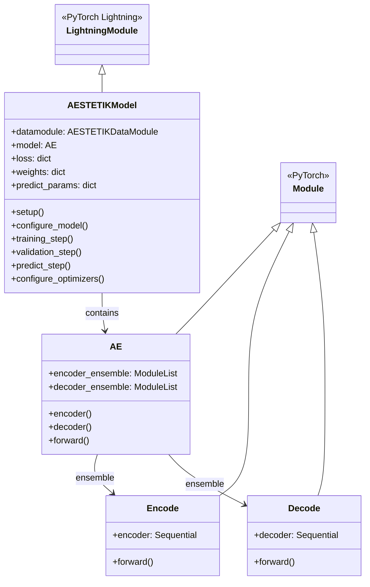

**Sources:** [src/aestetik/modules/aestetik_module.py:14-21](), [src/aestetik/models/model.py:51-98]()

---

## AESTETIKModel Lightning Module

The `AESTETIKModel` class extends `lightning.LightningModule` and serves as the training orchestrator. It wraps the core `AE` autoencoder and implements PyTorch Lightning's interface for training, validation, and prediction.

### Initialization Parameters

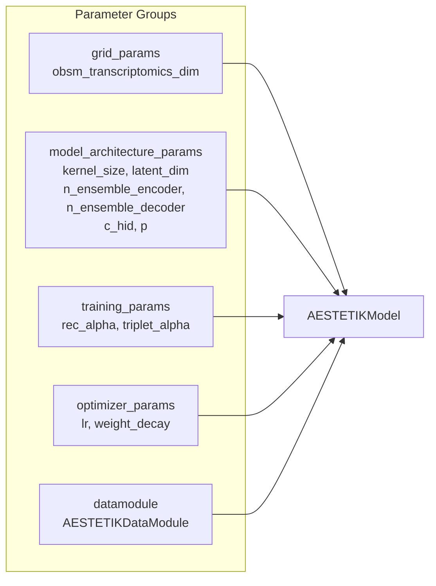

**Sources:** [src/aestetik/modules/aestetik_module.py:15-55]()

### Key Methods

| Method | Parameters | Returns | Purpose |
|--------|-----------|---------|---------|
| `setup()` | `stage` | `None` | Initialize loss functions and weights from datamodule |
| `configure_model()` | - | `None` | Build the `AE` model with grid parameters |
| `training_step()` | `batch`, `batch_idx` | `Tensor` | Compute forward pass and loss for training |
| `validation_step()` | `batch`, `batch_idx` | `Tensor` | Compute validation loss with gradient tracking disabled |
| `predict_step()` | `batch`, `batch_idx`, `dataloader_idx` | `Tensor` | Generate latent embeddings with Monte Carlo dropout |
| `configure_optimizers()` | - | `Optimizer` | Configure Adam optimizer with AMSGrad |

**Sources:** [src/aestetik/modules/aestetik_module.py:68-168]()

### Model Configuration

The model is lazily initialized in `configure_model()` to allow dynamic grid parameter determination:

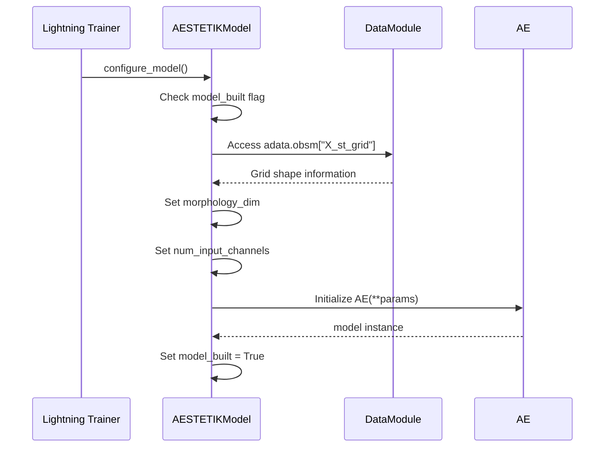

**Sources:** [src/aestetik/modules/aestetik_module.py:80-91]()

---

## AE Autoencoder Architecture

The `AE` class implements the core convolutional autoencoder with ensemble components. Both encoder and decoder use multiple independent networks whose outputs are combined via median aggregation.

### Architecture Overview

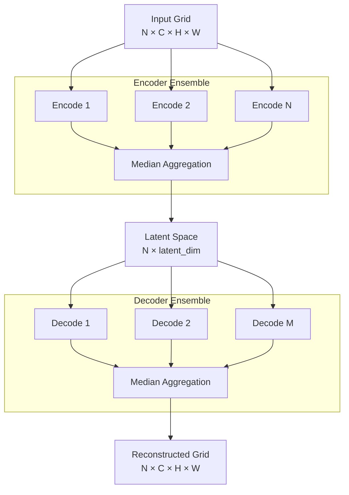

**Sources:** [src/aestetik/models/model.py:51-98]()

### Constructor Parameters

| Parameter | Type | Description |
|-----------|------|-------------|
| `num_input_channels` | `int` | Total number of channels (transcriptomics + morphology) |
| `morphology_dim` | `int` | Spatial dimension of input grid (height/width) |
| `c_hid` | `int` | Number of hidden channels in convolutional layers |
| `latent_dim` | `int` | Dimensionality of latent representation |
| `kernel_size` | `int` | Size of convolutional kernels |
| `p` | `float` | Dropout probability |
| `n_ensemble_encoder` | `int` | Number of encoder networks (default: 2) |
| `n_ensemble_decoder` | `int` | Number of decoder networks (default: 1) |

**Sources:** [src/aestetik/models/model.py:52-62]()

### Forward Pass Methods

The `AE` class provides three methods for inference:

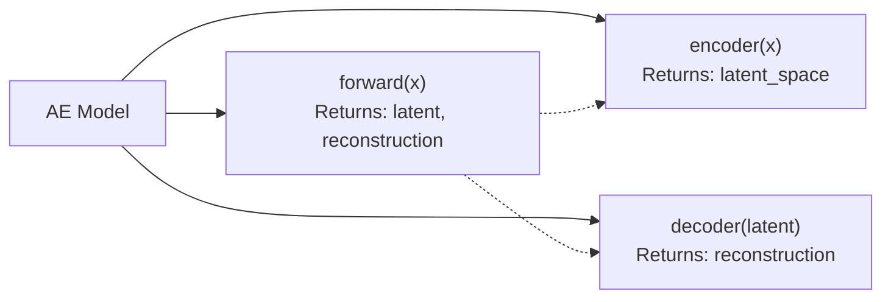

**Sources:** [src/aestetik/models/model.py:82-97]()

---

## Encoder Architecture (Encode Class)

The `Encode` class implements a single convolutional encoder network. Multiple instances are used in the ensemble.

### Layer Structure

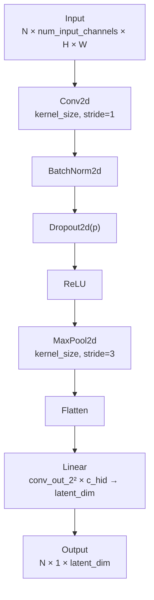

**Spatial Dimension Calculations:**

The spatial dimensions are computed during `AE.__init__()`:
- `conv_out_1 = (morphology_dim - kernel_size) + 1`
- `conv_out_2 = floor((conv_out_1 - kernel_size) / 3 + 1)`

**Sources:** [src/aestetik/models/model.py:8-26](), [src/aestetik/models/model.py:65-66]()

### Implementation Details

The encoder is implemented as a `nn.Sequential` module containing all layers. The `forward()` method adds a singleton dimension to output shape `(batch_size, 1, latent_dim)` for ensemble concatenation.

**Sources:** [src/aestetik/models/model.py:13-26]()

---

## Decoder Architecture (Decode Class)

The `Decode` class implements a single convolutional decoder network that reconstructs the input from latent space.

### Layer Structure

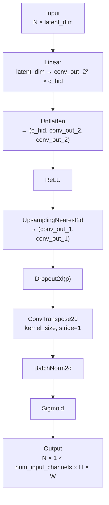

**Sources:** [src/aestetik/models/model.py:29-48]()

### Reconstruction Process

The decoder reverses the encoder operations:
1. Linear expansion from latent space
2. Reshape to spatial feature map
3. Upsampling to intermediate size
4. Transposed convolution to original spatial dimensions
5. Sigmoid activation for bounded output values

**Sources:** [src/aestetik/models/model.py:34-43]()

---

## Ensemble Mechanism

### Median Aggregation Strategy

Both encoder and decoder ensembles use median aggregation for robust predictions:

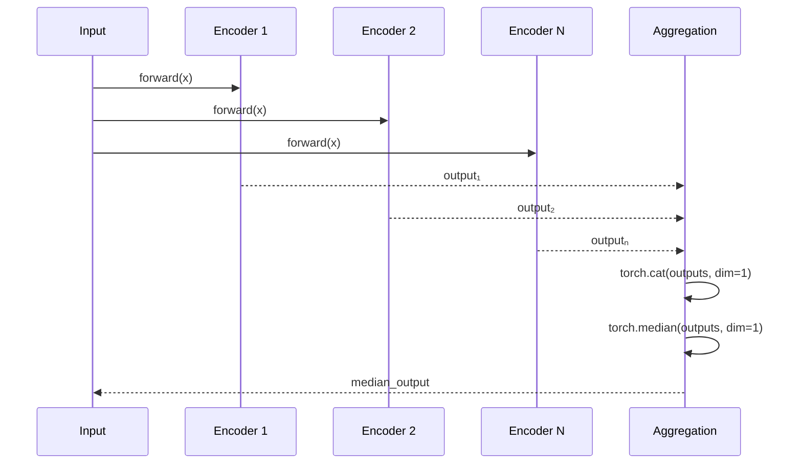

**Sources:** [src/aestetik/models/model.py:82-92]()

### Code Implementation

#### Encoder Ensemble

```
x_encode = [unit(x) for unit in self.encoder_ensemble]
x_encode = torch.cat(x_encode, 1)
x_encode_median, _ = torch.median(x_encode, 1)
```

**Sources:** [src/aestetik/models/model.py:82-86]()

#### Decoder Ensemble

```
x_decode = [unit(x) for unit in self.decoder_ensemble]
x_decode = torch.cat(x_decode, 1)
x_decode_median, _ = torch.median(x_decode, 1)
```

**Sources:** [src/aestetik/models/model.py:88-92]()

### Rationale

Median aggregation provides robustness to outlier predictions from individual ensemble members, unlike mean aggregation which can be skewed by extreme values.

---

## Loss Computation

The loss function combines reconstruction and triplet losses for both modalities.

### Loss Components

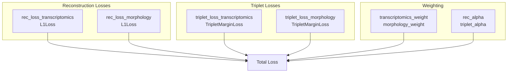

**Sources:** [src/aestetik/metrics/loss_function.py:39-89]()

### Loss Formula

The total loss is computed as:

```
total_loss = transcriptomics_weight × (rec_alpha × rec_loss_transcriptomics + 
                                        triplet_alpha × triplet_loss_transcriptomics) +
             morphology_weight × (rec_alpha × rec_loss_morphology + 
                                  triplet_alpha × triplet_loss_morphology)
```

**Sources:** [src/aestetik/metrics/loss_function.py:86-87]()

### Loss Function Interface

| Function | Parameters | Returns | Purpose |
|----------|-----------|---------|---------|
| `compute_loss()` | `model`, `anchor`, `anchor_encode`, `anchor_decode`, positive/negative lists, weights, alphas | `Tuple[Tensor, ...]` | Compute all loss components |
| `compute_reconstruction_loss()` | `anchor`, `anchor_decode`, `loss` | `Tensor` | L1 loss between input and reconstruction |
| `compute_average_triplet_loss()` | `model`, `anchor_encode`, `pos_list`, `neg_list`, `loss`, `device` | `Tensor` | Average triplet loss over samples |

**Sources:** [src/aestetik/metrics/loss_function.py:4-89]()

### Triplet Loss Computation

Triplet loss uses anchor, positive, and negative samples from the same/different clusters:

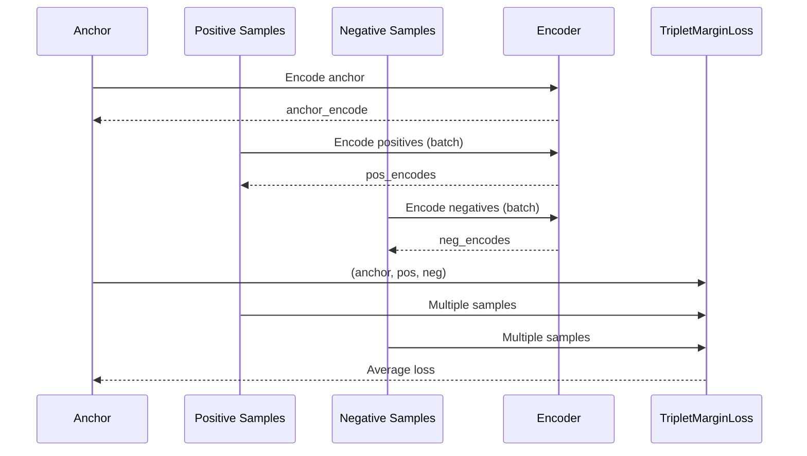

**Sources:** [src/aestetik/metrics/loss_function.py:4-29]()

---

## Training Workflow

### Training Step Implementation

The `training_step()` method in `AESTETIKModel` orchestrates the forward pass and loss computation:

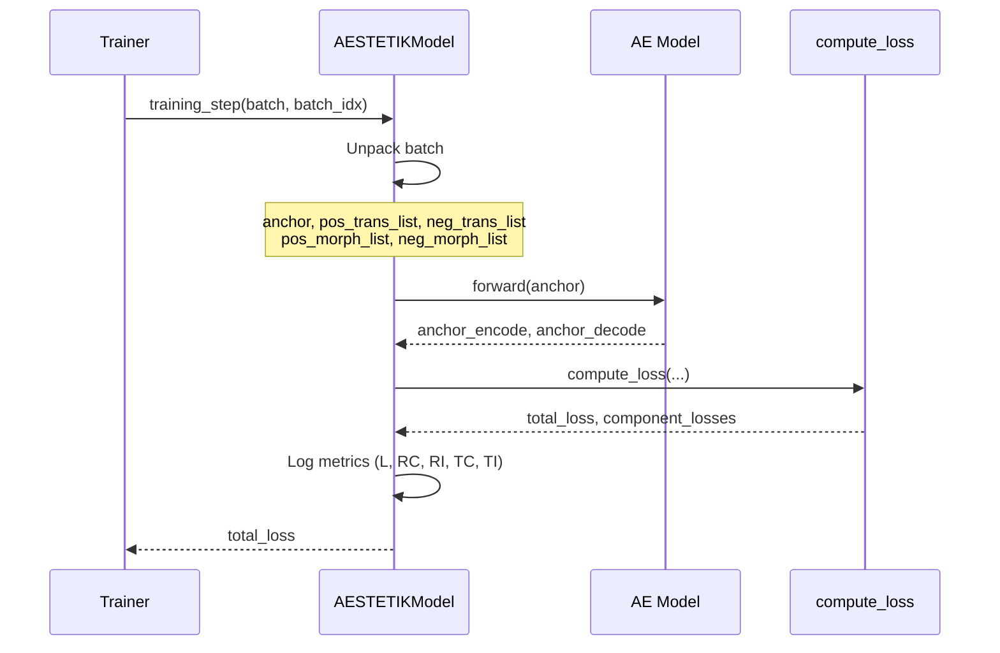

**Sources:** [src/aestetik/modules/aestetik_module.py:93-117]()

### Logged Metrics

| Metric Key | Description |
|------------|-------------|
| `L` | Total loss |
| `RC` | Reconstruction loss (transcriptomics) |
| `RI` | Reconstruction loss (morphology/image) |
| `TC` | Triplet loss (transcriptomics) |
| `TI` | Triplet loss (morphology/image) |

**Sources:** [src/aestetik/modules/aestetik_module.py:112-116]()

---

## Prediction Workflow

### Monte Carlo Dropout Prediction

The `predict_step()` method uses Monte Carlo dropout for uncertainty estimation:

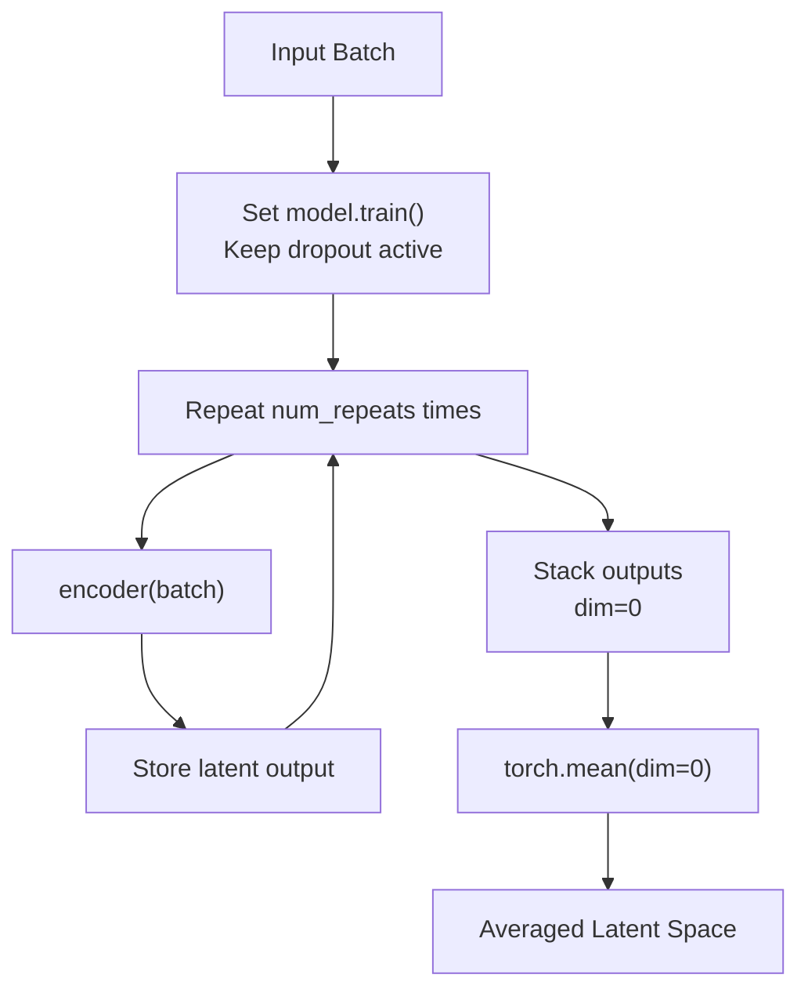

**Sources:** [src/aestetik/modules/aestetik_module.py:142-161]()

### Implementation Details

The prediction process:
1. Sets model to training mode to keep dropout layers active
2. Performs multiple forward passes (`num_repeats` times)
3. Averages the latent representations across repeats
4. Returns mean latent space for each batch

This approach provides more robust embeddings by sampling from the dropout distribution.

**Sources:** [src/aestetik/modules/aestetik_module.py:151-161]()

---

## Validation Workflow

The validation step is similar to training but with gradients disabled:

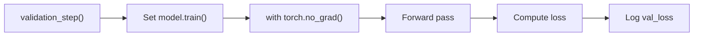

**Key differences from training:**
- Wrapped in `torch.no_grad()` context
- Only logs `val_loss` (total loss)
- Model still in training mode to maintain dropout behavior

**Sources:** [src/aestetik/modules/aestetik_module.py:119-140]()

---

## Optimizer Configuration

The `configure_optimizers()` method sets up the Adam optimizer:

```python
optimizer = torch.optim.Adam(
    self.model.parameters(),
    amsgrad=True,
    lr=optimizer_params["lr"],
    weight_decay=optimizer_params["weight_decay"]
)
```

**Configuration:**
- Algorithm: Adam with AMSGrad variant
- Adaptive learning rates for all model parameters
- L2 regularization via `weight_decay`

**Sources:** [src/aestetik/modules/aestetik_module.py:163-168]()

---

## Parameter Validation

Both `AESTETIKModel` and `AE` validate their parameters during initialization to ensure all required fields are present.

### Required Parameters by Group

| Parameter Group | Required Keys |
|----------------|---------------|
| `grid_params` | `obsm_transcriptomics_dim` |
| `model_architecture_params` | `kernel_size`, `latent_dim`, `n_ensemble_encoder`, `n_ensemble_decoder`, `c_hid`, `p` |
| `training_params` | `rec_alpha`, `triplet_alpha` |
| `optimizer_params` | `lr`, `weight_decay` |

**Sources:** [src/aestetik/modules/aestetik_module.py:171-185]()

---

## Callbacks

AESTETIK provides a custom callback for tracking training loss history:

### LossHistoryCallback

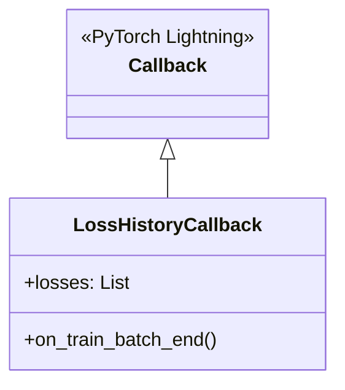

**Purpose:** Records loss values at the end of each training batch for visualization and analysis.

**Usage:** Automatically invoked by Lightning Trainer during training.

**Sources:** [src/aestetik/callbacks/callbacks.py:1-18]()

---

## Summary

The AESTETIK model architecture consists of:

1. **Lightning Wrapper (`AESTETIKModel`)**: Handles training orchestration, validation, and prediction workflows
2. **Core Autoencoder (`AE`)**: Convolutional encoder-decoder with ensemble members
3. **Encoder (`Encode`)**: Conv2d → BatchNorm → Dropout → MaxPool → Linear layers
4. **Decoder (`Decode`)**: Linear → Unflatten → Upsample → ConvTranspose2d → Sigmoid layers
5. **Ensemble Mechanism**: Median aggregation across multiple encoders/decoders
6. **Multi-Component Loss**: Reconstruction (L1) + Triplet losses for both modalities
7. **Monte Carlo Dropout**: Multiple forward passes during prediction for robust embeddings

This architecture enables robust learning of multi-modal spatial transcriptomics embeddings while maintaining spatial neighborhood information through grid-based inputs.

---