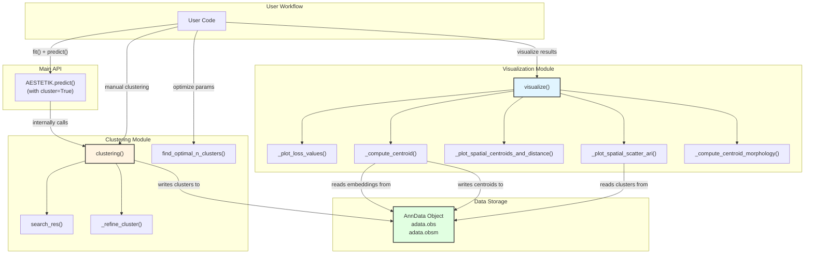
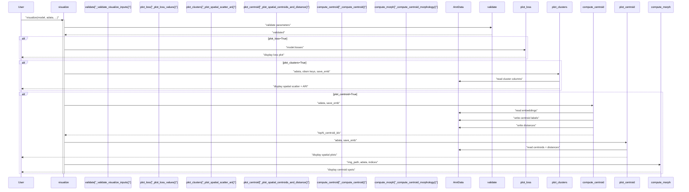
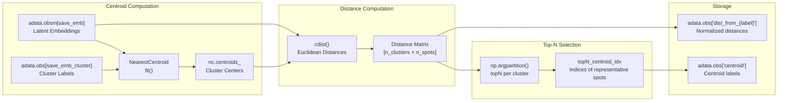
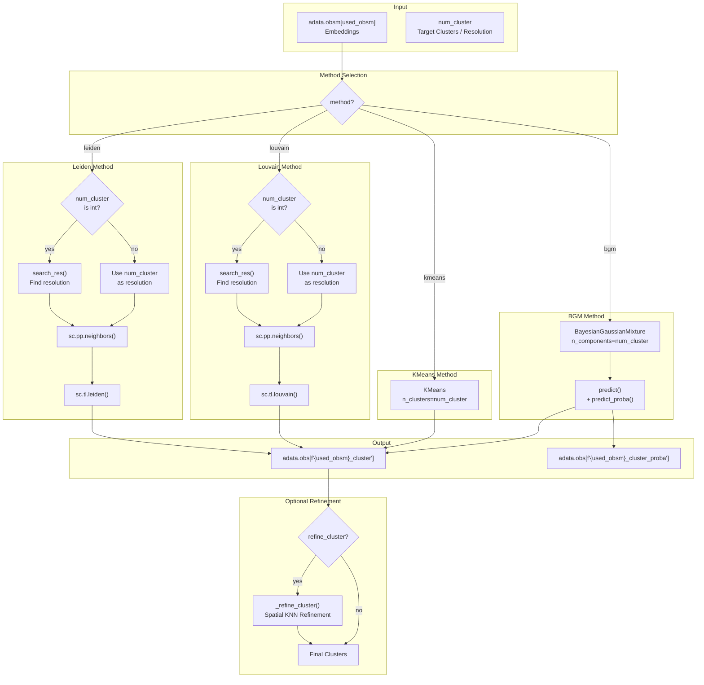
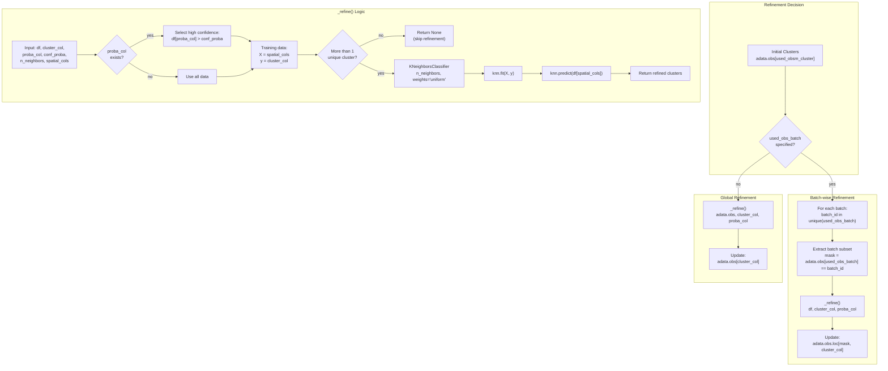

# Utility Functions

<details>
<summary>Relevant source files</summary>

The following files were used as context for generating this wiki page:

- [src/aestetik/utils/utils_clustering.py](src/aestetik/utils/utils_clustering.py)
- [src/aestetik/utils/utils_visualization.py](src/aestetik/utils/utils_visualization.py)

</details>


This page documents the utility functions in AESTETIK that support clustering, visualization, and analysis workflows. These utilities are primarily used after model training and prediction to analyze and visualize results.

For information about the main AESTETIK orchestrator class, see [AESTETIK Class](#5.1). For data preprocessing utilities used during training, see [Data Pipeline Components](#5.2). For visualization workflows and examples, see [Visualization](#4.5).

---

## Overview

AESTETIK provides two main utility modules:

| Module | Purpose | Primary Use Case |
|--------|---------|------------------|
| `utils_visualization.py` | Visualizing model outputs, clusters, and centroids | Post-prediction analysis and result interpretation |
| `utils_clustering.py` | Clustering embeddings and optimizing cluster parameters | Converting embeddings into discrete spatial domains |

These utilities operate on `AnnData` objects and integrate with the scanpy/squidpy ecosystem, following standard conventions for storing results in `.obs` and `.obsm` attributes.

**Sources:** [src/aestetik/utils/utils_visualization.py:1-256](), [src/aestetik/utils/utils_clustering.py:1-276]()

---

## Utility Integration Architecture



**Sources:** [src/aestetik/utils/utils_visualization.py:30-103](), [src/aestetik/utils/utils_clustering.py:140-211]()

---

## Visualization Utilities

### Main Visualization Function

The `visualize()` function provides a unified interface for visualizing different aspects of the AESTETIK model output.

#### Function Signature

[src/aestetik/utils/utils_visualization.py:30-42]()

```python
def visualize(model: AESTETIK,
              adata: Optional[anndata.AnnData] = None,
              img_path: Optional[str] = None,
              spot_diameter_fullres: Optional[int] = None,
              used_obsm_transcriptomics: str = "X_pca_transcriptomics",
              used_obsm_morphology: str = "X_pca_morphology",
              save_emb: str = "AESTETIK",
              plot_loss: bool = False,
              plot_clusters: bool = False,
              plot_centroid: bool = False,
              img_alpha: float = 0.6,
              dot_size: int = 5,
              ncols: int = 5) -> None
```

#### Parameters

| Parameter | Type | Default | Description |
|-----------|------|---------|-------------|
| `model` | `AESTETIK` | Required | Trained AESTETIK model instance |
| `adata` | `anndata.AnnData` | `None` | AnnData object (required for cluster/centroid plots) |
| `img_path` | `str` | `None` | Path to full-resolution image (required for centroid morphology) |
| `spot_diameter_fullres` | `int` | `None` | Spot diameter in full resolution pixels (required for centroid morphology) |
| `used_obsm_transcriptomics` | `str` | `"X_pca_transcriptomics"` | Key for transcriptomics data in `adata.obsm` |
| `used_obsm_morphology` | `str` | `"X_pca_morphology"` | Key for morphology data in `adata.obsm` |
| `save_emb` | `str` | `"AESTETIK"` | Key prefix for embeddings and clusters in `adata` |
| `plot_loss` | `bool` | `False` | Plot training loss over epochs |
| `plot_clusters` | `bool` | `False` | Plot spatial scatter of clusters with ARI scores |
| `plot_centroid` | `bool` | `False` | Plot cluster centroids and distances |
| `img_alpha` | `float` | `0.6` | Image opacity in spatial plots (0-1) |
| `dot_size` | `int` | `5` | Size of dots in scatter plots |
| `ncols` | `int` | `5` | Number of columns in subplot grid |

**Sources:** [src/aestetik/utils/utils_visualization.py:43-72]()

---

### Visualization Workflow



**Sources:** [src/aestetik/utils/utils_visualization.py:73-103]()

---

### Loss Visualization

The `_plot_loss_values()` function plots training loss over iterations.

[src/aestetik/utils/utils_visualization.py:107-111]()

**Input:** List of loss values from `model.losses`  
**Output:** Matplotlib line plot showing loss convergence

**Sources:** [src/aestetik/utils/utils_visualization.py:107-111]()

---

### Cluster Visualization

The `_plot_spatial_scatter_ari()` function creates spatial scatter plots comparing clustering results across modalities.

[src/aestetik/utils/utils_visualization.py:129-161]()

**Functionality:**
- Compares ground truth (if available) with clustering from different modalities
- Computes Adjusted Rand Index (ARI) for each clustering
- Uses `squidpy.pl.spatial_scatter()` for spatial plotting

**Data Flow:**
1. Reads cluster labels from `adata.obs`:
   - `{used_obsm_transcriptomics}_cluster`
   - `{used_obsm_morphology}_cluster`
   - `{save_emb}_cluster`
2. Computes ARI scores against `ground_truth` column
3. Displays spatial scatter plots with ARI in titles

**Sources:** [src/aestetik/utils/utils_visualization.py:129-161](), [src/aestetik/utils/utils_visualization.py:8]()

---

### Centroid Analysis



The `_compute_centroid()` function identifies representative spots for each cluster by finding the top-N spots closest to cluster centroids in latent space.

[src/aestetik/utils/utils_visualization.py:198-217]()

**Algorithm:**
1. Fit `NearestCentroid` classifier on embeddings
2. Compute Euclidean distances from each centroid to all spots
3. Select top-N closest spots per cluster
4. Normalize distances to [0, 1] range (inverted: 1 = closest)
5. Store results in `adata.obs`

**Output Columns:**
- `centroid`: Cluster label for centroid spots (NaN for others)
- `dist_from_{label}`: Normalized distance from cluster `{label}` for each spot

**Sources:** [src/aestetik/utils/utils_visualization.py:198-217](), [src/aestetik/utils/utils_visualization.py:9-10]()

---

### Centroid Morphology Visualization

The `_compute_centroid_morphology()` function extracts and displays morphological images of centroid spots from full-resolution tissue images.

[src/aestetik/utils/utils_visualization.py:219-234]()

**Dependencies:**
- `pyvips` for efficient large image handling
- Pixel coordinates: `adata.obs['x_pixel']`, `adata.obs['y_pixel']`

**Process:**
1. Load full-resolution image using `pyvips`
2. Extract spot regions using `_get_spot()` [src/aestetik/utils/utils_visualization.py:186-193]()
3. Display in grid layout organized by cluster

**Sources:** [src/aestetik/utils/utils_visualization.py:163-182](), [src/aestetik/utils/utils_visualization.py:186-193](), [src/aestetik/utils/utils_visualization.py:219-234]()

---

### Input Validation

The `_validate_visualize_inputs()` function ensures all required parameters are provided for the requested visualization modes.

[src/aestetik/utils/utils_visualization.py:238-256]()

**Validation Rules:**

| Condition | Requirement | Error Message |
|-----------|-------------|---------------|
| `plot_clusters=True` | `adata` must not be `None` | "Cannot plot clusters: 'adata' must be provided" |
| `plot_centroid=True` | `adata` must not be `None` | "Cannot plot centroids: 'adata' must be provided" |
| `plot_centroid=True` | More than 1 unique cluster | "Cannot plot centroids: more than one cluster required" |
| `plot_centroid=True` | `spot_diameter_fullres` and `img_path` must be provided | "Cannot plot centroids: 'spot_diameter_fullres' and 'img_path' must be provided" |

**Sources:** [src/aestetik/utils/utils_visualization.py:238-256]()

---

## Clustering Utilities

### Main Clustering Function

The `clustering()` function performs clustering on embeddings stored in `adata.obsm` and optionally refines results using spatial information.

#### Function Signature

[src/aestetik/utils/utils_clustering.py:140-151]()

```python
def clustering(adata,
               num_cluster,
               used_obsm,
               method,
               refine_cluster=False,
               n_neighbors=15,
               conf_proba=0.9,
               start=0.1,
               end=3,
               increment=0.02,
               used_obs_batch=None)
```

#### Parameters

| Parameter | Type | Description |
|-----------|------|-------------|
| `adata` | `anndata.AnnData` | AnnData object containing embeddings |
| `num_cluster` | `int` or `float` | Target number of clusters (int) or resolution parameter (float for leiden/louvain) |
| `used_obsm` | `str` | Key in `adata.obsm` containing embeddings to cluster |
| `method` | `str` | Clustering method: `"leiden"`, `"louvain"`, `"kmeans"`, or `"bgm"` |
| `refine_cluster` | `bool` | Whether to spatially refine clusters using KNN |
| `n_neighbors` | `int` | Number of neighbors for spatial refinement |
| `conf_proba` | `float` | Confidence threshold for BGM refinement (0-1) |
| `start` | `float` | Start resolution for leiden/louvain search |
| `end` | `float` | End resolution for leiden/louvain search |
| `increment` | `float` | Resolution increment for search |
| `used_obs_batch` | `str` or `None` | Column in `adata.obs` for batch-wise refinement |

**Sources:** [src/aestetik/utils/utils_clustering.py:140-151]()

---

### Clustering Methods



**Sources:** [src/aestetik/utils/utils_clustering.py:153-211]()

---

### Clustering Method Details

#### Leiden / Louvain

Graph-based community detection methods.

[src/aestetik/utils/utils_clustering.py:153-182]()

**Process:**
1. If `num_cluster` is `int`: call `search_res()` to find appropriate resolution
2. Build k-NN graph with `sc.pp.neighbors()` (n_neighbors=50)
3. Apply leiden or louvain algorithm
4. Store results in `adata.obs[f"{used_obsm}_cluster"]`

**Dependencies:** scanpy (`sc.tl.leiden`, `sc.tl.louvain`)

#### KMeans

Standard k-means clustering.

[src/aestetik/utils/utils_clustering.py:183-187]()

**Parameters:**
- `n_clusters`: Set to `num_cluster`
- `n_init`: 100 (number of random initializations)

#### Bayesian Gaussian Mixture (BGM)

Probabilistic clustering with uncertainty estimation.

[src/aestetik/utils/utils_clustering.py:188-201]()

**Parameters:**
- `n_components`: Set to `num_cluster`
- `init_params`: "random"
- `covariance_type`: "tied"
- `max_iter`: 1000
- `n_init`: 10

**Outputs:**
- Cluster assignments in `adata.obs[f"{used_obsm}_cluster"]`
- Cluster probabilities in `adata.obs[f"{used_obsm}_cluster_proba"]`

**Sources:** [src/aestetik/utils/utils_clustering.py:183-201](), [src/aestetik/utils/utils_clustering.py:7-10]()

---

### Resolution Search

The `search_res()` function finds the resolution parameter that yields the target number of clusters for leiden/louvain methods.

[src/aestetik/utils/utils_clustering.py:83-137]()

**Algorithm:**
1. Build k-NN graph with `sc.pp.neighbors()` (n_neighbors=50)
2. Iterate through resolution values from `start` to `end` by `increment`
3. Apply clustering at each resolution
4. Return first resolution that yields `n_clusters` unique clusters

**Default Search Range:**
- Start: 0.01
- End: 2.0
- Increment: 0.01

**Sources:** [src/aestetik/utils/utils_clustering.py:83-137]()

---

### Spatial Cluster Refinement



The cluster refinement process uses spatial information to improve clustering quality by leveraging the principle that nearby spots should have similar cluster assignments.

[src/aestetik/utils/utils_clustering.py:203-275]()

**Refinement Strategy:**

1. **Confidence-based Training:** If probability information is available (from BGM), only high-confidence spots (`proba > conf_proba`) are used to train the KNN classifier
2. **Spatial Prediction:** The trained KNN predicts cluster labels for all spots based on their spatial coordinates
3. **Batch-aware:** If `used_obs_batch` is specified, refinement is performed separately for each batch to avoid cross-batch contamination

**Spatial Columns Used:**
- `x_array`: x-coordinate in array space
- `y_array`: y-coordinate in array space

**Sources:** [src/aestetik/utils/utils_clustering.py:212-275](), [src/aestetik/utils/utils_clustering.py:8]()

---

### Cluster Optimization

The `find_optimal_n_clusters()` function helps determine the optimal number of clusters by evaluating metrics across a range of cluster counts.

[src/aestetik/utils/utils_clustering.py:18-80]()

**Evaluation Metrics:**

| Metric | Full Name | Purpose | Interpretation |
|--------|-----------|---------|----------------|
| SSE | Sum of Squared Errors | KMeans inertia | Lower is better; look for "elbow" |
| Silhouette Score | Silhouette Coefficient | Cluster quality | Higher is better (range: -1 to 1) |

**Process:**
1. For each value of `n_clusters` in range `[start, end)`:
   - Cluster transcriptomics data with KMeans
   - Cluster morphology data with KMeans
   - Compute SSE and silhouette score for both modalities
2. Normalize SSE values to [0, 1] range
3. Plot metrics using `plotnine` (ggplot-style)
4. Optionally show suggested number with vertical line

**Output:**
- Faceted plot showing silhouette score and SSE for both modalities
- Helps identify optimal cluster count where metrics stabilize

**Sources:** [src/aestetik/utils/utils_clustering.py:18-80](), [src/aestetik/utils/utils_clustering.py:1](), [src/aestetik/utils/utils_clustering.py:9-10]()

---

## Storage Conventions

All utility functions follow scanpy/AnnData conventions for storing results:

### Clustering Results

| Location | Key Pattern | Content |
|----------|-------------|---------|
| `adata.obs` | `{used_obsm}_cluster` | Cluster assignments (string labels) |
| `adata.obs` | `{used_obsm}_cluster_proba` | Cluster probabilities (BGM only) |
| `adata.obs` | `leiden` / `louvain` | Temporary storage for graph methods |

### Centroid Results

| Location | Key Pattern | Content |
|----------|-------------|---------|
| `adata.obs` | `centroid` | Cluster label for centroid spots (NaN for non-centroids) |
| `adata.obs` | `dist_from_{label}` | Normalized distance from cluster `{label}` (0-1, inverted) |

### Embeddings (Read by Utilities)

| Location | Key Pattern | Content |
|----------|-------------|---------|
| `adata.obsm` | `{save_emb}` | Latent space embeddings from AESTETIK model |
| `adata.obsm` | `X_pca_transcriptomics` | PCA embeddings of transcriptomics |
| `adata.obsm` | `X_pca_morphology` | PCA embeddings of morphology |

**Sources:** [src/aestetik/utils/utils_clustering.py:167](), [src/aestetik/utils/utils_clustering.py:187](), [src/aestetik/utils/utils_clustering.py:200-201](), [src/aestetik/utils/utils_visualization.py:203](), [src/aestetik/utils/utils_visualization.py:207-216]()

---

## Usage Patterns

### Pattern 1: Complete Visualization After Training

```python
# After model.fit() and model.predict()
from aestetik.utils.utils_visualization import visualize

visualize(
    model=model,
    adata=adata,
    img_path="path/to/fullres_image.tif",
    spot_diameter_fullres=177,
    plot_loss=True,          # Show training convergence
    plot_clusters=True,      # Compare clustering across modalities
    plot_centroid=True,      # Show cluster representatives
    save_emb="AESTETIK"
)
```

### Pattern 2: Manual Clustering with Optimization

```python
from aestetik.utils.utils_clustering import find_optimal_n_clusters, clustering

# Step 1: Find optimal number of clusters
find_optimal_n_clusters(
    adata,
    start=2,
    end=15,
    suggested_n=7  # Reference value from prior knowledge
)

# Step 2: Apply clustering with spatial refinement
clustering(
    adata,
    num_cluster=7,
    used_obsm="AESTETIK",
    method="bgm",
    refine_cluster=True,
    n_neighbors=15,
    conf_proba=0.9
)
```

### Pattern 3: Batch-aware Clustering

```python
# For multi-sample datasets
clustering(
    adata,
    num_cluster=7,
    used_obsm="AESTETIK",
    method="bgm",
    refine_cluster=True,
    used_obs_batch="sample_id"  # Refine within each sample
)
```

**Sources:** Based on function signatures in [src/aestetik/utils/utils_visualization.py:30-103]() and [src/aestetik/utils/utils_clustering.py:140-211]()

---

## Dependencies

### External Libraries

| Library | Purpose | Key Functions Used |
|---------|---------|-------------------|
| `matplotlib` | Base plotting | `plt.plot()`, `plt.imshow()` |
| `squidpy` | Spatial visualization | `sq.pl.spatial_scatter()` |
| `scanpy` | Single-cell tools | `sc.pp.neighbors()`, `sc.tl.leiden()`, `sc.tl.louvain()` |
| `sklearn` | Clustering and metrics | `KMeans`, `BayesianGaussianMixture`, `NearestCentroid`, `adjusted_rand_score`, `silhouette_score` |
| `pyvips` | Efficient image loading | `pyvips.Image.new_from_file()` |
| `plotnine` | Grammar of graphics plotting | `ggplot()`, `geom_line()`, `facet_wrap()` |
| `scipy` | Distance computation | `cdist()` |

**Sources:** [src/aestetik/utils/utils_visualization.py:1-12](), [src/aestetik/utils/utils_clustering.py:1-12]()

---

## Performance Considerations

### Large Image Handling

The `pyvips` library is used for loading full-resolution images because it:
- Streams data on-demand (low memory footprint)
- Supports large multi-gigabyte images
- Provides efficient region extraction with `.crop()`

[src/aestetik/utils/utils_visualization.py:165](), [src/aestetik/utils/utils_visualization.py:186-193]()

### Clustering Scalability

| Method | Time Complexity | Memory | Best For |
|--------|----------------|--------|----------|
| KMeans | O(n·k·i·d) | Low | Large datasets, known k |
| BGM | O(n·k·i·d) | Medium | Probabilistic assignments |
| Leiden | O(n·log(n)) | Medium | Graph-based, unknown k |
| Louvain | O(n·log(n)) | Medium | Graph-based, unknown k |

Where: n=spots, k=clusters, i=iterations, d=dimensions

### Batch-wise Refinement

When `used_obs_batch` is specified, refinement operates on each batch independently, which:
- Prevents cross-sample contamination
- Enables parallel processing (not currently implemented)
- Reduces memory for single-batch operations

**Sources:** [src/aestetik/utils/utils_clustering.py:183-201](), [src/aestetik/utils/utils_clustering.py:223-247]()

---