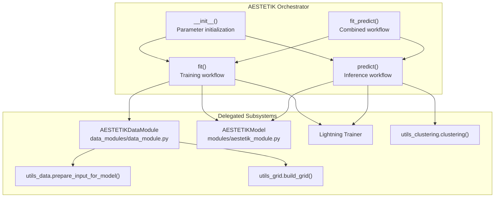
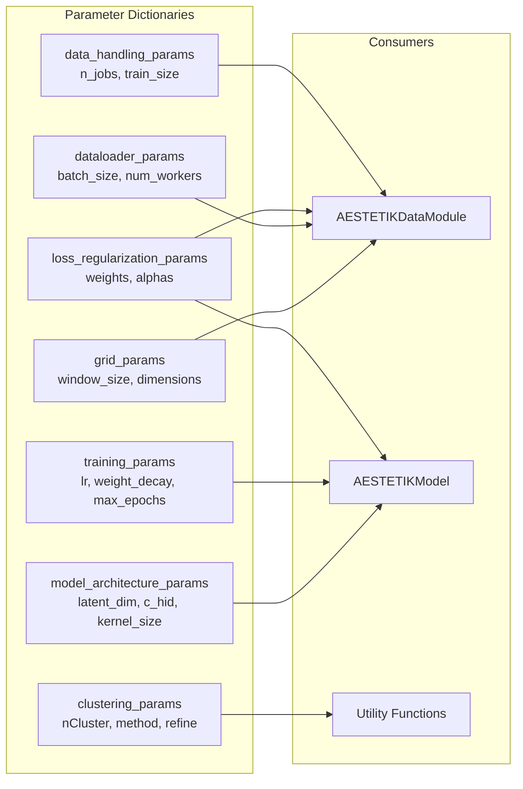
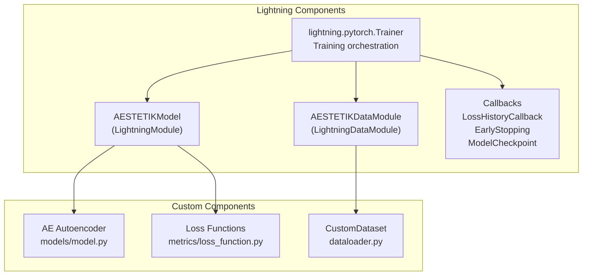
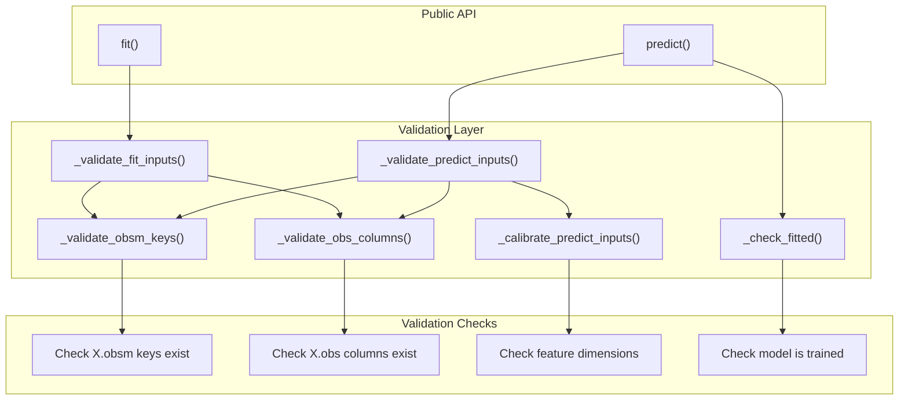
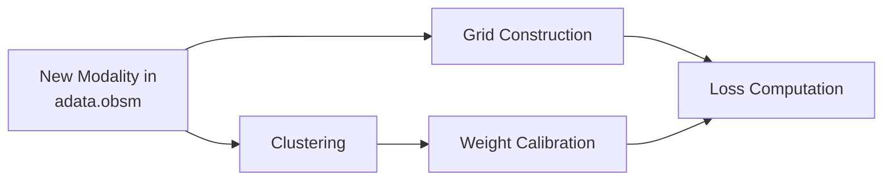
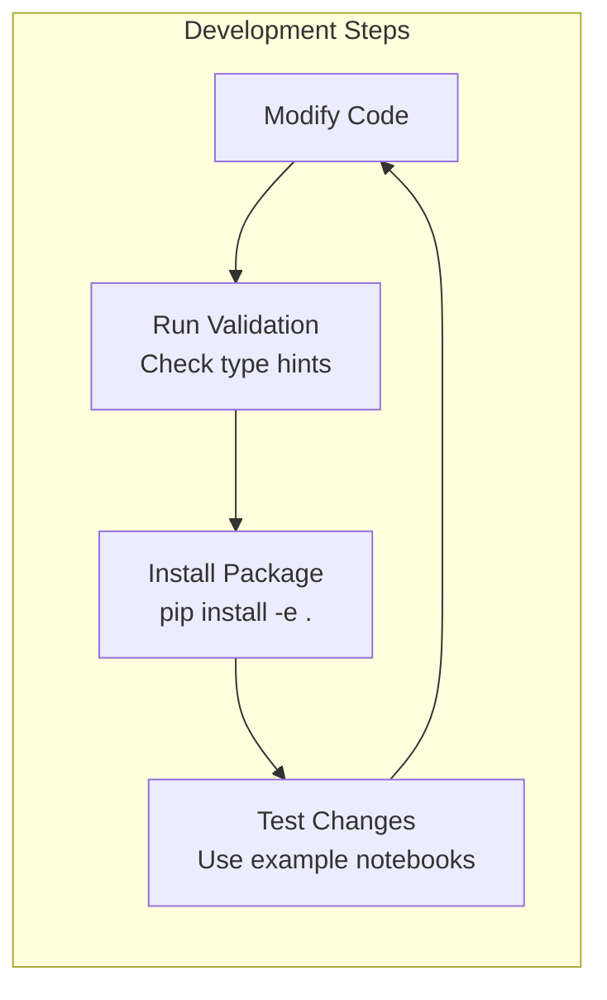
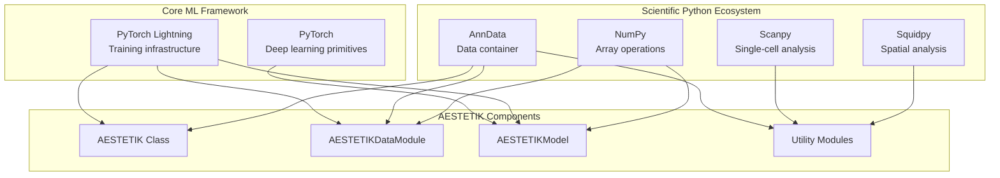
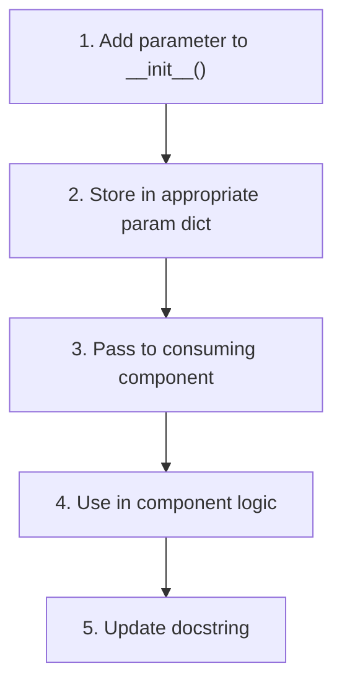

# Developer Guide

<details>
<summary>Relevant source files</summary>

The following files were used as context for generating this wiki page:

- [.codeboarding/on_boarding.md](.codeboarding/on_boarding.md)
- [src/aestetik/AESTETIK.py](src/aestetik/AESTETIK.py)

</details>


## Purpose and Scope

This guide provides technical information for developers who want to contribute to, extend, or deeply understand the AESTETIK codebase. It covers code organization, architecture patterns, extension points, and development workflows.

For information about using AESTETIK as an end-user, see the [User Guide](#4). For detailed API documentation, see the [API Reference](#5). For system architecture from a high-level perspective, see [System Architecture](#6.1).

---

## Code Organization

AESTETIK follows a modular structure where each component has a specific responsibility. The codebase is organized into the following main directories:

### Directory Structure

```
src/aestetik/
├── AESTETIK.py              # Main orchestrator class
├── data_modules/
│   └── data_module.py       # Lightning DataModule implementation
├── modules/
│   └── aestetik_module.py   # Lightning module wrapper
├── models/
│   └── model.py             # Core autoencoder architecture
├── metrics/
│   └── loss_function.py     # Loss computation functions
├── callbacks/
│   └── callbacks.py         # Training callbacks
├── utils/
│   ├── utils_data.py        # Data preparation utilities
│   ├── utils_grid.py        # Spatial grid construction
│   ├── utils_clustering.py  # Clustering algorithms
│   └── utils_visualization.py # Plotting utilities
└── dataloader.py            # Custom dataset implementation
```

### Module Responsibilities

| Module | Primary Responsibility | Key Classes/Functions |
|--------|------------------------|----------------------|
| `AESTETIK.py` | User-facing API and workflow orchestration | `AESTETIK` |
| `data_modules/` | Lightning-compatible data loading and batching | `AESTETIKDataModule` |
| `modules/` | Training/inference wrapper with Lightning integration | `AESTETIKModel` |
| `models/` | Neural network architecture definition | `AE`, `Encoder`, `Decoder` |
| `metrics/` | Loss function implementations | `calculate_loss` |
| `callbacks/` | Training event handlers | `LossHistoryCallback` |
| `utils/` | Preprocessing, clustering, visualization | Various utility functions |
| `dataloader.py` | Custom PyTorch dataset | `CustomDataset` |

**Sources:** [src/aestetik/AESTETIK.py:1-545](), [.codeboarding/on_boarding.md:1-78]()

---

## Core Architecture Patterns

### Orchestrator Pattern

The `AESTETIK` class acts as a thin orchestrator that delegates to specialized subsystems. It does not contain business logic; instead, it coordinates data preparation, model training, and inference.



**Key Methods:**
- `fit()` at [src/aestetik/AESTETIK.py:179-238]() orchestrates training
- `predict()` at [src/aestetik/AESTETIK.py:240-282]() orchestrates inference
- `fit_predict()` at [src/aestetik/AESTETIK.py:284-332]() chains both workflows

**Sources:** [src/aestetik/AESTETIK.py:24-174](), [src/aestetik/AESTETIK.py:179-332]()

---

### Parameter Management Strategy

AESTETIK uses a dictionary-based parameter management system. All configuration is stored in structured dictionaries initialized in `__init__()`:



**Parameter Dictionary Definitions:**
- `grid_params` at [src/aestetik/AESTETIK.py:120-124]()
- `model_architecture_params` at [src/aestetik/AESTETIK.py:126-133]()
- `dataloader_params` at [src/aestetik/AESTETIK.py:135-138]()
- `training_params` at [src/aestetik/AESTETIK.py:140-144]()
- `clustering_params` at [src/aestetik/AESTETIK.py:146-151]()
- `loss_regularization_params` at [src/aestetik/AESTETIK.py:153-161]()
- `data_handling_params` at [src/aestetik/AESTETIK.py:163-166]()

**Design Rationale:** This pattern allows passing multiple related parameters as a single object, making method signatures cleaner and enabling grouped validation.

**Sources:** [src/aestetik/AESTETIK.py:29-166]()

---

### Lightning Integration Pattern

AESTETIK leverages PyTorch Lightning for training infrastructure, following the Lightning module pattern:



**Key Lightning Methods:**
- `training_step()` - Implements forward pass and loss computation
- `validation_step()` - Validates during training
- `predict_step()` - Generates embeddings during inference
- `configure_optimizers()` - Sets up optimizer and learning rate

**Lightning Components Used:**
- `Trainer` at [src/aestetik/AESTETIK.py:234-237]()
- `LightningModule` wrapper in `AESTETIKModel`
- `LightningDataModule` in `AESTETIKDataModule`
- Callbacks at [src/aestetik/AESTETIK.py:449-467]()

**Sources:** [src/aestetik/AESTETIK.py:6-12](), [src/aestetik/AESTETIK.py:234-238]()

---

### Validation Strategy

AESTETIK follows a consistent validation pattern with private methods prefixed by `_validate_`:



**Validation Method Naming Convention:**
- `_validate_*` - Raises exceptions if inputs are invalid
- `_check_*` - Verifies internal state
- `_calibrate_*` - Adjusts inputs to match requirements

**Key Validation Methods:**
- `_validate_fit_inputs()` at [src/aestetik/AESTETIK.py:337-343]()
- `_validate_predict_inputs()` at [src/aestetik/AESTETIK.py:345-367]()
- `_validate_obsm_keys()` at [src/aestetik/AESTETIK.py:373-382]()
- `_validate_obs_columns()` at [src/aestetik/AESTETIK.py:384-393]()
- `_check_fitted()` at [src/aestetik/AESTETIK.py:369-371]()
- `_calibrate_predict_inputs()` at [src/aestetik/AESTETIK.py:410-425]()

**Sources:** [src/aestetik/AESTETIK.py:334-426]()

---

## Extension Points

### Adding Custom Clustering Methods

The clustering system is extensible through the `clustering()` function in `utils_clustering.py`. Currently supported methods: `"bgm"`, `"kmeans"`, `"louvain"`, `"leiden"`.

**To add a new clustering method:**

1. Modify the `clustering()` function to accept your new method name
2. Implement the clustering algorithm following the existing pattern
3. Ensure it returns cluster assignments compatible with `anndata.obs`
4. Update the type hint in `AESTETIK.__init__()` at [src/aestetik/AESTETIK.py:46]()

**Example Extension Points:**
- Initial clustering at data preparation: called from `utils_data.prepare_input_for_model()`
- Final clustering after embedding: called from `_postprocess_predictions()` at [src/aestetik/AESTETIK.py:514-520]()

**Sources:** [src/aestetik/AESTETIK.py:46](), [src/aestetik/AESTETIK.py:514-520]()

---

### Custom Loss Functions

Loss computation is centralized in `metrics/loss_function.py`. The `AESTETIKModel` computes separate losses for transcriptomics and morphology modalities.

**To add a custom loss component:**

1. Modify `calculate_loss()` in `metrics/loss_function.py`
2. Add parameters to `loss_regularization_params` in `AESTETIK.__init__()` at [src/aestetik/AESTETIK.py:153-161]()
3. Pass parameters to `AESTETIKModel` via `training_step_params` at [src/aestetik/AESTETIK.py:529-531]()

**Current Loss Components:**
- Reconstruction loss (L1Loss)
- Triplet loss (TripletMarginLoss)
- Separate weighting for transcriptomics and morphology
- Configurable alpha values: `rec_alpha`, `triplet_alpha`

**Sources:** [src/aestetik/AESTETIK.py:153-161](), [src/aestetik/AESTETIK.py:529-531]()

---

### Custom Callbacks

AESTETIK uses PyTorch Lightning callbacks for training events. Callbacks are created in `_create_callbacks()` at [src/aestetik/AESTETIK.py:449-467]().

**Built-in Callbacks:**
- `LossHistoryCallback` - Records loss history for visualization
- `EarlyStopping` - Stops training when validation loss plateaus
- `ModelCheckpoint` - Saves best model based on validation loss

**To add a custom callback:**

1. Create a class inheriting from `lightning.pytorch.callbacks.Callback`
2. Implement hook methods (e.g., `on_epoch_end`, `on_batch_end`)
3. Add to the callbacks list in `_create_callbacks()`

**Example Callback Location:**
[src/aestetik/callbacks/callbacks.py]() contains `LossHistoryCallback` implementation.

**Sources:** [src/aestetik/AESTETIK.py:11-12](), [src/aestetik/AESTETIK.py:449-467]()

---

### Adding New Data Modalities

AESTETIK currently supports transcriptomics and morphology. To add a new modality:

**Required Changes:**

1. **Grid Construction:** Modify `utils_grid.py` to incorporate the new modality's features into spatial grids
2. **Weight Calibration:** Update `utils_data.calibrate_weights()` to handle the new modality's quality assessment
3. **Loss Computation:** Extend loss functions in `metrics/loss_function.py` to support the new modality
4. **Parameter Dictionary:** Add modality-specific weights to `loss_regularization_params`

**Data Flow for New Modalities:**



**Sources:** [src/aestetik/AESTETIK.py:153-161]()

---

## Development Workflow

### Code Modification Workflow



**Key Development Commands:**

```bash
# Install in editable mode
pip install -e .

# Run example notebooks for testing
# Located in examples/ directory
jupyter notebook examples/gettingStartedWithAESTETIK.ipynb
```

**Sources:** [.codeboarding/on_boarding.md:1-78]()

---

### Private Method Naming Convention

AESTETIK follows a strict naming convention for method visibility:

| Prefix | Visibility | Purpose | Example |
|--------|-----------|---------|---------|
| No prefix | Public | User-facing API | `fit()`, `predict()` |
| `_` | Private | Internal implementation | `_validate_fit_inputs()` |
| `@staticmethod` | Static utility | No instance state required | `version()` |

**Categories of Private Methods:**

1. **Validation:** `_validate_*`, `_check_*` - Input validation and state checking
2. **Data Preparation:** `_set_*`, `_calibrate_*` - Parameter setup and adjustment
3. **Computation:** `_compute_*` - Core computation logic
4. **Construction:** `_build_*`, `_create_*` - Object initialization
5. **Postprocessing:** `_postprocess_*` - Result transformation

**Example Private Methods:**
- [src/aestetik/AESTETIK.py:337-393]() - Validation methods
- [src/aestetik/AESTETIK.py:398-425]() - Data preparation methods
- [src/aestetik/AESTETIK.py:489-520]() - Computation and postprocessing methods

**Sources:** [src/aestetik/AESTETIK.py:334-542]()

---

## Key Dependencies and Their Roles

### Dependency Architecture



### Dependency Responsibilities

| Dependency | Version Constraint | Primary Use Cases |
|------------|-------------------|-------------------|
| `torch` | >= 1.10 | Neural network implementation, tensor operations |
| `lightning` | >= 2.0 | Training loops, callbacks, distributed training |
| `anndata` | - | Data structure for spots and features |
| `scanpy` | - | Clustering algorithms, data processing |
| `squidpy` | - | Spatial analysis, cluster refinement |
| `numpy` | - | Array operations, data manipulation |
| `scikit-learn` | - | Scaling, KDTree for spatial queries |

**Import Locations:**
- Core imports at [src/aestetik/AESTETIK.py:1-22]()
- Lightning components at [src/aestetik/AESTETIK.py:6-12]()

**Sources:** [src/aestetik/AESTETIK.py:1-22]()

---

## Testing Strategy

### Testing Through Example Notebooks

AESTETIK uses Jupyter notebooks in the `examples/` directory as integration tests. The primary notebook `gettingStartedWithAESTETIK.ipynb` demonstrates:

- Complete workflow from data loading to visualization
- Expected input/output formats
- Common parameter configurations
- Error handling examples

**Testing Best Practices:**

1. **Modify code** - Make changes to source files
2. **Reinstall** - Run `pip install -e .` to update the installation
3. **Run notebook** - Execute example notebook cells to verify behavior
4. **Check outputs** - Validate that results match expected patterns

**Sources:** [.codeboarding/on_boarding.md:26-33]()

---

## Common Development Tasks

### Adding a New Hyperparameter



**Example: Adding `new_param` to model architecture:**

1. Add to `__init__()` signature at [src/aestetik/AESTETIK.py:29-57]()
2. Store in `model_architecture_params` at [src/aestetik/AESTETIK.py:126-133]()
3. Pass to `AESTETIKModel` at [src/aestetik/AESTETIK.py:537-541]()
4. Access in model implementation
5. Document in docstring at [src/aestetik/AESTETIK.py:58-116]()

**Sources:** [src/aestetik/AESTETIK.py:29-133](), [src/aestetik/AESTETIK.py:525-541]()

---

### Debugging Training Issues

**Key Logging Points:**

- Data module initialization: [src/aestetik/AESTETIK.py:216]()
- Model building: [src/aestetik/AESTETIK.py:527]()
- Training start: [src/aestetik/AESTETIK.py:233]()

**Accessing Training History:**

After `fit()`, loss history is available in `AESTETIK.losses` at [src/aestetik/AESTETIK.py:238]().

**Common Issues:**

| Issue | Likely Cause | Debug Location |
|-------|--------------|----------------|
| Input validation error | Missing keys in `adata.obsm` or `adata.obs` | [src/aestetik/AESTETIK.py:337-393]() |
| Dimension mismatch | Inconsistent feature dimensions | [src/aestetik/AESTETIK.py:352-366]() |
| Training not starting | Model not fitted before predict | [src/aestetik/AESTETIK.py:369-371]() |

**Sources:** [src/aestetik/AESTETIK.py:216](), [src/aestetik/AESTETIK.py:233-238](), [src/aestetik/AESTETIK.py:337-393]()

---

## Design Decisions

### Why Parameter Dictionaries?

AESTETIK groups related parameters into dictionaries rather than passing individual arguments. This design:

- **Reduces method signatures** - Avoids methods with 15+ parameters
- **Enables grouped validation** - Related parameters validated together
- **Facilitates parameter passing** - Single object passed to multiple components
- **Supports future extension** - New parameters added without changing signatures

**Trade-off:** Less explicit than individual parameters, but improves maintainability at scale.

**Sources:** [src/aestetik/AESTETIK.py:120-166]()

---

### Why Lightning Integration?

PyTorch Lightning provides:

- **Training boilerplate reduction** - No manual training loops
- **Callback system** - Easy extension without modifying core code
- **Distributed training** - Future scalability without code changes
- **Best practices enforcement** - Separation of concerns between model and training logic

**Trade-off:** Additional dependency and learning curve, but significantly reduces maintenance burden.

**Sources:** [src/aestetik/AESTETIK.py:6](), [src/aestetik/AESTETIK.py:234-237]()

---

### Why AnnData Throughout?

AnnData serves as the universal data container because:

- **Ecosystem compatibility** - Seamless integration with scanpy/squidpy
- **Standardized structure** - `.obsm` for features, `.obs` for metadata
- **In-place modification** - Results stored directly in input object
- **Interoperability** - Easy data exchange with other spatial transcriptomics tools

**Trade-off:** Tighter coupling to the scanpy ecosystem, but enables powerful integrations.

**Sources:** [src/aestetik/AESTETIK.py:1](), [src/aestetik/AESTETIK.py:180-187]()

---

## Version Information

The static method `version()` at [src/aestetik/AESTETIK.py:543-545]() returns the current version string.

For detailed information about versioning and citation tracking, see [Project Metadata and Citations](#6.3).

**Sources:** [src/aestetik/AESTETIK.py:543-545]()

---