# System Architecture

<details>
<summary>Relevant source files</summary>

The following files were used as context for generating this wiki page:

- [.codeboarding/AESTETIK_API_Orchestration.md](.codeboarding/AESTETIK_API_Orchestration.md)
- [.codeboarding/on_boarding.md](.codeboarding/on_boarding.md)
- [src/aestetik/AESTETIK.py](src/aestetik/AESTETIK.py)
- [src/aestetik/modules/aestetik_module.py](src/aestetik/modules/aestetik_module.py)

</details>


## Purpose and Scope

This document provides a comprehensive technical overview of AESTETIK's internal architecture, component interactions, and design patterns. It is intended for developers who need to understand the system's internals for contribution, extension, or debugging purposes.

This page focuses on architectural design and component relationships. For specific API usage patterns, see [User Guide](#4). For detailed class and method documentation, see [API Reference](#5). For development environment setup, see [Development Setup](#6.2).

---

## Architectural Layers

AESTETIK follows a layered architecture with clear separation of concerns. The system is organized into five primary layers, each with distinct responsibilities.

### Layer Diagram

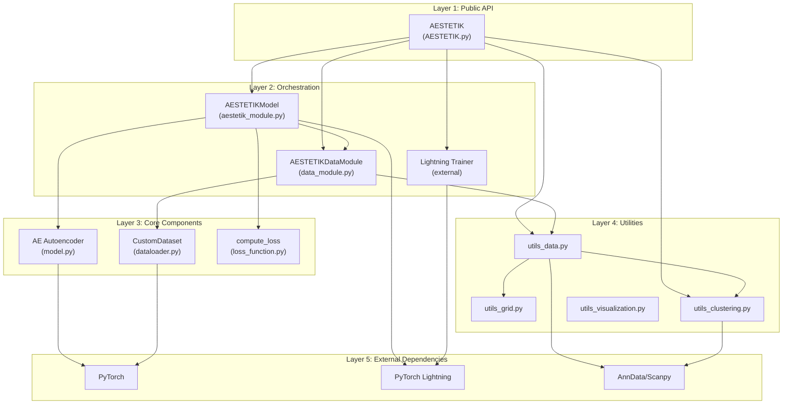

**Sources:** [src/aestetik/AESTETIK.py](), [src/aestetik/modules/aestetik_module.py](), [src/aestetik/data_modules/data_module.py]()

### Layer Responsibilities

| Layer | Components | Primary Responsibilities |
|-------|-----------|-------------------------|
| **Public API** | `AESTETIK` class | User-facing interface, parameter validation, workflow orchestration |
| **Orchestration** | `AESTETIKDataModule`, `AESTETIKModel`, `Trainer` | Training/inference coordination, data preparation, checkpoint management |
| **Core Components** | `AE`, `CustomDataset`, `compute_loss` | Model architecture, data batching, loss computation |
| **Utilities** | `utils_*` modules | Preprocessing, grid construction, clustering, visualization |
| **External Dependencies** | PyTorch, Lightning, AnnData | Framework primitives and data structures |

**Sources:** [src/aestetik/AESTETIK.py:24-173](), [src/aestetik/modules/aestetik_module.py:14-65]()

---

## Core Component Interactions

### AESTETIK Class: The Orchestrator

The `AESTETIK` class acts as a facade, exposing three primary methods while managing complex internal state through parameter dictionaries.

#### Parameter Organization

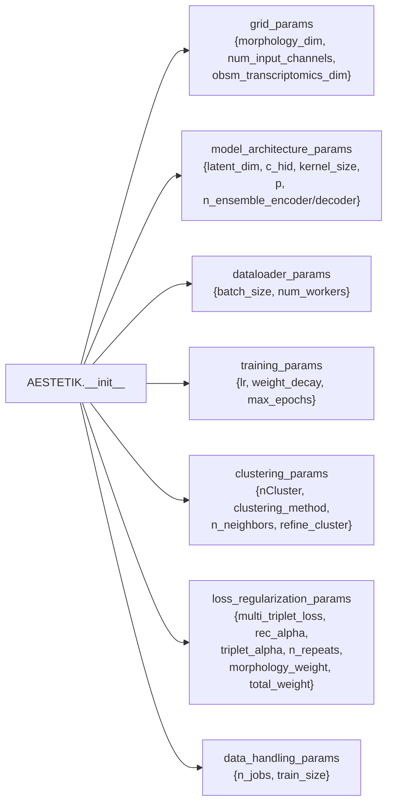

**Sources:** [src/aestetik/AESTETIK.py:120-166]()

#### Method Delegation Pattern

The `AESTETIK` class follows a delegation pattern where public methods orchestrate private methods:

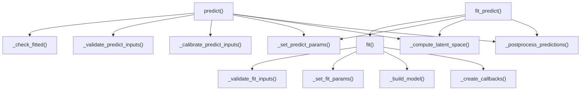

**Sources:** [src/aestetik/AESTETIK.py:179-332]()

---

## Data Flow Architecture

### Training Data Flow

The training data flow involves transformation through multiple stages before reaching the model.

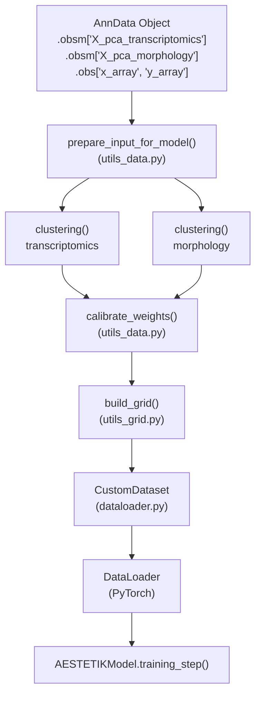

**Sources:** [src/aestetik/data_modules/data_module.py](), [src/aestetik/utils/utils_data.py](), [src/aestetik/utils/utils_grid.py]()

### Data Transformations Table

| Stage | Input | Output | Key Operations |
|-------|-------|--------|----------------|
| **Clustering** | `X.obsm[used_obsm_*]` | `X.obs['cluster_transcriptomics']`, `X.obs['cluster_morphology']` | BGM/KMeans/Louvain/Leiden clustering |
| **Weight Calibration** | Cluster labels | `transcriptomics_weight`, `morphology_weight` | Silhouette score comparison |
| **Grid Construction** | Features + spatial coords | `X.obsm['X_st_grid']` (N × C × H × W) | KDTree neighbor search, MinMaxScaling |
| **Dataset Creation** | Grids + cluster labels | Batches of (anchor, pos_list, neg_list) | Triplet sampling with `n_repeats` |

**Sources:** [src/aestetik/utils/utils_data.py](), [src/aestetik/utils/utils_grid.py](), [src/aestetik/dataloader.py]()

### Prediction Data Flow

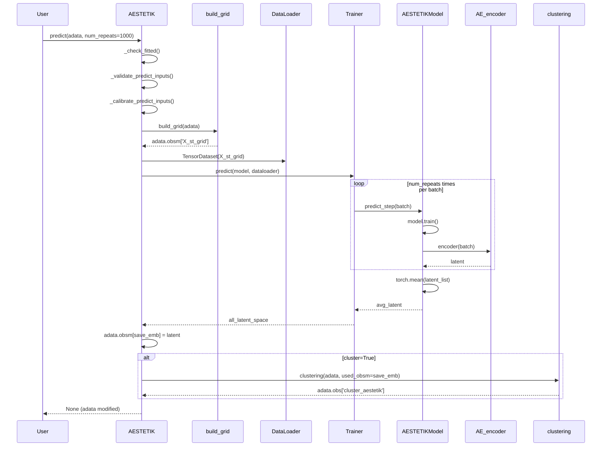

**Sources:** [src/aestetik/AESTETIK.py:240-282](), [src/aestetik/modules/aestetik_module.py:142-161]()

---

## Model Architecture Components

### AESTETIKModel: Lightning Module Wrapper

The `AESTETIKModel` wraps the core autoencoder in a PyTorch Lightning module, managing the training loop.

#### Component Relationships

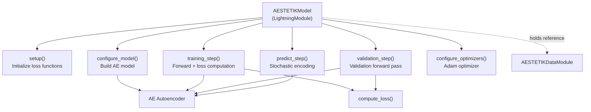

**Sources:** [src/aestetik/modules/aestetik_module.py:14-185]()

#### Training Step Breakdown

The `training_step` method [src/aestetik/modules/aestetik_module.py:93-117]() performs:

1. **Batch unpacking**: `anchor, pos_transcriptomics_list, neg_transcriptomics_list, pos_morphology_list, neg_morphology_list = batch`
2. **Forward pass**: `anchor_encode, anchor_decode = self.model(x=anchor)`
3. **Loss computation**: Calls `compute_loss()` with all components
4. **Logging**: Logs `L` (total), `RC` (reconstruction transcriptomics), `RI` (reconstruction morphology), `TC` (triplet transcriptomics), `TI` (triplet morphology)

**Sources:** [src/aestetik/modules/aestetik_module.py:93-117]()

### AE Autoencoder: Ensemble Architecture

The actual model architecture is defined in `src/aestetik/models/model.py`. It implements an ensemble of encoder-decoder pairs with median aggregation.

#### Ensemble Structure

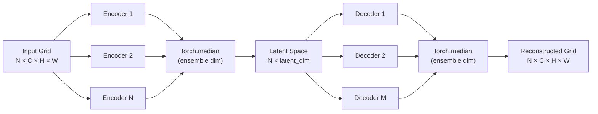

**Sources:** [src/aestetik/models/model.py]()

---

## Design Patterns and Principles

### 1. Parameter Dictionary Pattern

AESTETIK organizes related parameters into dictionaries that flow through the system:

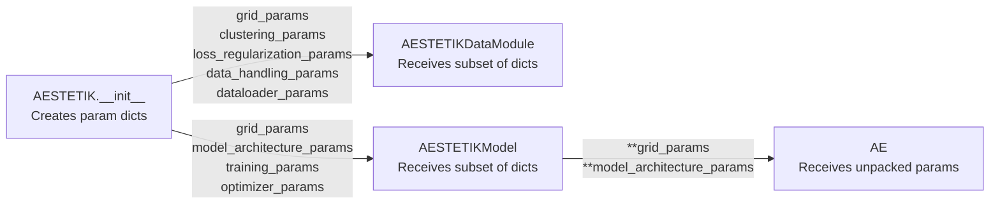

This pattern provides:
- **Encapsulation**: Related parameters grouped together
- **Flexibility**: Easy to pass subsets to different components
- **Validation**: Centralized parameter checking in `_validate_params()`

**Sources:** [src/aestetik/AESTETIK.py:120-166](), [src/aestetik/modules/aestetik_module.py:15-21]()

### 2. Lazy Initialization Pattern

The `AESTETIKModel` defers model construction until data characteristics are known:

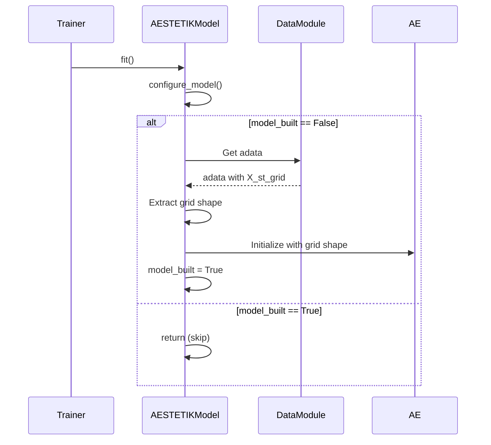

**Sources:** [src/aestetik/modules/aestetik_module.py:80-90]()

### 3. Strategy Pattern for Clustering

Multiple clustering algorithms are supported through a unified interface:

| Method | Implementation | Parameters |
|--------|---------------|-----------|
| `"bgm"` | Bayesian Gaussian Mixture | `nCluster` (int) |
| `"kmeans"` | KMeans | `nCluster` (int) |
| `"louvain"` | Scanpy Louvain | `nCluster` (float resolution) |
| `"leiden"` | Scanpy Leiden | `nCluster` (float resolution) |

The `clustering()` function [src/aestetik/utils/utils_clustering.py]() selects the appropriate strategy based on `method` parameter.

**Sources:** [src/aestetik/utils/utils_clustering.py](), [src/aestetik/AESTETIK.py:146-151]()

### 4. Template Method Pattern in DataModule

`AESTETIKDataModule` implements PyTorch Lightning's `LightningDataModule` interface:

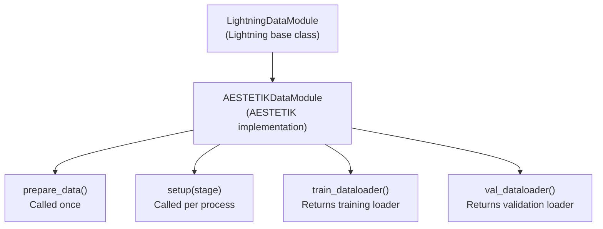

**Sources:** [src/aestetik/data_modules/data_module.py]()

---

## Integration with External Frameworks

### PyTorch Lightning Integration Points

AESTETIK leverages PyTorch Lightning's infrastructure:

| Lightning Component | AESTETIK Usage | Location |
|---------------------|----------------|----------|
| `LightningModule` | `AESTETIKModel` extends it | [src/aestetik/modules/aestetik_module.py:14]() |
| `LightningDataModule` | `AESTETIKDataModule` extends it | [src/aestetik/data_modules/data_module.py]() |
| `Trainer` | Created in `AESTETIK.fit()` | [src/aestetik/AESTETIK.py:234-237]() |
| `Callback` | `LossHistoryCallback`, `EarlyStopping`, `ModelCheckpoint` | [src/aestetik/callbacks/callbacks.py](), [src/aestetik/AESTETIK.py:449-467]() |

**Trainer Configuration:**

```python
self.trainer = Trainer(
    max_epochs=self.training_params["max_epochs"],
    callbacks=callbacks,
    num_sanity_val_steps=0
)
```

**Sources:** [src/aestetik/AESTETIK.py:234-237]()

### AnnData Integration Pattern

AESTETIK follows scanpy conventions for data storage:

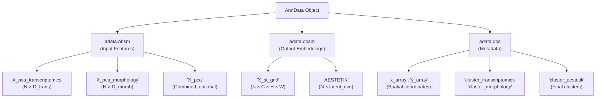

**Sources:** [src/aestetik/AESTETIK.py:337-393](), [src/aestetik/utils/utils_data.py]()

---

## Component Lifecycle Management

### Fit Lifecycle

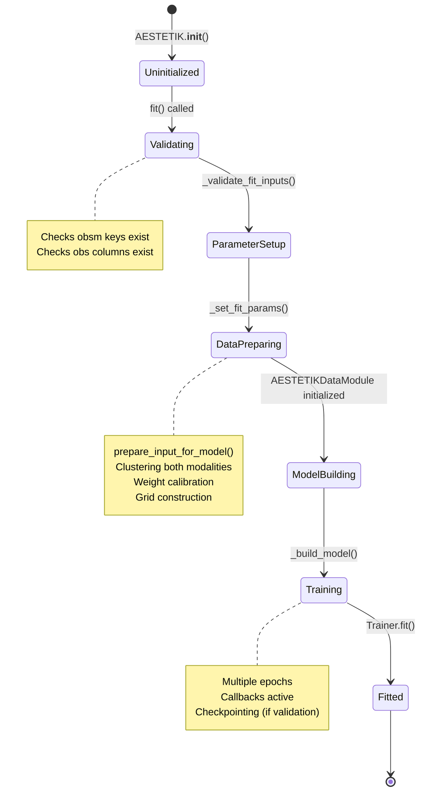

**Sources:** [src/aestetik/AESTETIK.py:179-238]()

### Predict Lifecycle

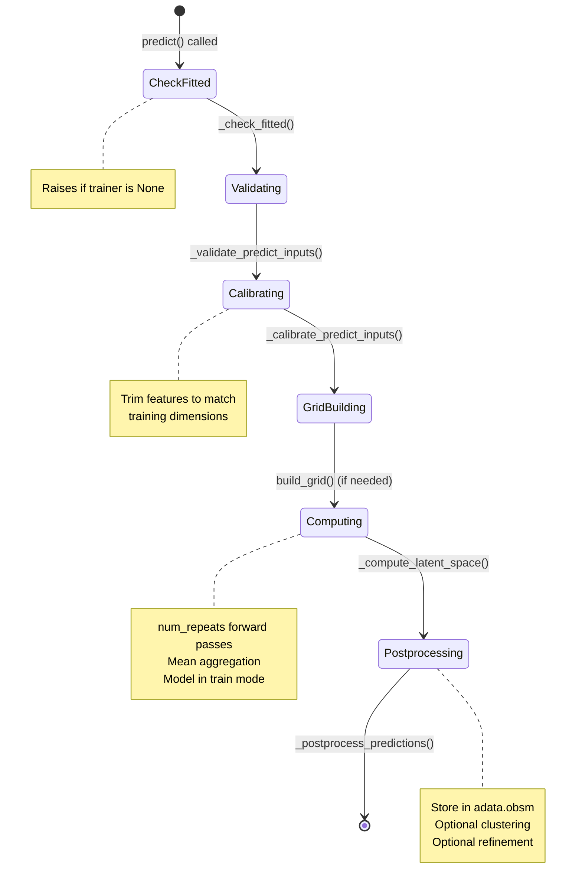

**Sources:** [src/aestetik/AESTETIK.py:240-282](), [src/aestetik/AESTETIK.py:369-426]()

### State Management

The `AESTETIK` class maintains minimal mutable state:

| Attribute | Type | Set During | Purpose |
|-----------|------|------------|---------|
| `lit_aestetik_model` | `Optional[AESTETIKModel]` | `fit()` | Reference to trained model |
| `trainer` | `Optional[Trainer]` | `fit()` | Reference to Lightning trainer |
| `losses` | `dict` | `fit()` | Training history from callbacks |
| Various `*_params` dicts | `dict` | `__init__()` | Configuration storage |

**Sources:** [src/aestetik/AESTETIK.py:170-171](), [src/aestetik/AESTETIK.py:238]()

---

## Key Implementation Details

### Stochastic Prediction with Dropout

During prediction, the model is set to train mode to enable dropout, and multiple forward passes are averaged:

```python
self.model.train()  # Enable dropout
batch_latent_space = []

for _ in range(self.predict_params["num_repeats"]):
    out = self.model.encoder(batch_spots)
    batch_latent_space.append(out)

batch_latent_space = torch.stack(batch_latent_space, dim=0)
batch_latent_space = torch.mean(batch_latent_space, dim=0)
```

**Sources:** [src/aestetik/modules/aestetik_module.py:151-160]()

### Grid Construction with KDTree

Spatial grids are constructed using efficient KDTree neighbor search:

1. Build KDTree from `(x_array, y_array)` coordinates
2. For each spot, query `window_size × window_size` nearest neighbors
3. Fill grid with MinMaxScaled features from neighbors
4. Parallelize across spots using `n_jobs`

**Sources:** [src/aestetik/utils/utils_grid.py]()

### Weight Calibration Logic

The system automatically balances modality contributions based on clustering quality:

```python
def calibrate_weights(silhouette_transcriptomics, silhouette_morphology,
                      morphology_weight, total_weight):
    if silhouette_transcriptomics > silhouette_morphology:
        # Morphology provides weaker signal
        transcriptomics_weight = total_weight - morphology_weight
    else:
        # Transcriptomics provides weaker signal
        transcriptomics_weight = morphology_weight
        morphology_weight = total_weight - morphology_weight
    return transcriptomics_weight, morphology_weight
```

**Sources:** [src/aestetik/utils/utils_data.py]()

### Triplet Sampling Strategy

The `CustomDataset` implements triplet sampling with configurable repeats:

- **Anchor**: Random spot from dataset
- **Positives**: `n_repeats` spots from same cluster (both modalities)
- **Negatives**: `n_repeats` spots from different cluster (both modalities)
- Sampling ensures diverse triplets across epochs

**Sources:** [src/aestetik/dataloader.py]()

---

## Summary

AESTETIK's architecture demonstrates several key design principles:

1. **Separation of Concerns**: Clear boundaries between API, orchestration, core components, and utilities
2. **Framework Integration**: Deep integration with PyTorch Lightning and AnnData ecosystems
3. **Flexible Configuration**: Parameter dictionaries enable modular component configuration
4. **Lazy Initialization**: Components constructed only when data characteristics are known
5. **Ensemble Robustness**: Multiple encoder/decoder instances with median aggregation
6. **Stochastic Inference**: Monte Carlo dropout for uncertainty-aware predictions

The system's modular design allows for extension at multiple points: custom clustering methods, alternative model architectures, different loss functions, and additional preprocessing utilities.

**Sources:** [src/aestetik/AESTETIK.py](), [src/aestetik/modules/aestetik_module.py](), [src/aestetik/data_modules/data_module.py](), [src/aestetik/models/model.py]()

---