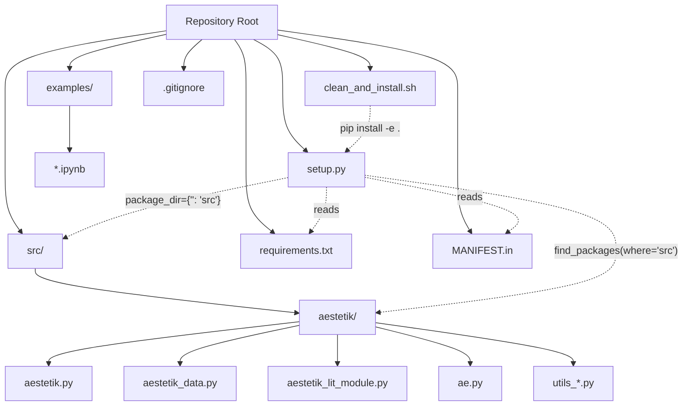
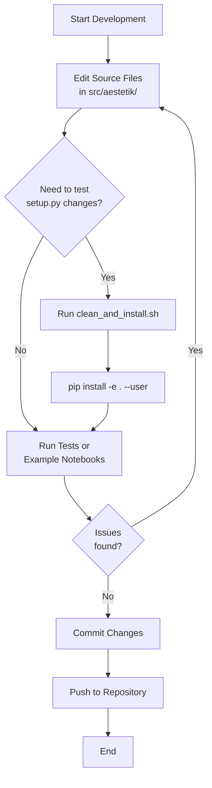
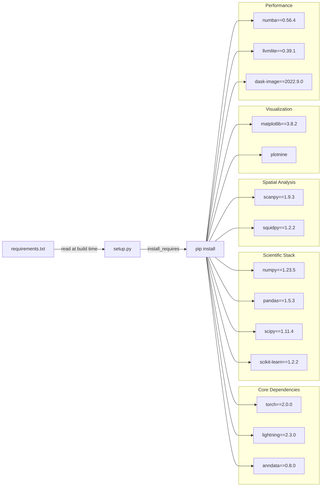
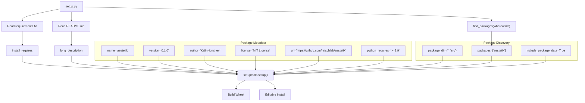
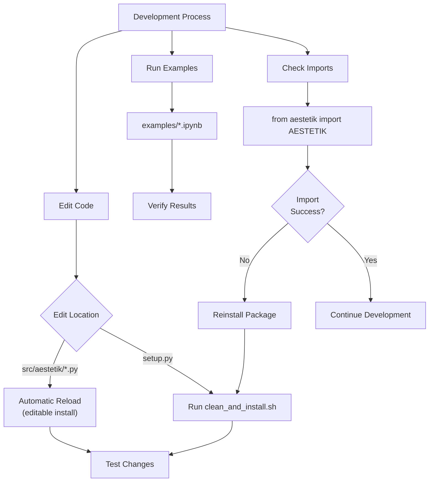

# Development Setup

<details>
<summary>Relevant source files</summary>

The following files were used as context for generating this wiki page:

- [.gitignore](.gitignore)
- [MANIFEST.in](MANIFEST.in)
- [clean_and_install.sh](clean_and_install.sh)
- [requirements.txt](requirements.txt)
- [setup.py](setup.py)

</details>


## Purpose and Scope

This document provides guidance for developers who want to contribute to or extend AESTETIK. It covers development environment setup, package structure, development workflows, and build processes.

For end-user installation instructions, see [Installation](#2.1). For architectural details about AESTETIK's internal design, see [System Architecture](#6.1).

---

## Prerequisites

### Required Software

| Software | Minimum Version | Purpose |
|----------|----------------|---------|
| Python | 3.9 | Core language requirement specified in [setup.py:21]() |
| pip | Latest | Package installation |
| git | Any recent | Source control |

### Recommended Tools

- Virtual environment manager (`venv`, `conda`, or `virtualenv`)
- Development IDE or text editor with Python support
- Jupyter for running example notebooks

**Sources:** [setup.py:21](), [requirements.txt:1-16]()

---

## Repository Structure

### Package Organization



**Package Structure Details:**

The AESTETIK package uses a `src/` layout pattern, which is configured in [setup.py:16-17]():

- **`src/`**: Root for all package code
- **`src/aestetik/`**: Main package directory containing all modules
- **`examples/`**: Jupyter notebooks demonstrating usage
- **`setup.py`**: Package metadata and build configuration
- **`requirements.txt`**: Pinned dependency versions
- **`MANIFEST.in`**: Additional files to include in distribution

**Sources:** [setup.py:16-17](), [MANIFEST.in:1-2]()

---

## Development Environment Setup

### Step 1: Clone Repository

```bash
git clone https://github.com/ratschlab/aestetik.git
cd aestetik
```

### Step 2: Create Virtual Environment

**Using venv:**
```bash
python -m venv aestetik-dev
source aestetik-dev/bin/activate  # On Windows: aestetik-dev\Scripts\activate
```

**Using conda:**
```bash
conda create -n aestetik-dev python=3.9
conda activate aestetik-dev
```

### Step 3: Install in Editable Mode

**Manual installation:**
```bash
pip install -e .
```

**Using provided script:**
```bash
bash clean_and_install.sh
```

The `-e` (editable) flag installs the package in development mode, where changes to source files are immediately reflected without reinstalling.

**Sources:** [setup.py:1-22](), [clean_and_install.sh:1-3]()

---

## Development Workflow

### Edit-Test-Debug Cycle



### When to Use `clean_and_install.sh`

The cleanup script [clean_and_install.sh:1-3]() performs three operations:

1. **Uninstall existing package**: `pip uninstall -y aestetik`
2. **Clean build artifacts**: Removes `dist/`, `aestetik.egg-info/`, `build/`
3. **Reinstall in editable mode**: `pip install -e . --user`

**Use this script when:**
- You've modified [setup.py]()
- You've added/removed package files
- You're experiencing import issues
- Build artifacts are stale

**Don't use for:**
- Regular source code edits in `src/aestetik/*.py` (editable install handles these automatically)

**Sources:** [clean_and_install.sh:1-3]()

---

## Dependency Management

### Dependency Specification



### Dependency Categories

| Category | Packages | Purpose |
|----------|----------|---------|
| Deep Learning | `torch`, `torchvision`, `lightning` | Model implementation and training |
| Data Structures | `anndata`, `pandas`, `numpy` | Data handling and manipulation |
| Spatial Analysis | `scanpy`, `squidpy` | Single-cell and spatial transcriptomics |
| Clustering | `scikit-learn`, `scipy` | Clustering algorithms |
| Performance | `numba`, `llvmlite`, `dask-image` | JIT compilation and parallel processing |
| Visualization | `matplotlib`, `plotnine` | Plotting and visualization |

### Version Pinning Strategy

All dependencies in [requirements.txt:1-16]() use exact version pinning (`==`) to ensure reproducible environments. This is critical for:

- Reproducible scientific results
- Consistent behavior across development machines
- Avoiding breaking changes from upstream packages

**When updating dependencies:**
1. Test thoroughly with new versions
2. Update version in [requirements.txt]()
3. Run `bash clean_and_install.sh` to rebuild
4. Verify all tests and examples still work

**Sources:** [requirements.txt:1-16](), [setup.py:4-5,20]()

---

## Build and Installation Process

### Setup.py Configuration



### Key Configuration Points

**Package Discovery** [setup.py:16-17]():
- `package_dir={'': 'src'}`: Specifies that packages are under `src/`
- `find_packages(where='src')`: Automatically discovers `aestetik` package

**Dependency Loading** [setup.py:4-5]():
```python
with open(os.path.join(os.path.dirname(__file__), "requirements.txt")) as f:
    requirements = f.read().splitlines()
```
Reads dependencies dynamically from [requirements.txt]()

**Additional Files** [setup.py:18]():
- `include_package_data=True`: Includes files specified in [MANIFEST.in:1-2]()
- Ensures `README.md` and `requirements.txt` are packaged

**Sources:** [setup.py:1-22](), [MANIFEST.in:1-2]()

---

## Ignored Files and Build Artifacts

### .gitignore Configuration

The [.gitignore:1-11]() file excludes several categories of files from version control:

| Pattern | Purpose |
|---------|---------|
| `.snakemake/` | Snakemake workflow metadata |
| `/lightning_logs` | PyTorch Lightning training logs |
| `*.log` | All log files |
| `.ipynb_checkpoints` | Jupyter notebook checkpoints |
| `aestetik.egg-info` | Build metadata directory |
| `build/` | Setuptools build directory |
| `dist/` | Distribution packages |
| `*/__pycache__/*` | Python bytecode cache |

### Cleaning Build Artifacts

The [clean_and_install.sh:2]() script removes key build artifacts:

```bash
rm -rf dist/ aestetik.egg-info/ build/
```

This ensures a clean rebuild when:
- Package structure changes
- Setup configuration is modified
- Build artifacts become corrupted

**Sources:** [.gitignore:1-11](), [clean_and_install.sh:2]()

---

## Development Best Practices

### Code Organization



### Workflow Recommendations

1. **Keep dependencies updated**: Regularly check for security updates in [requirements.txt]()

2. **Use editable installs**: Always develop with `pip install -e .` to avoid repeated reinstalls

3. **Clean build when needed**: If imports fail or behavior is unexpected, run [clean_and_install.sh]()

4. **Test with examples**: Verify changes using notebooks in `examples/` directory

5. **Maintain version consistency**: All developers should use the same pinned versions from [requirements.txt:1-16]()

6. **Respect .gitignore**: Don't commit files matching patterns in [.gitignore:1-11]()

### Common Issues

| Issue | Cause | Solution |
|-------|-------|----------|
| Import errors after editing | Stale build artifacts | Run `bash clean_and_install.sh` |
| Module not found | Package not installed | Run `pip install -e .` |
| Wrong version behavior | Multiple installations | Uninstall all, then clean install |
| Dependency conflicts | Version mismatches | Recreate virtual environment |

**Sources:** [setup.py:1-22](), [clean_and_install.sh:1-3](), [requirements.txt:1-16](), [.gitignore:1-11]()

---

## Summary

### Quick Reference Commands

```bash
# Initial setup
git clone https://github.com/ratschlab/aestetik.git
cd aestetik
python -m venv aestetik-dev
source aestetik-dev/bin/activate
pip install -e .

# Clean rebuild (when needed)
bash clean_and_install.sh

# Uninstall only
pip uninstall aestetik
```

### File Reference

| File | Purpose | When to Edit |
|------|---------|--------------|
| [setup.py]() | Package configuration | Adding dependencies, changing metadata |
| [requirements.txt]() | Dependency versions | Updating dependency versions |
| [clean_and_install.sh]() | Clean rebuild script | Never (use as-is) |
| [MANIFEST.in]() | Additional package files | Adding non-Python files to package |
| [.gitignore]() | Ignored files | Adding new file patterns to ignore |

**Sources:** [setup.py:1-22](), [requirements.txt:1-16](), [clean_and_install.sh:1-3](), [MANIFEST.in:1-2](), [.gitignore:1-11]()

---