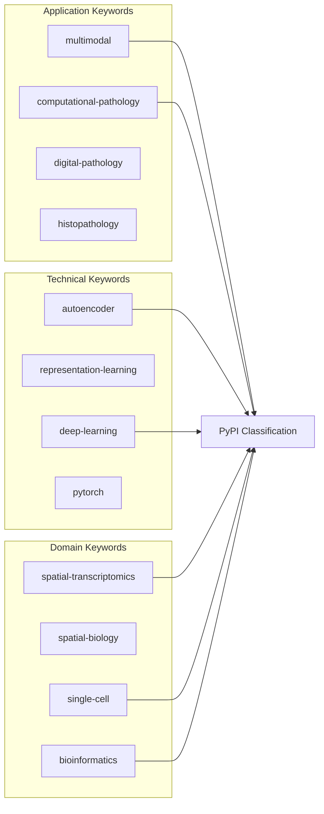
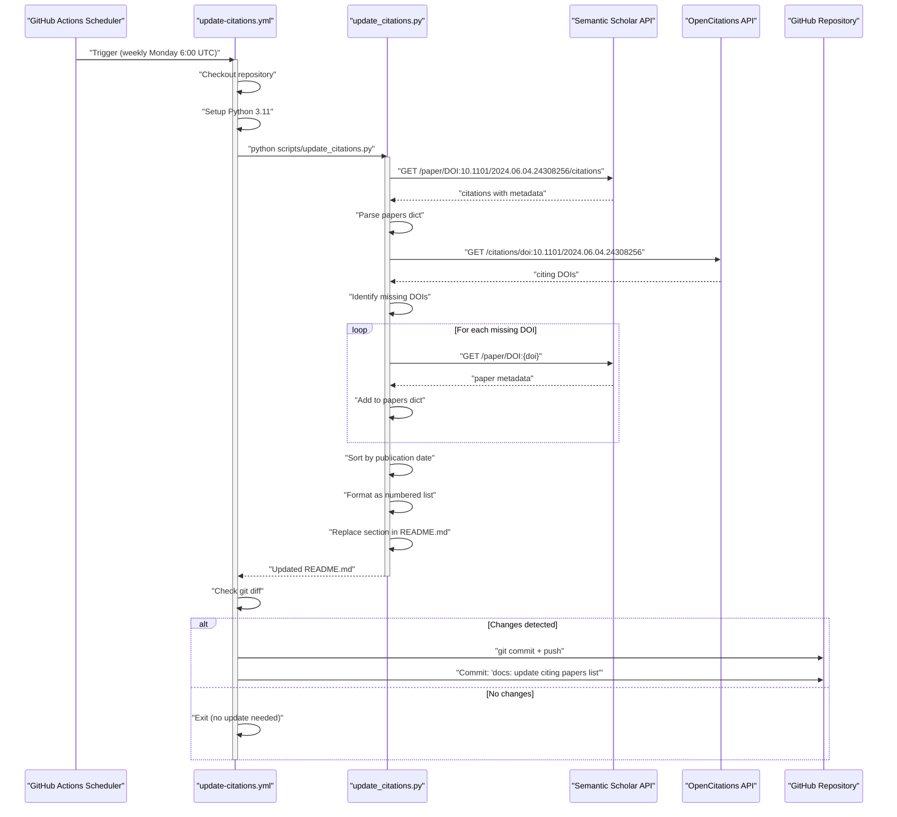
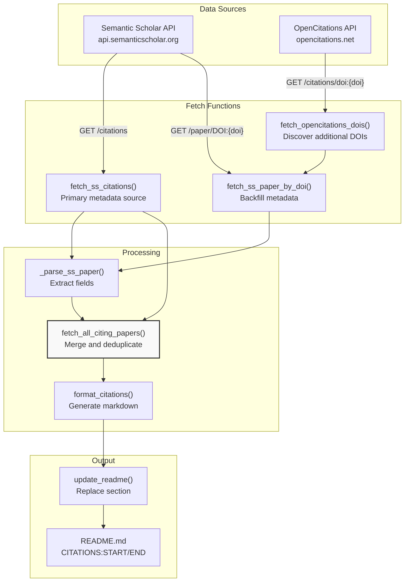

# Project Metadata and Citations

<details>
<summary>Relevant source files</summary>

The following files were used as context for generating this wiki page:

- [.github/workflows/update-citations.yml](.github/workflows/update-citations.yml)
- [CHANGELOG.md](CHANGELOG.md)
- [CITATION.cff](CITATION.cff)
- [LICENSE](LICENSE)
- [pyproject.toml](pyproject.toml)
- [scripts/update_citations.py](scripts/update_citations.py)

</details>


This page documents AESTETIK's project metadata, citation information, versioning system, and automated citation tracking infrastructure. This information is primarily relevant for developers managing releases, users citing AESTETIK in publications, and contributors updating project documentation.

For information about development workflows and testing, see [Development Setup](#6.2). For system architecture details, see [System Architecture](#6.1).

---

## Citation Information

AESTETIK uses the [Citation File Format (CFF)](https://citation-file-format.github.io/) to provide machine-readable citation metadata in [CITATION.cff:1-66]().

### Primary Citation

The preferred citation for AESTETIK is the medRxiv preprint:

**Nonchev, K., Andani, S., Ficek-Pascual, J., Nowak, M., Sobottka, B., Tumor Profiler Consortium, Koelzer, V.H., and Rätsch, G.** "Representation learning for multi-modal spatially resolved transcriptomics data." *medRxiv* (2024). DOI: [10.1101/2024.06.04.24308256](https://www.medrxiv.org/content/10.1101/2024.06.04.24308256v1)

This citation is defined in [CITATION.cff:43-65]() under the `preferred-citation` field.

### Software Citation

Users may also cite AESTETIK as software:

**Nonchev, K., Andani, S., Ficek-Pascual, J., Nowak, M., Sobottka, B., Tumor Profiler Consortium, Koelzer, V.H., and Rätsch, G.** "AESTETIK: AutoEncoder for Spatial Transcriptomics Expression with Topology and Image Knowledge" (version 0.1.0). GitHub: [https://github.com/ratschlab/aestetik](https://github.com/ratschlab/aestetik)

### Citation Metadata Structure

```mermaid
graph TB
    CFF["CITATION.cff"]
    
    subgraph "Top-Level Metadata"
        Title["title<br/>full software name"]
        Type["type: software"]
        Message["message<br/>usage instructions"]
        Version["version: 0.1.0"]
        Release["date-released: 2024-06-04"]
    end
    
    subgraph "Authors List"
        Auth1["Kalin Nonchev<br/>ORCID: 0009-0001-4904-8772"]
        Auth2["Sonali Andani"]
        Auth3["Joanna Ficek-Pascual"]
        Auth4["Marta Nowak"]
        Auth5["Bettina Sobottka"]
        Auth6["Tumor Profiler Consortium"]
        Auth7["Viktor Hendrik Koelzer"]
        Auth8["Gunnar Rätsch"]
    end
    
    subgraph "Identifiers"
        DOI["doi: 10.1101/2024.06.04.24308256<br/>medRxiv preprint"]
        Repo["repository-code<br/>GitHub URL"]
        URL["url: preprint URL"]
    end
    
    subgraph "Keywords"
        KW["spatial-transcriptomics,<br/>autoencoder,<br/>representation-learning,<br/>multimodal,<br/>computational-pathology,<br/>deep-learning,<br/>pytorch,<br/>bioinformatics"]
    end
    
    subgraph "Preferred Citation"
        PrefType["type: article"]
        PrefTitle["paper title"]
        PrefAuthors["same authors list"]
        PrefDOI["doi + journal"]
        PrefYear["year: 2024"]
    end
    
    CFF --> Title
    CFF --> Type
    CFF --> Message
    CFF --> Version
    CFF --> Release
    CFF --> Auth1
    CFF --> DOI
    CFF --> KW
    CFF --> PrefType
    
    style CFF fill:#f9f9f9,stroke:#333,stroke-width:2px
```



**Sources:** [CITATION.cff:1-66]()

---

## Project Metadata

AESTETIK's project metadata is defined in [pyproject.toml:1-47]() following the [PEP 621](https://peps.python.org/pep-0621/) specification.

### Core Metadata

| Field | Value | Location |
|-------|-------|----------|
| **Name** | `aestetik` | [pyproject.toml:6]() |
| **Version** | `0.1.0` | [pyproject.toml:7]() |
| **License** | MIT | [pyproject.toml:10](), [LICENSE:1-22]() |
| **Python Version** | `>=3.9` | [pyproject.toml:11]() |
| **Build System** | setuptools ≥64 | [pyproject.toml:2]() |

### Description

The package description emphasizes the multi-modal integration capability:

> "AESTETIK: Convolutional autoencoder for learning spot representations from spatial transcriptomics and morphology data"

**Source:** [pyproject.toml:8]()

### Keywords

AESTETIK is categorized with 12 keywords spanning spatial biology, deep learning, and computational pathology:



**Sources:** [pyproject.toml:15-28](), [CITATION.cff:27-38]()

### PyPI Classifiers

AESTETIK declares standard PyPI classifiers for discoverability:

| Classifier Type | Values |
|-----------------|--------|
| **Development Status** | Beta (4) |
| **Intended Audience** | Science/Research |
| **License** | MIT |
| **Python Versions** | 3.9, 3.10, 3.11 |
| **Topics** | AI, Bioinformatics, Medical Apps |

**Source:** [pyproject.toml:29-40]()

### Project URLs

| URL Type | Target |
|----------|--------|
| **Homepage** | https://github.com/ratschlab/aestetik |
| **Repository** | https://github.com/ratschlab/aestetik |
| **Bug Tracker** | https://github.com/ratschlab/aestetik/issues |
| **Preprint** | https://www.medrxiv.org/content/10.1101/2024.06.04.24308256v1 |

**Source:** [pyproject.toml:42-46]()

---

## Versioning and Changelog

AESTETIK follows semantic versioning principles. The current version `0.1.0` represents the initial public release.

### Version History

The [CHANGELOG.md:1-39]() documents breaking changes introduced in the June 2025 release that refactored the API to follow scikit-learn conventions:

#### Removed Components

**Methods:**
- `AESTETIK.summary()` - Removed entirely
- `AESTETIK.prepare_input_for_model()` - Integrated into `fit()`
- `AESTETIK.train()` - Replaced by `fit()`
- `AESTETIK.compute_spot()` - Replaced by `predict()`
- `AESTETIK.vizualize()` - Fixed typo, renamed to `visualize()` and moved to [utils/utils_visualization.py]()

**Instantiation parameters:** [CHANGELOG.md:13-22]() lists 9 parameters removed from `AESTETIK.__init__()`, including `adata`, `device`, and modality-specific parameters. These are now passed directly to the methods that require them.

#### Added Components

**New methods:**
- `AESTETIK.fit()` - Training interface
- `AESTETIK.predict()` - Inference interface  
- `AESTETIK.fit_predict()` - Combined training and inference

**New parameters:**
- `num_workers: int = 7` - DataLoader parallelism control

**New capabilities:**
- Cross-sample training and prediction
- Multi-sample support

**Sources:** [CHANGELOG.md:1-39]()

---

## Automated Citation Tracking

AESTETIK implements an automated system to track papers citing the preprint and update the README.md documentation.

### Citation Tracking Workflow



**Sources:** [.github/workflows/update-citations.yml:1-33](), [scripts/update_citations.py:1-187]()

### GitHub Actions Configuration

The workflow is defined in [.github/workflows/update-citations.yml:1-33]() with the following configuration:

| Property | Value | Description |
|----------|-------|-------------|
| **Name** | `Update Citing Papers` | Workflow identifier |
| **Schedule** | `0 6 * * 1` (cron) | Every Monday at 6:00 UTC |
| **Trigger** | `workflow_dispatch` | Manual execution allowed |
| **Permissions** | `contents: write` | Required for git push |
| **Runner** | `ubuntu-latest` | Execution environment |
| **Python** | `3.11` | Interpreter version |

**Sources:** [.github/workflows/update-citations.yml:1-20]()

### Citation Fetching Logic

The [scripts/update_citations.py:1-187]() script implements a dual-source citation discovery strategy:

#### API Integration



**Sources:** [scripts/update_citations.py:39-129]()

#### API Endpoints and Fields

**Semantic Scholar:**
- Base URL: `https://api.semanticscholar.org/graph/v1`
- Citation endpoint: `/paper/DOI:{AESTETIK_DOI}/citations`
- Fields requested: `title,authors,year,externalIds,url,venue,journal,publicationDate`
- Limit: 500 papers

**OpenCitations:**
- Base URL: `https://opencitations.net/index/api/v2`
- Citation endpoint: `/citations/doi:{AESTETIK_DOI}`
- Returns: Citing DOI list

**Sources:** [scripts/update_citations.py:8-25](), [scripts/update_citations.py:39-74]()

#### Citation Metadata Extraction

The `_parse_ss_paper()` function extracts the following fields from Semantic Scholar responses:

| Field | Extraction Logic | Fallback |
|-------|-----------------|----------|
| **title** | `paper["title"]` | Required (skip if missing) |
| **authors** | `[a["name"] for a in authors]` | Empty list → "Unknown" |
| **year** | `paper.get("year")` | Empty string |
| **venue** | `paper.get("venue")` | `journal["name"]` if available |
| **link** | `https://doi.org/{doi}` | `paper.get("url")` |
| **date** | `paper.get("publicationDate")` | Empty string (for sorting) |

**Sources:** [scripts/update_citations.py:85-102]()

#### Deduplication and Merging

The `fetch_all_citing_papers()` function implements the merging logic:

1. **Fetch from Semantic Scholar** - Primary source with full metadata
2. **Fetch from OpenCitations** - Discover additional DOIs
3. **Identify missing DOIs** - Compare lowercase DOI keys
4. **Backfill metadata** - Query Semantic Scholar for missing papers
5. **Sort by date** - Use `publicationDate` (descending), then `year`

**Sources:** [scripts/update_citations.py:105-129]()

#### README Update Mechanism

The script updates README.md between marker comments:

```markdown
<!-- CITATIONS:START -->
[generated citation list]
<!-- CITATIONS:END -->
```

The `update_readme()` function uses regex substitution to replace the section while preserving surrounding content:

```python
pattern = re.escape(SECTION_START) + r".*?" + re.escape(SECTION_END)
readme = re.sub(pattern, new_section, readme, flags=re.DOTALL)
```

**Sources:** [scripts/update_citations.py:22-23](), [scripts/update_citations.py:165-181]()

#### Citation Formatting

Citations are formatted in academic style using `format_citations()`:

**Format pattern:**
```
{number}. {authors} "{title}." *{venue}* ({year}). [DOI]({link})
```

**Author formatting:**
- Single author: "Author Name"
- Multiple authors: "First, Second, ..., and Last"

**Sources:** [scripts/update_citations.py:132-162]()

---

## License

AESTETIK is distributed under the MIT License, allowing broad usage, modification, and distribution rights.

### Key License Terms

| Permission | Granted |
|------------|---------|
| **Commercial use** | Yes |
| **Modification** | Yes |
| **Distribution** | Yes |
| **Private use** | Yes |

**Conditions:**
- Include copyright notice and license text in distributions
- Software provided "as is" without warranty

**Copyright:** © 2024 Kalin Nonchev

**Sources:** [LICENSE:1-22](), [pyproject.toml:10](), [CITATION.cff:24]()

---

## File Reference Summary

The project metadata system consists of the following files:

| File | Purpose | Update Frequency |
|------|---------|------------------|
| **CITATION.cff** | Machine-readable citation metadata | Manual (with releases) |
| **pyproject.toml** | Python package metadata and build config | Manual (with releases) |
| **LICENSE** | MIT license text | Rarely (legal changes only) |
| **CHANGELOG.md** | Version history and breaking changes | Manual (with releases) |
| **.github/workflows/update-citations.yml** | Citation tracking automation | Rarely (workflow changes) |
| **scripts/update_citations.py** | Citation fetching script | As needed (API changes) |
| **README.md** | Main documentation (includes citations) | Automated (weekly) + manual |

**Sources:** [CITATION.cff:1-66](), [pyproject.toml:1-47](), [LICENSE:1-22](), [CHANGELOG.md:1-39](), [.github/workflows/update-citations.yml:1-33](), [scripts/update_citations.py:1-187]()