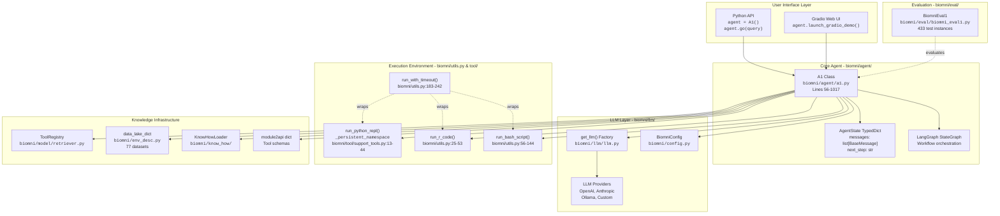
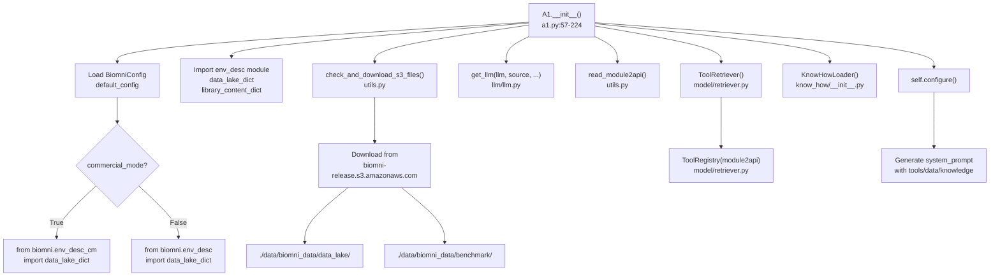
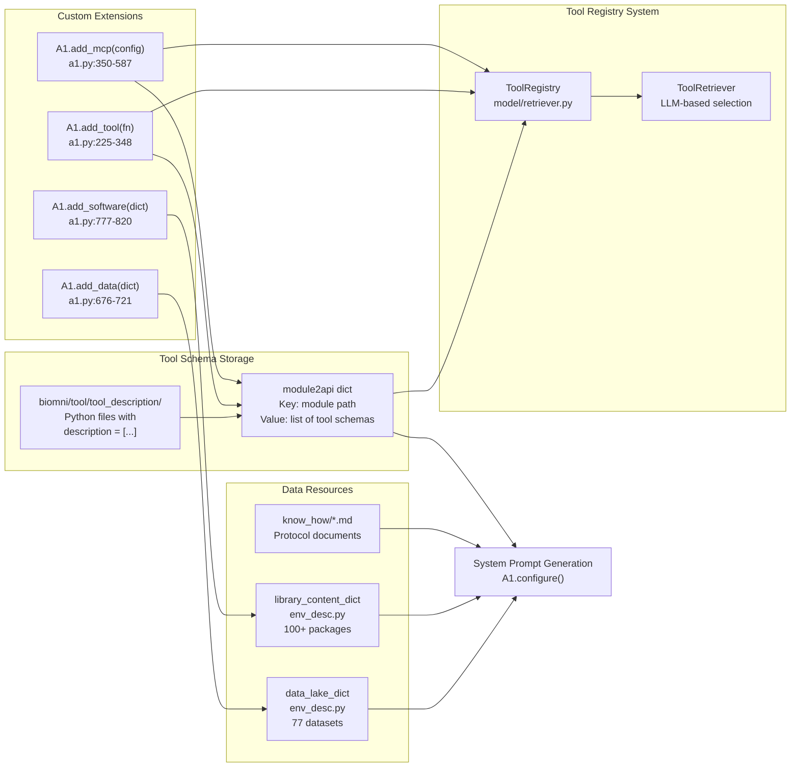

# Overview

<details>
<summary>Relevant source files</summary>

The following files were used as context for generating this wiki page:

- [README.md](README.md)
- [biomni/agent/a1.py](biomni/agent/a1.py)
- [biomni/eval/__init__.py](biomni/eval/__init__.py)
- [biomni/eval/biomni_eval1.py](biomni/eval/biomni_eval1.py)
- [biomni/tool/support_tools.py](biomni/tool/support_tools.py)
- [biomni/tool/tool_description/support_tools.py](biomni/tool/tool_description/support_tools.py)
- [biomni/utils.py](biomni/utils.py)
- [biomni/version.py](biomni/version.py)

</details>


## Purpose and Scope

This document provides a high-level introduction to the Biomni system, a general-purpose biomedical AI agent platform designed to autonomously execute research tasks across diverse biomedical subfields. Biomni integrates large language model (LLM) reasoning with retrieval-augmented planning, code-based execution, and a comprehensive tool ecosystem to assist scientists in research productivity.

This overview covers:
- The system's architectural components and their relationships
- Core execution workflows from user query to result
- Key abstractions and code entities that implement the system
- Integration points between major subsystems

For detailed information on specific subsystems:
- Agent configuration and initialization: See [Configuration System](#2.5)
- Tool development and usage: See [Tool Reference](#5)
- Evaluation benchmarks: See [Evaluation and Benchmarking](#7)
- Installation procedures: See [Installation and Setup](#3)

**Sources:** [README.md:25-30](), [biomni/agent/a1.py:56-224]()

---

## High-Level Architecture

Biomni consists of five major subsystems that work together to provide an autonomous biomedical research agent:



**Key Code Entities:**
- **A1**: Primary agent class defined in [biomni/agent/a1.py:56-1017]()
- **AgentState**: TypedDict defined in [biomni/agent/a1.py:51-54]() storing conversation messages and workflow state
- **run_python_repl**: Persistent Python execution environment with global `_persistent_namespace` dict [biomni/tool/support_tools.py:13-44]()
- **BiomniConfig**: Configuration singleton in [biomni/config.py]()
- **BiomniEval1**: Evaluation class in [biomni/eval/biomni_eval1.py:14-265]()

**Sources:** [biomni/agent/a1.py:56-224](), [biomni/config.py](), [biomni/tool/support_tools.py:1-45](), [biomni/utils.py:25-242](), [biomni/eval/biomni_eval1.py:14-40]()

---

## Core Agent Workflow

The following diagram illustrates how a user query flows through the A1 agent, mapping each step to actual function calls and code entities:

```mermaid
sequenceDiagram
    participant User
    participant A1["A1.go()<br/>a1.py:1036-1203"]
    participant Configure["A1.configure()<br/>a1.py:874-1034"]
    participant LLM["self.llm<br/>get_llm() factory"]
    participant REPL["run_python_repl()<br/>support_tools.py:13-44"]
    participant Namespace["_persistent_namespace<br/>(global dict)"]
    participant Timeout["run_with_timeout()<br/>utils.py:183-242"]
    
    User->>A1: agent.go("Design CRISPR screen...")
    
    A1->>Configure: Build system prompt
    Configure->>Configure: textify_api_dict(module2api)
    Configure->>Configure: Format data_lake_dict
    Configure->>Configure: Load know-how documents
    Configure-->>A1: System prompt with tools/data/protocols
    
    A1->>A1: Initialize AgentState with HumanMessage
    
    loop Iterative Reasoning Loop
        A1->>LLM: Generate next action (AIMessage)
        LLM-->>A1: Response with code in execute tags
        
        A1->>A1: parse_tool_calls_from_code()
        
        alt Python Code
            A1->>Timeout: run_with_timeout(run_python_repl, ...)
            Timeout->>REPL: execute code
            REPL->>Namespace: exec(command, _persistent_namespace)
            Namespace-->>REPL: result
            REPL-->>Timeout: output string
            Timeout-->>A1: observation
        else R Code (#!R marker)
            A1->>Timeout: run_with_timeout(run_r_code, ...)
            Timeout-->>A1: observation
        else Bash Code (#!BASH marker)
            A1->>Timeout: run_with_timeout(run_bash_script, ...)
            Timeout-->>A1: observation
        end
        
        A1->>A1: Append observation to messages
        A1->>LLM: Continue reasoning with observation
        LLM-->>A1: Next step or final solution
        
        alt Solution Complete
            A1-->>User: Final answer with checkboxes
        end
    end
```

**Key Functions:**
- **A1.go()**: Main entry point for executing queries [biomni/agent/a1.py:1036-1203]()
- **A1.configure()**: Generates system prompt with available tools, data, and know-how [biomni/agent/a1.py:874-1034]()
- **run_python_repl()**: Executes Python code in persistent environment [biomni/tool/support_tools.py:13-44]()
- **run_with_timeout()**: Wraps execution with timeout protection using threading [biomni/utils.py:183-242]()
- **parse_tool_calls_from_code()**: Extracts execution blocks from LLM response [biomni/utils.py referenced in a1.py]()

**Sources:** [biomni/agent/a1.py:874-1203](), [biomni/tool/support_tools.py:13-44](), [biomni/utils.py:183-242]()

---

## Agent Initialization and Configuration

The A1 agent initialization involves several configuration steps that load resources and establish execution parameters:



**Configuration Hierarchy:**

| Parameter | Source Priority | Default Location |
|-----------|----------------|------------------|
| `llm` | 1. Constructor arg<br/>2. `default_config.llm` | `default_config.llm` |
| `source` | 1. Constructor arg<br/>2. `default_config.source` | `default_config.source` |
| `timeout_seconds` | 1. Constructor arg<br/>2. `default_config.timeout_seconds` | 600 |
| `commercial_mode` | 1. Constructor arg<br/>2. `default_config.commercial_mode` | False |
| `path` | 1. Constructor arg<br/>2. `default_config.path` | "./data" |

**Sources:** [biomni/agent/a1.py:57-224](), [biomni/config.py](), [biomni/utils.py:check_and_download_s3_files]()

---

## Tool and Data Infrastructure

Biomni's power comes from its extensive tool and data infrastructure, which is dynamically loaded and made available to the agent:



**Key Data Structures:**

```python
# module2api structure (loaded from tool descriptions)
module2api = {
    "biomni.tool.database_tools": [
        {
            "name": "query_uniprot",
            "description": "Query UniProt database...",
            "required_parameters": [...],
            "optional_parameters": [...]
        },
        # ... more tools
    ],
    "biomni.tool.genomics_tools": [...],
    # ... more modules
}

# data_lake_dict structure
data_lake_dict = {
    "protein_interactions_biogrid.csv": "BioGRID protein-protein interactions...",
    "msigdb_hallmark.gmt": "MSigDB Hallmark gene sets...",
    # ... 77 total datasets
}

# _persistent_namespace (global execution state)
_persistent_namespace = {
    # Variables persist across run_python_repl() calls
    # Imports, functions, data loaded by agent stay in scope
}
```

**Sources:** [biomni/agent/a1.py:225-820](), [biomni/env_desc.py](), [biomni/tool/support_tools.py:6-8](), [biomni/model/retriever.py]()

---

## Execution Environment Details

Biomni supports three execution environments, each with language-specific handling and a unified timeout mechanism:

### Python REPL Environment

The Python REPL maintains state across executions through a global `_persistent_namespace` dictionary:

**Key Implementation:**
- **Persistent State**: [biomni/tool/support_tools.py:7]() defines `_persistent_namespace = {}` at module level
- **Execution**: [biomni/tool/support_tools.py:31]() uses `exec(command, _persistent_namespace)` 
- **Custom Function Injection**: [biomni/utils.py:inject_custom_functions_to_repl]() adds user tools to namespace

**State Persistence Example:**
```python
# First execution
agent.go("Import pandas and load data")
# Creates variables in _persistent_namespace: {'pd': <module>, 'df': <DataFrame>}

# Second execution - variables still available
agent.go("Analyze the df we loaded earlier")
# Can access 'pd' and 'df' from previous execution
```

### R and Bash Execution

**R Code Execution:**
- Function: [biomni/utils.py:25-53]()
- Creates temporary `.R` file
- Executes via `subprocess.run(["Rscript", temp_file])`
- No state persistence between calls

**Bash Script Execution:**
- Function: [biomni/utils.py:56-144]()
- Adds shebang and `set -e` if missing
- Executes with current environment variables and working directory
- Returns stdout or error messages

### Timeout Protection

All executions are wrapped with `run_with_timeout()`:
- Implementation: [biomni/utils.py:183-242]()
- Uses daemon threads with `queue.Queue` for result passing
- Default timeout: 600 seconds (configurable via `timeout_seconds` parameter)
- Attempts to terminate runaway threads via `PyThreadState_SetAsyncExc`

**Sources:** [biomni/tool/support_tools.py:1-44](), [biomni/utils.py:25-242]()

---

## Evaluation Framework

BiomniEval1 provides a standardized benchmark for assessing agent performance:

| Component | Location | Description |
|-----------|----------|-------------|
| **BiomniEval1 Class** | [biomni/eval/biomni_eval1.py:14-265]() | Main evaluation interface |
| **Dataset** | `hf://datasets/biomni/Eval1/biomni_eval1_dataset.parquet` | 433 test instances |
| **Task Types** | 10 distinct tasks | GWAS, CRISPR, lab bench, rare disease, etc. |

**Evaluation Method:**
```python
evaluator = BiomniEval1()
score = evaluator.evaluate(
    task_name="gwas_causal_gene_opentargets",
    task_instance_id=0,
    user_answer="BRCA1"
)
# Returns: 0.0 or 1.0
```

**Task-Specific Validation:**
- **Exact Match**: GWAS causal gene, screen gene retrieval (case-insensitive)
- **Letter Match**: CRISPR delivery, HLE, lab bench questions (A-Z)
- **JSON Parsing**: Rare disease diagnosis (OMIM_ID match), patient gene detection (list intersection)
- **Variant Match**: GWAS variant prioritization (exact string match)

Implementation: [biomni/eval/biomni_eval1.py:71-158]() contains task-specific `_compute_reward()` logic

**Sources:** [biomni/eval/biomni_eval1.py:14-265](), [README.md:311-333]()

---

## Version and Package Information

| Attribute | Value | Location |
|-----------|-------|----------|
| **Current Version** | 0.0.8 | [biomni/version.py:1]() |
| **PyPI Package** | `biomni` | Install: `pip install biomni` |
| **Source Repository** | https://github.com/snap-stanford/Biomni | |
| **License** | Apache 2.0 | Individual tools may have restrictions |
| **Python Environment** | `biomni_e1` conda env | See [Environment Setup](#3.1) |

**Sources:** [biomni/version.py:1](), [README.md:46-56]()

---

## Summary

Biomni is implemented as a Python package centered around the `A1` agent class, which orchestrates:

1. **LLM Reasoning**: Via `get_llm()` factory supporting multiple providers
2. **Code Execution**: Through `run_python_repl()`, `run_r_code()`, and `run_bash_script()` with timeout protection
3. **Tool Access**: Via `ToolRegistry` and dynamic `module2api` schema system
4. **Knowledge Retrieval**: Through `data_lake_dict`, `library_content_dict`, and `KnowHowLoader`
5. **Evaluation**: Via `BiomniEval1` benchmark with 433 test instances

The system maintains execution state in `_persistent_namespace`, allows dynamic tool/data/software additions via `add_tool()`, `add_data()`, and `add_software()` methods, and supports both commercial and academic usage modes through environment filtering.

For deeper dives into specific components, see the linked wiki pages at the beginning of this document.

**Sources:** [biomni/agent/a1.py:56-1203](), [biomni/config.py](), [biomni/tool/support_tools.py](), [biomni/utils.py](), [biomni/eval/biomni_eval1.py](), [README.md:25-149]()

---