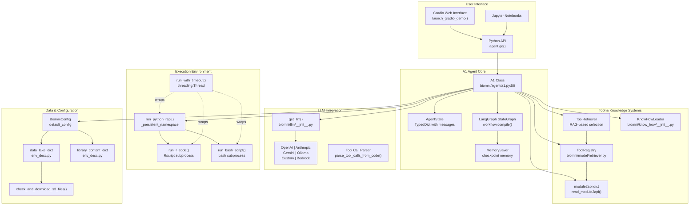
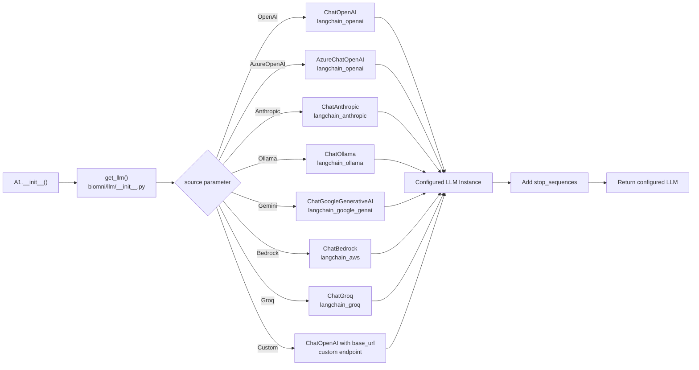
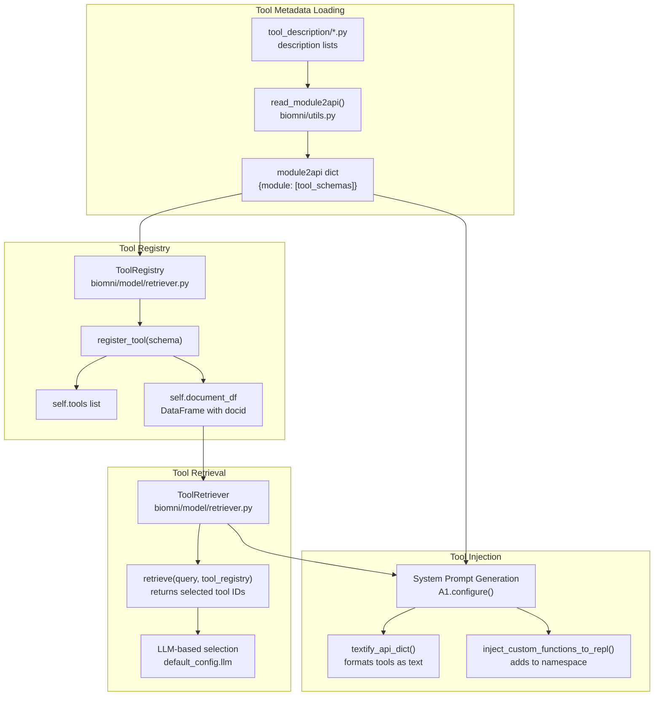
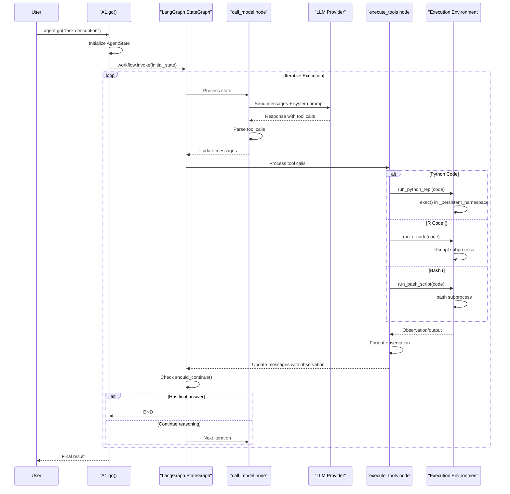
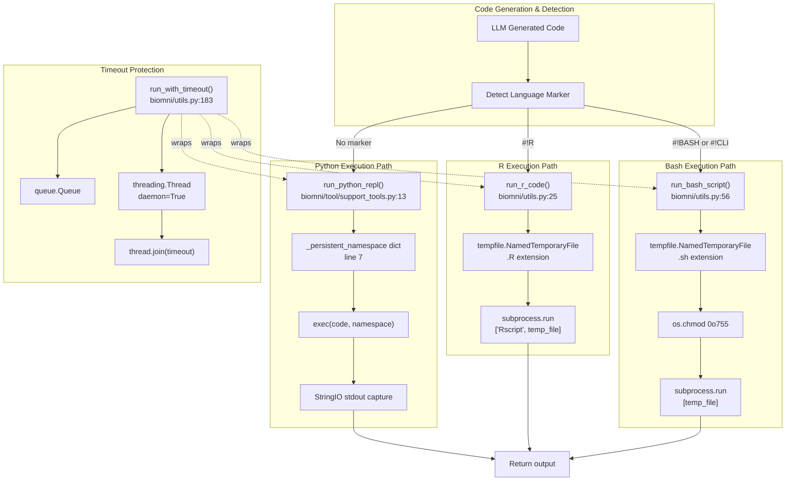
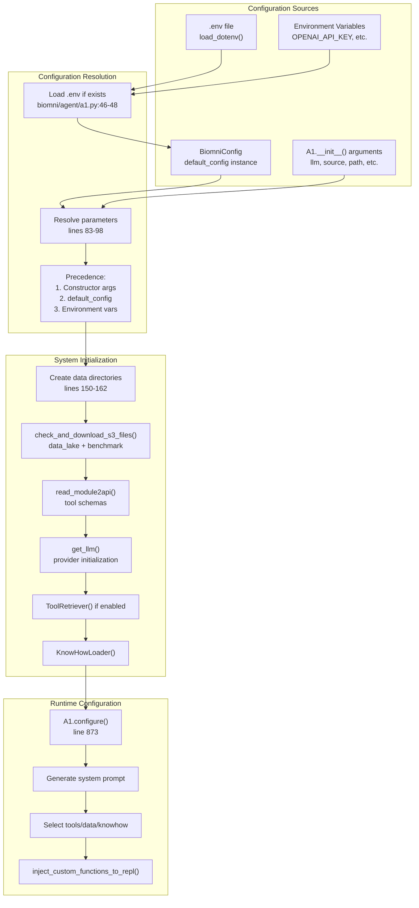
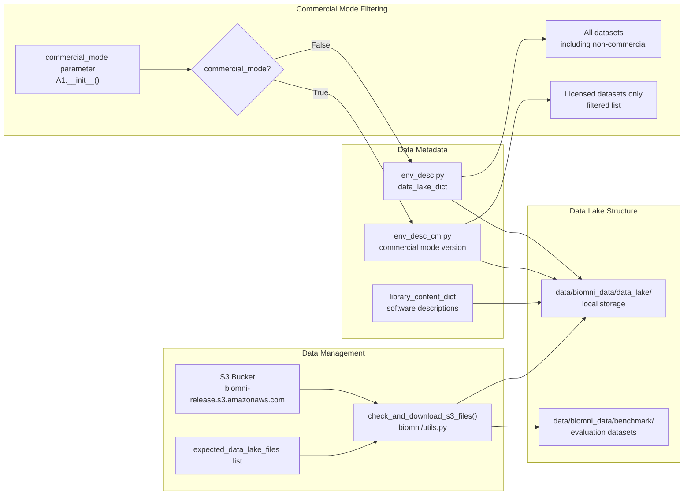
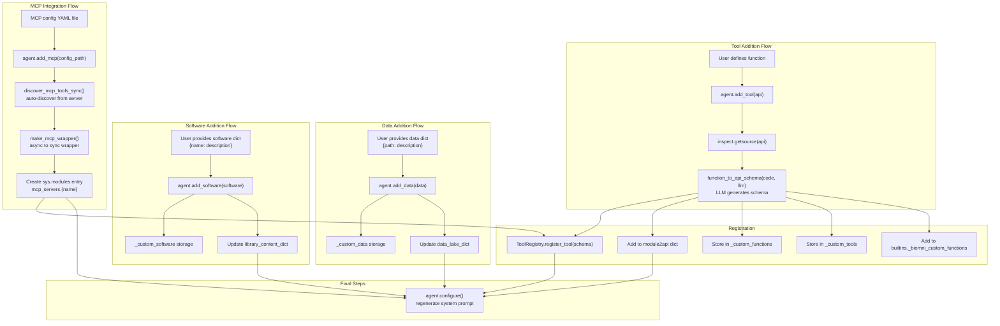
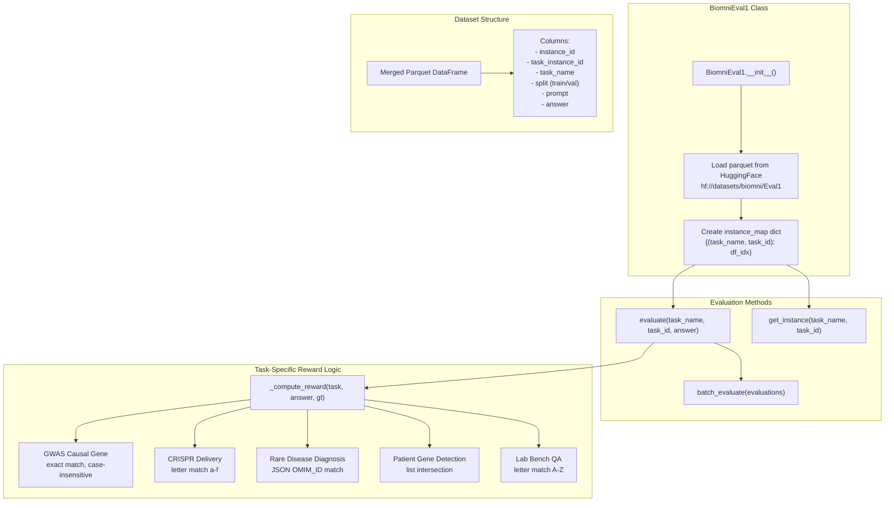
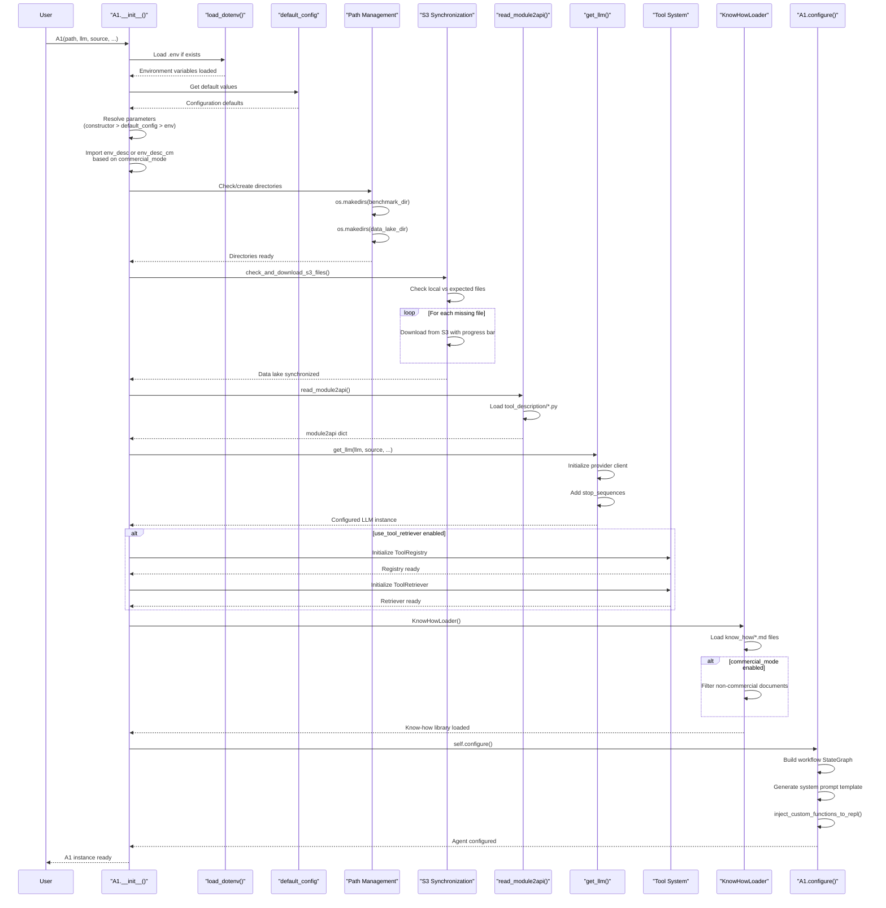

# System Architecture

<details>
<summary>Relevant source files</summary>

The following files were used as context for generating this wiki page:

- [README.md](README.md)
- [biomni/agent/a1.py](biomni/agent/a1.py)
- [biomni/eval/__init__.py](biomni/eval/__init__.py)
- [biomni/eval/biomni_eval1.py](biomni/eval/biomni_eval1.py)
- [biomni/tool/support_tools.py](biomni/tool/support_tools.py)
- [biomni/tool/tool_description/support_tools.py](biomni/tool/tool_description/support_tools.py)
- [biomni/utils.py](biomni/utils.py)
- [biomni/version.py](biomni/version.py)

</details>


## Purpose and Scope

This document provides a comprehensive overview of Biomni's system architecture, describing the major components, their interactions, and the overall design philosophy. It covers the high-level structure of the agent system, execution pipelines, tool ecosystem, and data infrastructure.

For detailed information about specific subsystems, refer to:
- Agent internals and state management: [A1 Agent Core](#2.1)
- Code execution mechanisms: [Execution Pipeline](#2.2)  
- LLM provider integration: [LLM Integration Layer](#2.3)
- Tool discovery and selection: [Tool Registry and Retrieval](#2.4)
- System configuration: [Configuration System](#2.5)
- Dataset management: [Data Infrastructure](#2.6)
- Protocol documents: [Know-How Library](#2.7)

## High-Level Architecture

Biomni implements an agent-based architecture where the `A1` class orchestrates complex biomedical workflows through LLM-driven reasoning, tool execution, and iterative refinement.



**Sources:** [biomni/agent/a1.py:1-1000](), [biomni/utils.py:1-300](), [biomni/tool/support_tools.py:1-100]()

## Core Components Overview

### A1 Agent Class

The `A1` class is the primary orchestrator, implementing the main agent logic. It is initialized with configuration parameters and manages the entire execution lifecycle.

| Component | Code Location | Description |
|-----------|---------------|-------------|
| **A1 Class** | [biomni/agent/a1.py:56-224]() | Main agent class with initialization, tool management, and workflow execution |
| **AgentState** | [biomni/agent/a1.py:51-54]() | TypedDict defining agent state structure with messages list and next_step |
| **configure()** | [biomni/agent/a1.py:873-1021]() | Generates system prompt with selected tools, data, and know-how |
| **go()** | [biomni/agent/a1.py:1023-1198]() | Primary execution method that runs the agent workflow |

**Sources:** [biomni/agent/a1.py:51-224]()

### LLM Integration Layer

The system supports multiple LLM providers through a unified factory pattern implemented in `get_llm()`.



**Sources:** [biomni/llm/__init__.py](), [biomni/agent/a1.py:197-204]()

### Tool Registry and Retrieval System

The tool system uses a two-tier architecture: `ToolRegistry` for storage and `ToolRetriever` for intelligent selection.



**Sources:** [biomni/model/retriever.py](), [biomni/agent/a1.py:873-1021](), [biomni/utils.py:807-900]()

## Agent Workflow Execution

The agent follows a structured workflow implemented using LangGraph's `StateGraph`. The workflow alternates between LLM reasoning and code execution.



**Sources:** [biomni/agent/a1.py:1023-1198](), [biomni/agent/a1.py:1261-1500]()

### State Graph Node Definitions

The workflow is defined by three primary nodes:

| Node | Code Location | Function |
|------|---------------|----------|
| **call_model** | [biomni/agent/a1.py:1261-1360]() | Sends current state to LLM and parses tool calls from response |
| **execute_tools** | [biomni/agent/a1.py:1362-1467]() | Executes parsed tool calls and returns observations |
| **should_continue** | [biomni/agent/a1.py:1469-1477]() | Conditional edge determining whether to continue or end |

**Sources:** [biomni/agent/a1.py:1261-1477]()

## Multi-Language Execution Architecture

Biomni supports Python, R, and Bash execution through a unified interface with persistent state management and timeout protection.



**Key Implementation Details:**

- **Persistent Python Namespace:** Variables and imports persist across executions via `_persistent_namespace` global dictionary ([biomni/tool/support_tools.py:7]())
- **Language Detection:** Code is parsed for language markers (`#!R`, `#!BASH`, `#!CLI`) to route to appropriate executor ([biomni/agent/a1.py:1382-1396]())
- **Timeout Protection:** All execution wrapped with `run_with_timeout()` using daemon threads and queue-based result passing ([biomni/utils.py:183-243]())
- **Custom Function Injection:** User-added tools via `add_tool()` are injected into `_persistent_namespace` ([biomni/utils.py:34-43]())

**Sources:** [biomni/tool/support_tools.py:1-45](), [biomni/utils.py:25-243](), [biomni/agent/a1.py:1362-1467]()

## Configuration and Initialization Flow

The system uses a hierarchical configuration system with multiple override mechanisms.



**Configuration Hierarchy:**

1. **Constructor arguments** to `A1()` take highest precedence
2. **`default_config`** values used if constructor argument is `None`
3. **Environment variables** used for API keys and provider settings
4. **`.env` file** loaded if present in working directory

**Important Note:** Constructor arguments to `A1()` only affect agent reasoning LLM. Database queries and retrieval operations always use `default_config` values. For system-wide configuration, modify `default_config` before creating agent instances.

**Sources:** [biomni/agent/a1.py:46-224](), [biomni/config/__init__.py]()

## Data Infrastructure

Biomni maintains a structured data lake with automatic S3 synchronization and commercial mode filtering.



**Data Lake Components:**

| Component | Description | Location |
|-----------|-------------|----------|
| **data_lake_dict** | Dictionary mapping filenames to descriptions for ~77 datasets | [biomni/env_desc.py]() or [biomni/env_desc_cm.py]() |
| **library_content_dict** | Dictionary of available Python packages, R packages, and CLI tools | [biomni/env_desc.py]() |
| **S3 Synchronization** | Automatic download of missing files from S3 bucket | [biomni/utils.py:845-920]() |
| **Commercial Mode** | Filters datasets based on licensing restrictions | [biomni/agent/a1.py:100-113]() |

**Sources:** [biomni/agent/a1.py:100-194](), [biomni/env_desc.py](), [biomni/utils.py:845-920]()

## Tool Extension Architecture

Users can dynamically add custom tools, data, and software to extend agent capabilities.



**Extension Methods:**

| Method | Purpose | Code Location |
|--------|---------|---------------|
| **add_tool(api)** | Add custom Python function as tool | [biomni/agent/a1.py:225-348]() |
| **add_data(data)** | Add dataset to data lake | [biomni/agent/a1.py:676-721]() |
| **add_software(software)** | Add software description | [biomni/agent/a1.py:777-820]() |
| **add_mcp(config_path)** | Integrate MCP server tools | [biomni/agent/a1.py:350-587]() |

**Key Features:**

- **Automatic Schema Generation:** LLM analyzes function source code to generate API schema ([biomni/utils.py:251-290]())
- **MCP Auto-Discovery:** MCP servers can be queried for available tools instead of manual configuration ([biomni/agent/a1.py:382-413]())
- **Persistent Storage:** Custom additions stored in instance attributes and persist across `go()` calls
- **System Prompt Regeneration:** `configure()` automatically called after adding resources to update agent context

**Sources:** [biomni/agent/a1.py:225-820](), [biomni/utils.py:251-290]()

## Evaluation Framework Integration

BiomniEval1 provides standardized benchmarking across 10 task types with 433 instances.



**Evaluation Interface:**

```python
from biomni.eval import BiomniEval1

evaluator = BiomniEval1()
score = evaluator.evaluate('gwas_causal_gene_opentargets', 0, 'BRCA1')
# Returns: 1.0 (correct) or 0.0 (incorrect)
```

**Task Types and Validation:**

| Task Category | Evaluation Method | Code Location |
|---------------|-------------------|---------------|
| **GWAS Causal Gene** | Exact string match (case-insensitive) | [biomni/eval/biomni_eval1.py:78-80]() |
| **CRISPR Delivery** | Letter match (a-f, case-insensitive) | [biomni/eval/biomni_eval1.py:74-76]() |
| **Rare Disease Diagnosis** | JSON OMIM_ID field match | [biomni/eval/biomni_eval1.py:94-117]() |
| **Patient Gene Detection** | List intersection of causal_gene field | [biomni/eval/biomni_eval1.py:123-155]() |
| **Lab Bench Q&A** | Letter match (A-Z, case-insensitive) | [biomni/eval/biomni_eval1.py:90-92]() |

**Sources:** [biomni/eval/biomni_eval1.py:1-325]()

## System Initialization Sequence

This diagram shows the complete initialization sequence when creating an `A1` agent instance.



**Sources:** [biomni/agent/a1.py:46-224](), [biomni/utils.py:845-920]()

## Summary

Biomni's architecture is designed around several key principles:

1. **Modularity:** Clear separation between agent core, execution environment, tool system, and data infrastructure
2. **Extensibility:** Dynamic tool, data, and software addition without code modification
3. **Multi-LLM Support:** Provider-agnostic design through factory pattern
4. **Persistent Execution:** Python REPL maintains state across multiple executions
5. **Safety:** Timeout protection and error handling for all code execution
6. **Knowledge-Augmented:** Integration of structured know-how documents and data lake metadata

The system's design enables complex biomedical workflows while maintaining flexibility for different deployment scenarios (academic vs. commercial, different LLM providers, custom tool additions).

---